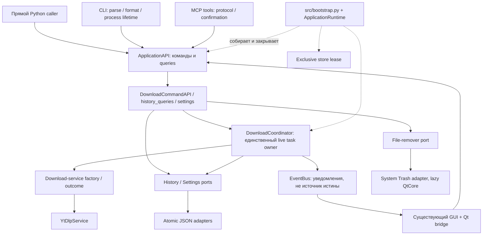

# 1. Решение, полномочия и конечный результат

**Решение Oracle:** сохранить существующие `ApplicationAPI`, command/query helpers, JSON repositories, `DownloadCoordinator`, EventBus, yt-dlp и текущие точки входа. Довести их до независимого прикладного API с **одним явным владельцем состояния и жизненного цикла**, а не создавать новую архитектуру рядом.

Профиль **B в пределах процесса + обычные операции A**, история сохраняется, исполнение после restart не возобновляется. Основные гарантии/сигнатуры/defaults/ошибки/эффекты принадлежат [CONTRACT.md](CONTRACT.md); здесь — фактическая база, причины, owners, последовательность и доказательства. Второй реестр команд, отдельный ADR на то же решение и параллельный backlog не нужны.

Пользователь разрешил реализацию и безопасные offline-проверки **после этого плана**. Hermes после получения READY создаёт отдельную ветку от текущего checkout, сохранив свои незакоммиченные документы. Oracle ветку не создаёт. Дополнительного человеческого согласования архитектуры/начала coding не требуется. Текущий отдельный проектный grant: после независимого ACCEPTED среза **тот же Reviewer** завершает документы/инструкции и selectively commit/push в `refactor/command-first` по [agent-team](../agent-team.md). Coder не владеет index. Main/force/tags/release и destructive Git не разрешены; первоначальные запреты Oracle сохраняются только в исторических receipts.

Исполняет один постоянный Coder `openai-codex/gpt-6.1-sol`, requested `max`; независимый Reviewer — отдельная постоянная сессия того же назначенного маршрута. Oracle `openai-codex/gpt-6-astra`, requested `xhigh`, остаётся владельцем существенных развилок. Hermes — только оркестратор. Freeze → Reviewer → точные замечания тому же Coder → delta recheck тем же Reviewer. Нет самоприёмки или второго самостоятельного planner-а.

## Пользовательские сценарии / наблюдаемый успех

1. **Python без окна:** создать runtime с явными synthetic путями, добавить работу, получить id, дождаться результата, прочитать реальные сохранённые пути после reopen, закрыть ресурсы. Импорт/вызов API не требует QApplication/CLI/MCP SDK.
2. **Человек или MCP в GUI-процессе:** намерение проходит один API; работа MCP видна существующим Qt bridge, отмена из другого consumer-а относится к **тому же** task. Правила не живут в click handler.
3. **Автоматизация CLI:** query не поднимает очередь; standalone add честно различает принятие и завершение и не оставляет бесхозный executor. Новая CLI-команда cancel не притворяется подключённой к GUI.
4. **Standalone MCP:** работает без GUI, сохраняет состояние между calls в lifetime сервера; реальный stdio tool call читает synthetic history/artifact, а не только успешно discovers tools.
5. **Сохранность:** неудача записи не выглядит успехом; отказ/отмена не превращается в done с пустыми путями; delete не удаляет целую общую папку, не обходит подтверждение, не уничтожает безвозвратно файлы.
6. **Завершение:** остановлены/join-нуты собственные workers и transport, снята lease; следующая сессия может открыть тот же store. Крах не запускает автоматически прежние загрузки.

# 2. База: что реально есть

Исследована ветка `main`, HEAD `0abda8e2959b53561e8327f40c53118c944c94f8`. На входе runtime source неизменён; dirty docs принадлежат Hermes, `tools/project-foundation/` — импортированный read-only методический пакет. В ходе Oracle source/index/branch не менялись. Исторический `docs/cli_mcp_unification_plan.md` **не** источник фактов о текущем CLI.

Связи ниже установлены по определениям, imports/usages и реальным adapter handlers, а не по именам папок. Ключевые graph locations сверены с исходником/Serena; отсутствие source body одного graph symbol компенсировано чтением его определения. Runtime/private директории специально не индексировались и не читались ради исследования.

| Найденный owner / вход | Фактическая роль и существенные consumers |
|---|---|
| `main.py:24–81::initialize_app` | Создаёт APPDATA/config/data/logs, repositories, settings, EventBus, coordinator; возвращает dict и facade aliases. Импортируется GUI, CLI bootstrap, smokes, FFmpeg test |
| `src/application/api.py:20–116` | Уже общий facade queries + commands. `_command_api()` каждый раз строит DownloadCommandAPI и требует coordinator даже для delete; command returns пока Any. Query-only ApplicationAPI уже используется tests |
| `src/application/command_api.py:77–241` | URL/quality/type normalization, add/cancel/delete previews/results/errors; `delete_download` делает `shutil.rmtree` выбранной папки, затем repo.delete |
| `src/application/history_queries.py`, `dto.py`, `history_semantics.py` | Реальные list/get/search/content queries и сериализация, limits и subtitle cleanup. `_details_dto` теряет description_path через summary; folder helper — display heuristic, не ownership proof |
| `src/application/download_coordinator.py:26–314` | In-memory tasks, futures, active services; сам конструирует конкретный YtDlpService. Сохраняет queued/history, управляет executor и публикует события. State mutations частично вне lock |
| `src/infrastructure/repositories.py:27–153` | JSON caches и thread lock history; settings без lock. `_save/_load` глотают ошибки, прямая запись поверх файла, наружу выдаются mutable записи. Защиты между процессами нет |
| `src/domain/protocols/download_service.py` | Уже есть backend port, но coordinator его не использует; annotation result не соответствует subtitles list. Domain models — существующие dataclasses/enums |
| `src/infrastructure/ytdlp_service.py:141–359` | Настоящий downloader; cancel event очищается перед download; cancel превращается в empty result; fallback берёт newest folder; playlist result представляет один folder/элемент, код download return не проверяется |
| `src/interfaces/cli/root.py:95–143,310–470` | Существующие queue/history/server commands, output/error codes. Самостоятельно создаёт services даже для query; add печатает queued без явной lifetime policy; finally close нет; logging default пишет в checkout |
| `src/interfaces/cli/bootstrap.py` | Сейчас владеет созданием FastMCP и HTTP/stdio запуском. `src/infrastructure/mcp/server.py` импортирует эту реализацию из CLI — нежелательная направленность |
| `src/infrastructure/mcp/tools/*`, `manifest.py` | 10 tools уже вызывают ApplicationAPI; manifest централизует только регистрацию. Confirm — политика adapter-а; error branches местами логируют/возвращают raw exception |
| `app.py:50–120` | Создаёт runtime, запускает HTTP в daemon thread, затем MainWindow/Qt loop. Нет управляемого server handle/join/finally lifecycle |
| `src/ui/managers/download_manager.py:22–127` | Полезный EventBus→Qt signal bridge, но add/cancel/get_task идут напрямую в coordinator |
| `src/ui/managers/history_manager.py:18–76` | Query идёт в repo; delete использует API при наличии, иначе silently repo.delete. GUI использует его и существующие HistoryEntry widgets |
| `src/ui/main_window.py:58–88,309–330,344–364,419–423` | Прямые repo/settings/coordinator references; theme/settings сохраняются вне API. closeEvent вызывает `shutdown()` и detach. История обновляется через Qt-сигналы DownloadManager, не старый worker callback |
| `src/ui/widgets/history_widget.py:161–175` | Уже существующий Yes/No+checkbox delete dialog; подтверждение сейчас не связано с неизменным preview |
| `src/core/event_bus.py:17–60`, `logging_setup.py` | Sync callbacks в publisher thread; ошибки subscriber изолируются, но печатается raw traceback; subscribe/unsubscribe не защищены. Logging — реальные rotating handlers, без доказанного privacy filter |

## Конкретные gaps, не косметика

- **Библиотека общая, память — нет:** каждый вызов initialize_app создаёт другую очередь и JSON cache; два процесса способны потерять updates и выдать одинаковые IDs. GUI+его HTTP уже используют один dict, standalone stdio/CLI — нет.
- **Неверная отмена:** coordinator.cancel сразу пишет history cancelled и event, не переводя queued task snapshot; service может ещё работать. Backend очищает token, а empty cancellation result затем принимается за done.
- **Гонки регистрации:** worker может завершиться до записи `_futures`; queued event публикуется после submit, поэтому started/done способны опередить карточку. Cancel между submit и service registration теряется.
- **Settings/lifecycle:** mutable settings читаются worker-ом позже admission. Любой update запускает новый executor с `wait=False`, старый продолжает работу. shutdown с docstring «ждёт» фактически не ждёт и не отменяет queued. CLI/servers не владеют cleanup явно.
- **Ложная сохранённость:** JSON failure логируется и подавляется, caller получает success; cache уже изменён. Тот же HistoryEntry меняется вне repo lock. После restart незавершённые статусы остаются вечными, реальной durable queue нет.
- **Опасная область удаления:** folder resolution через output_dir/parent ничего не доказывает о принадлежности дерева; recursive permanent deletion + blind confirmation/retry нарушает сохранность. Active entry можно удалить до worker finalization.
- **Неполный результат:** пустой dict становится done; newest-folder fallback способен приписать чужой результат; playlist partial outcome не различается. Это влияет и на queries, и на следующий delete.
- **Обход API:** GUI add/cancel/settings/history path не совпадает с CLI/MCP semantic owner. MCP bootstrap физически спрятан в CLI.
- **Проверка слабее заявлений:** текущие command tests преимущественно используют StubCoordinator; coordinator coverage отнесён к opt-in E2E со старыми сигнатурами. Help/discovery не проверяют execution/state/readback/cleanup.

# 3. Целевое устройство и почему оно минимально



Это карта ответственностей **в одном runtime**, не утверждение, что отдельный CLI-process автоматически соединён с этим графом. Схема режимов/полномочий — CONTRACT §2.

| Выбор | Обоснование | Что сознательно не вводим |
|---|---|---|
| B, in-process tasks | Add уже возвращает task_id, GUI/MCP нужны наблюдение/отмена после call | A-only не сохраняет существующую очередь; новый Job framework/Command Bus не нужен |
| Durable history, не durable execution | История/готовые файлы должны переживать normal close, но restart-resume не запрошен | Workflow D, scheduler service, replay/outbox/idempotency store |
| Один writer на data root + read snapshots | Убирает реальную потерю JSON updates между GUI/CLI/MCP | SQLite migration, multiwriter transactions, межпроцессная общая очередь |
| Существующий GUI HTTP как Attached | Уже есть настоящий общий owner внутри app.py | Новый daemon/IPC client/автозапуск владельца/attach discovery |
| Typed methods и имеющиеся DTO | Уже понятный компактный API, существующие adapters | Универсальный execute(dict), генератор schemas, дублирующий operation registry |
| Coordinator остаётся scheduler/manager | Один небольшой owner достаточен для независимых загрузок | Микросервисы, отдельный pool manager на каждую команду |
| Cooperative cancellation | Реальная возможность текущего yt-dlp/threads; честное ограничение | Kill threads, жёсткий deadline остановки FFmpeg, rollback/публикационный barrier |
| Exact file plan + Trash | Минимум, который не удаляет чужое дерево и оставляет восстановление | Recursive permanent removal, новый storage layout, глобальный file index/GC, API Undo |
| Lazy OS-trash адаптер на уже имеющемся QtCore | Кроссплатформенная системная Корзина без новой зависимости и без QApplication | Qt в application/domain, новый GUI, установка пакетов, unsafe native fallback |

C не нужен: нет редактируемого общего документа/несохранённого workspace. D не нужен: нет восстанавливаемых зависимых этапов/ожидания решений. Изолированный worker process пересматривается только при реальном требовании жёсткой остановки/изоляции; durable queue — при явном требовании переживать crash; внешний Attached CLI — при требовании управлять GUI из отдельного CLI. Эти условия не создают текущих задач.

## Инварианты и нецели

- Один owner для каждого mutable ресурса; adapters не сохраняют историю/settings и не решают terminal state.
- Прямой API вызывается без QApplication и transport SDK. `import` не читает пользовательскую конфигурацию, не открывает сервер и не пишет логи.
- Acceptance, physical completion, persistence, cancellation request и transport delivery различаются.
- Состояние/артефакты доступны через snapshot query, не выводятся из логов/наличия карточки.
- Внешняя ошибка/частичный результат не означают «ничего не было»; no raw-content diagnostics.
- Форматы/entrypoints сохраняются с **явно перечисленной** safety/lifetime дельтой CONTRACT §8. Схема истории расширяется только backward-readable полями; destructive migration/массовая правка данных не нужна.
- GUI не развивается: не менять темы, иконки, layout, вкладки, подписи, взаимодействия ради нового UX. Допустимы только API injection, typed projection, передача preview token через существующий dialog и close wiring.
- Нет новых внешних зависимостей, install/sync/download vendor, uv.lock/.gitignore churn, network E2E или package/release. Git-доставка ограничена отдельно разрешённым принятым срезом и назначенным Reviewer. Методический пакет и источник PFK read-only.
- Не обещаем полную атомарность набора media+JSON, автоматическое возобновление, exactly-once, bounded stop latency, remote sandbox, cross-profile shared output или визуальную приёмку.

# 4. Владельцы миграции

Таблица — целевые owners всей миграции, не утверждение, что каждый уже готов. После S2 существуют bootstrap/runtime/download_rules/runtime_lock и связанные persistence/API seams; остальные будущие изменения отмечены срезами. Не переносить файлы ради красоты; сохранять wrappers/imports реальных consumers.

| Ответственность | Целевой owner и совместимость |
|---|---|
| Composition/paths/default implementations | Новый `src/bootstrap.py`; `main.initialize_app` тонко делегирует и сохраняет dict keys. Ни одного глобального runtime singleton |
| Lifecycle/ownership | Новый `src/application/runtime.py`; принимает готовые зависимости/lease resource, не выбирает OS/Qt. Explicit close/admission, owned vs borrowed resources |
| Backend contract | Существующий `src/domain/protocols/download_service.py` + небольшой typed outcome/model; factory в composition, coordinator не импортирует infrastructure |
| Чистая download normalization | Новый `src/domain/download_rules.py` либо эквивалентный один domain owner; существующие command методы делегируют ему. Без второго GUI/CLI правила |
| Queries/serialization | Существующие api/history_queries/dto; HistoryEntry copies для старого GUI, wire DTO для CLI/MCP; точные defaults и поля удерживаются characterization tests |
| Settings | API/runtime coordinating save + snapshot; GUI получает копию и вызывает update_settings, включая theme toggle |
| Persistence + lease | `src/infrastructure/repositories.py`, новый `src/infrastructure/runtime_lock.py`, существующие repository protocols. Atomically replace JSON, fail closed, deep copies |
| File deletion | `command_api.py`, при необходимости ограниченный `src/application/deletion.py`; новый `src/domain/protocols/file_remover.py`, `src/infrastructure/file_remover.py`. Policy в application, OS effect в adapter |
| MCP server creation/lifetime | Существующий `src/infrastructure/mcp/server.py`: canonical create factory + managed HTTP handle. `src/interfaces/cli/bootstrap.py` остаётся совместимым delegator, без обратной зависимости MCP→CLI |
| UI | `main_window.py`, `managers/download_manager.py`, `managers/history_manager.py`, узкая callback/signal часть `widgets/history_widget.py`; не остальное дерево UI |
| Logging | Существующий `src/core/logging_setup.py` + безопасные emitters затронутого пути; не новый tracing framework |

При одном writer нет нужды мигрировать на другой storage engine. `next_id` может расходоваться отдельно от записи: gaps допустимы, дубликаты нет. All repo access под собственным lock, owner transitions последовательны; не удерживать lock во время yt-dlp, Qt callbacks, MCP response или ожидания пользователя. Порядок application mutation → repository внутренний lock фиксируется в коде; callback после выхода из lock.

# 5. Упорядоченные проверяемые срезы

Это зависимости доставки, не параллельные ветки и не журнал task status. Один Coder получает связный срез; следующий начинается после готового frozen кандидата/вердикта по местному циклу. Не добавлять человеческую approval-точку между ними. Обязательные замечания не расширяют scope автоматически.


## S1 — Сделать baseline воспроизводимым без доступа к рабочим данным

**Вход:** этот план, сохранённые Oracle failures, созданная Hermes ветка. **Результат:** реальная обязательная offline-команда и smokes безопасно запускаются; исходные дефекты не скрыты fixture-ами.

**Разрешённые пути:** `src/core/logging_setup.py`; `tests/conftest.py`, `tests/test_ffmpeg_detection.py`, `tests/test_ffmpeg.py`; новые узкие `tests/test_logging_setup.py`/`tests/test_command_first_characterization.py`; `scripts/smoke_cli_help.py`, `smoke_mcp.py`, `smoke_mcp_stdio.py`, `smoke_gui.py` (при необходимости один маленький общий `scripts/smoke_support.py`); начальный factual `docs/command-first/VERIFICATION.md`. Не менять downloader/coordinator/repositories ради зелёного baseline в этом срезе.

1. Зафиксировать current characterization нормальных query/serialization/GUI defaults. Сохранённый Oracle RED cancellation — не превращать в passing assertion, ожидающую неправильный статус. Исполняемые failing regression cases на lifecycle входят S3 вместе с fix; можно сохранить их явный red receipt до него.
2. Поддержать explicit `YTDL_LOG_DIR`/log_dir без изменения handler/rotation semantics. Проверить настоящий непустой файл и stderr, а не disable logging. Tests/subprocess roots назначаются **до** collection/import, conftest tmp_path не объявлять заменой ранней изоляции.
3. Исправить три baseline-fixture failures Windows: simulated POSIX selection отделить от host-specific `shutil.which` (контролируемый resolver на этой границе + проверка аргументов/ветки). Сохранить существующий настоящий native PATH fallback test. Не skip-ать три cases, не менять env→vendor→PATH product policy ради симуляции.
4. FFprobe fixture не обязана кодировать H.264: выбрать доступный built-in MPEG-4 для своего 1-секундного synthetic файла, затем настоящий ffprobe проверяет video dimensions **и audio stream**. Oracle установил отсутствие libx264 в vendor build; не устанавливать другой binary и не считать fixture PASS доказательством libx264 support.
5. Smoke children используют текущий interpreter либо `uv run --locked --no-sync`, наследуют synthetic roots, имеют timeout/context cleanup. Stdio smoke не синхронизирует environment. Smokes явно закрывают созданные services даже при assertion failure; пока runtime ещё нет — текущий coordinator cleanup, без заявлений о полноценной lifecycle-гарантии.

**Проверки:** targeted logging/FFmpeg tests; затем `uv run --locked --no-sync pytest tests/ -m "not e2e" -q` в pre-isolated process, четыре module-form smokes, narrow lint S1 Python files. У full-suite должен быть объяснён любой skip, а не просто exit0. Existing ruff/mypy baseline не устранять массовым formatting.

**Consumer:** S2 получает безопасный runner/environment и исходные characterization bytes. **Review:** независимо проверить, что подмена только host-resolver/внешний input, а не API/coordinator, и что tests не пишут checkout logs.

## S2 — Ввести явный runtime, порты и единственного persistence writer

**Зависимость:** S1. **Результат:** независимое приложение собирается/закрывается и не лжёт о записи/владении; прежний `initialize_app` ещё пригоден старым adapters.

**Scope:** `src/bootstrap.py`, `src/application/runtime.py`, `api.py`, `command_api.py` (injection/typing, не новая delete policy), `download_coordinator.py` (factory/snapshot dependency seam), `history_queries.py`, `dto.py`, `src/domain/download_rules.py`, существующие `src/domain/models/{app_settings,download_task,history_entry}.py`, `src/domain/protocols/*` по указанным контрактам, `src/infrastructure/repositories.py`, `runtime_lock.py`, `main.py`, относящиеся `__init__.py`; новые runtime/repository/import-boundary tests, existing query/model tests. В `tests/test_download_e2e.py` разрешена только сигнатурная совместимость с injected factory/settings, **без запуска**.

- Сборка explicit paths/factories, writable lease, read-only query mode; close ownership/borrowed contract. Полноценная cooperative task shutdown закрывается S3, не объявляется здесь готовой заранее.
- Убрать concrete backend import из application. Использовать найденный IDownloadService, исправить result typing, не добавить ещё один параллельный port.
- Atomic fail-closed history/settings writes; копии на read/write; отсутствующие и повреждённые файлы различать. Сохранить old JSON и roundtrip старых synthetic записей.
- Общие settings/query фасады; optional additive persisted fields по CONTRACT. Fail persistence до enqueue — ни backend-call, ни успешный acceptance. Recovery только после lease, без сети/replay.
- Перенести/переиспользовать pure normalization один раз; сохранить CLI/MCP explicit defaults и GUI settings-derived None semantics. Не вводить новый URL product whitelist.

**Детерминированные proofs:**

1. Fresh subprocess blocks imports Qt/FastMCP/argparse/yt-dlp при import core и выполняет direct API query; отдельная собранная runtime с fake backend/remover, настоящими repositories, без QApplication.
2. Two writer processes на одном synthetic root: второй OWNER_BUSY, первый store неизменён; после close первый handle освобождён, второй открывается. Одновременно read-only snapshot читает валидный JSON, не создавая executor/записи.
3. Distinctive settings/history → close → fresh repository readback; возврат и последующее изменение detached объекта не меняет repo без update.
4. Failure перед replace: прежний JSON byte-for-byte, memory view прежний; повреждённый JSON сохранён и возвращена STORAGE_CORRUPT. Не доказывать это только mock-save.called.
5. Synthetic orphan queued/downloading/merging → writable reopen → failed/INTERRUPTED, без backend; terminal и artifacts untouched. Read-only reopen ничего не переписывает.

**Compatibility gate:** existing query tests, main.initialize_app keys/aliases, GUI/MCP discovery smokes. **Consumer:** S3 получает правильные lifecycle и persistence seams; S5 переключит реальные consumers без повторного проектирования.

**Текущее disposition S2:** независимо ACCEPTED после узкого R1: новый YTDL_DATA_DIR теперь изолируется smoke owner-ом. Верифицированы construction/ports/lease/storage/recovery/settings и S2 resource lifetime. Initial refusal и RED сохранены; fresh delta/retained original proofs перечислены в [VERIFICATION](VERIFICATION.md). Это не S3 cancel/outcome/pool-schedule acceptance.

## S3 — Исправить выполнение, отмену, snapshot и terminal outcome

**Зависимость:** S2. **Результат:** одна настоящая очередь B с проверяемыми переходами и освобождением, а не косметический facade над прежними races.

**Scope:** `src/application/{download_coordinator,runtime,api,command_api,dto}.py`, relevant domain task/outcome/service protocol, `src/infrastructure/ytdlp_service.py`, `src/core/event_bus.py`; новые `tests/test_download_lifecycle.py`, `tests/test_ytdlp_outcomes.py`, relevant runtime tests. Backend форматные строки/URL semantics сохраняются; tests/test_ytdlp_unit.py — только затронутые contracts/lint.

- Cancellation record до submit; future/service registration и terminal transitions согласованы; queued event перед started. Late callback не воскрешает terminal status.
- Не очищать поданный token, не считать empty outcome успехом. Построить typed outcome и actual artifact attribution, исключить newest-folder fallback; учесть yt-dlp/playlist partial failure и postprocessed media. Сохранять известные файлы при cancel/failure, не удалять leftovers автоматически.
- Settings immutable per-admission snapshot; старый pool до drain, новый cap только затем; ни две одновременно работающие генерации pool, ни lock вокруг network.
- Implement wait/close/admission, честные `cancel_requested` и `result_persisted`. Terminal done event только после подтверждённого save. Live queries overlay status/artifacts и показывают persistence failure.
- Безопасные ошибки emitter/backend logger; EventBus callbacks вне locks, failures изолированы. Никакой raw exception text в диагностику.

**Обязательные schedules через публичный API + настоящий coordinator/repo:**

- Max1: A удержан на backend barrier, B queued; cancel B → ни одного backend invocation B, task/history cancelled. Oracle RED должен стать GREEN.
- Cancel A во время blocked fetch → immediate cancel_requested, **нет** terminal/history cancelled до освобождения; после release нет нового download-stage; worker quiescent, history readback cancelled.
- Cancel до service registration; затем immediate-completion backend; оба порядки completion/cancel. Проверить terminal monotonicity, отсутствие stale futures через observable wait/close/следующую задачу, не private `.clear()`.
- Backend, возвращающий empty/unrelated artifacts, не даёт done; два distinct task outputs/чужой newer folder не смешиваются. Playlist two-items partial keeps только реальные известные результаты; old unrelated bytes неизменны.
- Terminal save failure после media effect: файл остаётся, result_persisted=False/error виден, done event отсутствует. Следующая операция/cleanup выполняются, ошибка не скрыта.
- Settings update во время A/B не меняет их output/proxy/options; следующий admission имеет новый snapshot, concurrent worker count не превышает effective policy; drain/next pool проверен.
- Close при active+queued, repeated close, subscriber exception, admission после close, следующий runtime на том же root. Barriers release/join в finally даже при RED.

Подменять yt-dlp/network **на инфраструктурном краю**, не весь API. Дополнительно unit adapter tests с fake YoutubeDL на его границе проверяют именно реальный YtDlpService cancellation/outcome mapping. Основные сценарии сохраняют реальные файлы/JSON и readback. Live download не требуется и не разрешён.

**Текущий disposition S3:** whole-S3 независимо ACCEPTED после R1/R2 на cumulative successor. Один detached entry/task snapshot проходит selection/limit/mapping; реальные результаты разных admitted IDs разделены `output_root/download-<task_id>/…`. Quality format selectors, относительные title/playlist templates и URL semantics прежние; новые absolute paths записываются явно, старые файлы не мигрируют. Native A/B media и own partial paths при done/cancelled/failed проверены, не выведены из hook-флага. Прежние RED/NEEDS_CHANGES сохранены; адресные fresh5/51/type2/lint4 и применимые retained177/globaltype34/four smokes разделены в [VERIFICATION](VERIFICATION.md). Это не принятие S4–S6, codec/live/platform или complete adapter lifetime.

## S4 — Сделать delete ограниченным и восстановимым

**Зависимость:** S2–S3 (нужны authoritative active state и artifact attribution). **Результат:** preview не эффект; согласован только точный набор файлов; неполный effect виден.

**Scope:** `src/application/{command_api,api,dto,history_semantics}.py`, новый `deletion.py` только при достаточной обязанности; `src/domain/protocols/file_remover.py`, `src/infrastructure/file_remover.py`, minimal bootstrap wiring; `tests/test_cli_command_api.py` (direct API portion), новые `tests/test_safe_delete.py`, `tests/test_file_remover.py`. CLI/MCP/GUI передачи token переключаются в S5; до этого новый API уже fail-safe отказывает старому confirm без token.

- CONTRACT §6 реализуется целиком: snapshot token, revalidation, active guard, exact files, ancestry/shared/root rejection, no rmtree, no permanent fallback.
- Применить существующую cross-platform QtCore Trash возможность только внутри lazy infrastructure adapter; не добавлять Qt dependency в core и не требовать QApplication. При неподдержанном Trash — отказ.
- Partial file effect и persistence failure — структурированный error/result, record не исчезает «для красоты». Old output_dir-only fixture обновить на явно именованные артефакты для positive case; рядом добавить отрицательный legacy ambiguous folder case. Не сохранять unsafe expected whole-folder disappearance.

**Proof matrix (минимальные различные риски):** preview bytes unchanged; keep-files сохраняет bytes и удаляет только запись; точный file plan переносит данные в synthetic trash и сохраняет sibling/parent; root/outside/symlink/junction/shared/active отказы до effect; смена id/режима/файла после preview → stale; fail на втором trash move → первый файл сохранён в trash, второй на месте, record сохранился, частичный error; fail history-save после moves → не ложный deleted; новый файл с прежним именем защищён от replay старого token; повтор после успеха → not found без filesystem action.

Основная integration подмена — OS Trash boundary как настоящий перенос в принадлежащую fixture папку с byte readback, не stubbed success. Native Trash capability может проверяться только на своих synthetic файлах без обхода глобальной защиты; если среда/восстановление не позволяют — честный NOT_RUN, не fallback на unlink. Native proof и mocked-OS proof различать.

## S5 — Переключить действующие adapters и их владельцев lifetime

**Зависимость:** S2–S4. **Результат:** все заявленные входы вызывают один прикладной путь и не создают скрытые очереди/ресурсы.

**Scope:** `src/interfaces/cli/{root,bootstrap,__init__,__main__}.py`, `src/infrastructure/mcp/{server,manifest}.py`, `src/infrastructure/mcp/tools/*` только mapping/docs/errors/typing, `app.py`, `main.py`, `mcp_stdio_server.py`; строго wiring-части `src/ui/main_window.py`, `src/ui/managers/{download_manager,history_manager}.py`, `src/ui/widgets/history_widget.py`; relevant smokes, существующие CLI/MCP/GUI tests + новые adapter integration tests. Никаких theme/icons/download-options/settings-dialog redesign.

- Canonical MCP factory переместить из CLI bootstrap в MCP server, сохранить wrappers/reexports и ten-tool manifest. Фабрика принимает один API/services, не делает свой initialize_app.
- Standalone CLI выбирает read-only vs writable modes, явно ждёт own add, сохраняет один acceptance JSON/exit semantics, finally closes только owned runtime. Standalone cancel OWNER_REQUIRED до создания пустой очереди; --data-dir не значит attach. Не добавлять скрытого remote client.
- Mapping errors общий, no str(exc)/traceback leakage, logs stderr и owned log root. Новые --plan-token/plan_token передают API expectation, confirm не bypass.
- GUI DownloadManager остаётся Qt bridge, но вызывает API add/cancel/get_task. HistoryManager вызывает API queries/delete, fallback repo.delete исчезает. MainWindow settings/theme идут через API, не мутируют shared settings; видимый GUI сохраняется.
- Подготовка delete plan до existing modal и перенос выбранного token через callback/signal — единственное необходимое изменение wiring history widget, без новых controls/labels.
- При bootstrap сначала настроить GUI подписки/начальный snapshot, затем запускать embedded HTTP, чтобы событие от раннего MCP add не терялось. Имеющиеся карточки можно восстановить из `list_tasks`, не вводить новую UI модель/экран.
- У HTTP есть owned `uvicorn.Server`/thread handle, stop+join; app/CLI finally упорядочивает admission, transport и runtime close. MCP request disconnect не является Job cancel.

**Connected checks:**

1. Настоящий `python -m src.interfaces.cli` subprocess: query/description/transcript из synthetic store, exact JSON/stdout/error stderr/exit; wrappers/help ещё работают. В-process `services=` tests отдельно, не вместо subprocess.
2. Standalone queue add с backend seam, сконфигурированным только test harness (без production `FAKE_DOWNLOAD=1`): реальный parser/bootstrap/API/repo → acceptance flush → удержание процесса до controlled terminal → exit/readback; fail/cancel nonzero, cleanup. Product path не stubbed.
3. Реальная MCP stdio-сессия на synthetic root: discovery + get/list/read_description/missing-id + preview/keep-files apply с token и reopen; child interpreter inherits isolation, нет network download. In-process tool invocation с fake backend дополнительно доказывает add/cancel одного настоящего runtime. Не заменять protocol output вручную правильным JSON.
4. Managed loopback HTTP проверка одного own server на выделенном OS port (без внешней сети): actual tool call/read, finally stop/join/port reusable; чужой bind не трогать. Проверка GUI shared owner может использовать тот же API в FastMCP client + Qt event processing, без запуска полного `app.py` навсегда.
5. Offscreen GUI: настоящее окно с real runtime и boundary fake backend; application/MCP add приходит в существующую карточку, cancel отражает terminal только после release, history readback не теряет текущий filter. No-подтверждение delete не меняет файлы, изменение во время existing dialog даёт stale, Yes передаёт правильный token. UI actions/Qt signals реальные; ручное согласие в тесте моделируется на границе диалога, не fake production emission.
6. Failure partial startup/server bind/GUI construction → наконец освобождены собственные dependencies. Repeated close и borrowed services не закрывают чужой runtime.

## S6 — Выполнить конечные доказательства, согласовать знания и остановиться

**Зависимость:** S1–S5; frozen coherent candidate. **Scope:** только затронутые tests/scripts, `docs/command-first/{PLAN,CONTRACT,VERIFICATION}.md`, README, docs/README, docs/engineering, relevant `docs/agent-instructions/*.md`, canonical logging/testing instructions при фактическом изменении owner/процедуры; `.github/workflows/ci.yml` для bounded env/module-command alignment. Runtime corrections только по конкретному Reviewer finding в уже разрешённых path families, не новая feature-программа.

- `VERIFICATION.md` заполняется фактами: точная база/diff, commands/env/selection, raw exits, mutation boundaries, native/substituted distinctions, independent verdict и остатки. Статус документов не заменяет результат.
- Исправлять найденные документные противоречия (§7) **узкой дельтой**, сохранив первоначальную адаптацию. Coder фиксирует прикладную дельту и author evidence; после приёмки тот же Reviewer завершает factual docs/инструкции и их final-byte checks. Oracle чужие инструкции не редактирует. Затронутый sync не откладывается до S6, если срез уже принят.
- CI сохраняет существующую Linux/Windows matrix. Не запускать workflow/install remotely из этой задачи; лишь согласовать offline selectors, synthetic env и module smoke invocations. Новый dependency install рецепт/lock resolution не нужен. Local Windows evidence не считать Linux CI PASS.
- Выполнить обязательные команды ниже после адресных schedules и freeze; Reviewer независимо проверяет exact candidate, существенные connected paths и сохранность. Временный author PASS не окончательный verdict.
- Закончить при выполнении критериев; не расширять на GUI UX, session security platform, durable workflow, SQL, broad cleanup или live E2E. Принятый срез завершает тот же Reviewer: docs/instructions → final-byte checks → selective commit/push/readback. Не выдавать публикацию за remote CI PASS.

# 6. Gates, baseline и границы доказательства

## Реально выполненный Oracle baseline (не приёмка)

Windows, Python 3.14.2, existing `.venv`, `uv run --locked --no-sync`, offline/no-download env. APPDATA/HOME/USERPROFILE/temp/cache/output/log paths назначены **до** процесса. Full-suite logging setup перенаправлен wrapper-ом в собственный log dir, сам handler/formatter не подменён; это ограничение отмечено, не proof нативной CLI изоляции.

| Проверка | Raw exit | Наблюдение |
|---|---:|---|
| Offline suite через описанный isolation runner | **1** | **98 passed, 3 failed, 1 skipped, 7 deselected** |
| Full ruff `src tests scripts main.py app.py mcp_stdio_server.py` | **1** | 69 findings, включая UP; не changed-file gate |
| `mypy src/ --ignore-missing-imports` | **1** | 35 errors / 16 files, checked 59 |
| Module CLI help smoke | 0 | 5 help cases |
| Module MCP discovery smoke | 0 | 10 tools, не transport/effect |
| Module GUI smoke | 0 | Offscreen construct/processEvents/close; не app.py server lifecycle |
| Адресный FFmpeg suite | 0 | 6 passed, 1 skipped; пересекается с full suite |
| Coordinator synthetic public-path probe | **1 (RED)** | Queued task/history расходятся; active history prematurely cancelled; затем empty result превращается в done |
| Synthetic FFmpeg libx264 probe | FFmpeg native `3165764104`; uv/MSYS shell `8` | `Unknown encoder 'libx264'`, в bundled build `--disable-libx264` |

Три pytest failures — `test_linux_ignores_vendor_exe_and_falls_back_to_path` (ffmpeg/ffprobe/ffplay), `tests/test_ffmpeg_detection.py:98`: смешаны simulated os.name и native Windows resolver. Skip media generation объяснён отдельным probe, не замаскирован. Сохранены initial failures; Oracle runtime не исправлял.

Полные команды, wrapper/probe code, env overrides и индивидуальные `.exit/.txt` — локальные mission artifacts `oracle-evidence/BASELINE.md` и соседние файлы, перечисленные в `oracle-result.md`. Их не переносить с synthetic/private absolute paths в Git.

**Oracle NOT_RUN:** unwrapped required full-suite command (legacy logging не уважает изоляцию), stdio smoke (child без no-sync и checkout log side effect), real stdio/HTTP tool effects, `app.py` с сервером, native Trash, live YouTube/E2E, Linux runtime, packaged executable, visual/manual GUI, independent Reviewer. Offline refactor не заблокирован отсутствием прав на live download.

## Команды после реализации

Перед каждым процессом pre-import isolation по [testing instruction](../../.github/instructions/testing.instructions.md). `$TMPDIR` нельзя считать Hermes-owned без проверки: назначить явное собственное дерево. Не читать существующие пользовательские `.env`/settings/history/logs. Не ставить пакеты, не скачивать media/vendor.

```bash
uv run --locked --no-sync pytest tests/ -m "not e2e" -q
uv run --locked --no-sync ruff check --select E,F,I <changed-python-files>
uv run --locked --no-sync mypy src/ --ignore-missing-imports
uv run --locked --no-sync python -m scripts.smoke_cli_help
uv run --locked --no-sync python -m scripts.smoke_mcp
uv run --locked --no-sync python -m scripts.smoke_mcp_stdio
uv run --locked --no-sync python -m scripts.smoke_gui
```

`<changed-python-files>` — реальный непустой список. Full ruff baseline с теми же путями полезен для сравнения; это отдельный exit, не повод скрыть narrow E/F/I failure. Остаточные mypy findings сравниваются по location/cause, не только числу. Новые owned failures устраняются; существующие вне scope перечисляются. Full offline должен стать зелёным после адресной fixture-коррекции S1; исходные failures нельзя списать как «legacy» и назвать обязательный gate PASS.

Сценарные проверки S2–S5 — часть tests; smokes остаются отдельными transport/bootstrap доказательствами. Нельзя заменить реальный owner stub-ом, уменьшить assertions/timeouts ради зелёного, очищать private queues или подделывать production emissions. Не складывать пересекающиеся прогоны как уникальные тесты. Выход formatter/последней команды shell не заменяет raw native exit; Windows FFmpeg пример выше особенно важен.

Logging privacy gate: synthetic URL/proxy/title/path/exception sentinels → настоящий emitter/filter/formatter/rotating handler → flush/readback; непустые нужные id/code/count/duration присутствуют, запрещённые markers отсутствуют и в основном, и error output. Отдельно проверить CLI JSON stdout и MCP protocol stdout. Caplog alone не достаточен.

# 7. Обновляемые знания и конкретные риски

## Найденные поправки и состояние после S3

Oracle первоначально зафиксировал следующие gaps; текущий docs-sync не меняет его исторические receipts:

- 02/04 и README: после S1 различены ручная установка пользователем и existing-env checks; smoke примеры — module-form/locked/no-sync с pre-import isolation. Canonical stdio module сохранён. Исходные CLI help examples ещё не переписаны (source вне S1); их согласование остаётся S5. Прежняя bare запись в документах помечена исторической, не рабочим install-рецептом.
- Руководство: исправлены config/data locations и текущие defaults, объяснён default-True delete checkbox/legacy риск; после S4 ещё нужно заменить warning фактическими token/Trash/known-files/partial semantics, а не объявлять их реализованными сейчас.
- Logging instruction после S1 описывает argument → nonempty env → fallback, фактические adapter streams и доказанные nonempty sinks. Privacy filter всё ещё не доказан; последующие изменённые runtime/adapter error paths требуют своего gate.
- После S2 docs/instructions описывают create_runtime/YTDL_DATA_DIR, readonly snapshot/writer lease/recovery, detached settings/errors и фактические пределы close. Smoke helper явно изолирует новый root selector; R1 regression сохраняет competing store/artifacts/no-lock и restoration. Архитектурная root precedence не изменялась ради теста.
- После S3 добавлены truthful cancel intent/quiescence/outcome/persistence snapshots и pool-after-drain; R1/R2 поправки согласовали один query snapshot и task-ID output namespace. Это видимая дельта новых backend paths, не новое полномочие удалять дерево. Сохранённые legacy paths не переезжают; standalone/GUI finally и Safe Delete ещё S4/S5.
- Engineering entry связан с PLAN/CONTRACT/VERIFICATION; исторический CLI/MCP план не второй текущий канон. Explicit checker corpus включает новые документы по authoring-схеме.
- `tests/test_download_e2e.py`: S2 выполнил только signature/factory/settings adaptation; прежние assertions/markers сохранены, тела live tests не исполнялись. Это **не** live readiness; нужны отдельные URL/разрешение. CI isolation/module invocation alignment остаётся S6.

## Риски и ограниченные решения

| Риск | Обязательная защита / предел |
|---|---|
| User-data access во время collection/bootstrap | Pre-process roots, проверенные imports/plugins/scripts, logging env. Не принимать tmp_path как достаточную изоляцию |
| Shared-root corruption | Exclusive writer lease, atomic JSON, fail-closed load/save, real second-process test |
| Thread races / close | Barriers, snapshot copies, monotonic transitions, finally release/join; нет обещания hard cancellation |
| Old API/default drift | Existing dataclass serialization + exact adapter JSON tests, explicit old/new в CONTRACT; новые поля только необходимые |
| Unsafe historical paths | Не trust folder; explicit candidates/plan checks/Trash; ambiguous legacy → safe refusal, не «миграция удалением» |
| Qt-core trash adapter | Lazy infrastructure-only import, отсутствие QApplication requirement; unsupported OS/Trash → refusal. Native proof отдельно от synthetic move |
| Wrong artifact ownership | Никакого newest-folder adoption; runtime backend attribution tests с чужими файлами и playlist partial |
| GUI regression | Только wiring, Qt bridge остаётся; no visual claim, offscreen actions/close + существующий filter test |
| Hidden resource/server | Owned handles, stop/join/finally; отсутствие background residue проверяет создающий его тест, не kill чужих процессов |
| Scope creep | Ни dependency churn, ни UI redesign/SQL/daemon/прочих улучшений. Существенная новая неопределённость — исходному Oracle с точным failing evidence |

# 8. Done и ближайшая передача

**Done всей реализации:** S1–S5 реально выполнены; новый контракт соответствует коду/сериализации; адресные schedules и обязательные offline gates выполнены с raw exits/limits; новые errors отсутствуют; собственные ресурсы освобождены; документы согласованы; назначенный независимый Reviewer дал итоговый ACCEPTED для точных frozen bytes. Unverified live/OS/platform/package boundaries явно остаются NOT_RUN. Ни план, ни авторский PASS, ни discovery не являются этим Done. Каждый принятый срез затем сохраняется/публикуется тем же Reviewer в пределах отдельного grant; actual delivery и её возможный auth/CI blocker сообщаются отдельно от technical verdict.

**S1–S3 независимо приняты:** S2-R1 и S3-R1/R2 закрыты на соответствующих coherent successors; исходные refusals и прежние доказательства сохранены. Факты и ограничения — [VERIFICATION](VERIFICATION.md). Документы и selective доставка завершаются тем же Reviewer по действующему grant, публикация/CI сообщаются отдельно.

**Следующий шаг Hermes после disposition/delivery S3:** передать тому же Coder **S4** с CONTRACT и его точными границами, не начинать новый архитектурный survey или повторную приёмку неизменённых S1–S3. Содержательные вопросы scope/lifetime/effects возвращаются Oracle; конкретные review defects — тому же Coder. Следующий результат — реализованный/проверенный frozen срез с фактическими exits, не новый план.
