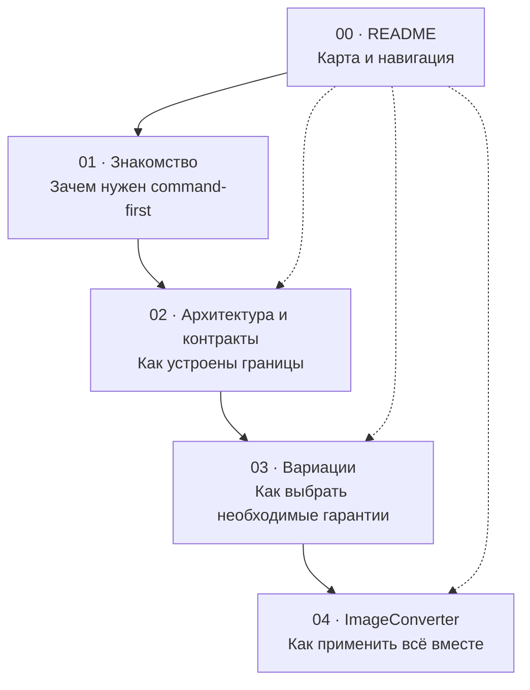
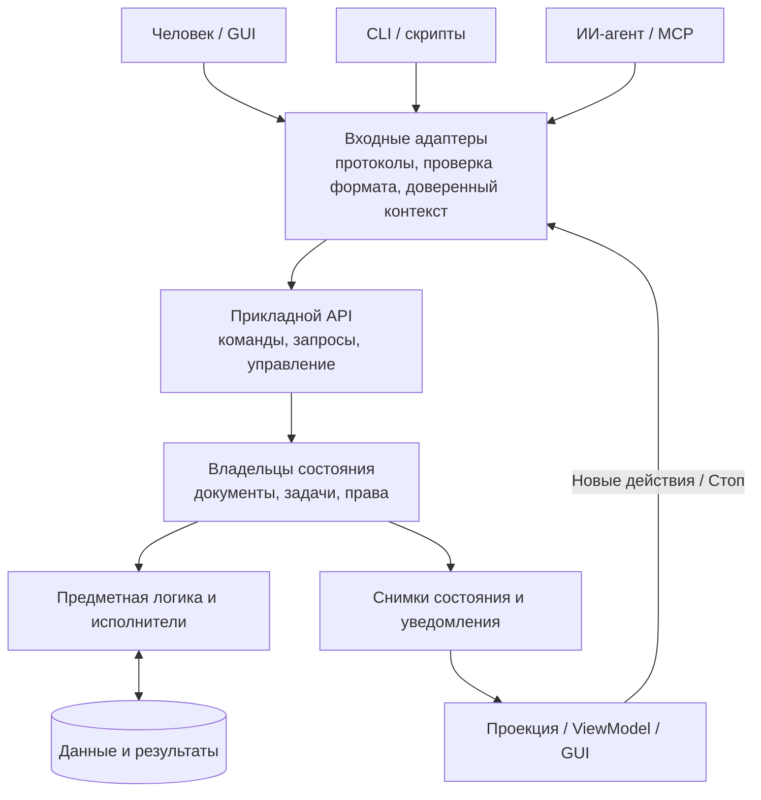
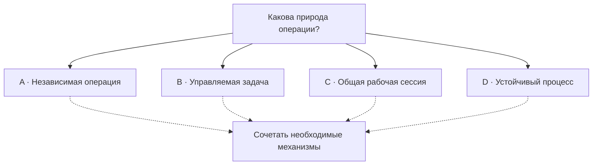
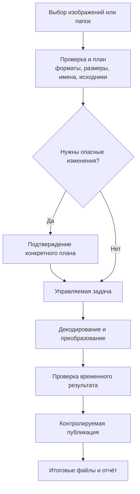
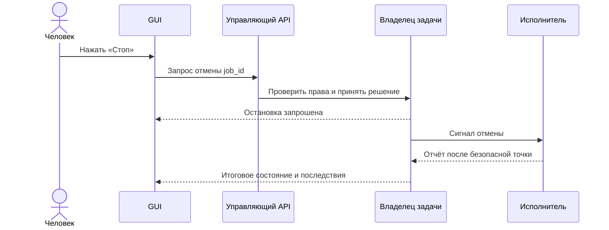
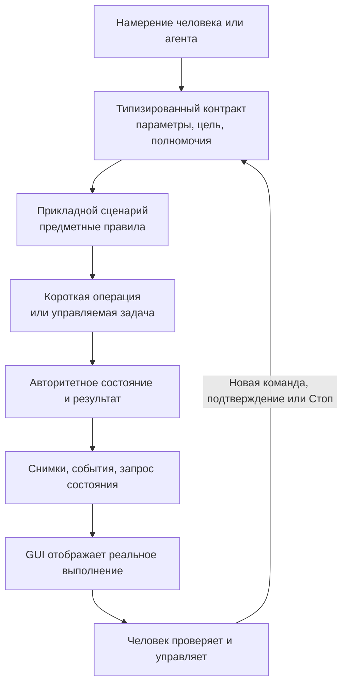

## 00 — Приложения для людей, скриптов и ИИ-агентов 🧭

*Путеводитель по серии о command-first-архитектуре: от независимого прикладного API до управляемых задач, живого графического интерфейса, взаимодействия с ИИ-агентами и практического проекта конвертера изображений.*

Приложение может предоставлять одни и те же возможности человеку через графический интерфейс, скриптам через CLI и ИИ-агентам через MCP. Существенный архитектурный вопрос состоит в том, **используют ли все эти способы управления общие операции, правила и состояние** или каждый создаёт собственную версию поведения программы.

**Command-first** в этой серии — название проектного принципа, а не новой обязательной технологии: значимые функции приложения имеют понятные программные точки входа и контракты, а графический интерфейс и автоматизация работают через эти точки входа. Приложение остаётся владельцем данных и правил; агент формулирует намерение, GUI показывает факты, а человек может контролировать последствия.

> [!abstract] Суть серии
> **GUI, CLI и ИИ-агент — не три разных приложения.** Это клиенты прикладной системы. Команды позволяют действовать, запросы — изучать состояние, события и снимки — наблюдать результат, а управляющие операции — вмешиваться в выполнение. Степень сложности выбирается по необходимым гарантиям, а не по модности технологий.

> [!info] Статус комплекта
> Серия содержит **четыре самостоятельные технические статьи** и этот **нулевой навигационный README**. Статьи 01–03 посвящены принципам, контрактам и вариантам устройства; статья 04 применяет их к спроектированному приложению для конвертации изображений. Представленные в ней контракты, схемы и фрагменты кода составляют **архитектурный проект**, а не готовую реализацию, проверенный дистрибутив или исходный репозиторий.

---

## 1. Содержание: четыре статьи и навигационный ноль 📚

| № | Материал | Главный вопрос | Результат чтения |
|---|---|---|---|
| **00** | **README — карта серии** | Где искать нужную тему? | Маршруты чтения, предметный указатель, словарь и связи |
| **01** | [Command-first: приложение как программируемая система](01_Command_First_Introduction.md) | **Зачем** отделять операции от интерфейса? | Понимание подхода, отличий от CLI-обёрток, MCP и общей сессии |
| **02** | [Command-first изнутри: слои, контракты и управляемое выполнение](02_Command_First_Architecture_and_Contracts.md) | **Как** устроена система? | Границы, DTO, прикладной API, состояние, события, Job, отмена, типизация |
| **03** | [Вариации command-first: выбор архитектуры по требованиям и гарантиям](03_Command_First_Architecture_Variants.md) | **Какой вариант** нужен конкретному продукту? | Профили A–D, матрица выбора, цена усложнения, стратегии эволюции |
| **04** | [Конвертер изображений: практическая command-first-архитектура](04_Command_First_Image_Converter_Architecture.md) | **Как применить** подход в предметном проекте? | Проект конвертера: изображения, планы, публикация, GUI, CLI, MCP, остановка |

Последовательное чтение формирует движение **от принципа к механике, затем к архитектурному выбору и конкретной спецификации**. Однако статьи самостоятельны: при необходимости можно сразу обратиться к нужному контракту, диаграмме или сценарию ошибки.

### 01 — Знакомство с идеей 💡

[Открыть статью 01](01_Command_First_Introduction.md)

Первая статья объясняет разницу между действием программы и способом его вызвать. В ней сравниваются CLI как отдельная исполняемая утилита, общее ядро и CLI как клиент уже запущенного приложения. Рассматриваются Command Registry, MCP, Headless и Attached, наблюдаемость работы агента, ограничения безопасности и причина, по которой **видимые изменения в GUI не требуют имитации кликов**.

Особенно полезна для чтения до выбора библиотек и фреймворков: она отделяет архитектурный смысл от конкретного синтаксиса Python, TypeScript или Rust.

### 02 — Слои и контракты 🧱

[Открыть статью 02](02_Command_First_Architecture_and_Contracts.md)

Вторая статья задаёт технический словарь: **прикладной API, входные и выходные порты, адаптеры, предметная модель, DTO, ViewModel, доверенный контекст, Job, Attempt и Artifact**. В ней описаны границы владения состоянием, публикация событий после фиксации, согласованная подписка GUI, управление длительной работой, идемпотентность и версия контрактов.

Есть псевдокод, JSON Schema, типизированные примеры на Python/Pydantic и TypeScript/Zod. Отдельно показано, почему **описание типа не является проверкой полномочий**, а «событие пришло» — ещё не гарантия восстановления состояния после разрыва соединения.

### 03 — Варианты по требованиям ⚖️

[Открыть статью 03](03_Command_First_Architecture_Variants.md)

Третья статья отвечает на инженерный вопрос: **какие механизмы действительно понадобятся**. Она сравнивает четыре архитектурных профиля, дополнительные варианты сохраняемой очереди, размещение в GUI-процессе, локальном сервисе или backend, способы отмены и восстановления после ошибок.

Материал показывает, почему большая система не обязана иметь много логических слоёв, а маленькая утилита иногда требует серьёзных гарантий надёжности. Завершается матрицей решений, разобранными ситуациями и принципами постепенной эволюции.

### 04 — Практическая архитектура конвертера 🖼️

[Открыть статью 04](04_Command_First_Image_Converter_Architecture.md)

Четвёртая статья проектирует **ImageConverter** как самостоятельный пример приложения класса «GUI + CLI + MCP». В нём выбираются изображения и каталоги, задаётся выходной формат, выполняется изменение размеров с сохранением пропорций, а результаты проходят отдельную границу проверки и публикации.

Рассматриваются реальные различия декодирования и кодирования, ориентация, цвет, прозрачность, метаданные, безопасные имена файлов, сохранение оригиналов, план преобразования, ограниченная параллельность, управляемые задачи, кнопка «Стоп» и проверка всей конструкции испытаниями. Выбранный профиль — **B: управляемые задачи**, с возможностью дополнительных механизмов при необходимости.

> [!important] Четыре формата в практической статье
> Основной выходной профиль ImageConverter — **WebP, PNG, AVIF и JPEG**. HEIC/HEIF рассматривается среди входных семейств; другой четырёхформатный профиль с HEIF вместо PNG разобран как отдельная вариация. Увеличение означает обычный ресэмплинг с сохранением пропорций, а не обещание нейросетевого восстановления деталей.

---

## 2. Как устроена последовательность материалов 🗺️



*Сплошные стрелки показывают рекомендуемую последовательность. Пунктир — возможность перейти к тематическому материалу напрямую. Статья 04 использует решения из предыдущих, но не требует воспроизводить каждую их диаграмму в новом проекте.*

### Три полезных маршрута чтения 🚶

| Цель | Маршрут | На что обратить внимание |
|---|---|---|
| Разобраться в идее без выбора стека | **01 → 03** | CLI против общего API, Headless/Attached, какие гарантии окупаются |
| Спроектировать внутренние границы | **01 → 02 → 03** | DTO, права, состояние, события, владельцы данных, направление зависимостей |
| Подготовить техническую спецификацию продукта | **02 → 03 → 04** | Контракты выполнения, выбранный профиль, планирование, остановка, тесты |

Четвёртая статья особенно полезна после второй: без различия между запросом, планом, задачей, попыткой и опубликованным файлом отдельные правила безопасной конвертации выглядят излишне сложными. В совокупности они объясняют, **почему успешный вызов кодека ещё не всегда означает успешную пользовательскую операцию**.

### Быстрые переходы в Obsidian 🔗

Помимо обычных ссылок на файлы, Obsidian позволяет ссылаться прямо на заголовки. Несколько точек входа для повторного обращения:

| Задача | Ссылка на раздел |
|---|---|
| Отличить command-first от CLI-обёртки | [[01_Command_First_Introduction#4. Чем это отличается от CLI с графической и MCP-обёртками ⌨️|01 · CLI и обёртки]] |
| Разобрать границы слоёв | [[02_Command_First_Architecture_and_Contracts#2. Слои и направление зависимостей 🧱|02 · Слои]] |
| Понять надёжную подписку GUI | [[02_Command_First_Architecture_and_Contracts#10. Надёжная подписка: снимки, версии и восстановление 📡|02 · Снимки и обновления]] |
| Выбрать архитектурный профиль | [[03_Command_First_Architecture_Variants#3. Четыре архитектурных профиля, а не четыре ступени зрелости 🧩|03 · Профили A–D]] |
| Спроектировать кнопку «Стоп» | [[03_Command_First_Architecture_Variants#14. Кнопка «Стоп»: выбор силы гарантии 🛑|03 · Гарантии отмены]] |
| Разобрать безопасную публикацию результата | [[04_Command_First_Image_Converter_Architecture#16. Публикация результата: отдельная граница ответственности 💾|04 · Публикация]] |
| Проследить GUI, агента и одну задачу | [[04_Command_First_Image_Converter_Architecture#19. GUI: одна проекция для человека и агента 🖥️|04 · Живой GUI]] |

*Обычные Markdown-ссылки выше рассчитаны на совместимость с файловыми просмотрщиками и GitHub. Ссылки вида `[[...]]` предназначены для Obsidian; вне него могут отображаться как текст.*

---

## 3. Единая архитектурная идея всей серии ⚙️

Удобно разделять систему на **три контура**: действия, наблюдение и управление выполнением. Контуры могут реализовываться несколькими методами одного сервиса либо самостоятельными подсистемами; они **не равны трём серверам или трём архитектурным слоям**.



*Это диаграмма логических обязанностей. Она не диктует, где работают отдельные процессы. Для Attached-режима внешнему адаптеру обычно нужен канал к владельцу той же рабочей сессии, что использует GUI.*

### Контур действий: изменить или запустить 📨

Прикладной запрос выражает намерение: изменить документ, выполнить конвертацию, начать экспорт. Контракт определяет цель, параметры, предусловия, побочные эффекты, полномочия и результат. UI не должен иметь скрытой «своей» версии бизнес-операции; MCP не должен обходить её правила.

### Контур наблюдения: понять, что произошло 👀

Операцию можно наблюдать не по имитации мыши, а по фактам: задача принята, прогресс обновлён, документ изменён, результат опубликован. **Снимок состояния** описывает текущее положение дел, а **уведомление** сообщает об изменении. Для переподключения GUI одного потока событий недостаточно: нужен способ перечитать авторитетное состояние.

### Контур управления: сохранить участие человека 🛑

GUI может запросить остановку конкретной задачи, потребовать подтверждение опасного плана или ограничить дальнейшие действия агентной сессии. Эти операции направляются владельцу состояния, а не напрямую в кнопки или чужую память. **Отмена исполнения, восстановление изменений и запрет новых действий — разные контракты**.

> [!warning] Важная граница
> Успех вызова инструмента не обязательно означает завершение длительной задачи. Сообщение «остановка запрошена» не означает «исполнитель уже остановился». Состояние `cancelled` не обещает автоматического удаления всех ранее созданных файлов. Эти различия определяются именно прикладным контрактом.

---

## 4. Четыре архитектурных профиля: как не строить лишнего 🧩

Статья 03 вводит профили **A–D** для классификации требований. Они не являются официальным стандартом, лестницей «от плохого к хорошему» или обязательной последовательностью миграции. В одном приложении могут одновременно встречаться несколько профилей.

| Профиль | Главная сущность | Когда полезен | Что добавляет |
|---|---|---|---|
| **A · Прикладной сервис** | Операция и результат | Независимые короткие действия и простые утилиты | Общий типизированный API и тонкие адаптеры |
| **B · Управляемые задачи** | `Job` | Пакетная работа, прогресс, карточки, кнопка «Стоп» | Владелец задач, состояния, исполнитель, отмена и наблюдение |
| **C · Рабочая сессия** | Документ / workspace | Интерактивный редактор, несохранённые изменения, совместная работа | Авторитетное состояние документа, версии и согласование изменений |
| **D · Устойчивый процесс** | Workflow / этапы | Длительные зависимые действия, подтверждения, восстановление после сбоя | Сохраняемая координация, повторы и контролируемые эффекты |

**Дополнительная долговечность не равна автоматически профилю D.** Независимые задачи профиля B могут сохраняться в хранилище и возобновляться после сбоя без полноценного workflow-движка. Профиль D требуется, когда восстанавливать нужно также *логику многошагового процесса и его допустимые переходы*.



*Схема намеренно не делает профиль D продолжением C. Вариант выбирается независимо по времени жизни работы, характеру общего состояния, участникам, обратимости и последствиям ошибок.*

> [!tip] Критерий усложнения
> Новый компонент оправдан, когда появляется новое проверяемое требование. «GUI должен видеть задачу, запущенную до открытия окна» обосновывает чтение состояния и подписку. «Нужна кнопка “Стоп”» обосновывает управляющий контракт и отменяемое исполнение. Одно лишь слово «агент» не обосновывает брокер сообщений, Event Sourcing или микросервисы.

---

## 5. Индекс тем: где искать конкретное решение 🔎

В этом указателе перечислены **реально разобранные темы**. Номер после названия статьи указывает раздел внутри неё; ссылки открывают соответствующие документы, где есть собственные карты навигации.

| Интересующая тема | Материал и ориентир |
|---|---|
| Отличия от CLI-wrapper, общий SDK, подключение к живой сессии | [01 — §4, §9](01_Command_First_Introduction.md) |
| Command-first, паттерн Command и каталог операций | [01 — §2, §6](01_Command_First_Introduction.md), [02 — §6](02_Command_First_Architecture_and_Contracts.md) |
| Command / Query / Event / Job и связь с CQRS | [01 — §7](01_Command_First_Introduction.md), [02 — §9, §12](02_Command_First_Architecture_and_Contracts.md) |
| API, входные и выходные порты, внедрение зависимостей | [02 — §2–3, §21](02_Command_First_Architecture_and_Contracts.md) |
| DTO, предметная модель, Value Object, ViewModel | [02 — §4–5, §11](02_Command_First_Architecture_and_Contracts.md) |
| JSON Schema, Python/Pydantic, TypeScript/Zod | [02 — §6, §19–20](02_Command_First_Architecture_and_Contracts.md) |
| Владелец состояния и проверка версии документа | [02 — §8](02_Command_First_Architecture_and_Contracts.md), [03 — §8](03_Command_First_Architecture_Variants.md) |
| Снимки, события, пропуски сообщений, переподключение GUI | [02 — §9–11](02_Command_First_Architecture_and_Contracts.md), [04 — §19–20](04_Command_First_Image_Converter_Architecture.md) |
| Менеджер задач, попытки исполнения и артефакты | [02 — §12–13](02_Command_First_Architecture_and_Contracts.md), [04 — §14–15](04_Command_First_Image_Converter_Architecture.md) |
| Кнопка «Стоп», отмена, Undo и компенсация | [02 — §14](02_Command_First_Architecture_and_Contracts.md), [03 — §14–15](03_Command_First_Architecture_Variants.md), [04 — §18](04_Command_First_Image_Converter_Architecture.md) |
| Безопасность, полномочия и подтверждение опасного плана | [02 — §17](02_Command_First_Architecture_and_Contracts.md), [03 — §17](03_Command_First_Architecture_Variants.md), [04 — §17, §21](04_Command_First_Image_Converter_Architecture.md) |
| Повторные вызовы, идемпотентность, неизвестный исход | [02 — §15–16](02_Command_First_Architecture_and_Contracts.md), [04 — §22, §24](04_Command_First_Image_Converter_Architecture.md) |
| Физическое размещение: процесс GUI, локальный сервис, backend | [03 — §11](03_Command_First_Architecture_Variants.md), [04 — §3, §21](04_Command_First_Image_Converter_Architecture.md) |
| Матрица выбора профиля и эволюция без усложнения | [03 — §21–23, §25](03_Command_First_Architecture_Variants.md) |
| Входные форматы и проверка возможностей кодеков | [04 — §5–6](04_Command_First_Image_Converter_Architecture.md) |
| Масштабирование с сохранением пропорций | [04 — §7](04_Command_First_Image_Converter_Architecture.md) |
| Ориентация, цвет, прозрачность и метаданные | [04 — §8–9](04_Command_First_Image_Converter_Architecture.md) |
| Конфликты имён, оригиналы, планы и безопасная публикация | [04 — §10–11, §16–17](04_Command_First_Image_Converter_Architecture.md) |
| Работа GUI, CLI и MCP с одним приложением | [01 — §8–11](01_Command_First_Introduction.md), [04 — §12, §19–21](04_Command_First_Image_Converter_Architecture.md) |
| Проверки, отказоустойчивость и последовательность реализации | [04 — §22–27, §29](04_Command_First_Image_Converter_Architecture.md) |

### Как пользоваться указателем 📌

Указатель не заменяет полные оглавления документов. Каждая статья содержит собственную карту чтения и локальные ссылки на заголовки; это удобнее, чем поддерживать в README несколько сотен глубоких ссылок, зависящих от конкретного Markdown-рендерера.

Для вопросов «что означает термин» полезен следующий словарь. Для вопросов «что именно следует построить» обычно требуется прочитать соответствующий раздел **второй статьи** вместе с ограничениями и компромиссами **третьей**.

---

## 6. Краткий словарь архитектуры 📖

| Термин | Значение в этой серии |
|---|---|
| **Command-first** | Принцип, по которому значимые возможности описываются программно доступными операциями с общими правилами, а не только обработчиками GUI |
| **Application API** | Публичная прикладная граница, через которую клиенты инициируют сценарии и читают состояние |
| **Command** | Намерение выполнить действие или изменение; не обязательно строка терминала и не обязательно отдельный класс |
| **Query** | Запрос на чтение состояния без намеренного изменения предметных данных |
| **Event** | Сообщение о произошедшем факте; не команда конкретному виджету |
| **Job** | Логическая длительная работа с собственным идентификатором и жизненным циклом |
| **Attempt** | Отдельная техническая попытка выполнить Job; может смениться при повторе |
| **Artifact** | Подготовленный либо опубликованный результат с определённой политикой доступа и хранения |
| **DTO** | Объект или схема передачи данных через оговорённую границу; не содержит скрытых ссылок на окно или БД |
| **Domain model** | Предметные сущности и правила корректного состояния, независимые от конкретного интерфейса |
| **ViewModel / Presentation Model** | Подготовленные для экрана данные и логика представления, не владеющие предметными изменениями |
| **Port** | Поведенческий интерфейс потребности или доступного сценария |
| **Adapter** | Реализация на конкретной границе: GUI, CLI, MCP, файловая система, кодек, IPC |
| **Command Registry** | Каталог имён операций, схем, обработчиков и описательных метаданных |
| **Dispatcher / Command Bus** | Маршрутизатор запросов к обработчикам; не обязательно брокер, очередь или отдельный сервис |
| **MCP** | Протокол, через который агентная среда обнаруживает и вызывает инструменты предоставляющего сервера |
| **IPC** | Способ обмена сообщениями между процессами; не заменяет прикладные правила |
| **Headless** | Запуск движка без GUI, возможно в собственной самостоятельной сессии |
| **Attached** | Работа с уже существующим владельцем состояния, к которому подключён открытый GUI |
| **Snapshot** | Представление состояния на определённый момент или версию |
| **Revision** | Версия конкретного ресурса; помогает обнаруживать устаревшие изменения и сообщения |
| **Stream cursor** | Позиция в потоке уведомлений для продолжения согласованного наблюдения; не равна версии ресурса |
| **Idempotency key** | Идентификатор логического намерения, который в сочетании с хранилищем и правилами позволяет распознать повтор |
| **Cancellation** | Запрос прекратить дальнейшее исполнение; не обещает автоматический откат уже состоявшихся эффектов |
| **Undo / Compensation** | Разные механизмы отмены изменений модели или исправления уже состоявшихся побочных эффектов |
| **Workflow** | Управляемая последовательность связанных этапов с собственными условиями перехода и возможностью сохранения исполнения |

### Пять различий, которые нельзя смешивать 🧠

| Похожие понятия | Принципиальное отличие |
|---|---|
| **Общий код / общее состояние** | Одна библиотека не обеспечивает видимость несохранённого документа или задачи между двумя процессами |
| **Команда / задача** | Команда запрашивает действие; Job имеет собственный жизненный цикл после завершения запускающего вызова |
| **Событие / источник истины** | Событие помогает узнать о перемене; актуальное состояние хранит и определяет его владелец |
| **Остановка / восстановление** | Остановка ограничивает новые действия; возвращение прежнего состояния требует отдельной политики |
| **Типизация / безопасность** | Корректная схема данных не доказывает полномочия инициатора и допустимость действия над ресурсом |

---

## 7. Сквозной пример всей серии: ImageConverter 🖼️

Практическое приложение из статьи 04 — **не графический редактор с общим несохранённым холстом**, а конвертер с пакетной обработкой и управляемыми задачами. Его назначение — показать, как один законченный прикладной сценарий проходит от запроса до безопасно опубликованного результата.

В качестве основного выходного профиля выбраны **WebP, PNG, AVIF, JPEG**. Поддержка входа определяется реальными возможностями декодеров и политикой обработки свойств изображения; название «любое изображение» не служит гарантией чтения произвольного RAW, векторного проекта или многослойного документа.

### Сквозной путь изображения 📷



Планирование не объявляет будущую запись безопасной навсегда: между подготовкой и публикацией файловая система может измениться. Именно поэтому статья отдельно разбирает конфликт имён, гонки, временные файлы, актуальность исходников и точку фиксации результата.

### Как в этой системе появляется «живой GUI» 👀

Человек или агент запускает задачу через общий API. Владелец задач регистрирует её состояние. GUI читает снимки, подписывается на обновления и строит карточки: «В очереди», «Обработка», «Останавливается», «Готово», «Ошибка».

Появление новой карточки не зависит от того, **кто нажал кнопку**. Агенту не нужно искусственно перемещать курсор и переключать вкладки. У пользователя остаётся собственное состояние просмотра; изменения прикладной работы отражаются через проекцию состояния.

### Что означает «Стоп» в этом примере 🛑



Отмена не означает, что уже опубликованные файлы исчезнут. Если требуется запретить агенту снова запускать подобную работу, применяется **отдельное управление допуском агентной сессии**, а не повторное нажатие на «Стоп».

---

## 8. Обязательные архитектурные вопросы перед реализацией 📐

Материалы серии позволяют ответить на небольшой набор вопросов ещё до выбора конкретных библиотек. Следующие формулировки полезны как контрольный список архитектурного обсуждения, а не как требование создать отдельный документ для каждого пункта.

| Вопрос | Что должно быть определено |
|---|---|
| Что является операцией? | Её публичная цель, вход, результат и допустимые последствия |
| Кто вызывает действие? | Проверенный контекст инициатора, его полномочия и ограничения |
| Где хранится состояние? | Авторитетный владелец и время жизни состояния |
| Как клиент узнаёт результат? | Ответ операции, запрос состояния, уведомление либо Job |
| Когда работа считается завершённой? | Проверяемое постусловие, а не только возвращение низкоуровневой функции |
| Что происходит при конфликте? | Проверка версии, политика перезаписи или понятный отказ |
| Что происходит при повторе? | Идемпотентность, статус прежнего действия либо явно запрещённый retry |
| Как работает «Стоп»? | Точка запроса, реакция исполнителя, граница публикации и частичные результаты |
| Что переживает перезапуск? | Сохраняемые задачи, опубликованные результаты, журналы или ничего — по контракту |
| Как безопасно показать работу в GUI? | Снимки, подписка, версии, ViewModel, политика пользовательского фокуса |
| Как проверить обещания? | Контрактные, предметные, интеграционные и сквозные тесты на границах сбоев |

> [!warning] Симптом архитектурной ошибки
> Если GUI способен изменить данные напрямую, минуя правила доступной агенту команды, система уже имеет два различных пути изменения. Если агент способен отменять задачу только в своём процессе, а кнопка GUI ничего о ней не знает, у приложения нет общего владельца этой работы. Если панель прогресса читает исключительно текстовые логи, наблюдение не имеет надёжного прикладного контракта.

### Чего материалы намеренно не обещают 🚧

Серия не представляет command-first как обязательный новый стандарт, не требует универсального Command Bus для пяти простых функций и не превращает MCP в реализацию бизнес-логики. Здесь не предполагается, что агент всегда правильно выбирает действия или что любое внешнее побочное действие можно откатить.

Равно как не предполагается, что типизация данных обеспечивает аутентификацию, что локальный IPC автоматически безопасен, что события доставляются ровно один раз или что любой асинхронный метод исполняет тяжёлую работу без блокировки GUI.

**Главный критерий архитектуры — действительные гарантии, подтверждённые контрактами и тестами.**

---

## 9. Языки, GUI-фреймворки и переносимость идеи 🌐

Большая часть серии намеренно **не привязана к языку**. Одни и те же роли реализуются разными средствами:

| Архитектурная роль | Python | TypeScript / JavaScript |
|---|---|---|
| Внешняя runtime-валидация | Pydantic | Zod или другой валидатор |
| Типы и поведенческие интерфейсы | `Protocol`, `dataclass`, `Literal` | `interface`, `type`, discriminated unions |
| GUI и представление | PySide6/PyQt6, Qt-сигналы, Presenter | React, Store, Electron Renderer |
| Исполнитель и длительная работа | Потоки, процессы, фоновые задачи | Async I/O, Worker Threads, Web Workers, процессы |
| Межпроцессная связь | Локальный IPC/RPC | Electron IPC, локальный RPC, WebSocket |
| Агентная интеграция | MCP-адаптер над прикладным API | MCP-адаптер над тем же смысловым API |

Это **соответствия по роли**, а не полная эквивалентность средств. Например, `async/await` не создаёт параллельное CPU-исполнение автоматически; TypeScript-типы не валидируют JSON во время выполнения; Qt-объекты GUI требуют соблюдения своей модели потоков.

Вторая статья содержит короткие типизированные примеры для Python и TypeScript. Четвёртая добавляет Python-эскиз для конвертера, но её правила файлов, планов, отмены и публикации остаются применимыми к другой реализации.

---

## 10. Первичные источники и направления для самостоятельного изучения 🔗

Ссылки ниже — выборочная карта первоисточников, на которых основаны разборы. **Подробные списки источников и точные границы утверждений приведены в конце каждой из четырёх статей.**

| Источник | Что помогает понять |
|---|---|
| [Alistair Cockburn — Hexagonal Architecture](https://alistair.cockburn.us/hexagonal-architecture) | Порты, адаптеры, независимость прикладного смысла от оболочек |
| [Martin Fowler — Service Layer](https://martinfowler.com/eaaCatalog/serviceLayer.html) | Общую границу прикладных сценариев |
| [Martin Fowler — Data Transfer Object](https://martinfowler.com/eaaCatalog/dataTransferObject.html) | Назначение объектов передачи данных |
| [Martin Fowler — Presentation Model](https://martinfowler.com/eaaDev/PresentationModel.html) | Разделение состояния представления и GUI-контролов |
| [Martin Fowler — What do you mean by Event-Driven?](https://martinfowler.com/articles/201701-event-driven.html) | Различие уведомления, переноса состояния и Event Sourcing |
| [Microsoft — Asynchronous Request–Reply](https://learn.microsoft.com/en-us/azure/architecture/patterns/asynchronous-request-reply) | Различие принятия работы и окончательного результата |
| [Microsoft — Compensating Transaction](https://learn.microsoft.com/en-us/azure/architecture/patterns/compensating-transaction) | Восстановление уже состоявшихся последствий |
| [JSON Schema](https://json-schema.org/understanding-json-schema/about) | Машинное описание данных на границах |
| [MCP — спецификация](https://modelcontextprotocol.io/specification/2026-07-28) | Роли host, client и server, инструменты и протокольные ограничения |
| [OWASP — Authorization Cheat Sheet](https://cheatsheetseries.owasp.org/cheatsheets/Authorization_Cheat_Sheet.html) | Проверка прав и минимальные полномочия |
| [FigCraft — архитектурные правила](https://github.com/storytold/figcraft/blob/main/AGENTS.md) | Открытый пример дисциплины «Everything is a Command» |
| [FigCraft — MCP](https://github.com/storytold/figcraft/blob/main/docs/mcp.md) | Пример Headless и Attached для редактора |

> [!note] Статус ссылок
> Источники изучались для материалов серии **23 октября 2026 года**. Страницы документации и ветки `main` могут измениться. Архитектурные примеры серии являются самостоятельными учебными проектными решениями, а не буквальным API FigCraft или обязательной схемой MCP. Поддержка конкретной версии протокола клиентами проверяется перед интеграцией.

---

## 11. Использование в Markdown и Obsidian 🗂️

Все пять файлов предназначены для размещения **в одном каталоге**. Тогда относительные Markdown-ссылки между статьями работают без изменения путей:

```text
Command-First/
├── 00_README.md
├── 01_Command_First_Introduction.md
├── 02_Command_First_Architecture_and_Contracts.md
├── 03_Command_First_Architecture_Variants.md
└── 04_Command_First_Image_Converter_Architecture.md
```

Обозначение `00` помогает держать навигацию впереди материалов при сортировке. При публикации в репозитории вместо `00_README.md` может использоваться стандартное имя `README.md`, если требуется автоматическое отображение корневой страницы площадкой; относительные ссылки на остальные статьи при этом сохранятся.

### Оформление материалов ✨

Статьи написаны по-русски как самостоятельные технические тексты. Они используют заголовки, таблицы сравнений, JSON и псевдокод, диаграммы Mermaid, Obsidian-callouts (`> [!note]`, `> [!warning]` и другие) и ссылки на первичные источники.

Для просмотра диаграмм используется Markdown-редактор с поддержкой Mermaid. Obsidian понимает внутренние ссылки `[[...]]` и callouts. В обычных Markdown-просмотрщиках такие элементы могут отображаться как текст, однако основные разделы и ссылки на файлы остаются читаемыми.

### Поддержание актуальности навигации 🔄

Если в отдельной статье переименован раздел, соответствующая ссылка на заголовок в README должна быть скорректирована. Если изменяется публичный контракт, исправление должно затронуть не только пример кода, но и семантику результата, ошибок, отмены и связанных гарантий.

Для новых предметных примеров можно добавлять отдельные самостоятельные статьи после четвёртой. При этом не требуется превращать данный README в техническую спецификацию всех будущих приложений: его задача — оставаться **картой понятий, решений и мест для углубления**.

---

## 12. Финальная карта: от намерения до управляемого результата 🧭



Главная архитектурная граница проходит не между языками программирования и не между «человеческими» и «агентными» функциями. Она проходит между **намерением клиента, правилами приложения, авторитетным состоянием и представлением результата**.

Когда эта граница определена, графический интерфейс может показывать настоящую работу агента, CLI — выполнять те же операции без окна, а человек — отменять управляемое выполнение или запрещать дальнейшие действия в пределах выданных полномочий. При этом для простой утилиты достаточно небольшого общего ядра, а сложные редакторы и восстанавливаемые процессы получают дополнительные механизмы по мере появления соответствующих требований.

> [!summary] Итог серии
> **Command-first — это проектирование приложения как самостоятельной программируемой системы.** Общие операции задают язык действий, контракты фиксируют смысл и границы, состояние делает происходящее наблюдаемым, а управляющие механизмы сохраняют возможность человеческого вмешательства. Выбор между простым сервисом, управляемыми задачами, общей рабочей сессией и устойчивым процессом определяется требуемыми гарантиями, а не названием фреймворка.

**Начало последовательного чтения:** [01 — Command-first: приложение как программируемая система](01_Command_First_Introduction.md).  
**Переход к практическому проекту:** [04 — Конвертер изображений: command-first-архитектура](04_Command_First_Image_Converter_Architecture.md).
