## 01 — Command-first: приложение как программируемая система 🧭

*Как устроить программу, чтобы человек, скрипт и ИИ-агент работали с одними возможностями, а графический интерфейс показывал настоящую жизнь приложения.*

У приложения может быть несколько способов управления: кнопки и меню, командная строка, программный интерфейс, инструменты для ИИ-агента. Архитектурный вопрос состоит не в том, сколько таких способов существует, а в том, **обращаются ли они к одной системе операций или каждый реализует собственную версию программы**.

Command-first — подход, при котором значимые действия приложения сначала оформляются как самостоятельные программно доступные операции. Графический интерфейс, CLI и агентные интеграции становятся разными способами вызвать эти операции, прочитать состояние и получить результат.

Эта идея полезна и без искусственного интеллекта. Агент лишь делает особенно заметными требования, которые раньше могли оставаться необязательными: явные параметры, предсказуемые ошибки, наблюдаемое выполнение, управление долгими задачами и возможность безопасного вмешательства человека.

> [!abstract] Центральная мысль
> Приложение — это не набор кнопок, к которому добавили автоматизацию. Это система правил, данных и операций, у которой могут быть разные интерфейсы управления. Хорошая агентная интеграция предоставляет доступ к этой системе, а не заставляет агента изображать человека перед монитором.

### Место статьи в серии 📚

| Материал | Основной вопрос | Граница материала |
|---|---|---|
| **01. Знакомство** | Что представляет собой подход и зачем он нужен? | Понятия, принцип работы, отличия от CLI-обёрток, живой GUI и контроль человека |
| **02. Архитектура и контракты** | Как организовать внутреннее устройство? | Слои, DTO, интерфейсы, состояние, события, типизация и правила взаимодействия |
| **03. Вариации архитектуры** | Какие механизмы нужны конкретному приложению? | Простая утилита, очередь задач, интерактивный редактор, восстанавливаемые процессы |
| **04. Практическое приложение** | Как собрать решения в целостный продукт? | Отдельный проект конвертера изображений на основе конкретных требований |
| **00. README** | Как пользоваться всей серией? | Итоговая карта материалов; формируется после основных статей |

Первая статья не задаёт обязательный стек библиотек и не превращает знакомство с идеей в реализацию собственного фреймворка. Небольшие JSON-примеры описывают **условный редактор документов**. Это иллюстрации контрактов, а не готовый протокол существующего продукта. Реальные механизмы FigCraft рассматриваются отдельно и снабжены ссылками на документацию проекта.

> [!info] Навигация по статье
> **Основа:** [[#1. Почему приложению нужен собственный язык операций 💡|Язык операций]] · [[#2. Что означает command-first и чего этот термин не обещает 🧩|Command-first]] · [[#4. Чем это отличается от CLI с графической и MCP-обёртками ⌨️|Сравнение с CLI]].
>
> **Механика:** [[#6. Контракт: общий язык приложения и его клиентов 📜|Контракты]] · [[#8. API, CLI, MCP и IPC: четыре разных роли 🔌|Протоколы и интерфейсы]] · [[#9. Headless и Attached: вопрос не в окне, а во владельце состояния 🧠|Рабочие сессии]].
>
> **Совместная работа:** [[#11. Как GUI становится живым наблюдателем работы агента 👀|Живой GUI]] · [[#12. Кнопка «Стоп»: управление выполнением, а не декоративный элемент 🛑|Остановка]] · [[#13. Совместная работа: одно содержимое, но не обязательно один фокус 🤝|Человек и агент]].
>
> **Практический смысл:** [[#14. FigCraft: практический пример, а не универсальный шаблон 🛠️|Пример FigCraft]] · [[#16. Сквозной сценарий: агент работает, человек сохраняет контроль 🎬|Сквозной сценарий]] · [[#18. Как сохранить простоту и оставить путь к развитию 🌱|Граница сложности]].

---

## 1. Почему приложению нужен собственный язык операций 💡

В привычном настольном приложении пользователь видит действия: открыть документ, добавить объект, изменить размер, сохранить результат. На экране эти действия представлены меню, кнопками, горячими клавишами и жестами.

Но кнопка «Переименовать» и операция переименования — разные вещи.

Кнопка отвечает за взаимодействие с человеком. Она может открыть поле ввода, показать подсказку, получить новое название и отобразить ошибку. Сама операция должна определить, существует ли объект, допускается ли изменение, корректно ли название и каким станет состояние после выполнения.

Пока у программы один интерфейс, эти обязанности легко смешать. Обработчик кнопки читает поля формы, меняет документ, записывает файл и обновляет соседние виджеты. Программа работает, но её функциональность оказывается привязана к конкретному экрану.

Когда появляется второй способ управления, возникает неприятный выбор: повторить эту логику в другой оболочке либо заставить новую оболочку взаимодействовать с существующим GUI.

### Когда кнопка становится единственным входом 🚪

В условном редакторе переименование страницы реализовано только в обработчике меню. Агенту приходится находить нужную страницу на экране, открывать контекстное меню, выбирать действие, вводить текст и подтверждать его. При этом смысл задачи — изменить одно свойство известного объекта — теряется за последовательностью интерфейсных действий.

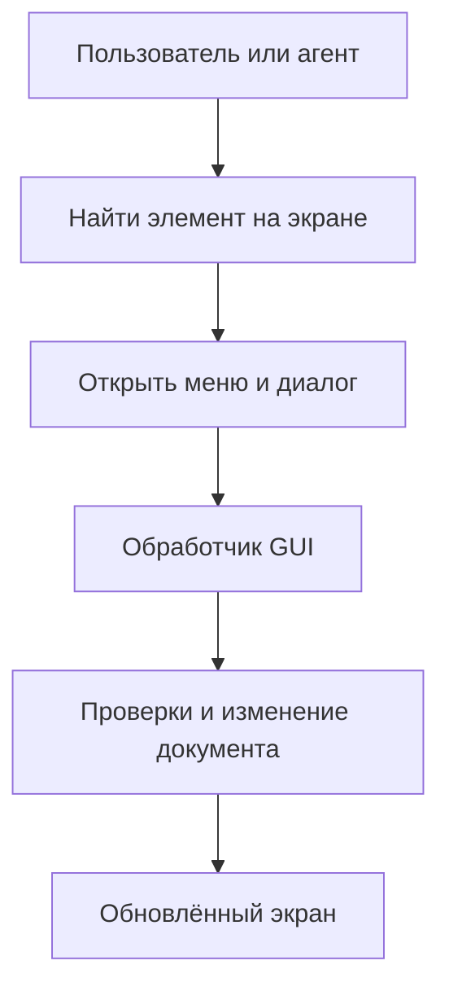

Такая автоматизация сама по себе не является неправильной. Она нужна при управлении чужим приложением без подходящего API, а также при тестировании интерфейса. Проблема возникает тогда, когда **собственное приложение специально проектируется так, что даже его внутреннюю функциональность можно вызвать только через экран**.

В этом случае изменения интерфейса начинают влиять на автоматизацию. Диалог, удобный человеку, становится дополнительным состоянием, которое программа-клиент должна распознать и обработать. Тест прикладной операции вынужден запускать графическую оболочку, даже если сама операция не имеет отношения к отображению.

Отделение внутренней логики от способов управления — не новая идея эпохи агентов. В исходном описании [Ports and Adapters][ports] приложение предлагается делать доступным через пользовательские интерфейсы, автоматизированные тесты и другие программы, не связывая его смысл с конкретным устройством ввода.

### Что меняет самостоятельная операция 🔑

Если у редактора есть операция `page.rename`, графический обработчик лишь собирает её параметры. CLI получает те же сведения из аргументов. Агентный адаптер принимает структурированный запрос.

Все эти пути сходятся в одной точке, где применяются одинаковые предметные правила. Отличаться могут полномочия инициатора, способ отображения ошибки и формат ответа, но не само значение переименования.

Появляется полезный критерий проектирования: **важное действие можно описать и проверить без упоминания расположения кнопок**.

Установка нового названия страницы соответствует этому критерию. Наведение указателя на пункт меню — обычно нет: это поведение представления, а не самостоятельная задача предметной области.

> [!note] Программируемость шире агентности
> Общий прикладной интерфейс одинаково полезен для скриптов, тестов, пакетной обработки и интеграций. ИИ-агент — ещё один клиент. Архитектуре не требуется считать его особой формой бизнес-логики.

---

## 2. Что означает command-first и чего этот термин не обещает 🧩

В этой серии **command-first** обозначает проектный принцип: значимые возможности программы имеют явные программные точки входа, а интерфейсы используют их вместо независимой реализации поведения.

Название не обозначает отдельный обязательный стандарт, библиотеку или технологию. Из него не следует, что каждая операция обязана быть классом `Command`, что все вызовы проходят через очередь или что приложение должно стать распределённой системой.

Близкое понятие — **прикладной API**, или Application API. Это граница, за которой находятся доступные сценарии программы: переименовать страницу, экспортировать документ, получить состояние задачи. В описании [Service Layer][service-layer] такая граница объединяет доступные операции и координирует реакцию приложения, вместо того чтобы повторять сценарии в разных интерфейсах.

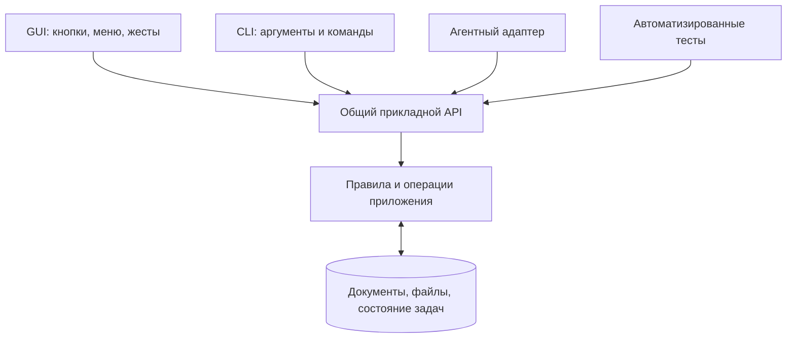

*Схема показывает логические обращения. Она не утверждает, что все компоненты работают в одном процессе или непосредственно разделяют память.*

### Одна семантика, а не обязательно одна большая функция ⚙️

Фраза «одна реализация операции» не означает, что всё приложение должно обслуживаться гигантским обработчиком.

Операция экспорта может обращаться к сервису подготовки документа, кодеку, хранилищу и менеджеру задач. Существенно другое: GUI и MCP не должны по-разному решать, что считается готовым экспортом, какие форматы поддерживаются и как обрабатывается конфликт выходного файла.

Сама операция также может иметь несколько технических реализаций. Например, разные кодеки могут выполнять один прикладной контракт. Это не нарушает общий подход, если выбор реализации контролируется приложением, а правила сценария остаются согласованными.

### Command-first и паттерн Command — не синонимы 🧱

Классический паттерн Command оформляет действие отдельным объектом. Такой объект удобно хранить, передавать исполнителю и связывать с обратной операцией. Например, [Undo Framework в Qt][qt-undo] строится на объектах команд, которые применяют изменение документа и знают, как его отменить.

Однако прикладная операция не обязана реализовываться именно так. Для небольшой программы достаточно обычного типизированного метода сервиса. Для расширяемого редактора удобнее реестр именованных операций. Для очереди фоновых работ требуется ещё и модель задачи.

Всё это совместимые варианты, но ни один не следует автоматически из наличия слова `Command` в названии класса.

### Что значит «всё является командой» 🪄

Лозунг *Everything is a Command* полезен как правило для значимого поведения: новая возможность не должна появляться только внутри графического обработчика.

Буквальное толкование быстро становится избыточным. Подсветка кнопки, промежуточный кадр анимации и движение курсора не обязаны превращаться в публичные операции для внешнего агента. Даже длительный жест редактирования может собираться в одно осмысленное изменение с общим шагом Undo.

Граница проходит по смыслу: **программный интерфейс должен выражать действия над приложением, а не обязаться воспроизводить каждый пиксель его поведения**.

> [!important] Общие правила не означают одинаковые права
> Человек и агент могут вызывать одну операцию, но иметь разные полномочия. Равноправие интерфейсов означает единую семантику сценария, а не бесконтрольный доступ всех клиентов ко всем возможностям.

---

## 3. Команда — это намерение, а не строка для терминала 📨

Слово «команда» употребляется сразу в нескольких смыслах. Терминальная команда запускает программу или обращается к её CLI. Прикладная команда сообщает приложению, какое изменение требуется. Команда протокола описывает сообщение между клиентом и сервером.

Эти вещи могут быть связаны, но не обязаны совпадать.

В учебном редакторе прикладной запрос может выглядеть так:

```json
{
  "operation": "page.rename",
  "arguments": {
    "document_id": "doc-17",
    "page_id": "page-4",
    "expected_revision": 28,
    "new_name": "Сводка результатов"
  }
}
```

Это не строка для Bash или PowerShell. Название `page.rename` ищется в прикладном интерфейсе. Параметры описывают цель операции: конкретный документ и страницу, ожидаемое состояние и новое значение.

Внутри одного процесса запрос может быть представлен типизированным объектом или аргументами метода. JSON нужен только там, где выбран соответствующий формат обмена.

### Почему полезно передавать идентификатор, а не «текущий объект» 🎯

Команда «переименовать активную страницу» удобна для горячей клавиши, когда действие связано с текущим фокусом пользователя. Для внешнего агента это может быть неоднозначно.

Пока агент готовит запрос, человек способен переключить вкладку. Если запрос опирается на неявную активность, он попадёт в другой объект. Явные `document_id` и `page_id` делают цель проверяемой.

Поле `expected_revision` в примере добавляет условие: операция предназначена для определённой версии документа. Если эта версия уже изменилась, приложение может вернуть конфликт вместо молчаливой записи поверх чужих правок. Это проектное решение конкретного API, а не обязательное поле любой команды.

### Ответ тоже должен иметь смысл ✅

После успешного выполнения редактор возвращает не только фразу «готово», но и факты:

```json
{
  "status": "succeeded",
  "result": {
    "document_id": "doc-17",
    "page_id": "page-4",
    "name": "Сводка результатов",
    "revision": 29
  }
}
```

При конфликте возможен другой ответ:

```json
{
  "status": "rejected",
  "error": {
    "code": "REVISION_CONFLICT",
    "message": "Документ изменился после чтения состояния",
    "current_revision": 30
  }
}
```

Машиночитаемый код ошибки позволяет клиенту выбрать следующий шаг: повторно прочитать документ, показать конфликт человеку или прекратить сценарий. Текстовое сообщение остаётся полезным для объяснения, но не должно быть единственным способом определить, что произошло.

Оба примера описывают **условный прикладной формат**. Внешний протокол может дополнительно оборачивать их идентификатором запроса, транспортным статусом и другими метаданными.

### Не каждая внутренняя функция должна стать публичной 🛡️

У приложения могут существовать низкоуровневые функции изменения структур данных. Это ещё не повод предоставлять агенту возможность вызывать их напрямую.

Операция `page.rename` способна проверить ограничения имени, право редактирования и состояние документа. Универсальное присваивание `set_internal_field` может обойти эти правила. Поэтому хороший прикладной API раскрывает **допустимые сценарии**, а не всю внутреннюю память программы.

---

## 4. Чем это отличается от CLI с графической и MCP-обёртками ⌨️

Утверждение «CLI-обёртки плохие, а command-first хороший» было бы неверным. CLI может быть качественным программным интерфейсом. Важны его контракт, управление состоянием и возможности наблюдения, а не сам факт вызова отдельного процесса.

Полезно различать три конструкции.

### Оболочки запускают CLI как отдельную программу 📦

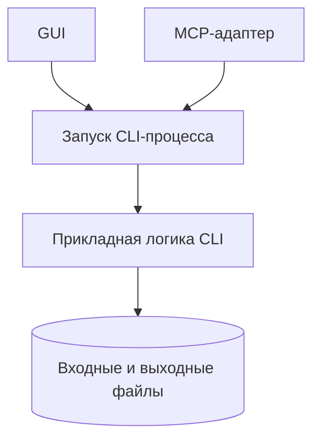

Для независимой обработки файлов это может быть простым и надёжным решением. Графический интерфейс выбирает параметры, запускает существующий инструмент и отображает результат. Обёртке не требуется знать внутренности проверенного обработчика.

Такой CLI не обязан выводить только текст для человека. Например, [Git документирует формат `--porcelain`][git-status] специально для программного разбора, с гарантиями стабильности соответствующего формата. Следовательно, наличие структурированного контракта не является исключительной особенностью SDK или MCP.

Сложности начинаются, если обёртка вынуждена разбирать неустойчивые сообщения, скрывать неоднозначные коды завершения или не умеет управлять длительным процессом. Это ограничения конкретной интеграции, а не неизбежные свойства CLI.

### GUI, CLI и MCP используют общую библиотеку 📚

Во втором варианте обработка вынесена из CLI в отдельное ядро. Все адаптеры вызывают его напрямую, когда находятся в одном процессе, либо используют собственный экземпляр ядра в своём процессе.

Это уже соответствует основному принципу серии. Для небольшого приложения дополнительный универсальный реестр команд может вообще не понадобиться.

Однако **общее исходное ядро ещё не означает общее живое состояние**. Два процесса, импортировавшие одну библиотеку, обычно создают разные экземпляры объектов. Именно поэтому интерактивный редактор требует отдельного разговора о владельце документа.

### CLI подключается к работающему экземпляру приложения 🔗

Третий вариант сохраняет терминальный интерфейс, но превращает его в клиента: CLI отправляет запрос уже запущенной программе или локальному сервису.

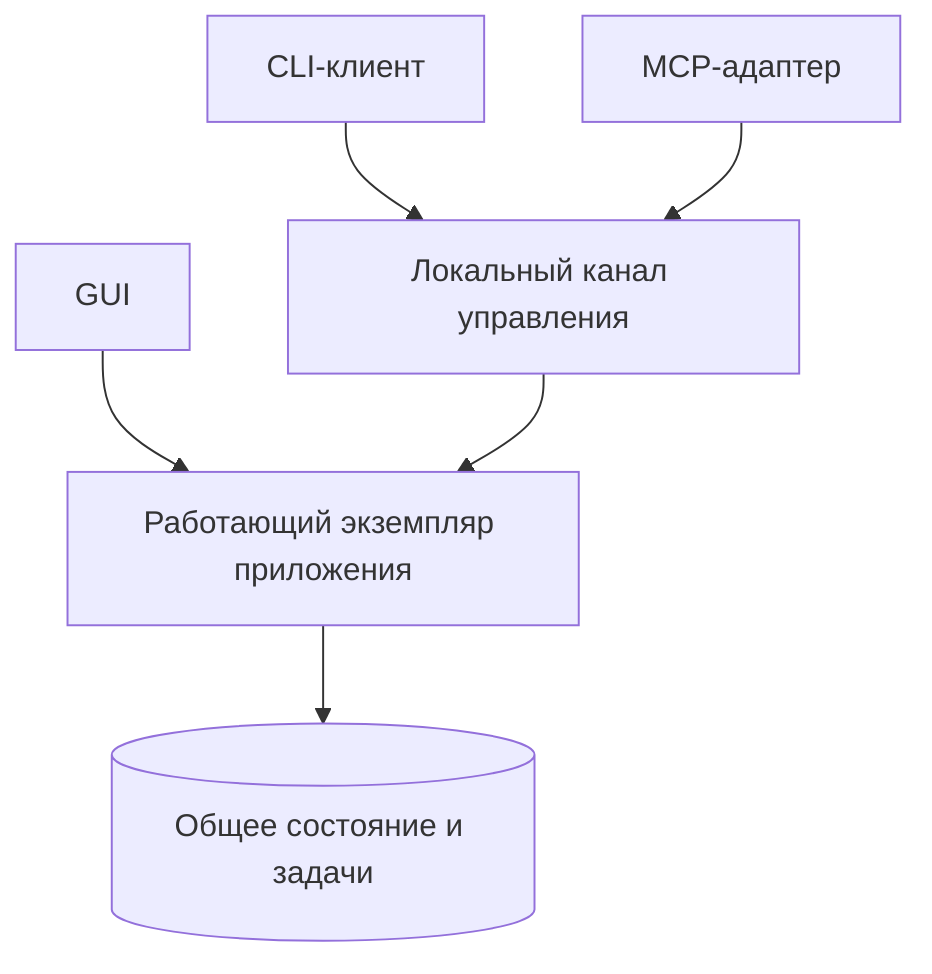

Такая архитектура способна поддерживать несохранённый документ, общую очередь задач и вмешательство человека. Терминальный интерфейс ничему этому не мешает.

| Вопрос | Запуск независимого CLI | Общее ядро | Подключение к живому приложению |
|---|---|---|---|
| Где выполняется работа? | В запущенном процессе | В экземпляре ядра выбранного процесса | У владельца текущей сессии |
| Доступна ли несохранённая модель GUI? | Не автоматически | Только если это тот же экземпляр или настроена связь | Да, если API предоставляет доступ к ней |
| Может ли результат быть структурированным? | Да | Да | Да |
| Можно ли показывать прогресс? | При наличии соответствующего канала | При наличии уведомлений | При наличии запросов состояния и уведомлений |
| Можно ли остановить работу? | Зависит от реализации и управления процессом | Зависит от исполнителя | Зависит от контракта задачи и исполнителя |

> [!tip] Сравниваются гарантии, а не названия технологий
> Хорошо спроектированный CLI с устойчивым контрактом и подключением к сервису может обеспечивать те же возможности, что и отдельный SDK. Реальное отличие появляется там, где приложение теряет общую семантику, наблюдаемость или доступ к нужному состоянию.

---

## 5. Минимальная карта приложения: три ответственности вместо десяти этажей 🧱

На первом знакомстве достаточно разделить **приём запросов**, **выполнение прикладных сценариев** и **техническую работу с внешним миром**.

Входной адаптер понимает форму обращения. GUI получает значения из элементов управления, CLI — из аргументов, MCP — из вызова инструмента. Каждый адаптер приводит внешнее представление к прикладному запросу.

Прикладной слой определяет, что означает операция. Он проверяет её допустимость, вызывает нужные компоненты и формирует результат. Именно здесь удобно удерживать общие правила выполнения, независимо от интерфейса.

Инфраструктурные компоненты умеют читать файлы, обращаться к БД, кодировать изображения, передавать сообщения или запускать исполнителей. Они реализуют технические механизмы, но не должны самостоятельно придумывать, какое действие пользователь имел в виду.

| Ответственность | Типичный вопрос | Пример |
|---|---|---|
| **Адаптер** | Как клиент выразил намерение? | Преобразовать аргументы MCP-инструмента в запрос |
| **Прикладная логика** | Что разрешено и что должно произойти? | Переименовать доступную страницу с проверкой версии |
| **Инфраструктура** | Каким механизмом это выполнить? | Сохранить файл, отправить уведомление, вызвать кодек |

Для сложного редактора отдельно выделяется предметная модель: документ, объекты, связи, ограничения. Для маленькой утилиты она может оставаться несколькими структурами и функциями рядом с прикладными сценариями.

### Слой не равен процессу, подсистема не равна слою 🧠

Менеджер задач, реестр команд и история изменений могут быть подсистемами одного прикладного слоя. Они не обязаны образовывать последовательную цепочку, через которую проходит каждый вызов.

Процесс — другая граница. Она определяет изоляцию памяти и способ коммуникации. У одного логического слоя могут быть компоненты в нескольких процессах, а несколько слоёв способны работать внутри одного процесса.

Следовательно, схема с шестью прямоугольниками не требует шести серверов. И обратное тоже верно: размещение всего кода в одном исполняемом файле не отменяет внутренних архитектурных границ.

### Что в такой модели считается ядром ⚙️

Термин «ядро» здесь обозначает функциональность, которой не требуется конкретный экран для выполнения своих обязанностей. Это не обязательно один пакет с именем `core` и не особый сверхобъект, управляющий всей программой.

У редактора ядро умеет применить изменение документа. У пакетной утилиты — выполнить преобразование. У менеджера задач — принять работу и вести её состояние. В каждом случае речь идёт о самостоятельном смысле, который может использоваться разными интерфейсами.

Рекомендуемая граница зависит от задачи. Для небольшого проекта отдельный сервис с понятной сигнатурой часто полезнее многоуровневого диспетчера, который лишь передаёт словарь от одной функции к другой.

---

## 6. Контракт: общий язык приложения и его клиентов 📜

Наличие метода с названием `execute` не делает интерфейс понятным. Клиенту необходимо знать, какие параметры допустимы, какой результат возвращается, что может измениться и как трактовать ошибку.

**Контракт операции** объединяет эти сведения. Он описывает не только форму данных, но и обещания приложения.

Для условного `page.rename` такой паспорт может выглядеть следующим образом:

| Часть контракта | Пример содержания |
|---|---|
| **Назначение** | Изменить название существующей страницы |
| **Цель операции** | Документ и страница, указанные устойчивыми идентификаторами |
| **Параметры** | Новое имя и, при необходимости, ожидаемая версия |
| **Предусловия** | Страница существует, клиент имеет право редактирования |
| **Результат** | Новое имя и актуальная версия документа |
| **Возможные отказы** | Нет доступа, объект отсутствует, конфликт версии |
| **Последствия** | Изменение модели документа; сохранение на диск оговаривается отдельно |
| **Повторы и отмена** | Поведение повторного запроса и поддержка Undo определены явно |

Последняя строка особенно важна. Команда может изменить документ в памяти, не сохраняя его на диск. Она может завершиться успешно, но быть необратимой. Эти свойства невозможно надёжно вывести только из названия или типов полей.

### DTO передаёт данные, но не заменяет контракт 📦

DTO — объект передачи данных. Он переносит запрос или результат через выбранную границу. В классическом описании [Data Transfer Object][dto] отдельно подчёркивается роль сериализуемого представления для обмена между процессами.

В рамках этой серии термин применяется и к типизированным объектам на внутренних прикладных границах. Существенно, что такой объект представляет данные запроса, а не скрытую ссылку на окно, соединение с базой или всё внутреннее состояние программы.

Схема данных может проверить, что идентификатор — строка, имя не пустое, а номер версии — неотрицательное целое число. Но проверка наличия страницы, права доступа и допустимости перехода состояния относится уже к выполнению сценария.

### Машинная схема и смысловая документация дополняют друг друга 🧾

[JSON Schema][json-schema] предоставляет язык описания структуры JSON-данных и ограничений на их значения. Такая схема полезна адаптерам и клиентам: она позволяет валидировать параметры и документировать ожидаемый формат.

Однако схема не отвечает на все вопросы. Из поля `overwrite: boolean` невозможно узнать, создаётся ли резервная копия. Из `cancel: true` нельзя вывести, остановлена ли работа немедленно. Из `page_id: string` не следует, кому принадлежит страница.

Поэтому контракт должен сочетать машинное описание данных и человеческое объяснение семантики. Агенту тоже нужны оба уровня: корректный JSON не гарантирует осмысленного действия.

### Реестр команд — каталог контрактов, а не само приложение 🗂️

Когда операций становится много, их удобно собирать в Command Registry. Он связывает имя с описанием, схемой параметров, обработчиком и необходимыми метаданными.

Диспетчер использует реестр, чтобы найти и вызвать нужный обработчик. Адаптер может построить на основе этого каталога справку, список доступных инструментов или интерфейс поиска действий.

Но реестр не обязан содержать бизнес-логику. И он не является условием существования хорошего API. Пять явных методов сервиса — уже программный интерфейс. Реестр становится полезным, когда действительно нужны динамическое обнаружение, расширение плагинами или единая обработка большого набора операций.

> [!warning] Описание опасности не является защитой
> Поле `destructive: true` способно предупредить клиента, но не остановит запрещённую операцию само по себе. Ограничение должно исполняться в доверенной части приложения, а не только присутствовать в документации инструмента.

---

## 7. Четыре разных понятия: команда, запрос, событие и задача 🔄

Для дальнейшего понимания полезно развести четыре сущности, которые часто называют одним словом «команда».

| Сущность | Смысл | Пример |
|---|---|---|
| **Command — команда** | Просьба выполнить изменение или действие | `page.rename` |
| **Query — запрос** | Получение информации без намеренного изменения предметного состояния | `document.get` |
| **Event — событие** | Сообщение о том, что уже произошло | `page.renamed` |
| **Job — задача** | Объект длительного выполнения с собственным состоянием | Экспорт большого документа |

### Команда выражает намерение, событие сообщает факт 📣

Команда может быть отклонена. Страница может оказаться удалённой или недоступной. Поэтому получение запроса `page.rename` ещё не означает появления события `page.renamed`.

Событие описывает состоявшийся переход. Его могут использовать разные наблюдатели: GUI обновит дерево страниц, журнал запишет действие, другой клиент перечитает документ.

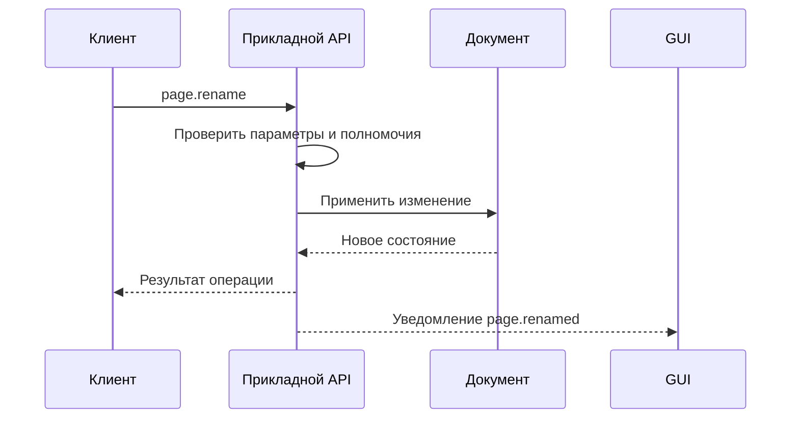

*Относительный порядок доставки ответа и уведомления в конкретной реализации должен быть определён отдельно. Клиентам не стоит полагаться на случайный порядок работы транспорта.*

### Чтение и изменение полезно различать, но без догматизма 🔍

[Command–Query Separation][cqs] проводит границу между чтением и изменением состояния. В строгой классической формулировке команда не возвращает значение. В прикладных API этой серии используется практический вариант: изменяющая операция может вернуть идентификатор созданного объекта, подтверждение принятия или итоговые данные.

Такое разделение не означает обязательного внедрения CQRS. [CQRS][cqrs] касается разделения моделей чтения и изменения; это более сильное архитектурное решение, способное добавить существенную сложность. Для обычного редактора можно явно различать операции и запросы, сохранив одну модель и одно хранилище.

### Задача живёт дольше запускающего её вызова ⏳

Переименование может закончиться внутри одного обращения. Экспорт большого документа — нет. Тогда команда запуска возвращает `job_id`, а состояние работы наблюдается отдельно.

Факт `accepted` означает, что запрос принят по правилам приложения. Он не равен `succeeded`. В модели [Asynchronous Request–Reply][async-request-reply] принятие работы и получение окончательного результата специально разделяются.

Это различие меняет и отображение: завершился вызов инструмента — ещё не обязательно завершилась работа. Карточка в GUI должна показывать состояние задачи, а не только факт возврата ответа адаптеру.

---

## 8. API, CLI, MCP и IPC: четыре разных роли 🔌

Сходство названий и частое соседство этих механизмов создают впечатление, будто они конкурируют друг с другом. В действительности они отвечают на разные вопросы.

**API** описывает, как программно обратиться к возможностям приложения. Он может быть локальным набором методов, сетевым интерфейсом или контрактом сообщений.

**CLI** представляет эти возможности через аргументы и команды терминала. Он может самостоятельно выполнять работу или пересылать запрос работающему сервису.

**MCP** задаёт протокол взаимодействия агентной среды с предоставляющими инструменты и контекст серверами. В [спецификации MCP][mcp-spec] различаются host — приложение-хост, client — его протокольный клиент и server — поставщик возможностей. Модель выбирает действие в рамках агентной среды, а реальные обращения исполняются программными компонентами.

**IPC** — межпроцессное взаимодействие. Оно требуется, когда запрос должен попасть из одного процесса в другой. Локальный сокет, pipe или другой транспорт решает задачу доставки, но не определяет смысл переименования страницы.

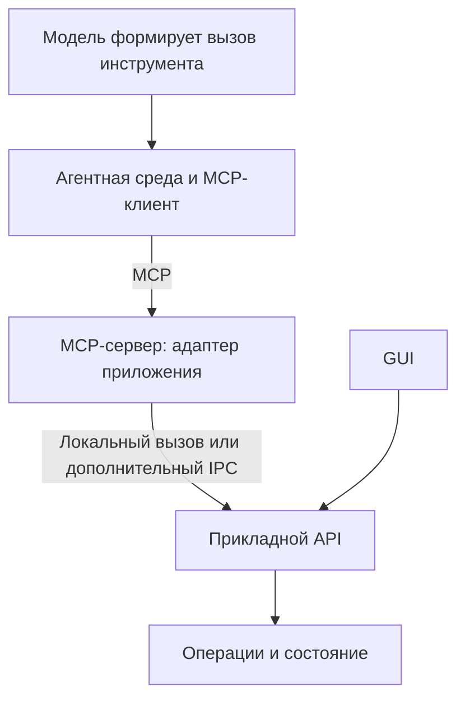

Именно здесь проходит важная граница: **MCP-сервер не обязан быть самим приложением**. Он может быть тонким адаптером к его ядру или мостом к уже запущенной сессии.

### MCP не генерирует прикладной API из ничего 🧰

Инструмент MCP имеет имя, описание и схему аргументов. Протокол позволяет обнаруживать и вызывать инструменты, но реализация их полезного поведения остаётся за сервером и приложением. Это следует из модели [MCP Tools][mcp-tools].

Если внутренняя операция существует только в обработчике окна, подключение SDK не устранит эту зависимость. Разработчику всё равно придётся выделить функциональность, вызвать существующий CLI либо автоматизировать GUI.

С другой стороны, наличие качественного прикладного API позволяет предоставить агентам доступ через разные протоколы. Приложение не обязано знать, какой поставщик модели сформировал запрос. Ему нужны валидные параметры, полномочия клиента и определённый контекст выполнения.

### Один инструмент или каталог операций? 🗂️

Небольшому приложению удобно предоставить отдельные инструменты: получить документ, переименовать страницу, запустить экспорт. Их схемы сразу описывают конкретные аргументы.

Для большого редактора возможен универсальный инструмент выполнения с отдельным каталогом команд. Агент сначала узнаёт контракт, затем вызывает операцию по имени. Такой подход уменьшает число верхнеуровневых инструментов, но требует дополнительных шагов обнаружения и более внимательной проверки внутри приложения.

Гибридная схема также допустима: частые действия доступны напрямую, остальные — через каталог. Это вариант проектирования адаптера, а не особое свойство самого ядра.

### Протокольная задача и задача приложения — не обязательно один объект 🧷

В экосистеме MCP существует [расширение Tasks][mcp-tasks], предназначенное для длительных операций и получения их результатов через отдельный дескриптор. Его использование требует поддержки соответствующих возможностей сторонами интеграции.

Прикладной `Job` полезно сохранять независимым от такого механизма. Он должен оставаться доступным GUI и другим клиентам, даже если конкретная MCP-интеграция использует иной способ ожидания результата. Адаптер может сопоставлять протокольную задачу с внутренней, но это сопоставление и его жизненный цикл нужно определить явно.

> [!note] Версия протокола — свойство интеграции
> В статье используются ссылки на MCP с датой спецификации `2026-07-28` и актуальную на дату проверки страницу расширения Tasks. Это не означает, что все существующие клиенты и серверы поддерживают именно эти возможности. Архитектурный принцип общего прикладного API от версии MCP не зависит.

---

## 9. Headless и Attached: вопрос не в окне, а во владельце состояния 🧠

Два режима особенно важны для приложений, которыми управляют агенты.

**Headless** означает работу без графической оболочки. Движок открывает данные, выполняет операции и возвращает результат. При этом у него вполне может быть богатое состояние в памяти: документ, очередь задач, промежуточные объекты. Отсутствие окна не означает отсутствие сессии.

**Attached** означает подключение к уже существующей рабочей сессии. Агент обращается к тому владельцу состояния, с которым связан открытый GUI. Это позволяет работать с несохранёнными изменениями и видеть результаты в текущем приложении.

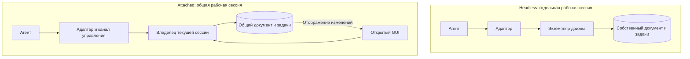

### Почему общий файл недостаточен 📄

Предположим, человек изменил документ, но ещё не сохранил его. Отдельный CLI-процесс открывает файл с диска и получает старую версию. Затем оба участника продолжают работу с разными состояниями.

Сохранение файла после каждого действия может уменьшить разрыв, но не решает автоматически вопросы согласования, промежуточных изменений и конкурирующей записи. Поэтому для живого редактора важен доступ к **авторитетной модели текущего документа**, а не просто к тому же пути на диске.

Аналогичная проблема возникает с задачами. Если GUI и MCP создали независимые менеджеры задач, кнопка остановки в одном из них не сможет управлять работой другого без дополнительной связи.

### Владелец состояния не обязан жить в GUI-процессе 🏠

Для небольшого настольного приложения удобно, когда рабочая сессия принадлежит процессу редактора. Внешний адаптер подключается к нему и передаёт операции.

Если работа должна продолжаться после закрытия окна, владельцем может стать отдельный локальный сервис. GUI тогда является наблюдателем и клиентом управления. В серверном приложении эту роль выполняет backend.

Иными словами, «Attached к приложению» не обязательно означает «подключён непосредственно к виджетам». Подключение должно вести к нужному состоянию и сценариям, а виджеты остаются способом их представления.

### Одинаковый код и одинаковое состояние — разные гарантии ⚖️

Повторное использование библиотеки устраняет дублирование реализации. Подключение к одной сессии устраняет случайное разделение рабочего состояния. Это две независимые задачи.

Для пакетной утилиты может быть достаточно первой. Для совместного редактирования обычно нужна и вторая. Если приложение поддерживает несколько документов или рабочих пространств, запрос дополнительно должен определять, к какой сессии он относится.

> [!important] Общий владелец не означает один глобальный объект на всё
> Владелец может быть отдельным для каждого документа, рабочего пространства или группы задач. Существенно, чтобы для конкретного ресурса существовали понятные правила изменения состояния, а клиенты не создавали несогласованные копии и не считали каждую из них единственной истиной.

---

## 10. Агенту недостаточно уметь действовать: он должен наблюдать 🔍

Программный доступ к операциям решает лишь часть задачи. Агенту необходимо определить, над чем работать, какие действия допустимы и изменилось ли приложение ожидаемым образом.

В условном редакторе команда `page.rename` бесполезна без способа узнать `page_id`. Операция выравнивания требует идентификаторов объектов. Экспорт зависит от состояния документа и доступных параметров.

Поэтому полноценный программный интерфейс включает не только действия, но и **обнаружение возможностей**, **чтение состояния** и **проверку результата**.

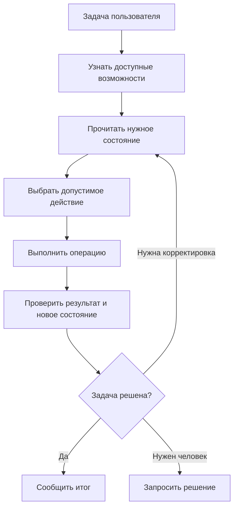

Эта схема описывает возможный рабочий цикл, а не обещает автоматического успеха. Хороший интерфейс даёт агенту проверяемые сведения, но не гарантирует правильного понимания пользовательского намерения.

### Структура документа и изображение решают разные задачи 🖼️

Машиночитаемое состояние удобно для точных проверок: объект существует, его ширина равна нужному значению, родитель указан правильно. Визуальное представление полезно для оценки внешнего результата: не перекрывается ли текст, не потерялась ли композиция, выглядит ли экран ожидаемым образом.

Поэтому наличие API не делает визуальную проверку бессмысленной. Оно устраняет необходимость угадывать все действия по картинке, но не заменяет зрительную оценку там, где задача действительно визуальная.

Обратная крайность тоже нежелательна: агенту не требуется запрашивать скриншот после каждого изменения одного числового свойства. Подходящий способ проверки зависит от ожидаемого результата.

### Наблюдение должно быть соразмерно задаче 📐

В небольшом документе можно вернуть полное дерево. В большом проекте полезнее выборка нужных объектов, фильтры, краткие сводки и постраничная выдача.

Это вопрос качества контракта. Если ради изменения одного заголовка агент каждый раз получает все документы и всю историю приложения, программный интерфейс формально существует, но практически неудобен.

Для чтения также действуют ограничения доступа. Возможность запросить список объектов не должна автоматически открывать чужие документы или внутренние секреты конфигурации.

### Успех операции и успех пользовательской задачи различаются ✅

Редактор может корректно применить неправильное действие. Например, агент безошибочно изменил название не той страницы. С точки зрения контракта операция завершилась успешно; с точки зрения пользователя цель не достигнута.

Поэтому структурированный ответ — необходимая обратная связь, но не окончательный судья качества. Часть задач требует проверки исходной цели, просмотра изменений или подтверждения человеком.

Именно поэтому программируемость не следует путать с автономностью. Приложение может предоставлять широкий API и при этом разрешать агенту выполнять только небольшие подтверждённые шаги.

---

## 11. Как GUI становится живым наблюдателем работы агента 👀

Когда агент вызывает прикладную операцию, интерфейс может показывать её результат без имитации нажатий. Документ изменился — холст обновился. Задача принята — появилась карточка. Выполнение началось — включился индикатор. Работа завершилась — стал доступен результат.

Для этого GUI должен отображать **состояние приложения**, а не только последствия собственных обработчиков кнопок.

Если карточка создаётся исключительно внутри функции «пользователь нажал “Экспорт”», задача, запущенная через MCP, останется невидимой. Если карточки строятся из общего списка задач, источник запуска перестаёт быть проблемой.

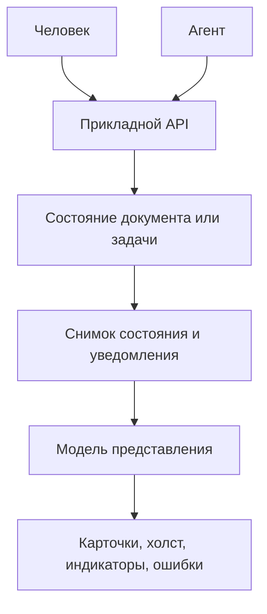

Отдельная модель представления преобразует прикладные факты в удобные для экрана данные. Этот принцип соответствует [Presentation Model][presentation-model]: состояние и поведение представления не должны быть неразрывно связаны с конкретными GUI-контролами.

### Что именно может появиться на экране 🎛️

| Прикладной факт | Возможное отображение |
|---|---|
| Задача принята | Карточка «В очереди» |
| Исполнитель начал работу | Статус «Выполняется», спиннер |
| Известна доля готовности | Полоса прогресса с процентом |
| Известен только этап | «Чтение», «Обработка», «Сохранение» без выдуманного процента |
| Изменился документ | Новое содержимое холста, дерева или списка |
| Требуется подтверждение | Уведомление с описанием последствий |
| Запрошена остановка | «Останавливается…» |
| Работа завершилась ошибкой | Ошибка с доступными дальнейшими действиями |

Процент не возникает из самого факта наличия диспетчера. Он должен поступать от исполнителя или рассчитываться по определённым правилам. Если библиотека не сообщает промежуточную готовность, честный неопределённый индикатор лучше фиктивного «почти готово».

### Событие — сигнал обновиться, а не единственный источник истины 📡

Событийная доставка удобна для живого интерфейса, но GUI может подключиться после запуска работы или пропустить сообщение при разрыве связи. Поэтому полезно иметь и запрос актуального состояния.

В предлагаемой модели окно сначала восстанавливает нужные данные, затем принимает обновления. После переподключения оно сверяет состояние снова. Версии объектов помогают не применять запоздавшие сведения поверх новых.

Уведомления и передача снимков — разные варианты организации событийного взаимодействия. Их различие, а также отличие от Event Sourcing, разбирается в [What do you mean by “Event-Driven”?][event-driven]. Само обновление карточки по событию не требует хранения всей истории событий и отдельного брокера сообщений.

### Видимость работы не требует театра с курсором 🖱️

Если агент изменил размер объекта через API, объект меняет размер. Для этого не требуется подсвечивать кнопку «Размер» и анимировать ввод цифр.

Отдельная панель активности может показывать инициатора, текущую операцию и затронутые объекты. Подсветка изменений также полезна. Но эти элементы объясняют настоящие события, а не имитируют произвольную последовательность кликов.

Переключение экранов лучше считать отдельной политикой представления. В фоновом режиме агент не мешает человеку работать. В режиме «следовать за агентом» GUI может открывать нужный документ и показывать целевой объект. Прикладные операции от этого не обязаны меняться.

### Рабочий исполнитель не должен замораживать наблюдателя 🧵

Длительная обработка и обновление интерфейса должны быть организованы так, чтобы цикл событий GUI оставался отзывчивым. Конкретный механизм зависит от среды: асинхронный ввод-вывод, рабочий поток, отдельный процесс или нативный исполнитель.

Например, [документация Qt][qt-threads] отделяет доступ к GUI из главного потока от выполнения длительной работы в рабочих потоках. Это иллюстрация общего ограничения, а не требование использовать Qt или определённый язык.

Без такого разделения интерфейс может корректно получить состояние «выполняется», но не успеть его нарисовать до завершения работы. Архитектура данных тогда верна, а наблюдение человеком всё равно не работает.

---

## 12. Кнопка «Стоп»: управление выполнением, а не декоративный элемент 🛑

Как только агент способен запустить длительную или массовую операцию, появляется естественное требование: человек должен иметь возможность вмешаться.

Для этого остановка должна быть частью прикладного интерфейса. GUI не обязан знать внутренние детали исполнителя. Он отправляет запрос на остановку конкретной задачи, а владелец задачи решает, как обработать его и какое состояние опубликовать.

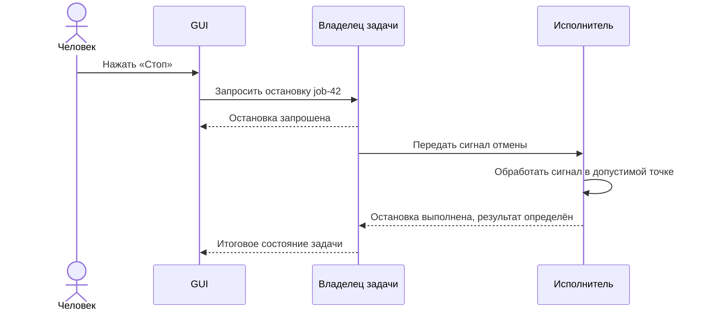

### Запрос остановки и остановленная работа — разные факты ⏸️

При [кооперативной отмене][cooperative-cancellation] управляющая сторона сообщает о желании остановить работу, а исполнитель обнаруживает сигнал и корректно завершает выполнение. Следовательно, положительный ответ на запрос ещё не означает, что работа уже остановлена.

В интерфейсе полезно различать «Выполняется», «Останавливается» и «Отменено». Если задача успела завершиться до обработки сигнала, итогом может оказаться «Готово». Это не обязательно ошибка приложения: завершение и отмена способны конкурировать по времени.

Некоторые этапы не поддерживают немедленного прерывания. Тогда остановка произойдёт на следующей допустимой границе. Принудительное завершение отдельного процесса возможно как аварийный механизм, но оно требует самостоятельной политики очистки и не должно изображаться как гарантированно безопасный откат.

### Отмена запроса, отмена задачи и Undo различаются 🔄

| Действие | Что оно означает | Чего не гарантирует |
|---|---|---|
| **Прекратить ожидание ответа** | Клиент больше не ждёт результат вызова | Что исполнитель перестал работать |
| **Отменить задачу** | Запросить прекращение конкретной работы | Что уже полученные результаты исчезли |
| **Приостановить** | Остановиться с возможностью продолжения, если это поддержано | Что любая операция умеет сохранять продолжение |
| **Undo** | Выполнить предусмотренную отмену изменений | Что доступны обратные действия для всех побочных эффектов |
| **Заблокировать сессию агента** | Не принимать от неё новые запрещённые действия | Что остановлена сама внешняя агентная среда |

Прикладной API должен сохранять эти различия даже тогда, когда транспорт тоже имеет механизм отмены. В [MCP Tasks][mcp-tasks] отмена также описывается как кооперативная. Протокольный запрос не делает используемый кодек или внешний сервис автоматически прерываемым.

### Остановить дальнейшее и вернуть прежнее — разные сценарии 🧹

Если задача создала сорок файлов из ста, остановка может означать, что остальные шестьдесят не создаются. Готовые результаты при этом сохраняются.

Если требуется убрать и их, возникает отдельная операция очистки. Если часть файлов была перезаписана, для восстановления нужны прежние версии. Если результат уже отправлен во внешнюю систему, простого отката локальной памяти недостаточно.

Такое восстановление связано с идеей [компенсирующих операций][compensation]: последствия отменяются специально предусмотренными действиями, которые зависят от предметной области и тоже могут завершаться ошибкой.

> [!warning] «Стоп» не является машиной времени
> Безопасная остановка ограничивает дальнейшую работу. Восстановление прежнего состояния требует отдельного механизма и собственного контракта. Особенно опасно обещать автоматический откат там, где уже изменены внешние файлы или данные другого сервиса.

### Остановка агента требует отдельной границы управления 🤖

Отмена одной задачи не запрещает агенту отправить следующую. Для сценариев самостоятельной работы полезен административный режим: запретить новые изменяющие операции определённой сессии, отменить ожидающие задачи и запросить остановку активных.

Такой режим должен применяться там, где принимаются решения о запуске, а не только в панели GUI. И он ограничивает именно доступ через приложение. Если внешний агент имеет независимое право менять те же файлы через терминал, блокировка API не отнимет это право.

На уровне знакомства достаточно зафиксировать принцип: **человек должен управлять и текущей работой, и допуском к последующим действиям; это разные полномочия и разные операции**.

---

## 13. Совместная работа: одно содержимое, но не обязательно один фокус 🤝

Подключение агента к живому приложению создаёт второго участника работы. Даже если операции выполняются строго последовательно, намерения человека и агента могут опираться на разные версии состояния.

Человек изменил страницу, пока агент готовил запрос. Агент удалил объект, который человек собирался переместить. Окно переключилось на другой документ. Всё это не ошибки транспорта, а обычные ситуации совместного редактирования.

### Общее состояние не отменяет необходимость согласования 🧮

В учебном редакторе уже использовалось поле `expected_revision`. Оно позволяет приложению обнаружить, что запрос подготовлен для устаревшего состояния.

Проверка должна происходить вместе с применением изменения в рамках выбранной модели согласования, а не задолго до него. Иначе между проверкой и записью снова появится возможность конфликта.

Один вариант — последовательно применять изменения документа у его владельца. Другой — использовать оптимистическую проверку версии. Более сложные редакторы могут поддерживать слияние изменений. Первая статья не выбирает универсальный механизм: важно само наличие определённой политики, а не надежда, что запросы случайно не пересекутся.

### Содержимое документа и состояние представления лучше различать 🪟

Название страницы и координаты объекта — часть общей модели. Масштаб просмотра, раскрытая панель и положение прокрутки могут принадлежать конкретному участнику.

Если агенту нужно работать с объектом на другой странице, это не обязательно должно переключать окно человека. GUI может показать уведомление или выделить изменение в панели активности. Перемещение фокуса становится отдельным решением интерфейса.

Такой подход особенно полезен при параллельной работе: программа остаётся общей, но агент не перехватывает пользовательский экран без необходимости.

### Неопределённый результат нельзя автоматически считать провалом 📬

После разрыва соединения клиент может не знать, выполнилось ли изменение. Запрос дошёл, документ изменился, но ответ потерялся. Слепое повторение команды создания способно породить дубликат.

Идемпотентность описывает поведение повторных выполнений, при котором итоговый предусмотренный эффект соответствует однократному выполнению. Это не гарантия одинакового текста ответа и не свойство, возникающее от добавления поля `request_id`. Общее определение и ограничения автоматических повторов сформулированы, в частности, в [RFC 9110][http-semantics].

Для прикладного API возможны разные решения: сохранённый ключ идемпотентности, проверка текущего состояния, отдельный запрос статуса операции. Выбор относится к контракту конкретного действия.

На уровне пользователя это означает простое правило интерфейса: сообщение «связь потеряна» не должно без основания превращаться в «изменений не было».

---

## 14. FigCraft: практический пример, а не универсальный шаблон 🛠️

FigCraft полезен для этой темы как открытый пример редактора, в котором программное управление рассматривается как часть внутренней архитектуры. Для понимания подхода не требуется принимать заявления о полном соответствии другим продуктам, темпах разработки или количестве реализованных функций.

В данном разделе отделены **механизмы, описанные самим проектом**, от архитектурных выводов. Документация проверена 23 октября 2026 года; запуск и независимая приёмка всех перечисленных возможностей в рамках статьи не проводились.

### Общие операции для разных интерфейсов 🧩

В [архитектурных правилах FigCraft][figcraft-agents] зафиксирован принцип *Everything is a command*. Меню, горячие клавиши, палитра действий, CLI, канал управления и MCP используют одни идентификаторы команд. Там же предусмотрено разделение движка и графической оболочки: нижележащие слои не должны зависеть от GUI-библиотек.

Для этой серии важен не язык реализации, а дисциплина разработки. Новая прикладная возможность должна получить программную точку входа и тесты; интерфейс использует её вместо собственной реализации сценария.

### Headless и Attached как явно разные режимы 🔗

В [документации MCP-сервера FigCraft][figcraft-mcp] описаны два режима. Headless создаёт собственную сессию движка без окна. Attached обращается к работающему редактору через его канал управления; изменения отражаются в открытом приложении.

Там же представлены инструменты выполнения операций, чтения структуры документа и получения визуального результата. Отдельно отмечено, что после сбоя связи изменяющие Attached-вызовы не повторяются автоматически: операция могла примениться до потери ответа.

Это хороший пример того, почему доступ к функциям, доступ к состоянию и политика повторов должны проектироваться вместе.

### Управление приложением не сводится к эмуляции мыши 🖱️

[Протокол управления FigCraft][figcraft-control] описывает локальный канал на loopback-интерфейсе, запросы к движку и чтение состояния. В нём также есть управление отдельными частями UI и вводом.

Существование этих дополнительных методов не означает, что каждая операция движка обязана проходить через имитацию клика. Прикладные команды и управление представлением остаются разными возможностями. Конкретная поддержка метода также не гарантирует, что он опубликован отдельным MCP-инструментом.

### Что именно стоит заимствовать из примера 🧭

Архитектурно из него следует полезная комбинация: общий язык операций, независимость основной модели от экрана, возможность программного чтения результата и явное подключение к живой сессии.

Но пример не доказывает, что каждому приложению нужны столько же внутренних уровней, такие же команды или тот же транспорт. Пакетная утилита может остановиться на общем сервисе. Редактор с несколькими рабочими пространствами потребует другой модели владения состоянием.

> [!note] Граница фактического описания
> Предложенные в статье карточки задач, административная блокировка сессии агента и универсальная кнопка остановки — архитектурные варианты. Они не приписываются FigCraft только на основании наличия MCP и режима Attached. Каждая такая возможность требует отдельного подтверждения в конкретном продукте.

---

## 15. Доверие определяется границей приложения, а не вежливостью агента 🛡️

Программный интерфейс облегчает автоматизацию, но одновременно расширяет доступную поверхность действий. Если операция способна удалить документ или перезаписать результаты, агенту становится легче выполнить её — как правильно, так и ошибочно.

Поэтому безопасность нельзя откладывать до момента, когда появится красивый MCP-адаптер. Уже на уровне прикладного сценария должно быть понятно, кто вызывает операцию и какие ресурсы ему доступны.

### Идентичность и права не должны приходить из свободного аргумента 🔐

Параметр `actor_id`, самостоятельно заполненный агентом, не является доказательством личности. Аналогично `source: "gui"` не должно давать повышенные привилегии.

Контекст доверия формируется принимающей стороной: на основе локальной сессии, аутентифицированного соединения или выданных возможностей. В запросе может присутствовать полезная информация об инициаторе, но решение о допуске принимает доверенный компонент.

Общие рекомендации [OWASP по авторизации][authorization] включают минимально необходимые полномочия, запрет по умолчанию и проверку доступа для каждого запроса. Применительно к command-first это означает, что новый способ вызова не должен случайно обходить проверки существующего сценария.

### Локальный канал не равен изоляции 🧱

Размещение сервиса на локальной машине ограничивает некоторые способы обращения, но не превращает все процессы этого компьютера в доверенные. Открытый локальный управляющий канал и ограничения файлового доступа требуют самостоятельной оценки.

В [рекомендациях по безопасности MCP][mcp-security] отдельно рассматриваются риски локальных серверов и доверия к передаваемым полномочиям. Наличие стандартного протокола не освобождает приложение от проверки ресурсов и границ доступа.

В предлагаемой модели разрешение «редактировать документ A» не означает «изменять любые файлы пользователя». Доступ к каталогу экспорта также не должен автоматически давать право управлять чужими задачами.

### Подтверждение полезно до необратимого действия 👤

Для опасных операций разумен отдельный сценарий подготовки: приложение вычисляет последствия, представляет план и запрашивает подтверждение. После подтверждения применяется именно согласованный план, а не произвольно изменённый набор действий.

Например, перед массовым удалением редактор может вернуть список объектов, зависимостей и невосстановимых последствий. Если состояние успело измениться, прежнее подтверждение не обязано оставаться действительным.

В [MCP Tools][mcp-tools] рекомендуется сохранять участие человека, обозначать вызываемые инструменты в интерфейсе и предоставлять возможность отклонять действия. Конкретная политика подтверждений при этом остаётся частью реализации приложения и клиента.

### Кнопка остановки не заменяет ограничение полномочий ⚠️

Быстрое изменение может закончиться раньше, чем человек успеет вмешаться. Поэтому для необратимых действий безопаснее заранее ограничить допустимый масштаб, потребовать подтверждение или работать с черновой копией.

Остановка особенно полезна для продолжительной работы. Проверка прав и подготовка изменений защищают от действий, которые нельзя успеть остановить. Эти механизмы дополняют друг друга, а не конкурируют.

Сохранение журналов также не должно превращаться в бесконтрольную запись секретов и содержимого всех документов. Для объяснения действия часто достаточно инициатора, цели операции, параметров без чувствительных значений и результата.

---

## 16. Сквозной сценарий: агент работает, человек сохраняет контроль 🎬

Концепции становятся понятнее, когда проходят через один целостный сценарий. В условном редакторе агент получает задачу: подготовить черновую копию документа, привести заголовки к общему стилю и экспортировать результат.

Ни один из этапов не требует управления физическим курсором. Однако вся значимая работа может быть видна в GUI.

### Сначала — определить объект и правила работы 🗺️

Агентный адаптер предоставляет операции чтения и изменения. Агент запрашивает доступные документы, выбирает конкретный идентификатор и получает нужную часть структуры.

В ответе присутствует версия состояния. Полномочия ограничены выбранным рабочим пространством. Сценарий предусматривает работу с копией, поэтому исходный документ не должен изменяться.

Здесь уже видны три разных элемента: описание возможностей, чтение данных и политика доступа. Ни один из них не заменяет остальные.

### Затем — выполнить ограниченные изменения 📝

Приложение создаёт черновую копию и возвращает её идентификатор. Все следующие операции явно указывают эту копию.

Изменение стиля заголовков проходит через общие правила редактора. Если какие-то объекты заблокированы или уже удалены, приложение возвращает определённые ошибки. GUI получает состояние копии и показывает изменившееся оформление.

Человек может открыть исходник, остаться в текущей вкладке или перейти к копии. Сама работа агента не обязана принудительно менять пользовательский фокус.

### Проверка предшествует дорогостоящей работе 🔍

После правок агент читает структуру документа и, при необходимости, получает визуальное представление. Он проверяет, что стиль применён к нужным объектам и документ пригоден к экспорту.

Если визуальное качество остаётся неоднозначным, сценарий может остановиться на подтверждении. Прямой программный доступ устраняет лишние клики, но не отменяет необходимость оценить результат.

### Длительный экспорт становится задачей ⏳

Операция запуска возвращает идентификатор задачи. GUI видит новую карточку с инициатором, названием документа и состоянием «В очереди», а затем — «Выполняется».

Поскольку внешний вызов уже вернул подтверждение, агент не должен считать экспорт завершённым. Он обращается к состоянию той же задачи, которую наблюдает GUI.

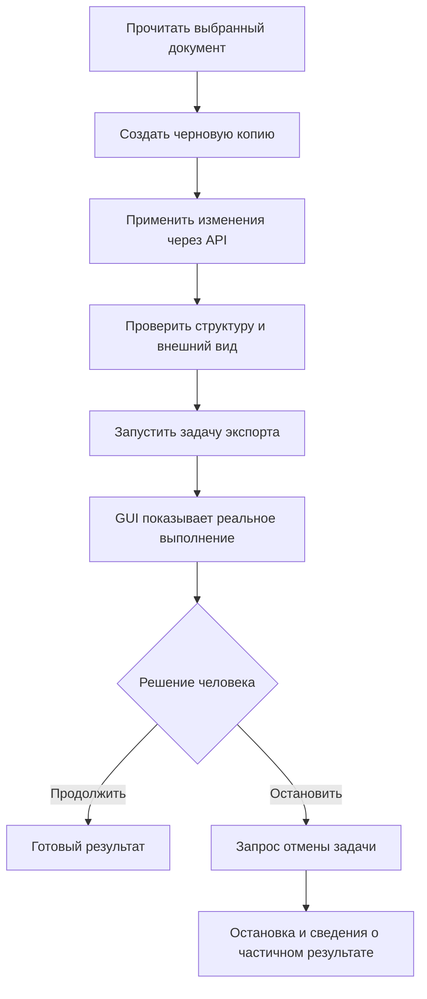

### Человек обнаруживает неподходящие параметры 🛑

Предположим, человек замечает, что выбран неверный вариант экспорта, и нажимает «Стоп». GUI отправляет запрос владельцу задачи. Карточка меняет состояние на «Останавливается…».

Исполнитель доходит до допустимой точки, завершает текущую безопасную часть работы и сообщает итог. В выбранной политике временный незавершённый результат удаляется, а черновая копия документа сохраняется. Это **условия данного сценария**, а не универсальная семантика любой отмены.

Агент получает тот же итог и не должен самовольно перезапускать задачу с прежними параметрами. Если требуется гарантированно запретить новые изменения, человек дополнительно блокирует соответствующую сессию в приложении.

### Что доказал этот сценарий ✅

Работа была общей, но роли различались. Агент формировал намерения и проверял результаты. Приложение применяло правила, владело состоянием и управляло исполнением. GUI показывал факты и передавал решение человека.

Ни модель, ни кнопки не стали единственным источником истины. Именно такое разделение делает совместную работу предсказуемой.

---

## 17. Что приложение получает — и за что приходится платить ⚖️

Command-first полезен не потому, что добавляет модное слово к архитектуре. Он меняет стоимость развития интерфейсов и интеграций.

Когда новая операция имеет самостоятельный контракт, её проще вызывать из нескольких оболочек. Когда результат не привязан к виджету, его проще проверять тестом. Когда состояние задачи доступно программно, новая панель наблюдения не обязана реконструировать выполнение по строкам журнала.

Но эти преимущества появляются только при соблюдении границ. Если обработчик команды немедленно обращается к конкретному окну и читает значение из его поля, название `CommandBus` ничего не исправляет.

### Выигрыш в согласованности важнее числа интеграций 🧭

Единый прикладной путь снижает риск, что один интерфейс проверяет ограничения, а другой их обходит. Исправление общего сценария может улучшить сразу несколько способов управления.

При этом полностью одинакового поведения оболочек не требуется. GUI показывает диалог, CLI возвращает код завершения, MCP формирует структурированный результат. Общим остаётся смысл операции, а представление адаптируется к среде.

Такое разделение упрощает и смену интерфейса. Новый frontend не должен заново изобретать правила документов. Однако обещать бесплатную замену любой оболочки тоже нельзя: её взаимодействие, производительность и особенности доступности остаются отдельной работой.

### Программный API становится продуктом внутри продукта 📐

Как только на операции опираются скрипты и агенты, их имена и семантика приобретают значение для совместимости. Переименование поля или изменение смысла параметра может сломать клиента, даже если GUI продолжает работать.

Поэтому появляются задачи сопровождения контрактов: документация, тесты совместимости, миграции, ясные ошибки. Это реальная цена программируемости. Она обычно оправдана там, где интеграции используются постоянно, но может быть избыточной для одноразовой небольшой утилиты.

### Автоматическая публикация не означает автоматическое качество 🏷️

Реестр способен помочь сформировать список инструментов, но описание каждой операции всё равно должно быть полезным. Агенту недостаточно увидеть `update`, `set` и `run` с произвольным JSON.

Слишком низкоуровневые операции заставляют клиента собирать сложную логику из множества мелких шагов. Слишком крупная команда «сделать всё правильно» скрывает последствия и затрудняет вмешательство. Хорошая гранулярность соответствует понятному прикладному действию с проверяемым результатом.

Вместо необоснованного обещания «одна команда автоматически доступна везде» корректнее говорить: общий контракт **позволяет** подключать её через адаптеры. Для новой кнопки, формы, справки или MCP-описания иногда всё равно потребуется отдельная работа.

### Тестирование ядра не заменяет тестирование интерфейса 🧪

Прямой тест операции способен проверить правила и результаты без запуска окна. Но он не доказывает, что GUI корректно показывает ошибку, что IPC не теряет сообщения или что схема MCP совпадает с реальным обработчиком.

Поэтому тестирование распределяется по границам. Прикладные тесты проверяют сценарий, адаптерные — преобразование данных, интеграционные — работу с реальными зависимостями, интерфейсные — важные пользовательские пути.

Преимущество состоит не в исчезновении сложных тестов, а в том, что проверку простого правила больше не требуется каждый раз проводить через весь экран.

> [!warning] Контракт не является гарантией правильности модели
> Система может надёжно выполнять валидные запросы и всё равно получать от агента неверные решения. Архитектура делает последствия наблюдаемыми и управляемыми; качество планирования, понимание задачи и оценка результата остаются отдельными вопросами.

---

## 18. Как сохранить простоту и оставить путь к развитию 🌱

Изучение архитектуры легко превращается в коллекционирование компонентов. После нескольких схем возникает желание сразу добавить реестр, шину команд, шину событий, отдельный сервис задач, журнал, очередь, сервер и систему восстановления.

Для первого приложения такой набор чаще мешает увидеть сам сценарий. Полезнее наращивать механизмы по мере появления требований, сохраняя небольшой устойчивый центр: **явные операции, общие правила и определённое состояние**.

### Минимум для небольшой утилиты 🧰

В небольшой программе достаточно прикладного сервиса с типизированными параметрами, результатами и ошибками. GUI и CLI вызывают его через тонкие адаптеры. MCP добавляется ещё одним входом.

Если операция длительная, появляются исполнитель и состояние выполнения. Для одной текущей работы это может быть компактный объект, а не сохраняемая система задач. Наличие кнопки остановки зависит от поддержки отмены, а не от количества архитектурных каталогов.

### Следующий механизм должен отвечать на следующий вопрос 🪜

| Новое требование | Какой механизм может стать оправданным |
|---|---|
| Много операций и динамическое обнаружение | Реестр контрактов и диспетчер |
| Несколько длительных работ | Менеджер задач и явный жизненный цикл |
| Общая сессия GUI и внешнего агента | Владелец состояния и канал управления |
| GUI подключается после запуска работы | Запрос снимка и последующие обновления |
| Работа продолжается после закрытия окна | Исполнение вне жизненного цикла GUI |
| Человек и агент изменяют один документ | Контроль конкурентных изменений и история |
| Требуется восстановление после сбоя | Сохраняемое состояние, контрольные точки и политика повторов |
| Опасные массовые действия | Планирование, подтверждение и ограничение полномочий |

Таблица описывает возможные ответы, а не универсальный рецепт. Например, общая сессия может жить в desktop-процессе или в отдельном сервисе. Отмена может проверяться между файлами или между этапами одного преобразования. Варианты определяются предметной задачей.

### Сложность определяется гарантиями, а не количеством кнопок 📏

Программа с сотней независимых простых операций может быть архитектурно легче редактора с десятком функций, но общей несохранённой моделью, Undo и совместной работой.

И наоборот, небольшой конвертер становится сложной системой, если обязан гарантированно продолжать многосуточную обработку после перезапуска, не дублировать публикацию результатов и учитывать действия нескольких пользователей.

Поэтому вопрос «сколько слоёв нужно» следует заменять вопросами о владении состоянием, последствиях ошибки, конкуренции, восстановлении и полномочиях.

### Модульный монолит остаётся полноценным вариантом 🏡

Реестр команд, менеджер задач и отдельный GUI не требуют микросервисов. Они могут быть модулями одного приложения с ясными зависимостями.

В [Monolith First][monolith-first] отдельно обсуждается цена раннего разделения системы на сервисы и трудность выбора устойчивых границ заранее. Для рассматриваемого подхода это важное напоминание: программная доступность функциональности и распределённое развёртывание решают разные задачи.

Полезная архитектура оставляет возможность выделить компонент позже, но не оплачивает эту возможность всеми издержками распределённой системы в первый день.

### Переход от существующего GUI не обязан быть переписыванием 🔧

У уже работающей программы можно выделить один значимый сценарий из обработчика кнопки, описать его вход и результат, подключить существующий GUI к новому сервису и проверить прямым вызовом. Затем к той же операции добавляется второй адаптер.

Если этот небольшой вертикальный срез сохраняет поведение и действительно уменьшает связанность, подход можно распространять на другие сценарии. Такой путь позволяет проверить идею на реальной функциональности, а не сначала построить универсальную платформу, которой ещё нечего обслуживать.

Здесь особенно важно не путать перенос логики с изменением требований. Выделение API само по себе не требует нового дизайна окна, другой базы данных или замены кодека.

---

## 19. Пять различий, которые помогают не запутаться 🧠

После большого числа терминов основную модель удобно удерживать через несколько противопоставлений.

| Похожие понятия | Существенное различие |
|---|---|
| **Общее ядро / общая сессия** | Первое означает повторное использование логики; второе — согласованную работу с конкретным живым состоянием |
| **Команда / задача** | Команда просит выполнить действие; задача представляет длительное выполнение и его состояние |
| **Результат вызова / результат работы** | Подтверждение принятия может прийти задолго до окончания обработки |
| **Живой GUI / автоматизация GUI** | В первом случае экран отображает изменения приложения; во втором программа управляет самим интерфейсом |
| **Остановка / откат** | Остановка прекращает дальнейшее выполнение; откат требует механизма восстановления уже изменённого |

К этим различиям добавляется ещё одно: **машинная схема и полный контракт не тождественны**. Схема проверяет форму сообщения. Контракт объясняет, что приложение обещает сделать и что произойдёт при ошибке, повторе или вмешательстве человека.

Именно поэтому полноценная агентная интеграция не сводится к публикации функций в MCP. Агенту нужен безопасный и наблюдаемый способ работать с системой, а человеку — понятный способ увидеть последствия и сохранить контроль.

### Итоговая архитектурная картина 🧭

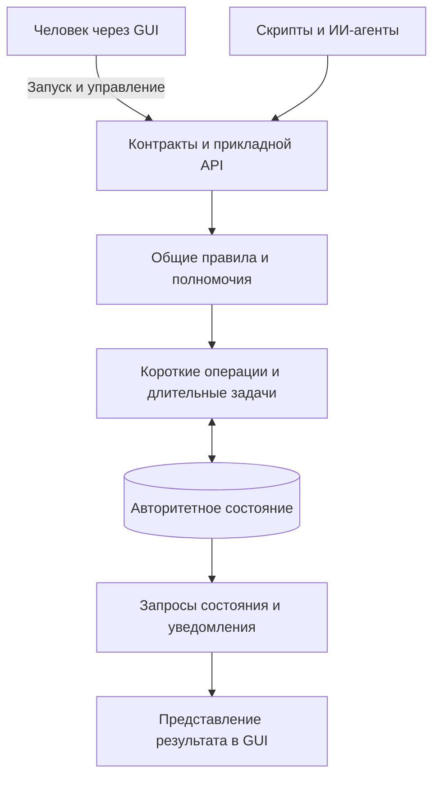

*Схема объединяет роли, а не предписывает число модулей или процессов. Для небольшой программы несколько ролей могут реализовываться одним компактным сервисом.*

В центре находится не терминал, не MCP и не диспетчер ради диспетчера. В центре находится **приложение с понятным языком действий, определёнными правилами и доступным для наблюдения состоянием**.

Графический интерфейс делает эту систему удобной человеку. CLI делает её удобной для терминальной автоматизации. Агентный адаптер предоставляет возможности среде ИИ. Общая архитектура не заставляет выбирать только один из этих способов.

> [!summary] Главный результат знакомства
> Command-first делает программное управление обычным способом использования приложения. Агент вызывает смысловые операции, GUI показывает реальное состояние, а человек может контролировать выполнение. Общие контракты связывают эти роли, но не отменяют необходимость проектировать безопасность, конкурентные изменения, отмену и восстановление.

### Переход к следующей статье 📘

Следующий материал посвящён внутреннему устройству этой системы: границам слоёв, DTO, поведенческим интерфейсам, владельцу состояния, типам сообщений и правилам преобразования прикладных данных в GUI. Отдельно рассматривается, какие проверки принадлежат внешней границе, а какие должны выполняться внутри сценария.

Выбор архитектуры под разные уровни сложности относится к третьей статье. Конкретный конвертер изображений — к четвёртой. Благодаря этому знакомство с принципом остаётся самостоятельным материалом, а детали реализации получают собственное пространство.

---

## Источники и границы утверждений 🔗

Текст сочетает общие архитектурные принципы, авторские учебные примеры и проверенные сведения о конкретных протоколах и проекте. JSON-примеры, схемы взаимодействия и предлагаемые политики приложения не являются выдержками из FigCraft или обязательными требованиями MCP.

**Дата проверки ссылок: 23 октября 2026 года.** Ссылки на ветку `main` и неприкреплённые к версии страницы документации могут со временем измениться. Версии и поддержку конкретного клиента следует сверять перед реализацией интеграции.

### Архитектурная основа 🧱

| Первичный источник | Для чего используется |
|---|---|
| [Alistair Cockburn — Hexagonal Architecture][ports] | Отделение приложения от пользовательских и технических адаптеров |
| [Randy Stafford — Service Layer, каталог Martin Fowler][service-layer] | Общая прикладная граница операций |
| [Martin Fowler — Data Transfer Object][dto] | Представление данных для обмена через границы |
| [Martin Fowler — Command Query Separation][cqs] | Различие чтения и изменения |
| [Martin Fowler — CQRS][cqrs] | Отличие простого разделения операций от отдельных моделей чтения и записи |
| [Martin Fowler — Presentation Model][presentation-model] | Представление состояния независимо от конкретных виджетов |
| [Martin Fowler — What do you mean by “Event-Driven”?][event-driven] | Уведомления, перенос состояния и Event Sourcing как разные решения |
| [Martin Fowler — Monolith First][monolith-first] | Цена преждевременного распределения системы |

### Протоколы, выполнение и безопасность ⚙️

| Первичный источник | Для чего используется |
|---|---|
| [MCP — спецификация 2026-07-28][mcp-spec] | Роли протокола и назначение интеграции |
| [MCP — Tools][mcp-tools] | Контракты инструментов и участие человека |
| [MCP — расширение Tasks][mcp-tasks] | Представление длительных протокольных операций |
| [MCP — Security Best Practices][mcp-security] | Границы доверия и риски интеграции |
| [JSON Schema — What is a schema?][json-schema] | Машинное описание структуры данных |
| [Microsoft — Asynchronous Request–Reply][async-request-reply] | Разделение принятия работы и получения результата |
| [Microsoft — Cooperative Cancellation][cooperative-cancellation] | Отличие запроса остановки от реакции исполнителя |
| [Microsoft — Compensating Transaction][compensation] | Отдельная логика восстановления последствий |
| [OWASP — Authorization Cheat Sheet][authorization] | Проверка полномочий и минимальные разрешения |
| [IETF — RFC 9110, HTTP Semantics][http-semantics] | Семантика идемпотентности и повторов |

### Примеры существующих механизмов 🛠️

| Первичный источник | Для чего используется |
|---|---|
| [Git — git-status][git-status] | Стабильный машинно-разбираемый интерфейс CLI |
| [Qt — Undo Framework][qt-undo] | Объекты команд и история отмены |
| [Qt — Threads and QObjects][qt-threads] | Разделение длительного исполнения и GUI |
| [FigCraft — AGENTS.md][figcraft-agents] | Общие идентификаторы команд и архитектурные ограничения |
| [FigCraft — MCP server][figcraft-mcp] | Headless, Attached и наблюдение за документом |
| [FigCraft — Control protocol][figcraft-control] | Программное управление работающим редактором |

[ports]: https://alistair.cockburn.us/hexagonal-architecture
[service-layer]: https://martinfowler.com/eaaCatalog/serviceLayer.html
[dto]: https://martinfowler.com/eaaCatalog/dataTransferObject.html
[cqs]: https://martinfowler.com/bliki/CommandQuerySeparation.html
[cqrs]: https://martinfowler.com/bliki/CQRS.html
[presentation-model]: https://martinfowler.com/eaaDev/PresentationModel.html
[event-driven]: https://martinfowler.com/articles/201701-event-driven.html
[monolith-first]: https://martinfowler.com/bliki/MonolithFirst.html
[mcp-spec]: https://modelcontextprotocol.io/specification/2026-07-28
[mcp-tools]: https://modelcontextprotocol.io/specification/2026-07-28/server/tools
[mcp-tasks]: https://modelcontextprotocol.io/extensions/tasks/overview
[mcp-security]: https://modelcontextprotocol.io/docs/2026-07-28/tutorials/security/security_best_practices
[json-schema]: https://json-schema.org/understanding-json-schema/about
[async-request-reply]: https://learn.microsoft.com/en-us/azure/architecture/patterns/asynchronous-request-reply
[cooperative-cancellation]: https://learn.microsoft.com/en-us/dotnet/standard/threading/cancellation-in-managed-threads
[compensation]: https://learn.microsoft.com/en-us/azure/architecture/patterns/compensating-transaction
[authorization]: https://cheatsheetseries.owasp.org/cheatsheets/Authorization_Cheat_Sheet.html
[http-semantics]: https://www.rfc-editor.org/rfc/rfc9110.html#name-idempotent-methods
[git-status]: https://git-scm.com/docs/git-status
[qt-undo]: https://doc.qt.io/qt-6/qundo.html
[qt-threads]: https://doc.qt.io/qt-6/threads-qobject.html
[figcraft-agents]: https://github.com/storytold/figcraft/blob/main/AGENTS.md
[figcraft-mcp]: https://github.com/storytold/figcraft/blob/main/docs/mcp.md
[figcraft-control]: https://github.com/storytold/figcraft/blob/main/docs/control-protocol.md
