## 02 — Command-first изнутри: слои, контракты и управляемое выполнение 🧭

*Техническая архитектура приложения, в котором GUI, скрипты и ИИ-агенты используют общие операции, наблюдают согласованное состояние и могут управлять выполнением работы.*

Программная доступность функции — только начало. Чтобы приложение оставалось предсказуемым при нескольких способах управления, необходимо определить, где принимаются решения, кто имеет право менять состояние и какие гарантии получает вызывающая сторона. Отдельно требуется объяснить, как результат превращается в изменения на экране и что происходит, когда человек вмешивается в работу агента.

В [первой статье](01_Command_First_Introduction.md) рассматривался основной принцип: важные возможности программы оформляются как самостоятельные операции, а интерфейсы становятся их клиентами. Этот материал раскрывает внутреннее устройство такой системы. В центре находятся **границы ответственности, контракты данных и поведения, владение состоянием и жизненный цикл выполнения**.

Ни MCP, ни реестр команд не являются обязательным центром всей архитектуры. Центр — прикладная модель с определёнными правилами. Протоколы, диспетчеры, фоновые исполнители и графические оболочки должны помогать работать с этой моделью, а не подменять её смысл.

> [!abstract] Основной тезис
> Хорошая command-first-архитектура задаёт не только способ вызвать действие, но и способ понять его результат, наблюдать состояние, обнаружить конфликт, безопасно обработать повтор и вмешаться в выполнение. Эти свойства появляются из контрактов и правил владения состоянием, а не из названий классов `CommandBus` или `AgentService`.

### Граница материала и учебный пример 📚

Статья рассматривает универсальное устройство приложения, без привязки к конкретному языку или GUI-фреймворку. Небольшой раздел о Python и TypeScript показывает способы выражения тех же контрактов, но не превращает материал в два параллельных руководства по разработке.

Сквозной пример — **условный редактор документов**. У документа есть страницы, устойчивые идентификаторы и номер версии. Короткая операция `page.rename` переименовывает страницу. Длительная операция `document.export.start` создаёт задачу экспорта неизменяемого снимка документа. Этот пример выбран для разбора архитектурных границ; конкретный конвертер изображений остаётся темой отдельной практической статьи.

Все имена команд, DTO, правила остановки и примеры сообщений ниже — проектные решения учебной системы. Они не объявляются готовым API FigCraft, стандартным форматом MCP или обязательным шаблоном для любого приложения.

| Часть серии | Вопрос |
|---|---|
| **01. Знакомство** | Зачем нужен общий программный язык операций? |
| **02. Архитектура и контракты** | Как организовать границы, состояние и взаимодействие компонентов? |
| **03. Вариации архитектуры** | Как выбрать достаточный набор механизмов под требования приложения? |
| **04. Практическое приложение** | Как собрать конкретный продукт на основе выбранных решений? |
| **00. README** | Как связать готовые материалы в общую карту? |

### Карта чтения 🗺️

> [!info] Основные маршруты
> **Устройство:** [[#1. Архитектуру описывают границы, а не каталоги 🧭|Границы]] → [[#2. Слои и направление зависимостей 🧱|Слои]] → [[#3. Прикладной API, порты и адаптеры 🔌|API и порты]].
>
> **Контракты:** [[#4. Контракт: форма, смысл, полномочия и время 📜|Состав контракта]] → [[#5. DTO, предметная модель и ViewModel 📦|Типы объектов]] → [[#6. Паспорт команды и единый источник схем 🗂️|Паспорт операции]].
>
> **Состояние и GUI:** [[#8. Владение состоянием и конкурентные изменения 🧠|Владелец состояния]] → [[#9. События: что, когда и кому сообщается 📣|События]] → [[#10. Надёжная подписка: снимки, версии и восстановление 📡|Восстановление]] → [[#11. GUI как проекция прикладного состояния 🖥️|Представление]].
>
> **Выполнение:** [[#12. Длительное выполнение: Job, Attempt и Artifact ⏳|Задачи]] → [[#13. Исполнители и управляющий канал 🧵|Исполнители]] → [[#14. Остановка, Undo и блокировка агентной сессии 🛑|Остановка]].
>
> **Надёжность и реализация:** [[#15. Ошибки и неопределённый результат 🌫️|Ошибки]] · [[#16. Повторные вызовы, идемпотентность и пакетные операции 🔁|Повторы]] · [[#17. Авторизация и подтверждение опасных действий 🛡️|Полномочия]] · [[#19. Типизация контрактов: общий принцип, Python и TypeScript 🐍|Типизация]] · [[#21. Сборка, тестирование и наблюдаемость 🧪|Проверка архитектуры]].

---

## 1. Архитектуру описывают границы, а не каталоги 🧭

Структура папок полезна, но сама по себе почти ничего не гарантирует. В каталоге `domain` может находиться код, который напрямую обращается к окну. В каталоге `services` может оказаться несколько функций, передающих один и тот же словарь друг другу. Формально слои присутствуют, но независимых обязанностей у них нет.

Архитектурная граница появляется там, где существует понятное соглашение: компонент получает определённые данные, отвечает за определённое поведение и не требует знания внутреннего устройства соседнего компонента.

Для рассматриваемой системы важны несколько независимых осей.

| Ось | На какой вопрос отвечает | Пример |
|---|---|---|
| **Ответственность** | Какой смысл обслуживает компонент? | Проверка операции, хранение документа, отображение карточки |
| **Зависимости кода** | О каких типах и модулях компонент знает? | Сценарий зависит от интерфейса хранилища, а не от SQLite |
| **Размещение** | Где выполняется код? | В GUI-процессе, локальном сервисе или рабочем процессе |
| **Владение состоянием** | Кто вправе изменить конкретные данные? | Владелец документа или менеджер задач |
| **Время жизни** | Как долго существует объект или работа? | Один запрос, одна задача, рабочая сессия, всё приложение |
| **Доверие** | Каким данным и полномочиям можно доверять? | Внешние аргументы не определяют роль вызывающей стороны |

Смешение этих осей порождает характерные ошибки. «Команда вызвана из того же процесса» начинают понимать как «параметры доверенные». «Все используют один пакет» — как «все видят один документ». «Объект неизменяемый» — как «операция потокобезопасная». Ни одно из этих следствий не возникает автоматически.

### Три контура одного приложения 🔄

Полезно рассматривать приложение одновременно как систему **действий**, **наблюдения** и **управления выполнением**.

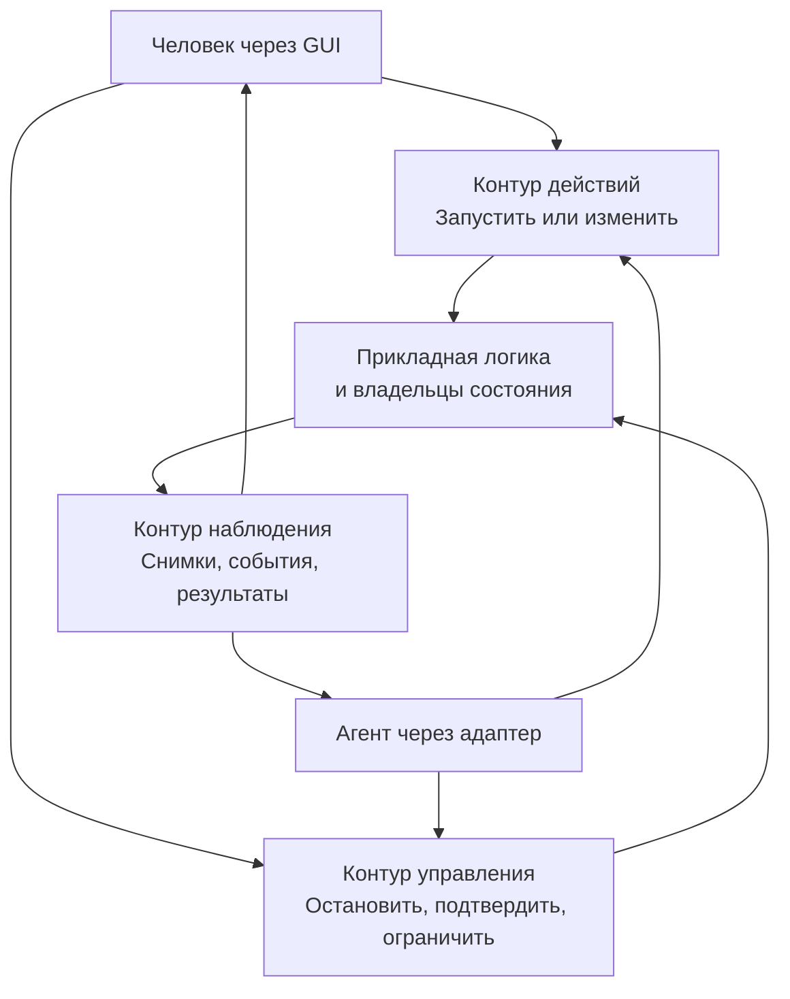

*Это функциональные контуры, а не три обязательных сервера. В небольшой программе они могут быть методами одного прикладного сервиса.*

Контур действий отвечает на вопрос «что выполнить». Контур наблюдения — «что происходит и что получилось». Контур управления — «можно ли остановить, подтвердить или запретить дальнейшую работу».

Если реализован только первый контур, агент получает инструмент выполнения, но человек не получает полноценного контроля. Если наблюдение существует лишь в строках журнала, GUI вынужден угадывать состояние. Если команда остановки попадает в заблокированную обработкой очередь, формально доступный управляющий API оказывается практически бесполезным.

### Независимость от интерфейса — проверяемое свойство 🔬

У операции `page.rename` должна быть возможность выполниться в тесте без запуска графического окна. У GUI должна быть возможность показать уже выполняющуюся задачу, которую запустил не его обработчик кнопки. У MCP-адаптера должна быть возможность вызвать сценарий, не импортируя виджеты.

Такое отделение приложения от входных и выходных устройств составляет основную идею [Ports and Adapters][ports]. В этой статье она применяется не как требование рисовать шестиугольник, а как практическая проверка зависимостей: изменение оболочки не должно менять смысл прикладного действия.

---

## 2. Слои и направление зависимостей 🧱

Для технического разбора удобно выделить четыре области: представление и входные адаптеры, прикладные сценарии, предметную модель и инфраструктуру. Они не обязаны соответствовать четырём пакетам, четырём процессам или четырём классам на каждую функцию.

| Область | Её работа | Пример в редакторе | Нежелательная зависимость |
|---|---|---|---|
| **Представление и входные адаптеры** | Принять внешнее действие и представить ответ | Прочитать поле формы, разобрать CLI, обработать MCP-вызов | Собственная реализация правил документа |
| **Прикладной слой** | Организовать конкретный сценарий | Проверить доступ, загрузить документ, применить изменение, вернуть результат | Конкретное окно или MCP SDK |
| **Предметная модель** | Сохранить смысловые правила и корректность состояния | Страница принадлежит документу; имя удовлетворяет правилам | Сокет, GUI-поток, таблица SQL |
| **Инфраструктура** | Реализовать технические возможности | Репозиторий, файловое хранилище, экспортёр, транспорт | Самостоятельное решение о пользовательском намерении |

### Представление и адаптер — близкие, но разные роли 🖥️

Представление решает, как показать состояние: какой текст вывести, какой объект выделить, когда открыть уведомление. Входной адаптер решает, как превратить действие клиента в прикладной запрос.

В GUI эти роли часто находятся рядом. Но MCP-адаптер не обязан иметь представление вообще. А ViewModel может агрегировать сведения из нескольких прикладных запросов, не являясь ещё одним уровнем бизнес-логики.

Универсальное правило «адаптер должен занимать не больше десяти строк» было бы неверным. Сетевой адаптер способен содержать немало кода аутентификации, разбора сообщений, ограничения размеров и преобразования ошибок. Он остаётся адаптером, пока не начинает заново определять, как переименовывать страницу или что считается успешным экспортом.

### Прикладной слой организует, предметная модель ограничивает 🧠

Сценарий переименования знает последовательность: определить инициатора, проверить право редактирования, получить документ нужной версии, применить новое имя и зафиксировать результат.

Предметная модель знает собственные правила. Например, страница не может принадлежать одновременно двум документам, а имя не должно состоять только из пробелов. Эти правила полезны независимо от того, каким интерфейсом вызвана операция.

Разделение не требует создавать и `RenameHandler`, и `RenameService`, и `RenameManager`, если каждый лишь передаёт параметры дальше. Для простого сценария один прикладной обработчик может непосредственно обращаться к модели и репозиторию. Дополнительный сервис оправдан общей логикой, повторным использованием или отдельной ответственностью, а не желанием увеличить число этажей.

Граница доступных операций и координации сценариев соответствует [Service Layer][service-layer]. При этом «сервис» здесь означает роль в приложении, а не обязательный отдельно развёрнутый сетевой сервис.

### Вызовы и зависимости исходного кода — разные схемы ↔️

Во время выполнения обработчик вызывает репозиторий, а конкретный репозиторий выполняет запрос к БД. Но прикладной код может знать только интерфейс `DocumentRepository`.

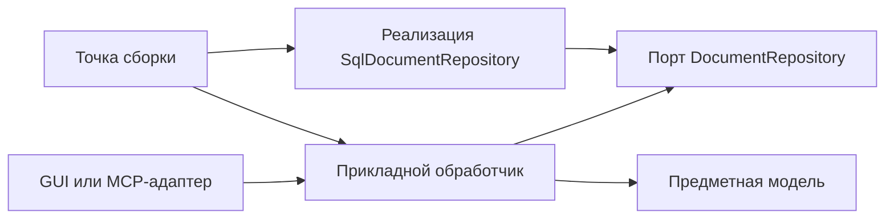

*Здесь стрелка означает зависимость исходного кода. Стрелка от реализации репозитория к порту показывает, что внешний компонент реализует внутренний контракт. Она не изображает направление SQL-запроса.*

В рабочем вызове всё выглядит иначе:

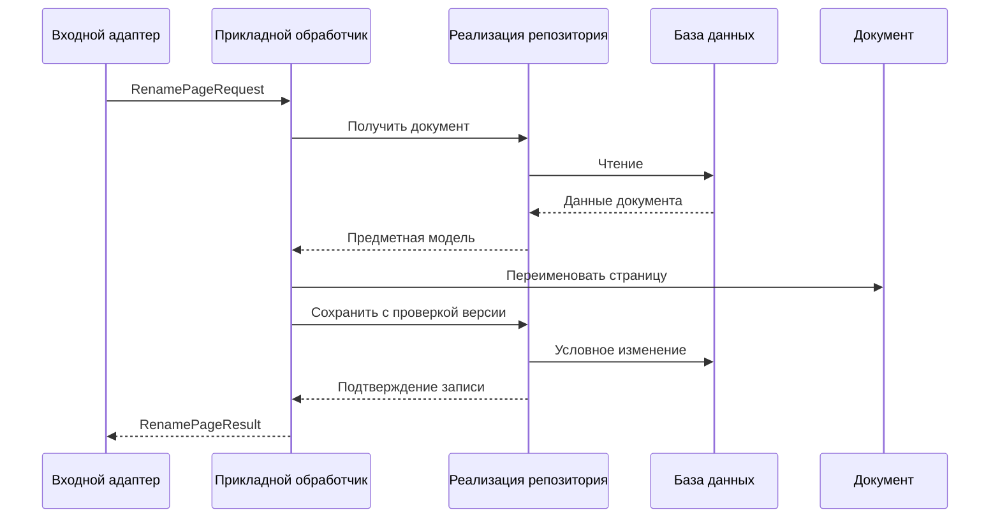

Такое разделение позволяет заменить хранилище тестовой реализацией, не переписывая сценарий. При этом подмена не отменяет необходимости отдельно тестировать настоящий адаптер БД.

> [!important] Контракты не образуют дополнительный обязательный этаж
> Контракты описывают границы. Модуль с DTO и интерфейсами может использоваться несколькими слоями, но через него не обязано «проходить выполнение». Это определения типов и обещаний, а не ещё один обработчик запроса.

---

## 3. Прикладной API, порты и адаптеры 🔌

Прикладной API отвечает на вопрос, какие осмысленные сценарии доступны клиентам. В учебном редакторе он может включать переименование страницы, получение документа, запуск экспорта, чтение состояния задачи и запрос её остановки.

Важно, что API описывается прежде транспорта. Метод `rename_page` может вызываться непосредственно в памяти. Его удалённый аналог может передаваться через локальный сокет. Инструмент MCP может предоставлять ту же возможность агентной среде. Смысл операции при этом не должен зависеть от упаковки сообщения.

### Входной порт выражает сценарий 🚪

Условное описание интерфейса не привязано к синтаксису конкретного языка:

```text
DocumentApplication
    rename_page(request, request_context) -> RenamePageResult
    get_document(query, request_context) -> DocumentSnapshot
    start_export(request, request_context) -> JobAccepted

JobApplication
    get_job(query, request_context) -> JobSnapshot
    request_cancel(request, request_context) -> CancelDecision
```

Это поведенческие контракты. Они определяют не только типы результатов, но и условия вызова: например, `request_cancel` должен быть доступен уполномоченному человеку, даже если исходную задачу создал агент.

Явный API часто удобнее универсального `execute(name, dict)`: редактор и анализатор типов видят связь конкретной операции с её запросом и результатом. Динамический диспетчер можно разместить поверх таких обработчиков для CLI, MCP и плагинов.

### Выходной порт выражает потребность ядра 🧰

Прикладному сценарию нужно сохранять документ, создавать артефакт экспорта или планировать выполнение задачи. Он описывает эту потребность интерфейсом, а инфраструктура предоставляет реализацию.

```text
DocumentRepository
    load(document_id) -> Document
    save(document, expected_revision) -> StoredDocumentVersion

ExportEngine
    export(snapshot, options, execution_context) -> PreparedArtifact

ArtifactStore
    publish(prepared_artifact, target_policy) -> PublishedArtifact
```

Не каждую библиотечную функцию требуется оборачивать отдельным портом. Полезная граница появляется там, где изолируется значимая зависимость, нужна тестовая подмена или существуют разные реализации. Интерфейс из одного метода, дословно повторяющего единственный внутренний вызов и ничего не защищающего, может оказаться лишним.

### Адаптер не определяет окончательные права 🔐

Адаптер устанавливает доверенный контекст: какое соединение принято, какая учётная или локальная сессия подтверждена, какие возможности выданы. Но окончательная проверка доступа к конкретному документу относится к прикладному сценарию или общему доверенному механизму перед ним.

Иначе локальный GUI будет проверять права, а новая CLI-оболочка случайно обойдёт ту же защиту. Общая рекомендация проверять разрешения для каждого запроса и придерживаться минимальных полномочий приведена в [OWASP Authorization Cheat Sheet][authorization].

### Точка сборки связывает реализации 🧩

Composition root — место, где создаются реальные зависимости. Например, репозиторий на SQLite, файловое хранилище, экспортёр, менеджер задач и сервер управления. Они передаются прикладным компонентам, после чего подключаются GUI и другие адаптеры.

Точка сборки вправе знать конкретные реализации. Это её обязанность. Предметная модель — нет.

Такой подход отличается от глобального объекта `app`, из которого любой модуль может получить всё что угодно. Глобальный контейнер скрывает зависимости: по сигнатуре функции больше невозможно понять, нужны ли ей база данных, окно и сетевой клиент. Явная передача небольшого набора портов сохраняет эту информацию.

---

## 4. Контракт: форма, смысл, полномочия и время 📜

Сигнатура `rename_page(request) -> result` описывает только поверхность операции. Она не объясняет, когда изменение считается принятым, сохраняется ли документ на диск и можно ли повторить вызов после разрыва соединения.

Поэтому контракт полезно рассматривать в нескольких измерениях.

| Измерение | Что требуется определить | Пример |
|---|---|---|
| **Форма данных** | Типы, обязательные поля, ограничения | `page_id` — непустая строка |
| **Предметный смысл** | Что именно изменяется | Название указанной страницы, а не активной вкладки |
| **Полномочия** | Кто и над какими ресурсами может действовать | Право редактирования данного документа |
| **Согласованность** | На каком состоянии основано изменение | Проверка `expected_revision` при записи |
| **Время** | Когда возвращается ответ и что он подтверждает | Применённое изменение либо только принятая задача |
| **Побочные эффекты** | Какие ресурсы затрагиваются | Документ, история изменений, экспортный артефакт |
| **Сбои и повторы** | Что делать при отказе, повторе и неизвестном исходе | Запрос состояния по ключу операции |
| **Наблюдаемость** | Как узнать о ходе и результате | Снимок документа, состояние задачи, уведомление |
| **Совместимость** | Какие изменения API допустимы | Сохранение смысла уже опубликованных полей |

В конкретной небольшой операции не обязательно заводить девять отдельных файлов. Однако соответствующие решения должны существовать хотя бы в коротком описании и проверяющих тестах.

### У контракта есть предусловия и постусловия 📐

Для `page.rename` предусловиями становятся существование документа и страницы, разрешение на редактирование и соответствие ожидаемой версии. Постусловие: в авторитетной модели у страницы установлено новое имя, а результат содержит версию полученного состояния.

Если документ живёт в памяти редактора, успешное переименование может не означать сохранение файла на диск. Если система подтверждает запись в БД, она должна определить, что именно было зафиксировано. Фразы «операция выполнена» и «результат переживёт аварийное выключение» не следует использовать как взаимозаменяемые.

Для экспорта контракт другой. `document.export.start` подтверждает создание задачи. Результат экспорта появится позднее. Система должна определить, принята ли задача только в память процесса или сохранена устойчиво до возврата ответа. Сам идентификатор не доказывает долговечность.

### Контракт данных не выполняет весь контракт поведения 🧾

JSON Schema способна проверить структуру объекта, обязательность полей и ограничения значений. Она не может сама установить, принадлежит ли страница данному документу и разрешено ли инициатору его менять. Назначение `properties`, `required` и `additionalProperties` описано в [документации JSON Schema][json-object].

Также машинная схема не равна алгоритму нормализации. В частности, ключ `default` в JSON Schema — аннотация: сам стандартный процесс валидации не обязан вставлять пропущенное значение. Заполнение значений по умолчанию является поведением выбранной библиотеки или приложения. Это различие прямо отмечено в [описании аннотаций JSON Schema][json-annotations].

У клиента, внутреннего валидатора и схемы инструмента не должно возникать три разных представления о значении пропущенного параметра.

### Время жизни запроса не равно времени жизни работы ⏱️

Короткий запрос может закончиться, оставив после себя задачу. Клиент может перестать ждать, а задача — продолжить выполнение. Окно может закрыться, хотя владелец задачи остаётся в сервисном процессе.

Отсюда следуют разные идентификаторы и разные операции управления. Тайм-аут вызова относится к ожиданию ответа. Дедлайн задачи относится к допустимой длительности работы. Запрос отмены относится к остановке конкретного исполнения. Объединение этих смыслов одним полем `timeout` создаёт неоднозначность.

> [!note] Контракт нужен не только внешнему агенту
> Он ограничивает и внутренний код. GUI не должен считать результат готовым только потому, что метод вернул `job_id`. Исполнитель не должен публиковать успех, пока не выполнены оговорённые условия. Новый адаптер не должен расширять доступ только потому, что работает локально.

---

## 5. DTO, предметная модель и ViewModel 📦

Не все объекты с одинаковыми полями должны быть одним типом. При этом не каждый переход между функциями оправдывает создание очередной копии данных. Различие определяется смыслом и границей доверия.

В классическом описании [Data Transfer Object][dto] DTO используется для передачи сериализуемых данных через границу. В этой серии термин применяется и к внутренним прикладным сообщениям, если они служат самостоятельным контрактом между компонентами.

### Четыре представления одного действия 🪞

| Представление | Что выражает | Чего в нём нет |
|---|---|---|
| **Внешний DTO** | Параметры, которые прислал клиент | Доказанных полномочий и гарантии существования цели |
| **Прикладная команда** | Проверенное намерение в терминах сценария | Зависимости от формы MCP- или HTTP-сообщения |
| **Предметная модель** | Состояние и правила документа | Форматирования карточки и транспортных метаданных |
| **ViewModel** | Данные, подготовленные для конкретного представления | Права самостоятельно менять авторитетный документ |

Например, `RenamePageRequest` несёт идентификатор страницы и новое имя. Объект `Document` содержит страницы и проверяет допустимость изменения. `RenamePageResult` сообщает факты об итоговом состоянии. `PageRowViewModel` содержит название для строки списка, признак ожидающего подтверждения изменения и другие свойства отображения.

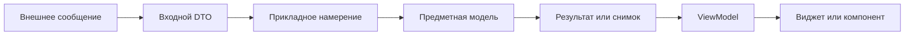

*Схема показывает смену смысла представления. В небольшой реализации входной DTO и прикладная команда могут быть одним типом, если у них одинаковые требования и это не протаскивает транспорт в ядро.*

### Почему предметный объект не стоит отдавать GUI как изменяемую ссылку 🔓

Если интерфейс получает живой `Document`, а затем напрямую меняет его поля, общий прикладной путь перестаёт быть обязательным. Изменение может обойти проверку версии, историю и уведомления. Агент действует через API, а GUI — через обходной вход.

Вместо этого наружу возвращается снимок или представление для чтения. Изменение запрашивается отдельной операцией. Это не запрещает оптимизированные локальные модели, но требует осознанного разграничения чтения и записи.

Отдельно важна неизменяемость передаваемого снимка. После публикации сообщения отправитель не должен менять содержимое того же объекта, пока получатель его обрабатывает. Иначе «событие версии 12» может незаметно превратиться в данные версии 13. Способ обеспечения этого свойства зависит от среды: неизменяемые структуры, копирование или строгая передача владения.

### Value Object отличается от DTO своей ролью 🧮

Значение `PageName` может гарантировать предметные ограничения имени: допустимую длину, отсутствие запрещённых символов и отсутствие имени из одних пробелов. Такой объект существует не ради перевозки данных, а ради сохранения инварианта.

DTO может содержать обычную строку. Прикладной сценарий превращает её в `PageName`; если преобразование невозможно, операция получает предметный отказ. Для простого приложения отдельный класс имени необязателен: ту же роль может выполнять чистая функция проверки. Важна централизация правила, а не выбор объектного синтаксиса.

### RequestContext не должен быть свободным аргументом агента 🔐

У запроса есть полезная нагрузка — что сделать. Рядом с ней существует контекст — от чьего имени и в каких условиях запрос выполняется.

```text
RenamePageRequest
    document_id
    page_id
    expected_revision
    new_name

RequestContext
    principal_id
    session_id
    permitted_workspace
    request_id
    origin
    tracing_context
```

Поля идентичности и полномочий формируются доверенной принимающей стороной. Агент не должен получить доступ к чужому документу, просто подставив другой `principal_id`. Значение `origin = gui` также не является доказательством привилегий.

Контекст выполнения длительной задачи — ещё один объект. Он может содержать токен отмены, средство сообщения прогресса, дедлайн и идентификатор попытки. Он не равен контексту входного сетевого запроса: исходное соединение способно закончиться задолго до завершения работы.

| Контекст | Время жизни | Кто создаёт |
|---|---|---|
| **RequestContext** | Обработка конкретного обращения | Доверенный входной адаптер |
| **JobExecutionContext** | Одна попытка выполнения задачи | Менеджер задач или исполнительная среда |
| **PresentationContext** | Работа конкретного окна или представления | GUI |

Внешний DTO не должен нести открытое соединение с БД, ссылку на окно или сериализованный токен отмены. Эти объекты имеют локальный жизненный цикл и не являются переносимыми данными контракта.

---

## 6. Паспорт команды и единый источник схем 🗂️

Имя команды — публичный идентификатор возможности, а не обязательное имя функции. Стабильное `page.rename` может продолжать существовать после реорганизации модулей и изменения внутренних классов.

Для учебной операции паспорт выглядит следующим образом.

| Поле | Содержание |
|---|---|
| **Имя** | `page.rename` |
| **Версия контракта** | `1` |
| **Назначение** | Переименовать существующую страницу указанного документа |
| **Вход** | Документ, страница, ожидаемая версия, новое имя |
| **Полномочие** | Право редактирования именно этого документа |
| **Предметное правило** | Имя допускается политикой документа; страница принадлежит документу |
| **Согласованность** | Версия проверяется атомарно вместе с применением изменения |
| **Результат** | Имя, версия документа и признак фактического изменения |
| **Побочный эффект** | Изменение авторитетной модели и предусмотренной истории |
| **Сохранение** | Определяется владельцем документа; не выводится из слова `rename` |
| **Повтор** | Поведение без ключа и с ключом идемпотентности различается |
| **Наблюдение** | Обновление документа, доступное GUI и другим клиентам |
| **Отмена** | Короткая операция не имеет полезного окна остановки; Undo — отдельное действие |

### Машинная схема фиксирует структуру 🧾

Ниже приведена схема полезной нагрузки. Она намеренно не содержит идентичности клиента и параметров транспорта.

```json
{
  "$schema": "https://json-schema.org/draft/2020-12/schema",
  "title": "RenamePageRequest",
  "type": "object",
  "additionalProperties": false,
  "required": [
    "document_id",
    "page_id",
    "expected_revision",
    "new_name"
  ],
  "properties": {
    "document_id": {
      "type": "string",
      "minLength": 1
    },
    "page_id": {
      "type": "string",
      "minLength": 1
    },
    "expected_revision": {
      "type": "integer",
      "minimum": 0,
      "maximum": 9007199254740991
    },
    "new_name": {
      "type": "string",
      "minLength": 1
    }
  }
}
```

В этом примере входная схема проверяет минимальную форму. Политика допустимых имён остаётся предметным правилом. Ограничения общего размера сообщения, числа запросов и стоимости обработки задаются принимающей стороной до дорогостоящего выполнения.

Верхняя граница версии выбрана для учебного JSON-контракта, совместимого с обычным числовым представлением JavaScript. В другой системе версия может передаваться непрозрачной строкой. Существенно, чтобы тип на проводе не терял точность; ограничения числовой совместимости JSON обсуждаются в [RFC 8259][json-rfc].

### Пример запроса и результата 📬

```json
{
  "operation": "page.rename",
  "operation_version": 1,
  "request_id": "req-104",
  "arguments": {
    "document_id": "doc-17",
    "page_id": "page-4",
    "expected_revision": 28,
    "new_name": "Сводка результатов"
  }
}
```

```json
{
  "request_id": "req-104",
  "outcome": "completed",
  "result": {
    "document_id": "doc-17",
    "page_id": "page-4",
    "name": "Сводка результатов",
    "revision": 29,
    "changed": true
  }
}
```

Это условная прикладная оболочка сообщений, не формат MCP. При прямом вызове методы могут получать и возвращать DTO без `operation` и `request_id` внутри полезной нагрузки.

Если имя уже совпадает и ожидаемая версия актуальна, контракт может вернуть `changed: false`, не создавать новую версию и не добавлять пустой шаг истории. Если версия устарела, выбранная политика сначала сообщает конфликт, даже когда желаемое имя случайно совпало. Такой порядок должен быть одинаковым для всех клиентов.

### Реестр хранит описание, диспетчер исполняет маршрут 🗃️

В реестре удобно хранить имя, входную и выходную схему, описание, требуемый тип полномочия и ссылку на обработчик. Диспетчер находит описание, проверяет запрос и вызывает обработчик.

Однако метаданные не заменяют проверки. Поле `requires: document.edit` описывает требование; конкретное решение должно учитывать текущего инициатора и целевой документ. Поле `supports_undo: true` также не реализует обратную операцию.

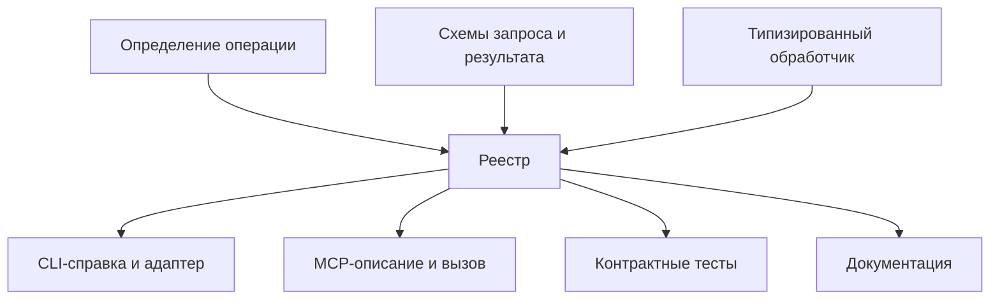

Генерация описаний помогает избежать расхождений, но не гарантирует хороший интерфейс автоматически. Новая команда может потребовать отдельной формы, понятного текста, ограничений выдачи и сценария подтверждения.

### Один источник контракта не всегда означает один файл 🧬

В однородном проекте источником могут быть типизированные схемы библиотеки, из которых выводятся типы и JSON Schema. В системе на нескольких языках источником может стать нейтральная схема с генерацией клиентов.

В обоих случаях необходимы тесты соответствия. Произвольный программный валидатор, обращение к БД и правило нормализации не всегда выражаются в JSON Schema. Генерация схемы не должна создавать иллюзию, будто она перенесла всю семантику обработчика.

---

## 7. Путь короткой операции от запроса до изменения ⚙️

Короткая операция полезна для понимания всей архитектуры: здесь ещё нет очереди задач, но уже видны доверие, типизация, состояние, транзакция и уведомления.

Внешний адаптер получает сообщение. До выполнения он ограничивает размер, разбирает формат, устанавливает контекст клиента и выбирает поддерживаемую версию операции. Затем данные превращаются во входной DTO.

Прикладной обработчик получает не произвольный словарь, а осмысленный запрос. Он проверяет доступ к ресурсу, загружает документ и применяет предметное действие в рамках выбранной модели согласования.

### Проверки принадлежат разным границам 🔍

| Проверка | Подходящее место | Почему |
|---|---|---|
| Сообщение слишком велико или не разбирается | Транспортный адаптер | До выделения больших ресурсов и поиска бизнес-сценария |
| Поле отсутствует или имеет неверный тип | Входной контракт | Одинаковая форма данных для всех адаптеров |
| Клиент аутентифицирован | Доверенный входной механизм | Это свойство соединения или сессии, а не имени документа |
| Есть право менять конкретный документ | Прикладной слой или общая политика доступа | Проверка должна действовать независимо от способа вызова |
| Страница принадлежит документу | Предметная модель или прикладной сценарий | Это смысл ресурса, а не синтаксис JSON |
| Версия не изменилась | Граница атомарного применения | Ранняя проверка не защищает от последующей гонки |
| Результат соответствует публичной схеме | Обработчик и выходной адаптер | Защита клиентов от ошибки самой реализации |

Порядок некоторых проверок зависит от политики раскрытия информации. Например, API может не сообщать неавторизованному клиенту, существует ли скрытый документ. Поэтому таблица описывает ответственность, а не обязательный глобальный порядок для всех систем.

### Обработчик координирует один законченный сценарий 🧩

Следующий фрагмент — псевдокод, а не готовый API какой-либо библиотеки:

```text
handle_rename(request, context):
    authorizer.require_document_edit(context, request.document_id)

    within document_change_boundary(request.document_id):
        document = documents.load(request.document_id)
        document.require_revision(request.expected_revision)

        outcome = document.rename_page(
            request.page_id,
            request.new_name
        )

        result = make_rename_result(document, outcome)
        validate_output_contract(result)

        documents.commit_if_version_matches(
            document,
            expected_revision=request.expected_revision
        )

    publish_committed_change_if_needed(document, outcome)
    return result
```

`document_change_boundary` обозначает выбранную границу согласованности: транзакцию, последовательное исполнение у владельца документа или другой механизм. Она не означает автоматическую транзакцию между любыми файлами и внешними сервисами.

Смысл [Unit of Work][unit-of-work] состоит в координации изменений одной работы и их фиксации. Для простого сценария отдельный объект с таким именем не обязателен, но начало и окончание атомарной части должны быть понятны.

### Почему публикация идёт после фиксации 📣

Если сначала отправить `page.renamed`, а затем запись завершится ошибкой, GUI покажет действие, которого в авторитетном состоянии нет. Поэтому событие об успешном изменении должно опираться на уже принятый результат.

Однако «после фиксации» ещё не означает «гарантированно доставлено». Между записью и отправкой процесс может аварийно завершиться. Это отдельная проблема, которая рассматривается в разделе о событиях, а не скрывается под названием транзакции.

### Успешная запись и успешный ответ — разные моменты 📍

Если изменение применилось, но сериализация ответа завершилась ошибкой, нельзя безоговорочно сообщить клиенту «операция отклонена, изменений нет». Серверная ошибка после фиксации не отменяет уже случившийся эффект.

Поэтому полезно проверять сформированный результат до фиксации там, где это возможно, и сохранять идентификаторы операции для последующей сверки. Но даже такая проверка не исключает потерю ответа в транспорте. Клиенту нужен способ отличать предметный отказ от неизвестного ему исхода.

---

## 8. Владение состоянием и конкурентные изменения 🧠

Главная практическая граница — не между папками `gui` и `core`, а между теми, кто **владеет состоянием**, и теми, кто его наблюдает или запрашивает изменения.

Для каждого значимого ресурса необходимо определить авторитетного владельца. У документа это может быть объект рабочей сессии. У фоновой задачи — менеджер задач с хранилищем. У локального масштаба просмотра — модель конкретного окна.

| Состояние | Возможный владелец | Кто получает проекцию |
|---|---|---|
| Содержимое документа | Документная сессия или прикладной сервис | GUI, агент, экспортёр |
| Состояние задачи | Менеджер задач | GUI, CLI, MCP-клиент |
| Выделение и прокрутка | Представление конкретного участника | Его собственное окно |
| Полномочия сессии | Доверенный сервис допуска | Адаптеры и прикладные проверки |
| Подготовленный результат | Менеджер артефактов | Клиенты с правом получения |

«Один владелец» не означает один глобальный объект на всё приложение. Документы могут иметь независимых владельцев. Это означает, что для каждого ресурса определён порядок принятия изменений, а несогласованные копии не выдают себя за равноправную истину.

### Проверить версию и записать нужно как одно решение 🔒

Предположим, человек и агент прочитали версию 28. Человек переименовал страницу, создав версию 29. Агент пытается применить изменение, подготовленное для версии 28.

Проверка только при чтении не помогает: между чтением и записью состояние уже изменилось. Вариант с оптимистической конкуренцией проверяет версию непосредственно при применении.

```sql
UPDATE documents
SET payload = :new_payload,
    revision = revision + 1
WHERE id = :document_id
  AND revision = :expected_revision;
```

Это иллюстрация условной записи, а не полная схема хранения документов. Если затронуто ноль строк, приложение разбирает ситуацию по своей политике: объект отсутствует, недоступен или его версия изменилась. Связанные изменения и история должны попадать в ту же транзакционную границу, если контракт обещает их совместную фиксацию.

Принцип предотвращения потерянных обновлений через условие версии используется и в HTTP: `If-Match` задаёт условие выполнения, описанное в [RFC 9110][http-semantics]. Прикладное `expected_revision` здесь имеет похожую цель, но не объявляется HTTP-заголовком.

### Единственный поток не исключает смысловую гонку 🧵

Даже когда изменения применяются последовательно, два намерения могут быть основаны на старом состоянии. Кроме того, асинхронный обработчик способен уступить управление между чтением и записью.

Последовательное владение упрощает реализацию атомарного участка, но не отменяет вопроса: разрешено ли выполнять запрос, подготовленный до чужого изменения? Это решение относится к контракту операции.

Для некоторых действий устаревшая версия допустима. Например, независимое добавление метки может быть коммутативным. Для замены большого фрагмента документа молчаливое применение обычно опаснее. Универсальная политика «всегда последняя запись побеждает» скрывает потерю намерений, а не решает её.

### Длительная работа не должна держать документ заблокированным ⏳

Экспорт может занять заметное время. Если всё это время удерживать общую блокировку документа, человек потеряет возможность редактирования, а управляющие операции начнут ждать завершения обработки.

В учебной модели экспорт получает **неизменяемый снимок документа определённой версии**. Задача сохраняет `source_revision`. Человек продолжает работать с более новой версией, а GUI честно показывает, из какого состояния построен результат.

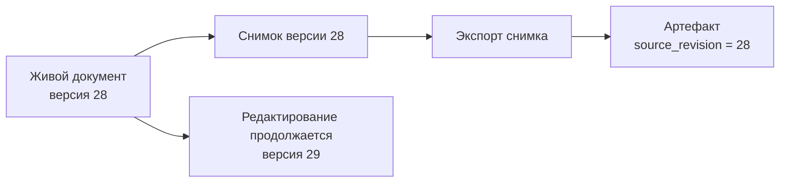

Снимок должен быть реальным: отдельная неизменяемая структура, сохранённая версия или другой устойчивый источник. Передача только номера `28` без возможности получить соответствующие данные не фиксирует вход задачи.

Если продукту нужен экспорт «самой свежей версии на момент начала», этот момент определяется отдельно. Выбор между моментом постановки, началом выполнения и публикацией результата не должен оставаться случайным поведением очереди.

---

## 9. События: что, когда и кому сообщается 📣

Событие описывает факт, но факты бывают разного уровня. Изменение документа, обновление состояния задачи и диагностическая запись о запуске обработчика не должны превращаться в один неразличимый поток.

| Вид сообщения | Пример | Назначение |
|---|---|---|
| **Предметное событие** | `page.renamed` | Сообщить о смысловом изменении модели |
| **Прикладное уведомление** | `job.snapshot.v1` | Передать клиенту актуальное представление задачи |
| **Телеметрия** | Обработчик занял 12 мс | Помочь диагностировать работу системы |
| **Управляющий запрос** | `job.cancel` | Попросить выполнить новое действие; это не состоявшийся факт |

Журнал с записью «экспорт запущен» не является надёжным API состояния задач. И событие `command.completed` не доказывает окончания экспорта: оно может означать только завершение команды, которая поставила работу в очередь.

### Уведомление, полный снимок и изменение — разные контракты 📦

Простейшее уведомление сообщает лишь: документ изменился, требуется перечитать его. Более насыщенное сообщение несёт полный снимок. Ещё один вариант передаёт только различие между версиями.

Эти подходы имеют разные компромиссы. Полный снимок проще применять и восстанавливать. Различие экономит передачу данных, но зависит от известного исходного состояния. Пустое уведомление требует дополнительного чтения. Такое разграничение близко к различию Event Notification и Event-Carried State Transfer в статье [What do you mean by “Event-Driven”?][event-driven]. Оно не означает обязательного Event Sourcing.

Для небольшой карточки задачи удобно отправлять полный снимок:

```json
{
  "event_type": "job.snapshot.v1",
  "event_id": "event-908",
  "stream_cursor": "cursor-a91",
  "causation_id": "req-export-201",
  "snapshot": {
    "job_id": "job-42",
    "revision": 12,
    "operation": "document.export",
    "document_id": "doc-17",
    "source_revision": 28,
    "initiator": {
      "kind": "agent",
      "display_name": "Агент редактора"
    },
    "state": {
      "status": "running",
      "phase": "rendering",
      "progress": {
        "kind": "units",
        "completed": 18,
        "total": 40,
        "unit": "page"
      }
    }
  }
}
```

Здесь `revision` относится к задаче, а `source_revision` — к документу, из которого готовится экспорт. `stream_cursor` указывает позицию в потоке доставки. Эти три значения не взаимозаменяемы.

### Кто создаёт окончательное событие 🏷️

Исполнитель сообщает менеджеру задач, что подготовил результат. Менеджер проверяет, относится ли сообщение к актуальной попытке, фиксирует состояние и только затем публикует новое представление задачи.

Аналогично экспортёр не должен единолично объявлять операцию успешной, если файл ещё не опубликован в целевом хранилище. Состояние `succeeded` определяется полным прикладным контрактом, а не фактом возврата из низкоуровневой функции.

В сообщении наружу не требуется передавать весь внутренний объект. Поля фильтруются по контракту и полномочиям получателя. Внутренняя ошибка с путями, секретами и стеком вызовов не должна автоматически становиться содержимым общей панели активности.

### Фиксация состояния и доставка события — две разные гарантии 💾

После успешной записи процесс может завершиться до отправки уведомления. Для GUI, который умеет перечитать состояние, потеря такого сигнала иногда допустима. Для запуска обязательного следующего этапа процесса — уже нет.

Если нужна надёжная связь между изменением БД и публикацией, применяется вариант с **transactional outbox**: состояние и запись о будущем сообщении сохраняются одной транзакцией, а отдельный отправитель доставляет сообщения позднее. При этом возможны повторные доставки, поэтому получатели должны корректно обрабатывать дубликаты. Именно проблему двойной записи и повторов описывает [AWS Transactional Outbox][outbox].

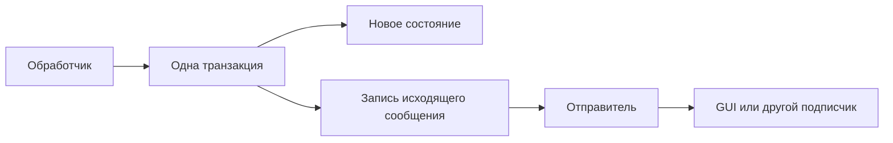

Outbox не нужен только ради того, чтобы показать спиннер. Он становится оправданным, когда пропуск события нарушает гарантии системы. Отдельный брокер также не устраняет проблему окна между записью в БД и отправкой: он решает другую часть доставки.

### События не должны скрывать обязательный сценарий 🧵

Цепочка «событие A запускает B, событие B случайно вызывает C, а C когда-нибудь публикует D» может сделать процесс трудным для понимания. Если этапы образуют одну обязательную работу, явный координатор часто понятнее набора неявно связанных подписчиков.

События хорошо сообщают независимым наблюдателям о результате. Но там, где приложение обязано дождаться конкретной реакции и обработать её отказ, лучше явно выразить эту зависимость в сценарии. Низкая связанность отдельных обработчиков не должна достигаться ценой потери целостного смысла выполнения.

---

## 10. Надёжная подписка: снимки, версии и восстановление 📡

Живой GUI должен корректно работать не только при идеальной доставке. Он может открыться после начала задачи, потерять связь, получить повтор или обработать сообщения в неожиданном порядке.

Поэтому интерфейсу нужны одновременно **способ получить текущее состояние** и **способ получать изменения после него**.

### Версия защищает от старого состояния, но не доставляет новое 🔢

Если карточка уже получила задачу версии 12, версия 11 не должна вернуть её в прошлое. Полный снимок с большей версией можно применить, даже если промежуточные снимки не пришли.

Однако из этого не следует, что потеря сообщений безвредна. Если последнее уведомление о завершении потерялось, следующего может вообще не быть. Клиент останется со спиннером. Исправить это способны повторная синхронизация, гарантированное продолжение потока или предусмотренная периодическая сверка.

В предлагаемом контракте версия монотонна в пределах одного ресурса и не сбрасывается незаметно при перезапуске. Если приложение использует только временные сессии и начинает нумерацию заново, нужен идентификатор поколения сессии и полная пересборка проекции после его изменения.

### Между чтением снимка и подпиской может потеряться изменение 🕳️

Наивная последовательность выглядит так: GUI получает список задач, затем подписывается на события. Задача, созданная между этими действиями, может не попасть ни в список, ни в последующий поток.

Более строгий контракт связывает снимок с позицией потока:

```text
read_jobs_snapshot() ->
    items
    stream_cursor

watch_jobs(after=stream_cursor) ->
    последовательность изменений после снимка
```

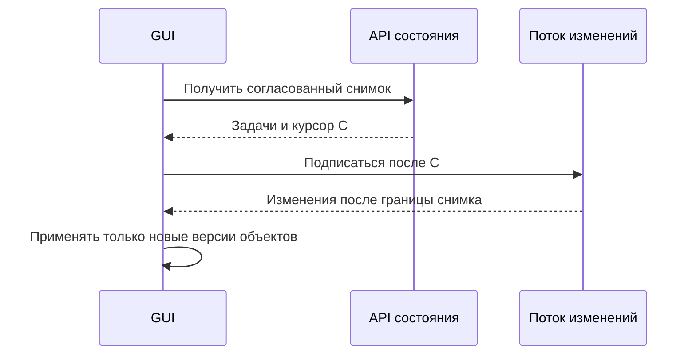

Курсор должен действительно обозначать согласованную границу: все изменения до неё отражены в снимке, а более поздние доступны в потоке. Произвольная временная метка рядом со списком этого свойства не обеспечивает.

Модель чтения списка и последующего наблюдения с версией используется, например, в [Kubernetes API][list-watch]. Здесь заимствуется принцип согласованной границы, а не требование использовать Kubernetes или повторять его протокол.

### Для локальной программы возможен более простой механизм 🏠

Если нет сохраняемого журнала событий, можно сначала установить подписку с подтверждённой готовностью и начать буферизацию, затем получить снимок, после чего применить накопленные обновления по версиям.

Такой вариант требует ясных условий: подписка уже активна до начала чтения, изменения не теряются без уведомления, а переполнение буфера приводит к повторной синхронизации. Если эти условия не выполнены, остаётся механизм сверки состояния, а не доказанная непрерывность доставки.

Для нескольких страниц списка нужна отдельная политика согласованности. Постраничный ответ, прочитанный в разные моменты времени, не обязательно является одним целостным снимком. При необходимости используется курсор снимка, согласованная выборка или повторная сверка.

### Удаления и изменение прав тоже относятся к состоянию 🧹

Полные снимки отдельных объектов не решают проблему исчезнувшего объекта: о нём больше не придёт новое содержимое. Поэтому поток должен передавать удаление или иной сигнал исключения, а полная синхронизация списка — удалять отсутствующие записи из локальной проекции.

Аналогично при отзыве доступа GUI должен убрать недоступные данные. Это не обязательно изменение самой задачи. Удобно отделять версии ресурсов от версии видимости или политики доступа и при её изменении пересинхронизировать представление.

### Медленный подписчик не должен останавливать работу приложения 🚦

Прогресс может приходить значительно чаще, чем интерфейс способен его рисовать. Для промежуточных снимков допустимо объединение: сохранить последний прогресс задачи и отбросить устаревшие промежуточные значения.

Но объединение прогресса нельзя механически применять к журналу аудита или к обязательным переходам процесса. Для каждого канала определяется собственная политика: какие сообщения допускается объединять, как ограничивается буфер и как обнаруживается потеря непрерывности.

> [!warning] Версия объекта, курсор потока и время события решают разные задачи
> Версия помогает выбрать более новое состояние одного объекта. Курсор помогает продолжить конкретный поток. Время удобно человеку и диагностике. Подмена одного другим создаёт ошибки порядка и восстановления.

---

## 11. GUI как проекция прикладного состояния 🖥️

Графический интерфейс должен отображать данные приложения, а не только собственные прошлые действия. Если карточка задачи создаётся исключительно внутри обработчика кнопки «Экспорт», работа, начатая агентом, останется невидимой.

Правильная точка создания карточек — обновление списка задач. GUI получает состояние независимо от инициатора, преобразует его в модель представления и отображает.

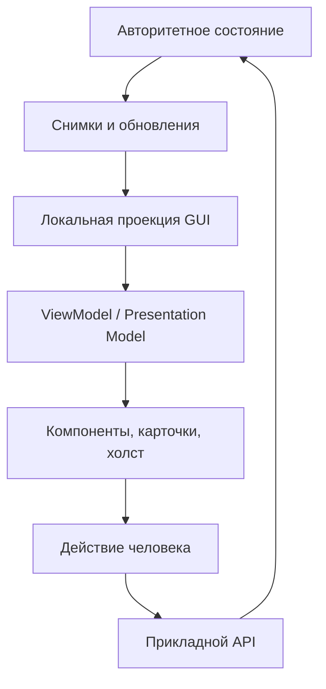

Отдельное представление состояния без зависимости от конкретных GUI-контролов соответствует [Presentation Model][presentation-model]. Для React это может быть хранилище и селекторы, для desktop-фреймворка — Presenter или ViewModel. Название механизма менее важно, чем направление данных.

### Проекция, ViewModel и локальное состояние интерфейса 🪟

У этих объектов разные обязанности.

**Проекция** хранит известные клиенту данные: задачи по идентификаторам, версии документов, доступные артефакты. Её можно восстановить из API.

**ViewModel** преобразует факты в представление: название карточки, текст этапа, вид индикатора, доступные действия.

**Локальное состояние GUI** хранит выбор вкладки, фильтр списка, раскрытые панели и ожидание ответа на нажатую кнопку. Оно не обязано существовать у агента или на сервере.

```text
JobSnapshot
    job_id = job-42
    status = running
    phase = rendering
    progress = 18 из 40 страниц

JobCardViewModel
    title = Экспорт документа
    subtitle = Обработано 18 из 40 страниц
    indicator = determinate
    fraction = 0.45

LocalViewState
    selected_job = job-42
    cancel_request_pending = false
```

Поле `cancel_request_pending` говорит, что окно отправило запрос и ждёт ответа. Оно не доказывает, что задача уже перешла в `cancelling`.

### Пример обработки снимка 📥

```text
apply_job_snapshot(incoming):
    previous = jobs[incoming.job_id]

    if previous exists and incoming.revision <= previous.revision:
        return

    jobs[incoming.job_id] = immutable_copy(incoming)
    notify_view_that_job_changed(incoming.job_id)
```

Это только обработка полного снимка одной задачи. Отдельно обрабатываются курсор потока, удаление, смена поколения сессии и изменение видимости. Уведомление с прежней версией задачи, но новыми правами клиента нельзя бездумно потерять из-за фильтра версии. Поэтому клиентские разрешённые действия лучше передавать отдельной политикой или отдельной версией представления.

### Потеря связи — не ошибка задачи 📶

У GUI полезно иметь два независимых состояния: состояние работы и состояние наблюдения.

```text
Состояние задачи: running, последнее подтверждение версии 12.
Состояние соединения: disconnected.
```

Такой экран должен сообщать «Связь потеряна; последнее известное состояние — выполняется», а не «Задача завершилась ошибкой». Неизвестность наблюдателя не является фактом о сервере.

По той же причине после нажатия «Стоп» можно сразу показать локальное ожидание, но нельзя объявлять задачу отменённой до подтверждения владельца состояния.

### Доступность кнопки не заменяет проверку на сервере 🛡️

GUI может скрывать или отключать отмену, исходя из состояния задачи и полученных возможностей. Это улучшает взаимодействие. Но право отмены проверяется повторно в прикладном API: состояние могло измениться между рисованием кнопки и нажатием.

Карточка не должна самостоятельно решать, кому разрешено остановить чужую задачу. Она лишь отображает результат соответствующей политики.

### Агент меняет содержимое, но не обязан забирать фокус 🎯

Обновление документа не требует переключать вкладку человека. Состояние просмотра может принадлежать конкретному участнику. Режим «следовать за агентом» реализуется как явная политика представления, а не как скрытый побочный эффект каждой команды.

Это позволяет одновременно иметь общую модель документа и разные локальные рабочие контексты. Человек наблюдает изменения, но не теряет управление интерфейсом при каждом действии автоматизации.

---

## 12. Длительное выполнение: Job, Attempt и Artifact ⏳

Короткая команда и длительная работа имеют разные жизненные циклы. `page.rename` может завершиться внутри одного вызова. Экспорт большого документа удобнее представить отдельной задачей.

Модель [Asynchronous Request–Reply][async-request-reply] разделяет принятие работы и получение её результата. Прикладной `Job` воплощает это разделение независимо от того, используется ли HTTP, локальный сокет или прямой вызов.

### Три сущности, которые не стоит склеивать 🧩

| Сущность | Смысл | Что происходит при повторе |
|---|---|---|
| **Job** | Логическая работа, принятая приложением | Может сохранять один идентификатор |
| **Attempt** | Конкретная попытка выполнить работу | Получает новый идентификатор и собственные технические сведения |
| **Artifact** | Подготовленный или опубликованный результат | Имеет собственные правила доступа, хранения и удаления |

Одна задача может пережить неудачную попытку и быть выполнена повторно. При этом запоздавшее сообщение старого исполнителя не должно переписать результат новой попытки. Поэтому менеджер связывает отчёты с актуальным `attempt_id`, а не только с `job_id`.

Ссылка на результат также не должна быть случайным временным путём внутри рабочего процесса. Контракт артефакта определяет идентификатор, доступность, срок хранения и способ получения. Временный подготовленный файл ещё не обязательно является опубликованным результатом.

### Запуск возвращает принятие, а не готовый экспорт 📬

```json
{
  "operation": "document.export.start",
  "request_id": "req-export-201",
  "arguments": {
    "document_id": "doc-17",
    "expected_revision": 28,
    "format": "pdf"
  }
}
```

```json
{
  "request_id": "req-export-201",
  "outcome": "accepted",
  "job": {
    "job_id": "job-42",
    "revision": 1,
    "state": {
      "status": "queued"
    },
    "source_revision": 28
  }
}
```

PDF в примере — выбранный формат экспорта. Конкретный механизм рендеринга остаётся за инфраструктурным адаптером и не меняет контракт управления задачей.

В принятой модели до ответа уже подготовлен доступный исполнителю снимок версии 28 и зарегистрирована задача. Если постановка в очередь не удалась, нельзя возвращать уверенное `accepted` без механизма, который гарантирует её последующий запуск или отражает отказ в состоянии.

### Состояния лучше описывать как варианты, а не набор флагов 🔄

```text
JobState =
    Queued
  | Running(phase, progress)
  | Cancelling(phase, progress, cancellation_requested_at)
  | Succeeded(result)
  | Failed(error, partial_artifacts)
  | Cancelled(reason, partial_artifacts)
```

В такой модели у успешного состояния обязателен результат, а у ошибки — описание. Не требуется угадывать смысл сочетания `is_done=true`, `is_running=true`, `error=null`.

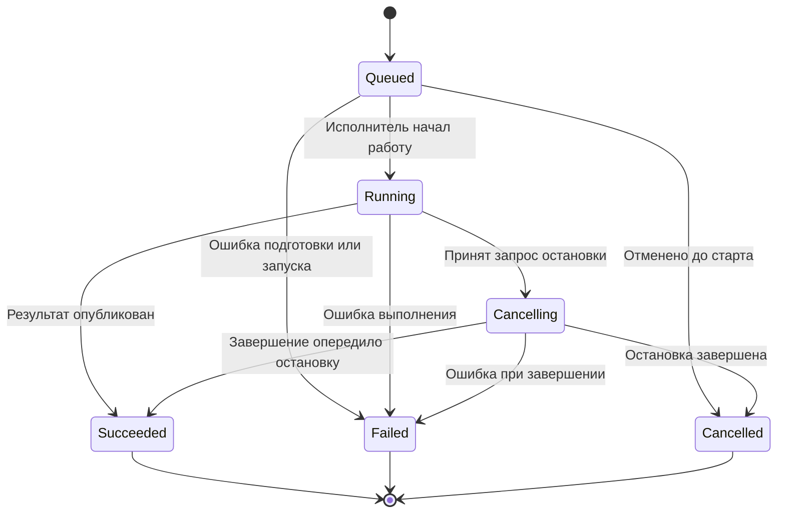

Это базовая учебная модель. Для восстановления после падения может понадобиться дополнительное состояние проверки или прерывания. Потеря исполнителя сама по себе не доказывает отсутствие побочных эффектов: восстановление должно выяснить, что было подготовлено или опубликовано.

Схема данных проверяет допустимость отдельного состояния. Допустимость перехода проверяет менеджер задач. Валидный объект `Running` ещё не означает, что его разрешено поставить после `Succeeded`.

### Прогресс нуждается в собственной семантике 📊

Значение `0.45` полезно только тогда, когда понятно, доля чего измеряется. Количество обработанных страниц не равно доле общего времени: одна страница может быть намного сложнее другой.

Удобно различать неопределённый прогресс, счётчик единиц и расчётную долю. Если число единиц известно, можно показывать «18 из 40 страниц». Если библиотека сообщает только этап — «Подготовка», «Рендеринг», «Публикация».

Приложение также должно определить, какие единицы считаются завершёнными. Подготовленная, но ещё не опубликованная страница и окончательно доступный результат — разные факты. Полоса прогресса не должна объявлять успех раньше выполнения постусловий задачи.

### Повтор попытки не равен возврату задачи в прошлое 🔁

Технический сбой исполнителя может привести к новой попытке внутри той же логической задачи. Политика задаёт допустимые ошибки, число попыток, задержку и проверку уже созданных эффектов.

Если же человек сознательно запускает новую работу с изменёнными параметрами, это обычно новая задача, а не скрытая подмена старой. История должна сохранять различие между повтором исполнения и новым намерением.

---

## 13. Исполнители и управляющий канал 🧵

Менеджер задач отвечает за жизненный цикл. Исполнитель выполняет конкретную работу. Это разделение особенно важно для GUI и остановки: управляющая часть должна оставаться доступной, пока обработка занята.

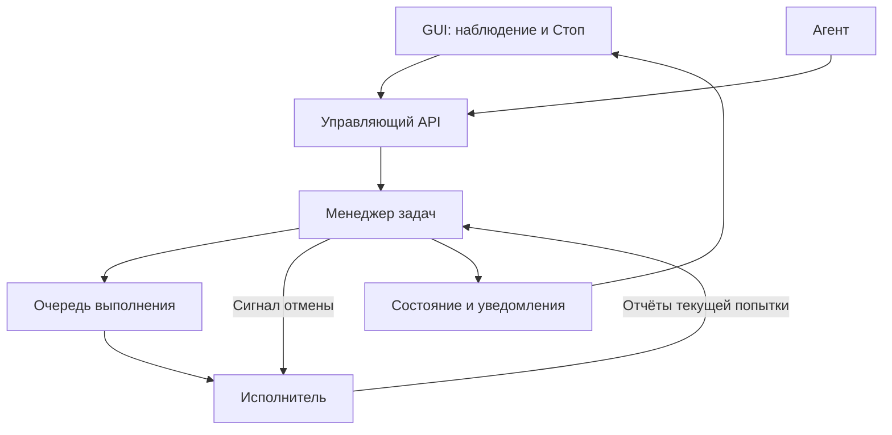

*Стрелка отмены обозначает независимую возможность управления. Это не обязательно отдельный сетевой канал, но она не должна ждать за всей очередью тяжёлой работы.*

### Исполнитель сообщает факты, но не владеет всем приложением 🧰

Внутренний контракт может выглядеть так:

```text
run_export(plan, execution_context) -> PreparedArtifact

execution_context:
    job_id
    attempt_id
    cancellation_signal
    progress_reporter
    execution_deadline
```

Исполнитель не получает графическое окно и не меняет карточку. Он также не обязан иметь универсальный доступ к реестру команд. Чем уже его полномочия и входной план, тем проще контролировать последствия.

Для отдельного рабочего процесса этот контекст собирается локально из сообщений и разрешённых ресурсов. Живой объект токена отмены или открытый дескриптор нельзя считать переносимым JSON-полем.

### Асинхронный метод не означает неблокирующее вычисление ⚡

`async` и `Promise` описывают способ ожидания, а не автоматически переносят тяжёлый код на другой процессор. Конкретная среда определяет, какие операции уже выполняются асинхронно, а какие требуют отдельного исполнителя.

Например, документация [Node.js Worker Threads][node-workers] связывает их применение прежде всего с CPU-нагруженным JavaScript, а не с обычным асинхронным вводом-выводом. В [Qt][qt-threads] GUI-объекты должны обслуживаться главным потоком, а результаты рабочих вычислений передаются туда подходящим механизмом.

Архитектурный вывод не зависит от языка: управление задачами и обновление экрана не должны блокироваться на длительном непрерываемом вычислении.

### Отмена должна иметь путь к выполняющейся работе 🛤️

Если в единственную последовательную очередь отправляются сначала «экспортировать весь документ», затем «остановить экспорт», второй запрос будет обработан слишком поздно. Менеджер должен иметь возможность установить сигнал отмены, не ожидая завершения основного действия.

Аналогично нельзя удерживать общий замок состояния задач на всё время работы экспортёра. Короткие переходы состояния защищаются отдельно; длительная обработка выполняется вне этой критической секции.

### Параллелизм требует ограничений, а не только запусков 🚦

Агент способен быстро отправить много корректных запросов. Без лимитов приложение может исчерпать память или заполнить очередь настолько, что управление потеряет отзывчивость.

Поэтому планировщик определяет пределы активных задач, объём ожидающей работы и распределение ресурсов. При насыщении API может вернуть понятный отказ или явно поставить задачу в очередь. Оно не должно молча обещать немедленное выполнение.

Для нескольких клиентов полезны ограничения на сессию и рабочее пространство. Эти механизмы остаются прикладной политикой исполнения, а не свойством MCP или GUI.

### Старый исполнитель не должен публиковать новый итог 🪪

Если задача была переназначена после сбоя, старый процесс иногда всё ещё способен закончить работу. Проверка `attempt_id` позволяет отклонить его запоздавший отчёт.

Но отклонить отчёт недостаточно, если процесс уже самовольно записал результат в общий целевой файл. Для защиты публикация должна проходить через контролируемую точку с проверкой актуальной попытки либо использовать иной механизм ограничения устаревшего исполнителя. Отсюда полезность разделения подготовки артефакта и его окончательной публикации.

---

## 14. Остановка, Undo и блокировка агентной сессии 🛑

Кнопка «Стоп» — внешнее представление прикладного управляющего сценария. Её корректность определяется не анимацией и не наличием метода `cancel`, а тем, какие действия обязаны выполнить менеджер и исполнитель.

[Кооперативная отмена][cancellation] разделяет отправку запроса и реакцию работающей операции. Поэтому подтверждение запроса не должно выдаваться за уже завершённую остановку.

### Контракт запроса остановки 📜

```text
CancelJobRequest
    job_id
    reason

CancelDecision =
    Requested(job_snapshot)
  | AlreadyFinished(job_snapshot)
  | NotSupported(explanation)
  | TooLate(job_snapshot)
```

Отказ по правам возвращается общим механизмом ошибок. Решение `Requested` означает, что намерение остановки принято по правилам системы. Окончательный исход остаётся в состоянии задачи.

`TooLate` может использоваться, если приложение явно выделяет необратимую завершающую фазу. Если такой фазы нет в контракте, не следует придумывать её только ради удобного объяснения отсутствующей отмены.

### Полный путь от кнопки до факта остановки 🎬

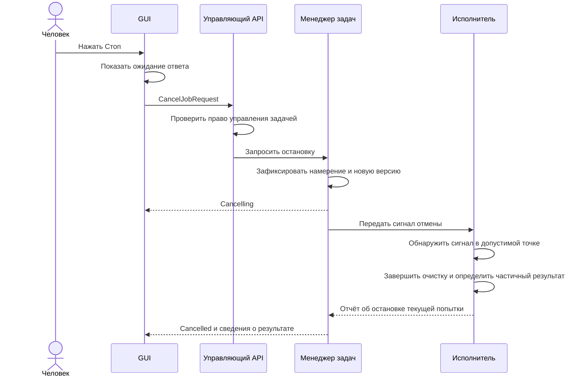

После фиксации намерения менеджер должен обеспечить его передачу исполнителю. Для восстанавливаемой системы одного временного вызова callback недостаточно: после перезапуска намерение не должно потеряться. Возможны повторная доставка сигнала, проверка сохранённого флага на контрольных точках или иной явно выбранный механизм.

### Гонка между отменой и завершением неизбежна без дополнительной гарантии 🏁

Человек нажал кнопку, когда последняя операция уже закончилась, но GUI ещё не получил событие. Либо исполнитель прошёл последнюю точку проверки отмены и начал непрерываемую публикацию.

В обычной кооперативной модели итогом может стать `succeeded`, даже если перед этим было принято намерение отмены. Если продукт обещает более сильное правило — «после подтверждения остановки никакой новый результат не будет опубликован» — необходима дополнительная координация отмены с точкой публикации.

Например, менеджер сериализует выдачу разрешения на публикацию и приём отмены. До выдачи разрешения отмена блокирует публикацию; после него API честно сообщает, что завершающий участок уже начался. Это отдельная гарантия, а не бесплатное свойство токена отмены.

### Точка фиксации делает границу последствий видимой 📍

У экспорта полезно различать подготовку, создание временного результата и окончательную публикацию. До публикации временные данные можно удалить без изменения уже существующего результата. После неё требуется отдельное действие восстановления или удаления.

При этом атомарная замена одного файла не образует транзакцию сразу для БД, нескольких файлов и внешнего сервиса. Если контракт охватывает несколько ресурсов, приложение отдельно определяет частичный успех и восстановление.

| Механизм | Основная цель | Обычный результат |
|---|---|---|
| **Cancellation** | Прекратить дальнейшее выполнение | Завершение задачи с известными оставшимися эффектами |
| **Undo** | Отменить предусмотренное изменение модели | Новое изменение, восстанавливающее определённый предыдущий смысл |
| **Rollback** | Отменить незавершённую транзакцию | Отсутствие зафиксированных изменений в её границе |
| **Compensation** | Исправить уже состоявшиеся внешние эффекты | Отдельные обратные действия, которые тоже могут завершиться ошибкой |

Сложность компенсации, включая учёт чужих последующих изменений, рассматривается в [Compensating Transaction][compensation]. Для совместного редактора это особенно важно: восстановление старого снимка целиком может стереть правки человека, сделанные после действий агента.

### Остановленная задача не означает остановленного агента 🤖

Агент может отправить новый запрос после отмены старого. Поэтому административное управление сессией — самостоятельный контракт:

```text
suspend_agent_session(session_id, policy) -> SessionControlResult
```

Возможная политика запрещает новые изменяющие запросы, снимает ещё не начатые задачи и запрашивает остановку активных. Проверка допуска выполняется не только при приёме, но и перед выдачей ожидающей работы исполнителю. Для длинных задач могут понадобиться дополнительные контрольные точки полномочий.

Необходимо определить судьбу уже выполняющихся коротких операций. Если нужна строгая граница «после подтверждения блокировки новые изменения этой сессии не фиксируются», проверка допуска должна быть согласована с фиксацией изменений. Простого флага в GUI недостаточно.

Такое ограничение действует внутри приложения. Оно не выключает внешнюю модель и не лишает агентную среду независимого доступа к терминалу или файловой системе. Отдельные разрешения среды запуска требуют отдельного контроля.

> [!warning] «Стоп» ограничивает будущее, а не переписывает прошлое
> Контракт должен явно сообщать, какие результаты сохранены, какие временные данные удалены и какие эффекты требуют отдельного восстановления. Статус `cancelled` не должен подразумевать «ничего никогда не происходило».

---

## 15. Ошибки и неопределённый результат 🌫️

Единый прикладной API нужен не только для одинакового успеха, но и для одинакового смысла отказов. Клиенты не должны распознавать причины по случайным строкам исключений.

При этом все неудачные ситуации нельзя свести к одному `error: true`. Существенно, на каком этапе возникла проблема и что известно о последствиях.

| Ситуация | Что известно | Подходящее поведение клиента |
|---|---|---|
| Неверная структура запроса | Сценарий не начался | Исправить параметры |
| Нет права на ресурс | Операция не разрешена | Не пытаться обходить ограничение |
| Конфликт версии | Данное изменение не принято | Перечитать состояние и заново оценить намерение |
| Задача принята, затем упала | Работа могла частично выполниться | Прочитать её итог и сведения об артефактах |
| Ответ потерян после отправки | Клиент не знает исход | Проверить состояние операции, не повторять вслепую |
| Ошибка сериализации после записи | Эффект мог быть зафиксирован | Обработать как технический сбой с возможным состоявшимся изменением |

### Ошибка должна иметь машинный смысл 🧾

```json
{
  "request_id": "req-104",
  "outcome": "rejected",
  "error": {
    "code": "REVISION_CONFLICT",
    "message": "Документ изменился после чтения состояния",
    "details": {
      "expected_revision": 28,
      "current_revision": 29
    },
    "recovery": "read_latest_state",
    "diagnostic_id": "diag-51"
  }
}
```

Такой ответ подходит для определённого отказа до фиксации данного изменения. Он не должен использоваться для неопределённого исхода после разрыва связи.

Поле `message` предназначено для объяснения. Решения клиента опираются на стабильный `code` и документированную семантику. Дополнительные сведения возвращаются только в пределах допустимого раскрытия данных.

Для HTTP существует стандарт [Problem Details, RFC 9457][problem-details]. Он может быть выбран внешним адаптером вместо самостоятельного формата HTTP-ошибок. Но ядро приложения не обязано зависеть от HTTP, а приведённый JSON не объявляется реализацией этого RFC.

### Флаг retryable часто слишком груб 🔁

Временная ошибка соединения может исчезнуть при повторе. Но повтор изменяющей операции способен создать дубликат. Следовательно, «причина временная» и «повтор безопасен» — разные свойства.

Более полезный контракт описывает стратегию восстановления: перечитать ресурс, проверить статус операции, повторить с тем же ключом идемпотентности, дождаться указанного условия или запросить решение человека.

Клиент не должен самовольно менять параметры, лишь бы добиться формального успеха. Например, конфликт версии не означает разрешения убрать `expected_revision` и перезаписать всё без проверки.

### Неопределённость — состояние наблюдателя 🌁

У клиента может возникнуть локальное состояние `outcome_unknown`: запрос отправлен, подтверждение не получено. Это не обязательно состояние серверной задачи.

Владелец документа мог успешно применить переименование. GUI другого участника уже видит новое имя. Только вызывающая сторона потеряла ответ. Поэтому восстановление должно обращаться к авторитетному состоянию или записи операции, а не превращать сетевой сбой в предметный откат.

### Ошибки подписчиков не отменяют состоявшееся действие 📣

Если после фиксации документа один обработчик GUI-уведомления упал, недопустимо делать вид, будто само переименование не состоялось. Изоляция ошибок подписчиков — часть контракта публикации.

Система может повторить уведомление, пометить подписчика неисправным или инициировать пересинхронизацию. Но результат изменения документа и результат доставки в конкретное окно должны оставаться различимыми.

---

## 16. Повторные вызовы, идемпотентность и пакетные операции 🔁

Повторы возникают не только из-за ошибок агента. Их создают тайм-ауты, повторное нажатие, автоматическая логика клиента и повторная доставка сообщений. Архитектура должна исходить из того, что один смысловой запрос способен поступить несколько раз.

Идемпотентность относится к предусмотренному эффекту повторных обращений, а не к обязательному совпадению текста ответов. Общее определение приведено в [RFC 9110][http-semantics]. Команда «установить имя X» может иметь идемпотентный эффект, но повтор с устаревшей ожидаемой версией всё равно законно получит другой ответ.

### Идентификаторы имеют разные обязанности 🪪

| Идентификатор | Назначение |
|---|---|
| `request_id` | Связать конкретное обращение, ответ и диагностику |
| `idempotency_key` | Распознать повтор одного намерения в заданной области и сроке |
| `job_id` | Адресовать логическую длительную работу |
| `attempt_id` | Различать попытки выполнения одной задачи |
| `event_id` | Различать сообщения |
| `revision` | Определять версию одного ресурса |
| `stream_cursor` | Продолжать конкретный поток изменений |

Использование одного UUID сразу во всех ролях иногда кажется удобным, но смешивает жизненные циклы. Новый сетевой запрос может повторять старое намерение и ссылаться на ту же задачу; это не одно и то же событие.

### Ключ работает только вместе с хранилищем и правилами 🗄️

Для команды запуска экспорта возможна такая логика:

```text
область ключа = инициатор + рабочее пространство + операция + версия
значение записи = отпечаток нормализованных аргументов + состояние + результат
```

При первом запросе приложение регистрирует ключ и создаёт задачу. Повтор с тем же ключом и теми же параметрами возвращает прежний `job_id`. Тот же ключ с другими параметрами считается конфликтом намерения.

Запись ключа и создание задачи должны быть согласованы атомарно в пределах доступного хранилища. Иначе два одновременных повтора оба увидят отсутствие записи и создадут две задачи. Если эффект находится во внешней системе, одной локальной таблицы уже недостаточно для универсальной гарантии.

Такие вопросы — клиентский идентификатор намерения, атомарность регистрации и конфликт разных параметров — подробно рассматриваются в [AWS Builders’ Library][idempotency].

### Авторизация сохраняется и при воспроизведении результата 🔐

Повторный запрос не должен получать ранее сохранённый результат в обход актуальной проверки доступа. Ключ не становится паролем к чужой операции. Область хранения учитывает инициатора и ресурс, а возвращаемые сведения фильтруются по действующим правилам.

Также определяются срок хранения ключа и поведение после его истечения. Если запись удалена, сервер не должен обещать распознавание бесконечно позднего повтора. Клиенту полезно знать, когда требуется сверка состояния вместо повторного запуска.

### Exactly-once нельзя вывести из одного поля ✨

Ключ идемпотентности может предотвратить повторное создание задачи. Он не доказывает однократность всех внешних эффектов исполнителя. Например, задача могла отправить результат во внешний сервис, после чего завершиться аварийно до фиксации подтверждения.

Сильные гарантии требуют согласования на границе самого эффекта: поддержки идемпотентности внешней стороной, атомарной публикации, проверки уже созданного артефакта или специальной процедуры восстановления. Корректный контракт описывает конкретно обеспечиваемую гарантию, а не обещает «ровно один раз» для всего мира.

### Batch — ещё не транзакция 📦

У пакетного вызова может быть несколько разных смыслов.

| Вид пакета | Гарантия | Возможный частичный результат |
|---|---|---|
| **Транспортный пакет** | Несколько обращений переданы вместе | Да; каждое действие независимо |
| **Прикладная последовательность** | Порядок и остановка при ошибке определены | Да, если не оговорено иное |
| **Атомарное изменение документа** | Либо весь набор применён к одной модели, либо ничего | Нет внутри этой границы |
| **Группа Undo** | Изменения объединены для пользовательской отмены | Зависит от реализации; это не обещание атомарности внешних эффектов |

В примере атомарного изменения документа все элементы сначала проверяются, затем применяются к допустимому состоянию и фиксируются одним решением. Если пакет затрагивает файлы и внешние сервисы, его атомарность нельзя получить только оборачиванием массива в `batch`.

Ожидание ответа языковой модели между шагами не должно удерживать долгую транзакцию документа. Агент формирует намерение вне критической секции, а приложение проверяет и применяет его в ограниченной по времени операции.

---

## 17. Авторизация и подтверждение опасных действий 🛡️

Command-first делает действия доступнее программам. Поэтому граница безопасности должна совпадать с настоящей границей изменения ресурсов, а не существовать только в интерфейсе подтверждения.

Основные принципы — минимальные полномочия, запрет по умолчанию и проверка доступа на каждом соответствующем обращении — описаны в [OWASP Authorization][authorization]. В предлагаемой архитектуре они выражаются прикладной политикой, общей для GUI, CLI и MCP.

### Структура валидна, действие всё ещё может быть запрещено 🚧

Корректный `document_id` не доказывает владение документом. Значение `source: gui` не доказывает участие человека. Доступ к чтению задачи не обязательно означает право остановить её. Возможность увидеть результат не обязательно разрешает записать его в произвольный каталог.

Поэтому проверяются как тип действия, так и конкретные ресурсы. Для долгих операций отдельно определяется, сохраняются ли выданные полномочия на весь срок работы или требуется повторная проверка на важных этапах. Оба варианта допустимы при явной модели делегирования; случайное сохранение полного пользовательского контекста в очереди — нет.

### Подтверждение должно относиться к конкретному плану 📝

Для разрушительных операций полезен двухэтапный сценарий:

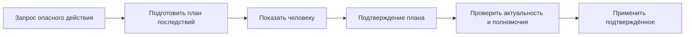

План связывается с набором ресурсов, параметрами, версиями и сроком действия. Если после подтверждения агент меняет список удаляемых объектов, прежнее разрешение не должно автоматически распространяться на новый запрос.

Поле `approved: true`, самостоятельно переданное клиентом, не является подтверждением доверенной стороны. Доказательство одобрения хранится или проверяется в приложении и относится именно к согласованному плану.

### Прикладные ограничения не равны изоляции процесса 🧱

Если плагин выполняет произвольный код в том же процессе и имеет прямой доступ к файлам, один Command Registry не превращается в песочницу. Если внешний агент может менять данные через терминал, блокировка MCP-инструмента не блокирует этот независимый путь.

В зависимости от угроз могут понадобиться ограничения операционной системы, отдельный процесс, узкий интерфейс файлового доступа или запуск с ограниченными полномочиями. Это другой уровень защиты, дополняющий прикладной контракт.

Ограничения путей также требуют реализации, а не только поля `allowed_root`. Путь должен интерпретироваться на стороне владельца файлов, с учётом реального механизма доступа. Между предварительной проверкой и использованием ресурс способен измениться, поэтому модель не должна обещать безопасность только на основании строкового сравнения префиксов.

### Содержимое документов остаётся данными 📄

Документ, название файла или комментарий может содержать текст, похожий на инструкцию. Прикладной API не должен трактовать такой текст как право расширить полномочия, отключить подтверждение или изменить внутреннюю политику.

GUI также отображает названия и сообщения безопасным для выбранного фреймворка способом. Данные результата не должны незаметно превращаться в исполняемый HTML, командную строку или код.

### Наблюдение тоже имеет границу доступа 👀

Общая шина событий не означает общий доступ ко всем событиям. Подписка фильтруется по полномочиям. Сведения о чужих документах, путях и задачах не должны утекать через панель активности даже тогда, когда прямой запрос чтения был бы запрещён.

При отзыве доступа подписка прекращается или меняет видимую область, а клиент очищает недоступную проекцию. Именно поэтому управление видимостью рассматривается отдельно от версии содержимого документа.

---

## 18. Локальный вызов, IPC и MCP без смешения уровней 🌐

Прикладной контракт и транспортный протокол отвечают на разные вопросы. Первый определяет смысл операции. Второй доставляет запросы и ответы, задаёт их оболочку, правила соединения и протокольные ошибки.

### Одна семантика, разные физические пути 🔌

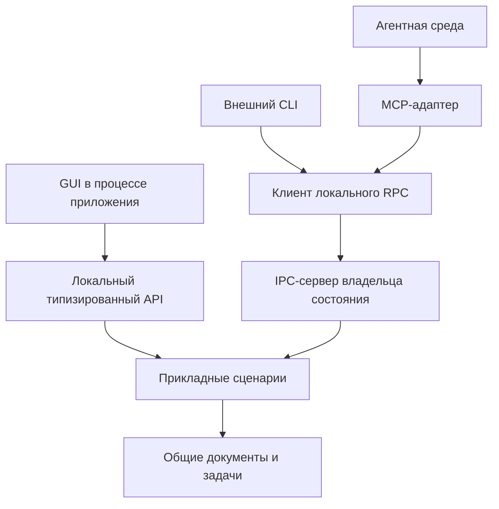

Вариант показан для общей рабочей сессии. Headless-клиент может создавать собственное ядро вместо подключения к текущему владельцу. Но это уже другая сессия, и её состояние не обязано автоматически появляться в открытом GUI.

### Удалённый прокси не делает сеть локальной функцией 📡

Один интерфейс клиента удобен, но он не должен скрывать реальные отличия. У IPC-вызова есть сериализация, размер сообщения, задержка, тайм-аут и возможность неизвестного исхода. Локальный метод может вернуть результат напрямую; удалённому клиенту понадобится запрос состояния.

Поэтому общий API сохраняет смысл операции, но не обещает одинаковое время выполнения и одинаковый класс всех технических ошибок. Клиентское представление транспортных сбоев отделяется от предметных отказов.

Открытое соединение также не обязано определять время жизни задачи. После получения `JobAccepted` работа принадлежит приложению и управляется по `job_id`, если контракт прямо не устанавливает другую политику.

### MCP предоставляет инструменты, а не заменяет прикладной слой 🤖

В [MCP Tools][mcp-tools] инструмент имеет имя, описание и схемы данных; протокол задаёт его обнаружение и вызов. Адаптер сопоставляет такой вызов с прикладным обработчиком и преобразует результат в протокольный ответ.

Ошибки протокола, ошибки выполнения инструмента и состояние фоновой работы различаются. Завершившийся вызов инструмента запуска может корректно вернуть принятый `job_id`, хотя сама задача продолжает выполняться. Не следует кодировать весь жизненный цикл приложения исключительно состоянием одного сетевого обращения.

### Отмена MCP-запроса и отмена прикладной задачи не тождественны 🛑

В спецификации MCP `2026-07-28` [отмена запроса][mcp-cancellation] зависит в том числе от транспорта. Для Streamable HTTP закрытие соответствующего потока ответа рассматривается как сигнал отмены этого запроса; для stdio используется уведомление. Поэтому утверждение «отключение клиента никогда ничего не отменяет» было бы неверным для всех интеграций сразу.

Однако запрос запуска, который уже вернул подтверждение, и созданная им прикладная задача — разные сущности. Для управления задачей через GUI или другое соединение нужен её собственный контракт отмены. Сопоставление протокольной отмены с прикладной политикой определяется адаптером явно.

Официальное [расширение MCP Tasks][mcp-tasks] предоставляет отдельные дескрипторы длительных операций, опрос состояния и отмену. Его поддержка и семантика согласуются участниками интеграции. Внутренний `Job` при этом полезно сохранять самостоятельным: он доступен не только MCP, но и GUI, CLI и тестам.

### Сессия приложения не обязана совпадать с сессией транспорта 🪪

Документная сессия, административная сессия агента и конкретное соединение имеют разные назначения. Переподключение не должно случайно создавать новый документ или обнулять запрет на дальнейшие действия агента.

Идентичность прикладной сессии связывается с доверенным контекстом и собственной политикой жизненного цикла. Она не выводится из произвольного идентификатора JSON-запроса.

> [!info] Версионная граница
> Сведения о MCP в статье привязаны к проверенной спецификации `2026-07-28` и странице расширения Tasks на 23 октября 2026 года. Поддержка конкретного SDK или клиента проверяется отдельно. Универсальные DTO редактора не объявляются сообщениями этой спецификации.

---

## 19. Типизация контрактов: общий принцип, Python и TypeScript 🐍

Типизация полезна на двух разных уровнях. Статический анализ проверяет, как собственный код соединяет компоненты. Проверка во время выполнения проверяет фактически пришедшие данные.

Аннотации Python не обеспечивают автоматическую проверку всех значений во время выполнения; это прямо указано в [документации `typing`][python-typing]. Типовые конструкции TypeScript также не превращаются в runtime-валидатор: компиляция удаляет типовые аннотации, что объясняется в [TypeScript Handbook][ts-basics].

Следовательно, ни `Protocol`, ни `interface` не заменяют проверку JSON, а runtime-схема не заменяет корректную типизацию внутренних вызовов.

### Архитектурные роли важнее названий библиотек 🧰

| Роль | Python | TypeScript / JavaScript |
|---|---|---|
| Проверка внешнего DTO | Pydantic-модель | Zod-схема или другой runtime-валидатор |
| Внутреннее значение | `dataclass`, обычный класс, неизменяемая структура | Объект, `type`, `interface`, неизменяемая структура |
| Поведенческий порт | `Protocol` или абстрактный класс | `interface` или тип функций |
| Разные состояния | Объединение типов с `Literal` | Discriminated union |
| Разные виды идентификаторов | `NewType` или отдельный тип значения | Branded type или отдельный тип значения |
| Проверка полноты обработки | `assert_never` и анализатор типов | `never` и проверка исчерпывающего `switch` |
| Внешняя схема | Генерация JSON Schema | Генерация JSON Schema или schema-first |

`NewType` и branded type помогают не перепутать идентификаторы в собственном коде. Они не доказывают существование ресурса и не являются механизмом авторизации.

### Python: явный DTO и небольшой поведенческий порт 🐍

Следующий пример рассчитан на Python 3.11+ и Pydantic v2. Он описывает контракт, но не реализует сам редактор.

```python
from dataclasses import dataclass
from math import isfinite
from typing import Annotated, Protocol

from pydantic import BaseModel, BeforeValidator, ConfigDict, Field


MAX_JSON_REVISION = 2**53 - 1


def parse_json_integer(value: object) -> int:
    # JSON-число 28.0 допускается как целое значение.
    # Строка "28" и логическое true числом версии не считаются.
    if type(value) is int:
        return value
    if type(value) is float and isfinite(value) and value.is_integer():
        return int(value)
    raise ValueError("Expected an integer-valued JSON number")


Revision = Annotated[
    int,
    BeforeValidator(parse_json_integer),
    Field(ge=0, le=MAX_JSON_REVISION),
]
NonEmptyText = Annotated[str, Field(min_length=1)]


class DTO(BaseModel):
    model_config = ConfigDict(
        strict=True,
        extra="forbid",
        frozen=True,
    )


class RenamePageRequest(DTO):
    document_id: NonEmptyText
    page_id: NonEmptyText
    expected_revision: Revision
    new_name: NonEmptyText


class RenamePageResult(DTO):
    document_id: NonEmptyText
    page_id: NonEmptyText
    name: NonEmptyText
    revision: Revision
    changed: bool


@dataclass(frozen=True, slots=True)
class RequestContext:
    principal_id: str
    session_id: str
    request_id: str


class DocumentApplication(Protocol):
    def rename_page(
        self,
        request: RenamePageRequest,
        context: RequestContext,
    ) -> RenamePageResult:
        ...
```

Проверка поступивших данных выполняется через `RenamePageRequest.model_validate(...)` или `model_validate_json(...)`. Схема формируется через `model_json_schema()`. Возможности моделей, сериализации и управления неизвестными полями описаны в [Pydantic Models][pydantic-models], а предварительная обработка значения — в [Pydantic Validators][pydantic-validators].

Небольшой числовой валидатор нужен здесь для согласованности с выбранной JSON-семантикой: целое значение допускается независимо от записи `28` или `28.0`, но строки и логические значения отвергаются. В другой политике контракт может требовать иной формат. Существенно не получить разные правила случайно из настроек двух библиотек.

`RequestContext` создаётся доверенной частью приложения. Его `dataclass` не выполняет аутентификацию. Метод `rename_page` описывает серверную прикладную границу; внешний клиент не получает права формировать произвольную доверенную личность.

### TypeScript: схема как источник статического типа 📐

Аналогичный входной контракт на Zod 4:

```typescript
import * as z from "zod";

const NonEmptyText = z.string().min(1);
const Revision = z.number()
  .int()
  .min(0)
  .max(Number.MAX_SAFE_INTEGER);

export const RenamePageRequestSchema = z.strictObject({
  document_id: NonEmptyText,
  page_id: NonEmptyText,
  expected_revision: Revision,
  new_name: NonEmptyText,
});

export const RenamePageResultSchema = z.strictObject({
  document_id: NonEmptyText,
  page_id: NonEmptyText,
  name: NonEmptyText,
  revision: Revision,
  changed: z.boolean(),
});

export type RenamePageRequest =
  z.output<typeof RenamePageRequestSchema>;

export type RenamePageResult =
  z.output<typeof RenamePageResultSchema>;

export type RequestContext = Readonly<{
  principal_id: string;
  session_id: string;
  request_id: string;
}>;

export interface DocumentApplication {
  renamePage(
    request: RenamePageRequest,
    context: RequestContext,
  ): Promise<RenamePageResult>;
}
```

Внешнее значение принимается как `unknown` и проверяется вызовом `RenamePageRequestSchema.parse(payload)`. Утверждение `payload as RenamePageRequest` не выполняет такой проверки. Конструирование схем и строгих объектов описано в [Zod API][zod-api].

Здесь `Promise` отражает асинхронный способ получения результата выбранного интерфейса. Он не означает автоматического переноса бизнес-логики в рабочий поток. Синхронное локальное ядро может использовать другую сигнатуру, если адаптер сохраняет корректную семантику ожидания.

### Типизированный реестр не обязан распространять словари по ядру 🗂️

TypeScript позволяет выразить связь между именем операции и её типами:

```typescript
type Commands = {
  "page.rename": {
    input: RenamePageRequest;
    output: RenamePageResult;
  };
  "page.get": {
    input: { document_id: string; page_id: string };
    output: { page_id: string; name: string; revision: number };
  };
};

interface CommandGateway {
  execute<K extends keyof Commands>(
    name: K,
    input: Commands[K]["input"],
  ): Promise<Commands[K]["output"]>;
}
```

Это статическая связь для собственного кода. Строка, пришедшая по IPC, всё ещё требует проверки имени, версии, параметров и полномочий. Приведение произвольной строки к `keyof Commands` не превращает её в разрешённую операцию.

В Python ту же практическую цель часто проще достичь явными методами сервиса и типизированными обработчиками. Динамический реестр остаётся на внешней границе, а не заставляет все внутренние функции принимать `dict[str, Any]`.

### Состояния должны сужать допустимые данные 🔄

Для Job полезно использовать дискриминатор `status`. Вариант `Succeeded` требует результата, `Failed` — ошибки, `Running` — сведений о текущем исполнении. Pydantic поддерживает [discriminated unions][pydantic-unions], а TypeScript — [сужение типов по дискриминатору и проверку через `never`][ts-narrowing].

Но эти механизмы не проверяют последовательность переходов. Два отдельных снимка могут быть корректны по схеме, а переход между ними — запрещён. Поэтому типы вариантов и автомат состояний решают разные задачи.

### Генерация схем полезна, но её границы нужно проверять 🧾

В Zod 4 предусмотрено преобразование через `z.toJSONSchema()`. При этом не все типы и преобразования имеют представление в JSON Schema; ограничения перечислены в [документации преобразования][zod-json-schema]. Аналогично произвольная функция проверки на стороне приложения не становится автоматически переносимым правилом.

Если используются Python и TypeScript одновременно, практический контракт закрепляется общим набором примеров: допустимых, недопустимых и пограничных. Проверяются неизвестные поля, числа, `null`, пропущенные значения, нормализация строк и единицы измерения длины. Входной тип до заполнения defaults может отличаться от типа после проверки.

`frozen` и `readonly` также не следует объявлять универсальной глубокой неизменяемостью. Вложенные коллекции и реальные возможности языка требуют отдельного внимания. В показанном DTO поля примитивные, поэтому этот риск ограничен; для дерева документа он существенно важнее.

### Язык не меняет границу GUI 🖥️

В React внешнее состояние может подключаться через [useSyncExternalStore][react-store], который требует корректной подписки и стабильного снимка при отсутствии изменений. В Qt используются подходящие межпоточные сигналы и модели представления. В Electron между renderer и привилегированной частью нужен ограниченный мост: [Context Isolation][electron-isolation] не заменяется общим TypeScript-интерфейсом.

Таким образом, типы облегчают реализацию, но архитектурный маршрут остаётся прежним: входной контракт → прикладной сценарий → авторитетное состояние → проекция → представление.

---

## 20. Эволюция контрактов и совместимость 🧬

После появления скриптов, агентов и независимых клиентов прикладной API становится интерфейсом, который нельзя менять только по состоянию текущего GUI. Новый клиент и старое приложение либо старый клиент и новое приложение могут встретиться в реальной эксплуатации.

Совместимость определяется не только набором полей. Изменение значения по умолчанию или условий успеха способно сломать сценарий, хотя JSON остаётся формально валидным.

| Изменение | Возможный риск |
|---|---|
| Переименование обязательного поля | Старый клиент перестанет вызывать операцию |
| Добавление обязательного параметра | Прежний запрос станет неполным |
| Изменение значения по умолчанию | Прежний запрос начнёт делать другое |
| Новое поле ответа | Строгий старый декодер может его отвергнуть |
| Новое значение `status` | Исчерпывающий обработчик клиента не знает нового состояния |
| Новый код ошибки | Старый клиент должен иметь безопасную неизвестную ветвь |
| Изменение смысла `accepted` | Клиент может ошибочно считать работу устойчиво сохранённой |
| Изменение единицы прогресса | GUI начнёт показывать неверные значения |

### Строгий ввод и расширяемый вывод требуют осознанной политики ⚖️

Запрет неизвестных аргументов хорошо обнаруживает опечатки клиента. Но тот же запрет на каждом старом клиенте при чтении ответа затрудняет добавление новых полей.

Возможные решения — согласованное обновление компонентов, явные версии, разрешённые расширения или более терпимое чтение несущественных полей. При этом неизвестный статус нельзя бездумно считать успехом, а неизвестное ограничение безопасности — игнорировать.

Показанные выше строгие схемы подходят для учебного контракта и совместно обновляемых компонентов. Независимое версионирование клиентов требует дополнительной политики совместимости.

### Версия контракта не равна версии записи в БД 🗄️

У системы могут независимо существовать версия операции, версия события, версия формата сохранённой задачи и номер ревизии конкретного документа.

Переход с `page.rename` v1 на v2 не обязан менять версию каждого документа. Миграция внутренней таблицы не должна автоматически менять публичный DTO. И `revision: 29` не сообщает, какая схема используется для декодирования сообщения.

Ясное разделение этих чисел предотвращает ситуацию, когда клиент пытается интерпретировать версию данных как номер API.

### Описание возможностей лучше случайных пробных вызовов 🧭

При необходимости клиент может получать каталог операций и поддерживаемых версий. Этот каталог помогает выбрать доступный контракт, но не заменяет проверку конкретного вызова: полномочия и состояние способны измениться.

Для нестандартных возможностей вроде остановки на определённом этапе полезнее явная информация, чем попытка угадать поддержку по имени приложения. Однако метаданные `supports_cancel` не являются обещанием мгновенной отмены; точная семантика остаётся в контракте выполнения.

### Общие контрольные примеры удерживают смысл 🧪

Для каждого публичного сообщения сохраняются образцы корректных данных, ожидаемых отказов и пограничных случаев. Их проверяют все реализации валидатора и адаптера.

Это особенно полезно при генерации типов. Сгенерированный код может успешно компилироваться, но иначе обрабатывать пропущенное поле или значение по умолчанию. Контрольные примеры проверяют наблюдаемое поведение, а не только совпадение названий типов.

---

## 21. Сборка, тестирование и наблюдаемость 🧪

Архитектурные границы становятся полезными, когда их можно проверить. Иначе через несколько изменений GUI снова начинает напрямую обращаться к репозиторию, а MCP — создавать собственный менеджер задач.

### Структура проекта должна показывать смысл модулей 📁

Один из вариантов организации не привязан к расширениям файлов:

```text
application/
├── documents/
│   ├── contracts        # Запросы и результаты сценариев документа
│   ├── handlers         # Прикладные операции
│   ├── model            # Документ, страницы и правила
│   └── ports            # Потребности во внешних возможностях
│
├── jobs/
│   ├── contracts        # Снимки, решения об отмене, сообщения
│   ├── lifecycle        # Допустимые переходы
│   ├── manager          # Владелец состояния задач
│   └── ports            # Исполнение, хранение, публикация
│
├── adapters/
│   ├── cli
│   ├── mcp
│   ├── ipc
│   └── persistence
│
├── presentation/
│   ├── projections
│   ├── view_models
│   └── views
│
└── bootstrap            # Сборка зависимостей и время жизни ресурсов
```

Такое деление по функциональным модулям может быть удобнее одной огромной папки `services`. При этом порты и DTO остаются лёгкими: импорт контрактов в GUI не должен случайно загружать БД, экспортёр и сервер.

Это не обязательная структура для маленькой программы. Устойчивость обеспечивается правилами импортов и сценариев, а не количеством директорий.

### Время жизни ресурсов входит в архитектуру 🔋

Точка сборки определяет, кто создаёт и закрывает соединения, рабочие пулы, подписки и локальный сервер. Подписка должна иметь способ завершения. Закрытие окна не должно оставлять случайные обработчики, продолжающие обращаться к уничтоженным виджетам.

При завершении приложения полезно отдельно прекратить приём новых задач, решить судьбу текущих, завершить управляющие каналы и освободить ресурсы. Если работа должна продолжаться после закрытия GUI, она должна принадлежать процессу или сервису с подходящим временем жизни.

Ни один `async`-метод не делает эту политику автоматической. Время жизни задачи — свойство приложения, а не случайное следствие того, осталась ли открытой вкладка.

### Тесты распределяются по границам 🔬

| Уровень | Что проверяет | Что не доказывает |
|---|---|---|
| **Предметные тесты** | Правила имён, принадлежность страниц, корректность модели | Доставку через IPC |
| **Тесты сценариев** | Полномочия, порядок действий, результаты и отказы | Надёжность конкретной БД |
| **Контрактные тесты** | Схемы, совместимость, ошибки, типы сообщений | Правильность всего пользовательского сценария |
| **Тесты хранилища** | Условную запись, транзакцию, конкуренцию | Корректное отображение карточки |
| **Тесты жизненного цикла** | Переходы задач, отмену и повтор попытки | Работу внешнего кодека во всех режимах |
| **Тесты проекции** | Старые версии, повторы, удаления, переподключение | Реальную безопасность процесса |
| **Интеграционные тесты** | Связь адаптера, ядра и зависимостей | Качество решения, принятого языковой моделью |
| **Сквозные GUI-тесты** | Видимость работы и доступность управления | Все внутренние варианты отказа |

Fake-репозиторий полезен для сценария, но может случайно скрывать настоящую гонку. Поэтому атомарная проверка версии отдельно испытывается на реальном хранилище. Аналогично тест события в памяти не доказывает правильность восстановления IPC-подписки.

### Самые ценные проверки — на границах успеха и сбоя 🧨

Для предлагаемой системы особенно полезны следующие контрольные ситуации:

| Ситуация | Ожидаемая гарантия |
|---|---|
| Два изменения одной версии приходят одновременно | Не происходит незаметной потери одного изменения |
| Ответ теряется после фиксации | Повтор не создаёт неконтролируемый дубликат |
| GUI открывается после старта задачи | Задача появляется из снимка состояния |
| Событие версии 11 приходит после версии 12 | Карточка не возвращается в прошлое |
| Последнее уведомление потеряно | Пересинхронизация восстанавливает итог |
| Остановка приходит до старта исполнителя | Задача не начинает работу вопреки принятой отмене |
| Остановка конкурирует с публикацией | Итог соответствует документированной границе фиксации |
| Старый исполнитель присылает успех | Не перезаписывается результат актуальной попытки |
| Подписчик падает после изменения документа | Состоявшаяся операция не объявляется неприменённой |
| Сессия агента заблокирована, очередь ещё содержит задания | Новые запуски этой сессии обрабатываются по политике блокировки |
| Полномочия отозваны при открытом GUI | Недоступные данные не остаются бесконтрольно наблюдаемыми |
| Валидатор пропустил семантически неверное имя | Предметная модель всё равно отвергает недопустимое изменение |

Такие тесты проверяют архитектурные обещания непосредственно. Они важнее поверхностного теста «вызван метод `execute`».

### Наблюдаемость связывает компоненты, но не заменяет состояние 📈

Для диагностики полезно связывать запрос, задачу, попытку, событие и артефакт. При этом диагностическая корреляция не равна идемпотентности и не является доказательством полномочий.

[OpenTelemetry Context Propagation][telemetry] описывает передачу контекста для связывания трасс, метрик и журналов. В небольшой программе аналогичную практическую задачу могут решить структурированные записи с идентификаторами, без развёртывания сложной платформы наблюдаемости.

Наблюдаемость должна отвечать на конкретные вопросы: где запрос был принят, какая версия изменена, какая попытка выполняется, дошёл ли сигнал остановки, опубликован ли результат. Бесконтрольная запись полных документов и всех промежуточных данных увеличивает риск утечек и затрудняет поиск полезной информации.

Панель задач читает прикладное состояние, а не парсит текстовые логи. Журнал помогает объяснить причины; он не должен быть единственным местом, где существует факт завершения работы.

---

## 22. Целостная модель: от намерения до видимого результата 🧩

После разделения компонентов целую систему полезно снова собрать вокруг одного сценария. В учебном редакторе агент переименовывает страницу и запускает экспорт документа. Человек наблюдает работу и при необходимости останавливает её.

### Короткое изменение проходит через общую границу 📝

Агент получает снимок документа и формирует `RenamePageRequest` с явными идентификаторами и версией. Адаптер валидирует сообщение, устанавливает доверенный контекст и вызывает прикладной обработчик.

Обработчик проверяет полномочия и предметные правила. Изменение применяется с проверкой версии. После фиксации возвращается результат, а подписчики получают сведения об обновлении. GUI меняет строку страницы независимо от того, какой клиент был инициатором.

Если версия устарела, приложение не пытается угадать намерение. Оно возвращает конфликт, позволяющий перечитать состояние. Успешное выполнение контракта не подменяется попыткой обязательно добиться видимого изменения любой ценой.

### Длительная работа получает собственную жизнь ⏳

При запуске экспорта приложение фиксирует источник: снимок определённой версии документа. Оно создаёт задачу и возвращает `JobAccepted`. Карточка появляется из общего состояния задач, а не из специальной «агентной анимации».

Исполнитель получает ограниченный план, сообщает прогресс и готовит артефакт. Менеджер задач проверяет сообщения актуальной попытки и публикует новые версии состояния. GUI преобразует их в текст этапа, индикатор и доступные действия.

Человек может изменить другой участок документа. Это не меняет молча уже зафиксированный источник экспорта. Связь результата с исходной версией остаётся проверяемой.

### Вмешательство человека использует тот же прикладной язык 🛑

Кнопка «Стоп» отправляет `CancelJobRequest`. Приложение проверяет право управления и фиксирует намерение. Исполнитель реагирует в допустимой точке. Итог показывает, что остановлено и какие результаты остались.

Если человек блокирует сессию агента, это отдельная операция допуска. Она не выдаёт себя за Undo и не обещает остановить внешнюю модель вне границ приложения.

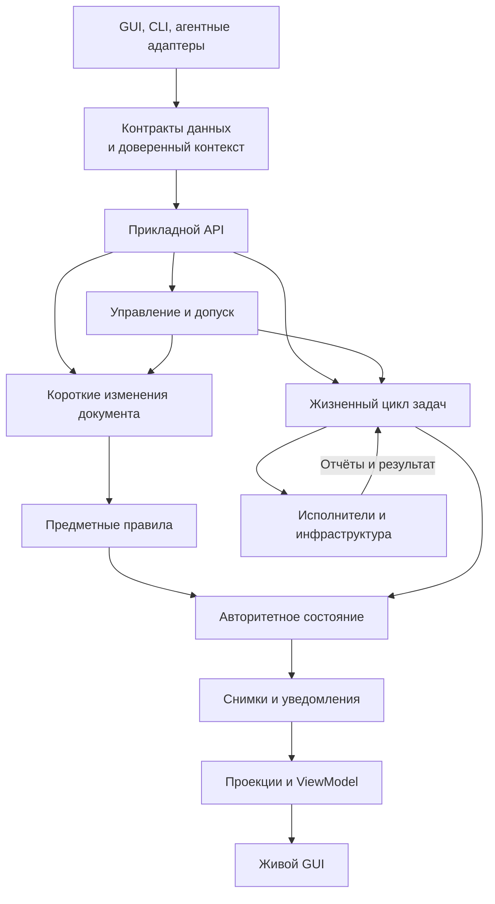

*Схема показывает обязанности и поток информации. Она не предписывает отдельный класс или процесс для каждого прямоугольника.*

### Компактная карта основных контрактов 🗺️

| Граница | Контракт данных | Контракт поведения |
|---|---|---|
| Внешний клиент → адаптер | Сообщение выбранного протокола | Разбор, ограничения, аутентификация |
| Адаптер → приложение | DTO запроса и доверенный контекст | Выполнить допустимый сценарий |
| Приложение → модель | Предметное намерение | Сохранить инварианты |
| Приложение → хранилище | Модель, ожидаемая версия | Согласованно зафиксировать изменение |
| Менеджер → исполнитель | План и контекст попытки | Выполнить работу с заданными ограничениями |
| Исполнитель → менеджер | Прогресс, результат, отказ | Сообщать факты актуального исполнения |
| Владелец → наблюдатель | Снимки и события | Предоставить оговорённую свежесть и восстановление |
| Проекция → GUI | ViewModel | Отобразить известное состояние без присвоения роли владельца |
| GUI → управление | Запрос отмены или подтверждение | Обработать вмешательство с проверкой полномочий |

### Что остаётся неизменным при выборе стека 🧭

Python, TypeScript, Rust или другой язык меняют средства выражения контрактов. Desktop, браузер или локальный сервис меняют размещение компонентов. Но вопросы остаются прежними: кто владеет состоянием, где проходит граница доверия, что означает ответ и как восстанавливается наблюдение после сбоя.

Наличие типизированного API не требует универсального диспетчера. Наличие событий не требует Event Sourcing. Наличие менеджера задач не требует микросервисов. Наличие живого GUI не требует имитации мыши.

При этом отказ от лишней инфраструктуры не означает отказа от семантики. Даже компактный сервис должен ясно определять результат, ошибку, повтор и последствия остановки, если эти возможности обещаны пользователю.

> [!summary] Архитектурное ядро
> Операции выражают намерения. Прикладной слой применяет полномочия и организует сценарий. Предметная модель сохраняет правила. Владелец состояния определяет факты. Исполнители выполняют работу в заданных границах. Снимки и события делают эти факты наблюдаемыми. GUI отображает их и передаёт решения человека. DTO и поведенческие интерфейсы связывают компоненты, не смешивая их обязанности.

### Переход к вариациям архитектуры 📘

Следующая статья рассматривает, какая часть этой системы действительно необходима разным приложениям: простой утилите, очереди обработки, интерактивному редактору и процессу с восстановлением после сбоев. Основной критерий выбора — требуемые гарантии, а не желание реализовать все рассмотренные механизмы одновременно.

[Вернуться к статье 01 — «Command-first: приложение как программируемая система»](01_Command_First_Introduction.md).

---

## Источники и границы применимости 🔗

Текст объединяет общие архитектурные принципы, авторскую модель учебного редактора и сведения из первичной документации. Контракты `page.rename`, `JobSnapshot`, `CancelDecision` и другие примеры являются самостоятельными иллюстрациями. Они не приписываются конкретному открытому проекту.

**Дата проверки источников: 23 октября 2026 года.** Документация библиотек по адресам `latest` может изменяться. Примеры Python используют API Pydantic v2, примеры TypeScript — Zod 4. Они показывают границы и типизацию, а не составляют готовое приложение: хранение, политика доступа, транспорт и исполнитель подключаются отдельными реализациями.

### Архитектурная основа 🧱

| Первичный источник | Связанный вопрос |
|---|---|
| [Alistair Cockburn — Hexagonal Architecture][ports] | Независимость приложения от устройств ввода, GUI и технических адаптеров |
| [Randy Stafford — Service Layer][service-layer] | Общая граница прикладных операций |
| [Martin Fowler — Data Transfer Object][dto] | Представление данных на границах обмена |
| [Martin Fowler — Unit of Work][unit-of-work] | Координация изменений и фиксации |
| [Martin Fowler — What do you mean by “Event-Driven”?][event-driven] | Различие уведомлений, переноса состояния и Event Sourcing |
| [Martin Fowler — Presentation Model][presentation-model] | Независимое от виджетов представление состояния |

### Выполнение, согласованность и безопасность ⚙️

| Первичный источник | Связанный вопрос |
|---|---|
| [IETF — RFC 9110, HTTP Semantics][http-semantics] | Идемпотентность, условные запросы и конкурентные изменения |
| [IETF — RFC 9457, Problem Details][problem-details] | Машиночитаемые ошибки HTTP API |
| [IETF — RFC 8259, JSON][json-rfc] | Формат обмена и числовая совместимость |
| [AWS Builders’ Library — Making retries safe with idempotent APIs][idempotency] | Идентичность намерения и безопасные повторы |
| [AWS — Transactional Outbox][outbox] | Согласование записи состояния и отправки сообщения |
| [Microsoft — Asynchronous Request–Reply][async-request-reply] | Принятие работы отдельно от окончательного результата |
| [Microsoft — Cancellation in Managed Threads][cancellation] | Кооперативный характер отмены |
| [Microsoft — Compensating Transaction][compensation] | Восстановление уже состоявшихся последствий |
| [Kubernetes — API Concepts][list-watch] | Согласованные списки, версии и наблюдение за изменениями |
| [OWASP — Authorization Cheat Sheet][authorization] | Полномочия, запрет по умолчанию, проверка каждого обращения |
| [OpenTelemetry — Context Propagation][telemetry] | Связывание наблюдаемых действий через границы компонентов |

### Схемы, типизация и представление 🧬

| Первичный источник | Связанный вопрос |
|---|---|
| [JSON Schema — Object][json-object] | Свойства, обязательные поля и неизвестные параметры |
| [JSON Schema — Annotations][json-annotations] | Отличие `default` от автоматического заполнения |
| [Python — typing][python-typing] | Статическая типизация, Protocol, NewType и ограничения runtime-проверок |
| [Pydantic — Models][pydantic-models] | DTO, сериализация и настройки моделей |
| [Pydantic — Validators][pydantic-validators] | Явная проверка и преобразование входных значений |
| [Pydantic — Unions][pydantic-unions] | Дискриминированные варианты состояния |
| [TypeScript — The Basics][ts-basics] | Отделение статических типов от выполнения |
| [TypeScript — Narrowing][ts-narrowing] | Сужение объединений и `never` |
| [Zod — Defining Schemas][zod-api] | Runtime-схемы и вывод типов |
| [Zod — JSON Schema][zod-json-schema] | Генерация схем и её ограничения |
| [React — useSyncExternalStore][react-store] | Подписка GUI на внешнее хранилище |
| [Qt — Threads and QObjects][qt-threads] | Разделение GUI-потока и рабочей обработки |
| [Node.js — Worker Threads][node-workers] | CPU-нагруженное исполнение вне основного JavaScript-потока |
| [Electron — Context Isolation][electron-isolation] | Ограниченный мост между renderer и привилегированной частью |

### Агентный протокол 🤖

| Первичный источник | Связанный вопрос |
|---|---|
| [MCP 2026-07-28 — Tools][mcp-tools] | Схемы инструментов, результаты и роль адаптера |
| [MCP 2026-07-28 — Cancellation][mcp-cancellation] | Отмена запросов и различия транспортов |
| [MCP — Tasks extension][mcp-tasks] | Отдельный протокольный жизненный цикл длительных операций |

[ports]: https://alistair.cockburn.us/hexagonal-architecture
[service-layer]: https://martinfowler.com/eaaCatalog/serviceLayer.html
[dto]: https://martinfowler.com/eaaCatalog/dataTransferObject.html
[unit-of-work]: https://martinfowler.com/eaaCatalog/unitOfWork.html
[event-driven]: https://martinfowler.com/articles/201701-event-driven.html
[presentation-model]: https://martinfowler.com/eaaDev/PresentationModel.html
[http-semantics]: https://www.rfc-editor.org/rfc/rfc9110.html
[problem-details]: https://www.rfc-editor.org/rfc/rfc9457.html
[json-rfc]: https://www.rfc-editor.org/rfc/rfc8259.html
[idempotency]: https://aws.amazon.com/builders-library/making-retries-safe-with-idempotent-APIs/
[outbox]: https://docs.aws.amazon.com/prescriptive-guidance/latest/cloud-design-patterns/transactional-outbox.html
[async-request-reply]: https://learn.microsoft.com/en-us/azure/architecture/patterns/asynchronous-request-reply
[cancellation]: https://learn.microsoft.com/en-us/dotnet/standard/threading/cancellation-in-managed-threads
[compensation]: https://learn.microsoft.com/en-us/azure/architecture/patterns/compensating-transaction
[list-watch]: https://kubernetes.io/docs/reference/using-api/api-concepts/
[authorization]: https://cheatsheetseries.owasp.org/cheatsheets/Authorization_Cheat_Sheet.html
[telemetry]: https://opentelemetry.io/docs/concepts/context-propagation/
[json-object]: https://json-schema.org/understanding-json-schema/reference/object
[json-annotations]: https://json-schema.org/understanding-json-schema/reference/annotations
[python-typing]: https://docs.python.org/3/library/typing.html
[pydantic-models]: https://docs.pydantic.dev/latest/concepts/models/
[pydantic-validators]: https://docs.pydantic.dev/latest/concepts/validators/
[pydantic-unions]: https://docs.pydantic.dev/latest/concepts/unions/
[ts-basics]: https://www.typescriptlang.org/docs/handbook/2/basic-types.html
[ts-narrowing]: https://www.typescriptlang.org/docs/handbook/2/narrowing.html
[zod-api]: https://zod.dev/api
[zod-json-schema]: https://zod.dev/json-schema
[react-store]: https://react.dev/reference/react/useSyncExternalStore
[qt-threads]: https://doc.qt.io/qt-6/threads-qobject.html
[node-workers]: https://nodejs.org/api/worker_threads.html
[electron-isolation]: https://www.electronjs.org/docs/latest/tutorial/context-isolation
[mcp-tools]: https://modelcontextprotocol.io/specification/2026-07-28/server/tools
[mcp-cancellation]: https://modelcontextprotocol.io/specification/2026-07-28/basic/patterns/cancellation
[mcp-tasks]: https://modelcontextprotocol.io/extensions/tasks/overview
