## 03 — Вариации command-first: выбор архитектуры по требованиям и гарантиям 🧭

*Как определить достаточную архитектуру приложения: от небольшого общего ядра до очереди задач, совместного редактора и восстанавливаемого процесса. Где нужны новые подсистемы, где достаточно хорошего контракта и как сохранить контроль человека над действиями агента.*

Две программы могут иметь одинаковую кнопку «Запустить», но совершенно разные архитектурные обязанности. Первая обрабатывает один файл и возвращает результат. Вторая принимает длительную работу, переживает закрытие окна, допускает подключение нескольких клиентов, сохраняет промежуточные результаты и обязана корректно остановиться по решению человека.

Внешне различие невелико. Внутри это разные обещания.

Именно обещания определяют необходимую архитектуру. Количество команд, экранов и классов лишь косвенно связано со сложностью. Небольшая программа с необратимой публикацией во внешней системе иногда требует более строгих механизмов, чем большой редактор с множеством независимых операций над локальными данными.

В [первой статье](01_Command_First_Introduction.md) рассматривалось, почему приложению полезен собственный программный язык операций. [Вторая статья](02_Command_First_Architecture_and_Contracts.md) описывала внутренние механизмы: слои, DTO, порты, состояние, задачи, события и управление исполнением. Этот материал отвечает на следующий вопрос: **какие из этих механизмов необходимы конкретному приложению, а какие пока не окупают своей сложности**.

> [!abstract] Основная мысль
> Хорошая архитектура — не максимальное число защитных механизмов и не минимальное число файлов. Это достаточная система границ и гарантий. Она умеет делать обещанное, честно обозначает ограничения и не заставляет простую операцию проходить через инфраструктуру, предназначенную для совершенно другой задачи.

### Место материала в серии 📚

| Материал | Его задача |
|---|---|
| [01. Знакомство](01_Command_First_Introduction.md) | Объяснить принцип общего прикладного API и отличие программного управления от имитации GUI |
| [02. Архитектура и контракты](02_Command_First_Architecture_and_Contracts.md) | Разобрать устройство отдельных механизмов и границы ответственности |
| **03. Вариации архитектуры** | Связать требования с выбором механизмов, их стоимостью и ограничениями |
| **04. Практическое приложение** | Спроектировать конкретный конвертер изображений на основе отдельного набора требований |
| **00. README** | Объединить готовую серию в навигационную карту; формируется последним |

Статья не привязана к языку, GUI-фреймворку или поставщику моделей. Примеры относятся к условной файловой утилите, системе индексирования, редактору документов и процессу подготовки публикаций. Они нужны для сравнения решений, а не задают заранее реализацию будущего практического проекта.

Обозначения профилей **A–D**, паспорта гарантий и примеры контрактов — учебная классификация этой серии. Это не отраслевой стандарт, не шкала качества и не обязательная последовательность развития продукта.

### Карта чтения 🗺️

> [!info] Маршруты по материалу
> **Выбор основы:** [[#1. Сложность определяется обещаниями, а не числом команд 📏|Требования]] → [[#2. Слои, модули и процессы: три разные карты 🧱|Границы]] → [[#3. Четыре архитектурных профиля, а не четыре ступени зрелости 🧩|Профили A–D]].
>
> **Варианты приложения:** [[#5. Профиль A: прикладной сервис без самостоятельной системы задач 🔧|Простая утилита]] · [[#6. Профиль B: задачи, очередь и общий контроль выполнения ⚙️|Управляемые задачи]] · [[#7. Сохраняемая очередь: важный промежуточный вариант 💾|Восстановление очереди]] · [[#8. Профиль C: интерактивная рабочая сессия и общий документ 🎨|Редактор]] · [[#9. Профиль D: устойчивый процесс с этапами и ожиданиями 🏗️|Длительный процесс]].
>
> **Размещение и управление:** [[#11. Где живёт приложение: окно, локальный сервис или сервер 🏠|Топология]] · [[#13. Живой GUI: сколько инфраструктуры действительно нужно 👀|Наблюдение]] · [[#14. Кнопка «Стоп»: выбор силы гарантии 🛑|Отмена]] · [[#15. Остановить задачу, пакет или агентную сессию — разные решения 🤖|Область управления]].
>
> **Практика выбора:** [[#21. Матрица выбора: требование → механизм → цена 🗺️|Матрица]] · [[#22. Четыре разобранных архитектурных решения 🔬|Сценарии]] · [[#23. Эволюция без полного переписывания 🌱|Переходы]] · [[#25. Паспорт архитектуры и записи решений 📓|Документирование]].

---

## 1. Сложность определяется обещаниями, а не числом команд 📏

Количество функций плохо подходит для выбора архитектуры. Сто независимых преобразований, каждое из которых получает входной файл и создаёт новый выходной файл, могут использовать один небольшой прикладной сервис. Десять операций над общей несохранённой моделью с одновременным участием человека и агента потребуют согласования состояния и правил истории.

Различие становится ещё заметнее, если добавить сбои. Утилита может честно предлагать повторить работу после перезапуска. Другая система обязана восстановить выполнение, не потерять подтверждение человека и не повторить внешнюю публикацию. Её сложность определяется не вычислением как таковым, а последствиями неопределённого исхода.

### Полезные оси сложности 🧭

| Ось | Более простое требование | Более сильное требование |
|---|---|---|
| **Время жизни работы** | Завершить действие в текущем экземпляре | Продолжить после закрытия окна или перезапуска |
| **Состояние** | Независимые вход и выход | Общий документ с несохранёнными изменениями |
| **Количество участников** | Один инициатор без конкурирующих изменений | Человек, агент и другие клиенты работают одновременно |
| **Обратимость** | Новый файл можно удалить | Уже изменены чужие данные или внешний сервис |
| **Наблюдение** | Показать текущий прогресс | Восстановить состояние после позднего подключения |
| **Управление** | Запросить остановку текущего действия | Заблокировать целую сессию и ограничить новые эффекты |
| **Доверие** | Известные внутренние клиенты | Внешние агенты, плагины и разные полномочия |
| **Нагрузка** | Небольшое число ожидаемых операций | Всплески запросов и конкуренция за ограниченные ресурсы |
| **Изменения продукта** | Все компоненты обновляются вместе | Независимые клиенты и долго живущие задания |

Эти оси независимы. Локальный редактор может быть сложным по модели документа, но не нуждаться в распределённом выполнении. Сервер преобразования файлов может иметь простую предметную логику, но сложное управление нагрузкой и восстановлением.

Поэтому фраза «сложное приложение» нуждается в уточнении: **сложное по состоянию, по длительности работы, по последствиям, по взаимодействию участников или по эксплуатации**.

### Требование должно описывать наблюдаемое поведение 🔍

«Нужна современная архитектура» не позволяет выбрать решение. «GUI должен показать задачу, которую агент запустил до открытия окна» — позволяет. Из второго требования следуют общий владелец задач, запрос актуального состояния и определённое время жизни записи.

«Нужна отмена» также недостаточно. Возможны разные условия: прекратить ожидание ответа, не запускать следующие элементы пакета, остановиться после текущего файла или запретить публикацию любого нового результата после подтверждения остановки. Для каждого условия требуется своя реализация.

Хорошее требование связывает ситуацию, действие и проверяемый итог. Например: после блокировки агентной сессии приложение отвергает её новые изменяющие запросы; уже выполняющиеся задачи обрабатываются по отдельно описанной политике. Здесь можно проверить и допуск, и границу обещания.

### Стоимость ошибки иногда важнее длительности ⏱️

Действие, выполняющееся мгновенно, может быть опаснее длительного вычисления. Удаление коллекции документов не становится безопасным от отсутствия очереди. Напротив, у человека может вообще не быть времени нажать «Стоп».

Для таких операций полезнее предварительный план и подтверждение, чем сложная система фоновых задач. Длительная работа нуждается в наблюдении и остановке. Необратимая работа — в ограничении полномочий и контроле точки применения. Система, в которой присутствуют оба свойства, нуждается в обоих механизмах.

> [!important] Простота не отменяет контракта
> Даже небольшой сервис должен определять, что он меняет, когда сообщает успех и что остаётся после ошибки. Упрощать можно инфраструктуру и количество модулей, но не смысл уже обещанного поведения.

---

## 2. Слои, модули и процессы: три разные карты 🧱

Архитектурные схемы часто смешивают разные вопросы. На одном рисунке оказываются GUI, бизнес-логика, очередь, база данных и рабочий процесс. Возникает впечатление, что каждое название означает очередной слой, а каждое усложнение требует нового этажа.

Полезнее отдельно рассматривать **ответственности**, **функциональные модули** и **физическое размещение**.

### Слои описывают ответственность и зависимости 📐

В принятой в этой серии раскладке небольшой программе достаточно трёх логических областей: адаптеров, прикладной логики и инфраструктуры. При появлении самостоятельной предметной модели последняя выделяется из прикладных сценариев в четвёртую область.

| Область | Основная обязанность | Возможное физическое выражение |
|---|---|---|
| **Представление и входные адаптеры** | Принять намерение, отобразить состояние | GUI, CLI, MCP-обёртка, обработчик IPC |
| **Прикладная логика** | Организовать сценарии и управлять их выполнением | Методы сервиса, обработчики команд, менеджер задач |
| **Предметная модель** | Сохранять правила и корректность предметных объектов | Документ, страницы, связи и допустимые изменения |
| **Инфраструктура** | Реализовать технические механизмы | Файлы, БД, кодеки, транспорт, исполнительная среда |

Три или четыре — не норматив. Другой способ группировки может отдельно показать представление и входные адаптеры. Существенно, чтобы правила документа не зависели от кнопок, а выполнение операции не требовало конкретной оболочки. Эта независимость соответствует исходной идее [Ports and Adapters][ports].

Контракты находятся **на границах**, а не образуют обязательный дополнительный слой исполнения. Модуль с DTO ничего не обрабатывает только потому, что через его типы разговаривают два компонента.

### Модули разделяют предметные обязанности 🧩

У сложного приложения могут быть модули документов, экспорта, задач, доступа и истории. Каждый способен иметь собственные прикладные сценарии, модель и инфраструктурные адаптеры.

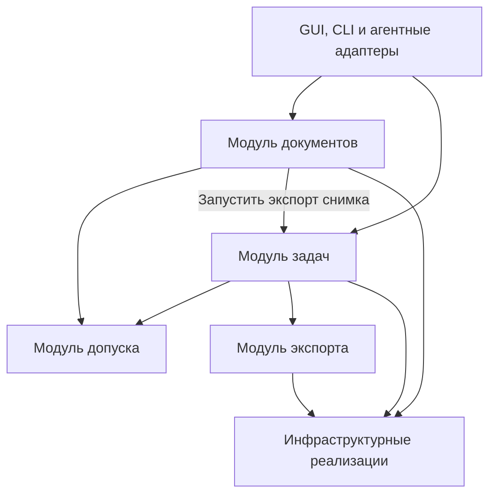

*Стрелки показывают возможные взаимодействия между модулями, а не жёсткое направление всех импортов. Порты позволяют прикладному коду зависеть от контрактов инфраструктуры, а не от конкретных реализаций.*

Такой продукт растёт преимущественно **в ширину по обязанностям**, а не в высоту по количеству промежуточных обработчиков. Для новой функции не обязательно добавлять очередной `Manager`, который передаст запрос существующему `Service`.

### Процессы определяют изоляцию и связь 🖥️

Отдельный процесс исполнителя может быть нужен для изоляции сбоя или принудительного завершения. Отдельный локальный сервис — для работы после закрытия GUI. Сервер — для удалённого доступа и нескольких пользователей.

Это не новые предметные слои. Это решения о том, где работают уже определённые компоненты.

И наоборот, размещение всего приложения в одном процессе не делает границы бессмысленными. Модульный монолит способен иметь строгие контракты, несколько исполнителей и хорошо организованное управление. Переход к независимо развёртываемым сервисам добавляет собственную стоимость; она отдельно рассматривается в [Microservice Premium][microservice-premium].

> [!note] Практический критерий слоя
> Новый слой оправдан, если у него есть собственная ответственность и ограничения зависимостей. Если он только повторяет сигнатуру следующего слоя и не принимает самостоятельных решений, скорее всего, добавлен не архитектурный механизм, а лишняя передача параметров.

---

## 3. Четыре архитектурных профиля, а не четыре ступени зрелости 🧩

Для дальнейшего сравнения используются четыре профиля. Они описывают характер работы, а не престиж архитектуры.

| Профиль | Центральная сущность | Основная задача |
|---|---|---|
| **A. Прикладной сервис** | Операция и её результат | Выполнить независимое действие через общий API |
| **B. Управляемые задачи** | Job и его жизненный цикл | Принять работу, наблюдать её и управлять исполнением |
| **C. Рабочая сессия** | Документ или рабочее пространство | Согласованно изменять общее живое состояние |
| **D. Устойчивый процесс** | Сценарий с сохраняемыми этапами | Продолжать многошаговую работу после ожиданий и сбоев |

Профиль B не является обязательной ступенью перед C. Редактор может сначала иметь общую модель документа и короткие операции, а очередь экспорта получить позднее. Профиль D можно применять к пакетному сервису без какого-либо интерактивного редактора.

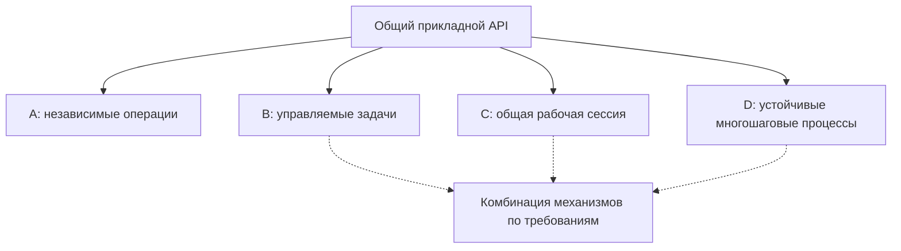

*Все профили используют общий принцип программных операций. Пунктир обозначает возможное сочетание, а не обязательное движение к «самому зрелому» варианту.*

### Надёжность — отдельная ось, а не синоним профиля D 💾

Менеджер задач профиля B может хранить очередь на диске и восстанавливаться после сбоя. Для этого не всегда нужен общий движок workflow. Если независимый элемент можно безопасно выполнить заново, достаточно устойчивого учёта элементов и правил повторов.

Профиль D становится интересен, когда сохранять требуется не только список работ, но и **логику их координации**: какой этап выполнен, какое подтверждение ожидается, какой внешний эффект уже произошёл и какой следующий переход допустим.

Аналогично профиль C не означает многопользовательский облачный редактор. Общая рабочая сессия может принадлежать одному локальному экземпляру, где действуют человек и один агент.

### Профиль может относиться к модулю, а не всему продукту 🧭

В одном приложении получение метаданных соответствует A, фоновое индексирование — B, редактирование проекта — C, а публикация с согласованием — D.

Попытка заставить все эти сценарии использовать одинаковый механизм исполнения обычно хуже, чем несколько согласованных путей. Общее требование — единые правила доступа и понятные контракты, а не одинаковое количество объектов на каждое действие.

### У каждого профиля есть граница отказа 📍

Профиль A может не обещать восстановление текущей операции после завершения процесса. B может восстанавливать задачи, но не хранить сложную историю редактирования. C может поддерживать Undo в текущей сессии, но не гарантировать откат уже отправленного внешнего сообщения. D может надёжно хранить этапы, но зависеть от возможностей внешнего сервиса при восстановлении побочного эффекта.

Эти ограничения не являются дефектами, если они согласованы с требованиями и видимы клиентам. Дефект появляется, когда приложение обещает более сильное поведение, чем обеспечивает выбранная конструкция.

---

## 4. Общий минимум: действия, наблюдение и управление 🔌

Во всех профилях сохраняется прикладная граница. Она определяет доступные действия и координирует их смысл вместо того, чтобы повторять сценарии в GUI, CLI и агентном адаптере. Эта роль соответствует [Service Layer][service-layer].

Однако общий API не требует универсального метода `execute` и сотен записей реестра. Для небольшой системы достаточно нескольких хорошо определённых методов. Каталог операций добавляется при реальной потребности в обнаружении, плагинах или генерации адаптеров.

### Три контура могут быть совсем небольшими 🔄

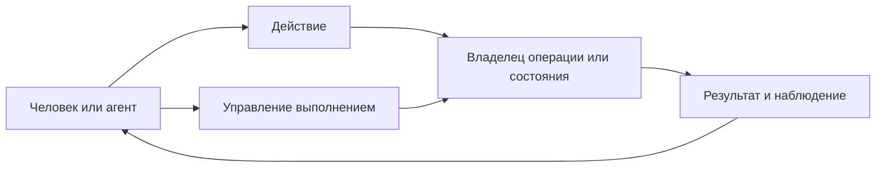

В простой утилите контур наблюдения может состоять из результата и callback прогресса. В системе задач он становится API снимков и подписок. В редакторе дополнительно существует наблюдение за документом. В workflow — за этапами и ожиданиями.

Контур управления также соразмерен работе. Для короткого переименования остановка может не иметь практического смысла; важнее предусловия и Undo. Для длительной обработки нужен запрос отмены. Для самостоятельной агентной сессии полезен отдельный запрет новых действий.

### Неизменяемое основание контрактов 📜

| Вопрос | Что должно быть определено в любом профиле |
|---|---|
| **Что является целью?** | Явный ресурс, файл, документ или иной объект операции |
| **Кто действует?** | Доверенно установленный контекст инициатора |
| **Что разрешено?** | Проверка операции и затрагиваемых ресурсов |
| **Что означает успех?** | Выполненные постусловия, а не просто отсутствие исключения |
| **Что означает отказ?** | Известно ли отсутствие эффекта или исход пока неопределён |
| **Как узнать результат?** | Ответ, состояние задачи либо состояние ресурса |
| **Можно ли повторить?** | Определённое поведение повторов и ключей намерения |
| **Что можно остановить?** | Реальная поддержка отмены, а не только кнопка |

Не каждой операции нужны отдельные типы для всех строк таблицы. Но ни одна оболочка не должна молча придумывать собственный ответ на эти вопросы.

### Агентность не требует собственного бизнес-слоя 🤖

Агент формирует запросы, а приложение определяет их допустимость. Правила конвертации, переименования или публикации не должны иметь независимые «человеческую» и «агентную» реализации.

Различаться могут полномочия, лимиты, требования подтверждения и представление активности. Это политики вокруг общего сценария, а не другая предметная логика.

[MCP Tools][mcp-tools] предоставляет обнаружение и вызов инструментов со схемами аргументов. Сам протокол не создаёт внутри программы очередь задач, документную модель или безопасную отмену. Такие возможности должны существовать в приложении и предоставляться через адаптер.

> [!tip] Сначала контракт, затем механизм
> Потребность в карточке задачи ещё не доказывает необходимость брокера. Потребность в программном вызове ещё не доказывает необходимость реестра. Архитектурный механизм выбирается после определения обещания, которое он должен выполнить.

---
## 5. Профиль A: прикладной сервис без самостоятельной системы задач 🔧

Этот профиль подходит для независимых действий: прочитать метаданные, проверить файл, сформировать небольшой результат, преобразовать переданный набор данных. Важное условие — приложению пока не требуется отдельная долговечная сущность выполнения, к которой будут возвращаться разные клиенты.

Центр архитектуры — прикладной сервис. Он получает определённый запрос, применяет правила, вызывает инфраструктуру и возвращает результат.

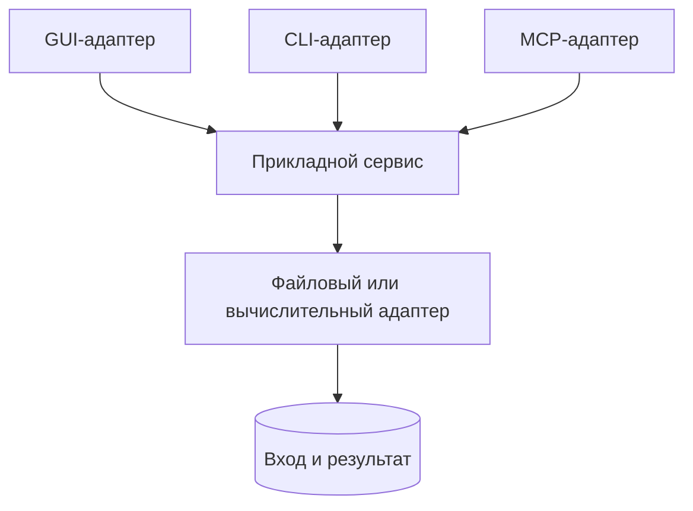

*Схема показывает общий путь логики. Если оболочки запущены независимо, у каждой может быть собственный экземпляр сервиса. Общая библиотека не означает общей памяти.*

### Минимальная организация 📦

В небольшом проекте достаточно модуля контрактов, прикладных функций, адаптера технической обработки и входных оболочек. Проверки предметных параметров могут находиться рядом со сценариями, если самостоятельная богатая модель ещё не появилась.

DTO запроса описывает входные данные. DTO результата сообщает созданные объекты или вычисленные значения. Поведенческий порт нужен там, где действительно изолируется зависимость: например, файловое хранилище или обработчик стороннего формата.

Условный контракт может выглядеть так:

```text
FileApplication
    inspect(request, context) -> FileInfo
    transform(request, context, execution) -> TransformResult

ExecutionControl
    report_progress(progress)
    is_cancellation_requested() -> boolean
```

Здесь `execution` — внутренний контекст исполнения, а не аргумент, который агент свободно сериализует в JSON. Адаптер создаёт его на стороне приложения и связывает с доступным механизмом управления.

Успешный `TransformResult` означает завершённый сценарий. Он не подменяется идентификатором ещё не выполненной работы. Если операция занимает заметное время, оболочка может ожидать её вне GUI-потока, но сама семантика результата остаётся синхронной: ответ приходит после окончания.

### Прогресс и остановка возможны без Job Manager 👀

Для одной текущей операции достаточно локального состояния выполнения. Оно хранит этап, известный прогресс, итог и сигнал отмены. GUI получает обновления этого объекта и показывает индикатор.

Внутренняя ссылка на текущую операцию может иметь методы ожидания и запроса остановки. Это ещё не постоянный публичный Job. Срок её жизни ограничен экземпляром приложения, а после перезапуска такой дескриптор может быть недействителен.

Если внешний агент запускает работу в открытом приложении, управляющий адаптер направляет вызов именно этому экземпляру. Если агент запускает отдельный CLI-процесс, GUI должен либо сам владеть этим процессом, либо иметь предусмотренный канал наблюдения. Без такого канала активность не появится на экране от одного лишь использования одинакового кода.

Кооперативная отмена требует участия исполняемой операции: она обнаруживает запрос и завершает работу в предусмотренной точке. Такая модель отделяет инициатора отмены от слушателя сигнала; пример её формализации приведён в [документации .NET][cancellation]. Это общий принцип, а не привязка данного профиля к .NET.

### CLI-обёртка здесь может быть правильным решением ⌨️

Если уже существует качественный инструмент с машинным форматом вывода и управляемым жизненным циклом, GUI и MCP могут вызывать его как процесс. Это не запрещает общий контракт: адаптер сопоставляет параметры, ошибки и результат с прикладной операцией.

При этом контракт должен определить судьбу дочернего процесса при закрытии окна, способ получения прогресса и последствия остановки. Текст stdout, предназначенный человеку, не стоит автоматически считать устойчивым API.

Выделение общей библиотеки становится полезным, когда вызов процесса создаёт ненужную сложность или требуется прямой доступ к общему состоянию. Оно не является обязательным исправлением каждой существующей CLI-утилиты.

### Паспорт профиля A 📋

| Свойство | Достаточное решение |
|---|---|
| **Владелец состояния** | Текущий вызов или экземпляр прикладного сервиса |
| **Жизненный цикл работы** | В пределах процесса; отдельная долговечная задача не обещана |
| **Наблюдение** | Результат и локальные сведения о выполнении |
| **GUI** | Отображение текущей операции |
| **Остановка** | Кооперативный сигнал либо управление изолированным исполнителем |
| **Восстановление** | Явно ограничено; часто требуется новый запуск |
| **Цена** | Небольшое количество компонентов, простая сборка и тестирование |

Граница профиля проявляется, когда появляется требование «показать все принятые работы», «подключиться позднее», «остановить операцию другого клиента» или «продолжить после перезапуска». Такие требования удобнее обслуживать самостоятельной моделью задач, а не постепенно превращать локальные callback-ссылки в скрытую очередь.

> [!warning] Простое не означает бесконтрольное
> Даже в профиле A два независимых процесса могут попытаться записать один выходной путь. Политика перезаписи и согласование публикации нужны там, где существует конфликт ресурсов, независимо от наличия менеджера задач.

---

## 6. Профиль B: задачи, очередь и общий контроль выполнения ⚙️

Профиль B нужен, когда работа должна существовать независимо от запускающего её вызова. Один клиент создаёт задачу, другой наблюдает, человек останавливает её через GUI, а исполнитель получает работу по мере доступности ресурсов.

Центральная сущность — **Job**, то есть логическая работа с идентификатором, состоянием и правилами переходов. Очередь — лишь один из механизмов её исполнения.

### Что добавляется к общему ядру 🧩

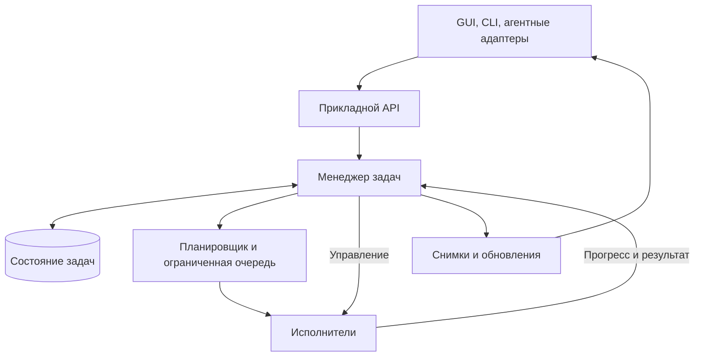

*Менеджер, планировщик и очередь могут быть частями одного компактного компонента. Их раздельное изображение показывает обязанности, а не обязательное число классов.*

Запуск возвращает подтверждение принятия, а не готовый результат. Состояние и результат запрашиваются отдельно. Такое разделение соответствует [Asynchronous Request–Reply][async-request-reply], хотя конкретный прикладной API не обязан использовать HTTP.

```text
JobsApplication
    submit(request, context) -> JobAccepted
    get(job_id, context) -> JobSnapshot
    list(query, context) -> JobsPage
    request_cancel(job_id, context) -> CancelDecision
```

Слово `accepted` требует уточнения. В одном варианте задача зарегистрирована только в памяти. В другом — сохранена в устойчивом хранилище до возврата ответа. Наличие `job_id` не позволяет клиенту догадаться, какой вариант выбран.

### Четыре обязанности, которые не стоит смешивать 🧠

**Менеджер задач** определяет допустимые переходы и фиксирует состояние. **Планировщик** выбирает, что может начать выполняться. **Исполнитель** делает конкретную работу. **Хранилище** сохраняет необходимые сведения.

Эти роли могут быть реализованы небольшим объёмом кода, но их смысл должен оставаться различимым. Рабочая функция не должна напрямую менять GUI. Очередь не должна быть единственным местом, где существует факт принятия работы. Состояние задачи не должно вычисляться только из наличия живого процесса.

В особенно простой реализации менеджер держит задачи в памяти, а планировщик обслуживает их по одной. Даже такой вариант уже позволяет подключить GUI и агентный адаптер к одному владельцу состояния.

### Карточка задачи становится проекцией, а не следом нажатия 🖥️

GUI строит список из снимков задач. Поэтому карточка появляется независимо от того, кто инициировал работу. В ней можно показать инициатора, параметры без чувствительных значений, текущий этап и доступные действия.

Если окно открылось после старта, оно получает список текущих задач. Если соединение оборвалось, состояние наблюдения показывается отдельно от состояния работы. Это не требует анимации кнопок или виртуальной мыши.

Локальная модель представления может быть простой. Она не обязана дублировать всю внутреннюю структуру менеджера: достаточно информации, нужной для отображения и управления.

### Пакет не обязан превращаться в сотни публичных задач 📦

При обработке коллекции возможны разные гранулярности. Один Job может иметь счётчик элементов и подробный отчёт. Либо пакет может содержать дочерние задачи с независимым повтором и отменой.

Выбор зависит от требований. Если отдельный элемент нужно остановить, повторить или передать другому исполнителю, самостоятельный идентификатор полезен. Если элементы короткие и управляются только общим запуском, тысячи карточек и записей жизненного цикла могут оказаться лишними.

При этом единая карточка не делает пакет атомарным. Политика частичного результата определяется отдельно: что сохраняется при ошибке или отмене, какие элементы считаются завершёнными и допускается ли продолжение оставшихся.

### Паспорт профиля B 📋

| Свойство | Решение |
|---|---|
| **Владелец состояния** | Менеджер задач, доступный всем нужным клиентам |
| **Жизненный цикл** | Отделён от отдельного запроса |
| **Контракты** | Запуск, снимок, список, результат, запрос отмены |
| **GUI** | Восстанавливаемый список задач в пределах обещанного времени жизни |
| **Конкуренция** | Планировщик ограничивает число и стоимость активных работ |
| **Устойчивость** | Может быть только в памяти или с сохранением; это отдельный выбор |
| **Цена** | Автомат состояний, управление ресурсами и согласование отчётов исполнителей |

Главная добавленная стоимость — необходимость корректно обслуживать жизненный цикл. Задача может ждать, завершиться раньше доставки события, получить отмену одновременно с успехом или потерять исполнителя. Эти случаи уже нельзя объяснить одним `try/except` вокруг вызова кнопки.

> [!tip] Где этот профиль особенно уместен
> Для приложения, в котором агент запускает работу, человек видит карточки и может нажать «Стоп», профиль B часто является достаточной отправной точкой. Само это требование ещё не обязывает вводить совместную документную модель или движок устойчивых процессов.

---

## 7. Сохраняемая очередь: важный промежуточный вариант 💾

Между временными задачами и полноценным workflow существует полезная конструкция: **устойчиво сохранённая очередь независимых работ**.

Она нужна, когда приложение должно помнить принятые задания после перезапуска, но сами задания не образуют сложную систему ожиданий, согласований и внешних эффектов. Например, коллекция документов индексируется по независимым элементам, а завершённый результат каждого элемента можно проверить.

### Сохранить задачу — не то же самое, что сохранить вычисление 🧾

Запись в БД может содержать параметры, идентификатор входа, состояние, номер попытки, результаты и намерение отмены. После перезапуска приложение знает, что было принято и что успело подтвердиться.

Но память рабочей функции, открытый дескриптор файла и промежуточное состояние сторонней библиотеки обычно не восстанавливаются из этой записи автоматически. Незавершённый элемент либо запускается заново, либо продолжается с явно поддержанной контрольной точки.

Поэтому формулировка «задачи сохраняются» слабее формулировки «работа продолжается ровно с того же места». Эти гарантии должны различаться и в документации, и в GUI.

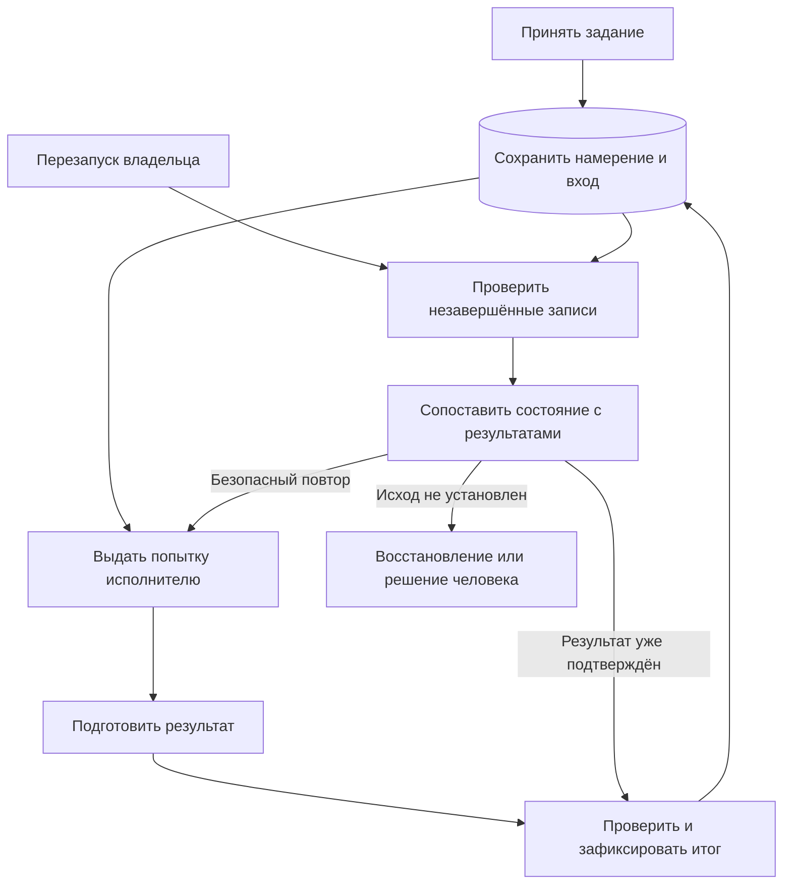

*Стрелка к фиксации после проверки не означает автоматического признания любого существующего файла успешным результатом. Должны совпасть идентичность операции, входа и проверяемого артефакта.*

### Устойчивость можно обеспечить локально 🏠

Сохраняемая очередь не требует отдельного сервера БД. Транзакционное локальное хранилище может быть достаточным. Например, [SQLite документирует атомарную фиксацию транзакций][sqlite-atomic], включая её предположения о файловой системе и оборудовании.

Из этого не следует, что транзакция БД автоматически включает произвольные выходные файлы. Если данные задачи сохранены, а файл ещё не опубликован, система должна понимать промежуточное состояние. Если файл уже появился, но подтверждение в БД потеряно, требуется сверка, а не безусловный повтор.

В данном профиле полезно заранее выбрать проверяемую границу завершения элемента: например, результат подготовлен, опубликован через контролируемый механизм и связан с записью задачи. Детали зависят от хранилища и формата результата.

### Вход должен оставаться определённым 📂

Путь к файлу — не всегда достаточная идентичность входа. Между постановкой и повтором файл может измениться. Тогда повтор той же задачи фактически обработает другие данные.

В предлагаемой модели выбирается одна из явных политик: задача работает с сохранённой копией, с версионируемым ресурсом или с проверяемым исходником, изменение которого приводит к отказу и новому решению. Контрольная сумма позволяет обнаруживать изменение, но сама по себе не сохраняет прежнее содержимое.

Аналогично результат не считается относящимся к задаче только потому, что совпало имя. Нужна связь с конкретным входом, параметрами и попыткой либо другая проверка, достаточная для выбранного сценария.

### Правила восстановления важнее слова persistent 🔍

| Обнаруженное состояние | Возможная политика |
|---|---|
| Задача принята, попытка ещё не назначалась | Снова предоставить её планировщику |
| Попытка выполнялась, её процесс исчез | Проверить последствия и допустимость повтора |
| Отмена была принята до сбоя | Не запускать работу заново вопреки сохранённому намерению |
| Подготовлен временный результат | Проверить его пригодность либо удалить как незавершённый |
| Результат опубликован, подтверждение не установлено | Сверить идентичность и состояние публикации |
| Исходные данные недоступны или изменились | Остановить автоматическое продолжение и сообщить причину |

Запоздавший исполнитель также требует внимания. Если после переназначения он всё ещё работает, его отчёт не должен переписать новую попытку. А если он имеет прямое право публиковать результат, одного отклонения отчёта недостаточно. Контроль нужен на самой границе публикации.

### Когда этого достаточно вместо workflow ⚖️

Если работа состоит из независимых элементов, каждый имеет понятный результат и безопасную политику повторения, сохраняемая очередь часто закрывает требования восстановления. Не обязательно вводить граф произвольных этапов, таймеры и инфраструктуру согласований.

Workflow становится оправданным, когда дальнейшее действие зависит от истории этапов, внешнего ответа, решения человека или компенсации предыдущего эффекта. Разница состоит не в количестве файлов, а в **сложности продолжения**.

> [!important] Восстановление не равно автоматическому повтору
> После сбоя система сначала устанавливает известные факты и границы неопределённости. Повтор запускается только тогда, когда его последствия допустимы. Состояние «неизвестно, был ли опубликован результат» нельзя честно заменить на «ничего не произошло».

---

## 8. Профиль C: интерактивная рабочая сессия и общий документ 🎨

У редактора главным ресурсом становится живой документ. Он может отличаться от сохранённого файла, иметь историю изменений и участвовать сразу в нескольких операциях. Человек и агент работают не просто с одинаковыми путями, а с одной предметной моделью.

Здесь выделение доменного слоя часто оправдано: корректность документа определяется связями между объектами и допустимыми изменениями, а не только структурой входного DTO.

### Кто владеет документом 🧠

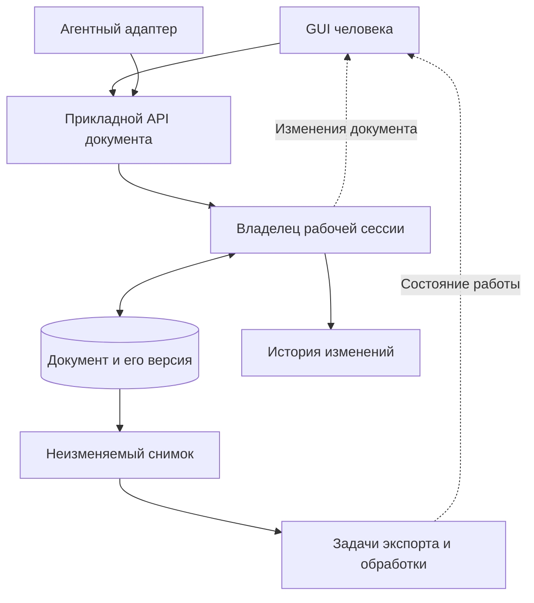

*История и экспорт получают данные от определённого владельца. Ни GUI, ни агент не должны обходить эту границу прямым изменением внутренней модели.*

Владелец может жить в desktop-процессе, локальном сервисе или на сервере. Его роль — определять, какие изменения приняты и в каком состоянии находится ресурс. Это не требование создать один глобальный объект на все документы: у разных рабочих пространств могут быть независимые владельцы.

### У редактора несколько видов состояния 🪟

| Состояние | Кому принадлежит | Должно ли быть общим |
|---|---|---|
| Содержимое документа | Документной модели | Да, для совместной работы над этим документом |
| История принятых изменений | Подсистеме истории по выбранной политике | В пределах установленной модели Undo и аудита |
| Активная вкладка, масштаб, прокрутка | Представлению участника | Необязательно |
| Присутствие участника и подсветка цели | Подсистеме совместной активности | При наличии такого UX |
| Выполнение экспорта | Менеджеру задач | Для клиентов с правом наблюдения |
| Сохранённая версия на диске | Механизму сохранения | По правилам сохранения, а не автоматически после каждого жеста |

Общий документ не требует общего курсора. Агент может изменить страницу, которую человек сейчас не рассматривает. GUI показывает факт изменения, но не обязан переключать экран. Режим «следовать за агентом» — отдельная политика представления.

Точно так же принятая правка не обязательно означает сохранение на диск. Если контракт обещает изменение живой модели, индикатор несохранённых изменений остаётся частью нормального поведения.

### Короткие изменения и длительная работа используют разные пути ⚡

Переименование страницы или изменение свойства обычно выполняется как ограниченная короткая операция. Для неё важны идентификатор цели, проверка версии, предметные правила и фиксация истории.

Экспорт или тяжёлая обработка создают Job. Они не должны удерживать документ заблокированным всё время выполнения. В предлагаемой модели длительная работа получает снимок определённой версии, а человек продолжает редактирование.

Завершённый результат связывается с исходной версией. Иначе GUI может показать экспорт как «актуальный», хотя он построен из более старого состояния. Это не обязательно ошибка исполнения, но это важный факт о результате.

### Совместный доступ не сводится к последовательному исполнению 🔀

Даже если владелец применяет операции по одной, агент может подготовить запрос на основе устаревшего снимка. Пока формировалось решение, человек изменил тот же объект.

Поэтому порядок исполнения и допустимость старого намерения — разные вопросы. В простом варианте используется ожидаемая версия и отказ при конфликте. В более гибком — проверка версии отдельного объекта или предметное правило, допускающее независимые изменения.

В любом случае GUI и агент должны проходить через одну границу применения. Если человек напрямую меняет объект в памяти, а агент использует версионируемый API, гарантии перестают быть общими.

### История требует собственного смысла 🔄

У одного пользовательского жеста может быть много промежуточных обновлений. У одного агентного действия — несколько связанных операций. Их можно объединить в осмысленную группу Undo, но это не делает всю группу автоматически транзакцией внешних эффектов.

Особенно важно различать «отменить последнее действие вообще» и «отменить действия конкретного агента». Во втором случае между агентными изменениями уже могли появиться правки человека. Простое восстановление старого снимка способно их стереть.

Для общего редактора политика истории должна учитывать происхождение и зависимости изменений. Иногда достаточно последовательного стека. Иногда нужна выборочная отмена или возврат к черновой ветке. Возможность такой отмены определяется моделью операций, а не наличием кнопки с изогнутой стрелкой.

### Паспорт профиля C 📋

| Свойство | Решение |
|---|---|
| **Центр модели** | Документ или рабочее пространство с инвариантами |
| **Владелец** | Определённая документная сессия или служба |
| **Контракты изменений** | Явные цели, версии, семантика истории и сохранения |
| **Наблюдение** | Снимки и изменения документа; отдельное состояние задач |
| **GUI** | Проекция общего содержимого и собственное состояние просмотра |
| **Длительные действия** | Job над зафиксированным входом, а не блокировка живой модели |
| **Цена** | Конкурентные изменения, история, восстановление клиентских проекций |

Профиль C может оставаться полностью локальным и монолитным. Его сложность возникает прежде всего из согласования состояния и намерений, а не из сети.

---

## 9. Профиль D: устойчивый процесс с этапами и ожиданиями 🏗️

Этот профиль нужен, когда работа состоит из зависимых этапов и должна сохранять смысл после длительных ожиданий, перезапусков и частичных отказов.

Условный процесс подготовки публикации может собрать исходные данные, сформировать черновой результат, дождаться подтверждения, отправить его во внешнюю систему и проверить факт публикации. Между этапами могут пройти значительные интервалы. Исходное соединение с агентом к этому моменту уже не имеет отношения к жизненному циклу работы.

### Что становится отдельной сущностью 🧭

Workflow — здесь **сохраняемый сценарий выполнения**, а не просто функция, последовательно вызывающая другие функции. У него есть состояние, известные этапы, условия переходов, политика повторов и способы вмешательства.

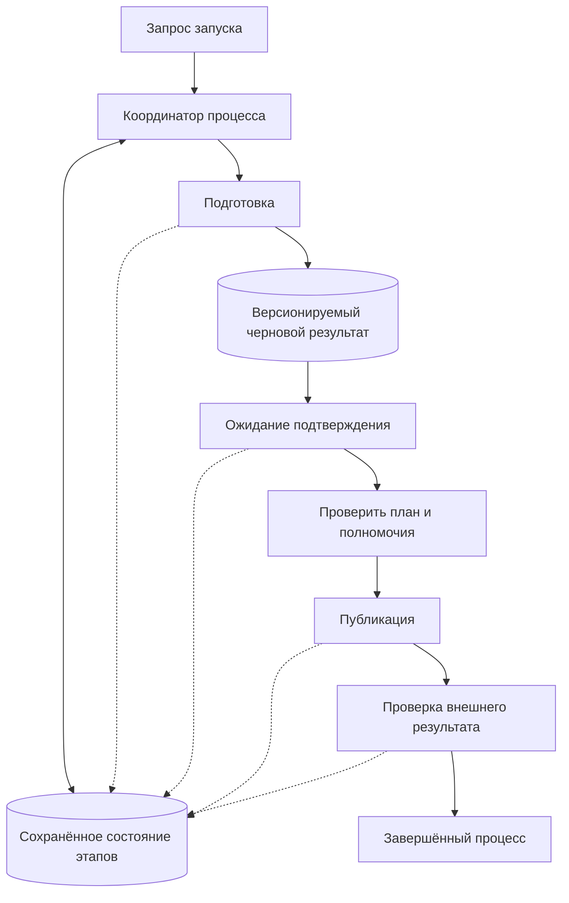

*Стрелки показывают учебный сценарий. Сохранение этапа должно соответствовать реальному контракту эффекта; запись «публикация началась» сама по себе не доказывает, что внешняя публикация состоялась.*

### Отличие от очереди независимых задач 📦

| Вопрос | Сохраняемая очередь | Устойчивый процесс |
|---|---|---|
| Что является единицей управления? | Независимая работа или элемент пакета | Сценарий с зависимыми этапами |
| Как выбирается следующий шаг? | Планировщик берёт готовый элемент | Координатор учитывает историю и условия |
| Есть ли длительное ожидание человека? | Возможно как особый статус | Обычно является явной частью модели |
| Что восстанавливается? | Задание, попытка и результат | Положение в сценарии, ожидания и решения |
| Как обрабатывается частичный внешний эффект? | По правилам конкретной работы | В контексте остальных этапов и возможной компенсации |
| Нужен ли общий workflow-движок? | Обычно нет | Возможно, если стоимость собственной координации становится существенной |

Один сложный этап может быть обычным Job. Один Workflow способен управлять несколькими задачами. Их идентификаторы не обязаны совпадать: процесс отвечает за общий смысл, задача — за конкретную работу.

### Восстановление не означает сохранение машинного стека 🔁

Устойчивый процесс обычно сохраняет наблюдаемые решения и результаты шагов, а затем восстанавливает логическое выполнение. Это не универсальная сериализация любой функции с её открытыми файлами и сетевыми соединениями.

Например, [Temporal описывает восстановление Workflow через историю и replay][temporal-workflow]. Это иллюстрация одного механизма durable execution. Она не означает, что любое приложение обязано внедрять Temporal или переносить собственную предметную модель на Event Sourcing.

Для собственной компактной реализации сценарий может быть явным автоматом состояний в БД. Но тогда разработка берёт на себя восстановление, согласование попыток, таймеры, совместимость сохранённых состояний и правила повторов. Удобный `while` поверх таблицы не освобождает от этих обязанностей.

### Внешние эффекты остаются отдельной проблемой 🌐

Самый сложный момент возникает между внешним действием и сохранением подтверждения. Система отправила публикацию, получила успех, но упала до записи. После перезапуска неизвестно, нужно ли отправлять снова.

Надёжное сохранение состояния координатора не устраняет это окно автоматически. Нужна поддержка идемпотентности у внешнего получателя, поиск результата по устойчивому идентификатору или процедура сверки. Если ни один механизм недоступен, честным итогом может быть необходимость ручного решения.

В [документации Temporal Activities][temporal-activity] отдельно рекомендуется проектировать действия идемпотентными. Это важная граница обещаний: устойчивость оркестрации не равна безусловному выполнению всех внешних эффектов ровно один раз.

### Ожидание подтверждения не должно удерживать рабочие ресурсы 👤

После подготовки черновика процесс может перейти в `awaiting_approval`. При этом не требуется держать открытой транзакцию документа или занимать тяжёлый исполнитель до ответа человека.

Сохраняется сам план: входные версии, параметры, подготовленный артефакт, допустимые последствия и срок актуальности. После подтверждения система проверяет, что одобряется тот же план и что полномочия ещё позволяют его применить.

Если источник изменился, возможны явные варианты: опубликовать зафиксированный черновик, пересобрать и запросить новое подтверждение либо завершить процесс без публикации. Автоматическая подмена подтверждённого результата новым содержимым нарушила бы смысл согласования.

### Версия процесса становится частью эксплуатации 🧬

Долго живущая работа может встретить новую версию приложения. Поэтому сохранённый этап должен оставаться интерпретируемым, а новое исполнение — совместимым с уже принятыми решениями.

В предлагаемой модели отдельно версионируются входной контракт, формат сохранённого процесса и алгоритм этапа. Их необязательно обновлять одновременно. Если продолжение старой работы невозможно, система должна объяснить это и предложить допустимый переход, а не начинать весь сценарий заново с другим смыслом.

### Паспорт профиля D 📋

| Свойство | Решение |
|---|---|
| **Центр модели** | Сохраняемый процесс и его этапы |
| **Жизненный цикл** | Независим от соединения, окна и отдельного исполнителя |
| **Ожидания** | Явные состояния для человека, таймера или внешнего результата |
| **Повторы** | Определены для этапов и согласованы с их эффектами |
| **Восстановление** | Проверяет факты и продолжает с допустимой логической границы |
| **GUI** | Показывает ход процесса, текущие задачи, ожидания и оставшиеся эффекты |
| **Цена** | Сложная семантика отказов, версионирование и эксплуатация |

> [!warning] Workflow не нужен только потому, что операция долгая
> Длительное независимое вычисление может оставаться обычной задачей. Устойчивый процесс оправдан, когда сохранять и восстанавливать нужно координацию этапов, а не только факт запуска одного исполнителя.

---
## 10. Гибридная архитектура: рост в ширину, а не бесконечная цепочка слоёв 🧰

Реальное приложение редко укладывается в один профиль. У него могут быть простые запросы, управляемые фоновые задачи, интерактивные документы и отдельные устойчивые процессы.

Ошибка состоит не в сочетании механизмов, а в попытке навязать всем операциям одинаковую тяжесть. Получение списка форматов не нуждается в долговечном Job. Изменение названия страницы не должно ожидать освобождения очереди тяжёлого экспорта. Публикация с человеческим подтверждением, напротив, не должна маскироваться под мгновенный setter.

### Разные пути, общие правила 🛤️

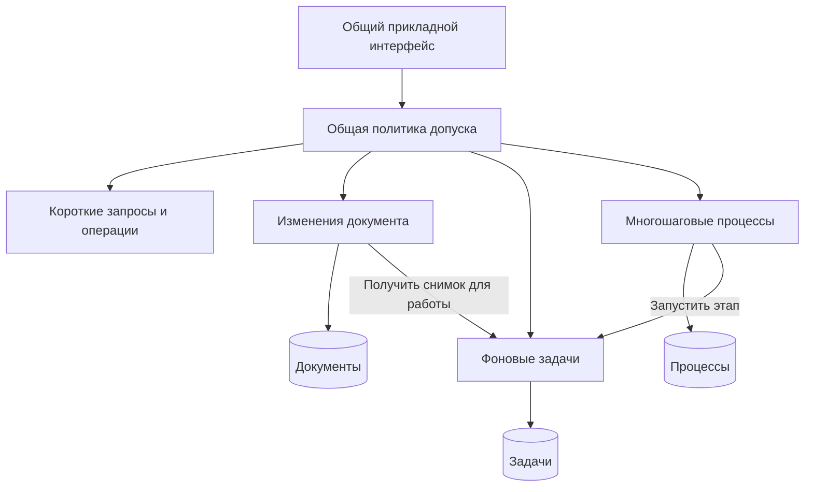

*Общая политика допуска — логическая обязанность, а не обязательно один глобальный сервис на каждый вызов. Конкретные проверки могут выполняться внутри модулей по согласованным правилам.*

У каждого пути остаётся свой владелец состояния. Процесс публикации не должен напрямую переписывать внутренние поля документа: он обращается к его API. Менеджер задач не становится универсальным владельцем всех предметных данных только потому, что умеет запускать функции.

### Модульный монолит подходит и сложному приложению 🏡

Все эти модули могут поставляться вместе и работать на одной машине. Самостоятельный worker-процесс ради изоляции не делает продукт микросервисной системой. Микросервисы связаны также с независимым развёртыванием, сетевыми границами и эксплуатацией.

Подход [Monolith First][monolith-first] подчёркивает ценность сначала понять реальные границы системы, а не оплачивать распределение до их появления. В контексте этой серии это означает, что разделение обязанностей можно обеспечить внутри продукта и выделять процессы или сервисы по конкретным причинам.

Такими причинами могут быть независимое масштабирование, разная среда исполнения, изоляция небезопасного обработчика или отдельный жизненный цикл. Причина «приложение стало серьёзным» слишком неопределённа.

### Общее хранилище не должно уничтожать модульные границы 🗄️

Модули могут использовать одну БД, но это не означает свободное изменение таблиц друг друга. Иначе право менять документ появится у любого обработчика, получившего соединение, а общий прикладной путь станет необязательным.

В предлагаемой модели каждый ресурс имеет определённую границу изменения. Совместная транзакция возможна, когда это осознанно выбранная часть архитектуры. Прямые случайные записи ради удобства — другая ситуация.

Аналогично общая шина событий не должна скрывать критический сценарий. Если этап B обязателен после A и его отказ влияет на общий результат, зависимость стоит показать в координаторе. Независимое уведомление GUI можно оставить событием.

### Не все дополнительные механизмы образуют комплект 📚

CQRS, Event Sourcing, брокер сообщений и workflow решают разные проблемы. [CQRS][cqrs] разделяет модели чтения и изменения; это не обязательное следствие наличия методов `get` и `update`. [Различные смыслы event-driven][event-driven] также не сводятся к хранению всей предметной истории.

Редактор может иметь Undo без Event Sourcing. GUI может обновляться по событиям без брокера. Устойчивая очередь может жить в одной БД. Workflow может быть нужен одному модулю, а не всему приложению.

> [!tip] Механизм должен иметь адрес
> Полезное архитектурное решение указывает, какую обязанность и какой сценарий оно обслуживает. Формулировка «весь проект теперь event-driven» менее информативна, чем «обновления задач доставляются подписчикам, а обязательные этапы публикации координируются явно».

---

## 11. Где живёт приложение: окно, локальный сервис или сервер 🏠

Выбор профиля не определяет размещение. Менеджер задач может работать внутри desktop-приложения, в отдельном локальном процессе или на сервере. Главное — соответствие времени жизни владельца обещанному времени жизни работы.

### Владелец внутри desktop-приложения 🖥️

В простом варианте основной процесс приложения владеет документами и задачами. GUI обращается к нему локально, а агентный адаптер — через управляющий канал. Тяжёлая работа при необходимости вынесена в исполнителей.

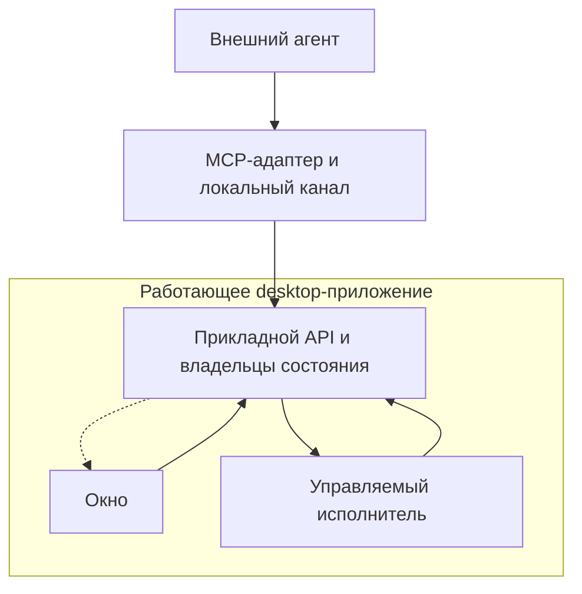

Это удобно, когда приложение существует как активная рабочая сессия. Но закрытие окна, завершение основного процесса и авария — разные события. Окно может скрываться в трей, основной процесс может оставаться живым, а worker — иметь собственную политику завершения.

Следовательно, обещание «после закрытия окна работа продолжается» должно быть реализовано жизненным циклом продукта, а не случайным оставшимся дочерним процессом.

### Локальный сервис как владелец работы 🔌

Если GUI может исчезать и появляться, удобно отделить владельца задач от окна.

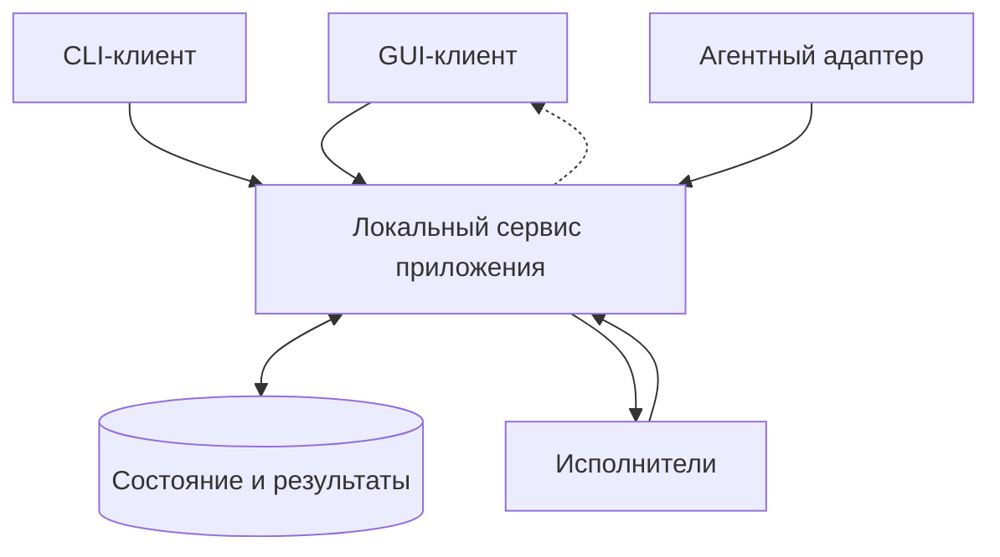

Все клиенты используют один источник состояния. GUI может подключиться позднее и восстановить список работ. Закрытие окна не обязательно влияет на выполнение.

Цена — запуск и остановка сервиса, обнаружение нужного экземпляра, IPC, проверка клиента, согласование версий и уборка ресурсов. Для локальной утилиты с одной короткой операцией эта цена может быть неоправданной. Для постоянной очереди или нескольких окон — уже полезной.

Локальный сервис также не обязан быть системной службой с повышенными правами. Область пользователя и минимально необходимые полномочия обычно лучше соответствуют настольному приложению.

### Серверный владелец и удалённые клиенты 🌐

Серверное размещение добавляет независимые соединения, задержки и распределённые отказы. GUI может быть браузерным или настольным. Прикладная логика остаётся той же по смыслу, но клиент обязан учитывать недоступность сервера и неопределённый исход вызова.

Задача не должна считаться остановленной только потому, что браузерная вкладка закрылась. И наоборот, для некоторых операций политика может специально связывать выполнение с клиентом. Эта связь задаётся контрактом, а не выводится из типа GUI.

Идентификаторы ресурсов становятся предпочтительнее локальных путей клиента. Путь на компьютере пользователя не является автоматически доступным входом серверного исполнителя. Передача файлов и управление артефактами требуют собственного контракта.

### Сравнение размещений ⚖️

| Решение | Когда уместно | За что приходится платить |
|---|---|---|
| **Ядро в основном процессе** | Одна локальная рабочая сессия | Работа зависит от жизни этого процесса; требуется не блокировать управление |
| **Основной процесс и изолированные workers** | Тяжёлые или нестабильные обработчики | IPC с исполнителями, контроль попыток и завершения |
| **Локальный сервис и отдельный GUI** | Работа продолжается без окна; несколько клиентов | Управление сервисом, обнаружение, безопасность локального канала |
| **Серверное ядро** | Удалённый доступ и общие ресурсы | Сеть, эксплуатация, доступ, восстановление соединений |
| **Реплицируемое локальное состояние** | Полноценная работа нескольких участников без постоянной связи | Отдельная модель синхронизации, конфликтов и полномочий |

Последняя строка не является обязательным продолжением серверной архитектуры. Offline-first — самостоятельное требование, существенно меняющее модель владения и согласования.

### Headless и Attached остаются режимами использования 🧭

Headless-клиент может создать собственное ядро и работать без окна. Attached-клиент обращается к существующему владельцу сессии. Ни один термин сам по себе не сообщает, где находится БД и переживёт ли работа перезапуск.

Особенно опасно подключить MCP к самостоятельному headless-ядру, а затем ожидать, что уже открытый GUI автоматически увидит его задачи. Для общей работы необходима общая область состояния или явная синхронизация, а не просто одинаковая сборка приложения.

> [!important] Физическая граница добавляет обязанности
> Перенос компонента в отдельный процесс даёт изоляцию, но добавляет сериализацию, сбои связи и жизненный цикл соединения. Перенос на другой компьютер добавляет ещё больше условий. Локальный прокси может скрыть синтаксис передачи, но не должен скрывать её реальные гарантии.

---

## 12. Как растут контракты и что должно оставаться стабильным 📜

Усложнение приложения не обязательно требует переписывать все DTO. Обычно появляются новые контракты вокруг существующих операций: задача, состояние, управление, версия документа, план подтверждения.

Важно отличать **расширение архитектуры** от **молчаливого изменения смысла API**.

### Из результата в принятую задачу нельзя перейти незаметно 📬

Пусть прежний метод `transform` возвращал готовый файл. Если после добавления очереди он начнёт возвращать `job_id`, старый клиент может ошибочно считать работу завершённой.

Корректные варианты — новая операция запуска, новая версия контракта либо заранее определённый тип результата с различимыми вариантами. Клиент должен явно знать, когда получает `completed`, а когда только `accepted`.

```text
Прямой сценарий:
    transform(request) -> TransformResult

Сценарий с задачей:
    start_transform(request) -> JobAccepted
    get_job(job_id) -> JobSnapshot
    get_result(job_id) -> TransformResult, когда результат доступен
```

Внутри реализации могут использоваться общие обработчики. Различие относится к обещанию вызывающей стороне.

### Матрица контрактов по профилям 🗂️

| Контракт | A: операция | B: задачи | C: сессия | D: процесс |
|---|---|---|---|---|
| **Вход** | Явные данные и параметры | Вход задачи и политика выполнения | Цель в документе, версия, намерение | План процесса и версии его входов |
| **Первый ответ** | Результат либо отказ | Принятие работы | Применённое изменение либо запущенная задача | Принятие процесса или подготовленного плана |
| **Чтение состояния** | Текущая операция при необходимости | Снимок Job | Снимки документа и задач | Состояние этапов, ожиданий и задач |
| **Управление** | Отмена поддержанного исполнения | Отмена Job или пакета | Управление задачами, историей и сессией | Остановка процесса, подтверждение, допустимое продолжение |
| **Конкуренция** | Конфликт конкретных ресурсов | Актуальная попытка и ограничения запуска | Версии, владение, история | Согласование этапов и внешних эффектов |
| **Результат** | Конечные данные | Артефакты задачи | Новая версия документа или артефакт | Итог процесса и сведения о последствиях |

Таблица не предписывает фиксированный набор полей. Например, версионирование ресурса может понадобиться и простой операции, если она изменяет общий объект. Матрица показывает типичный центр внимания, а не исключительные права профилей на механизмы.

### Свойства выполнения полезно раскрывать явно 🏷️

Каталог операций может сообщать клиенту не только схему аргументов, но и поддерживаемое управление. Ниже — учебный пример метаданных приложения, не формат MCP:

```json
{
  "operation": "files.process.start",
  "contract_version": 1,
  "execution": {
    "kind": "job",
    "state_lifetime": "persistent",
    "cancel_mode": "cooperative",
    "cancel_boundary": "between_items",
    "partial_result_policy": "keep_completed"
  }
}
```

Из такого описания клиент понимает общую семантику. Но оно не заменяет проверку конкретного вызова: возможность остановки может зависеть от этапа и полномочий. Статическое `cancel_mode` не является обещанием, что кнопка доступна прямо сейчас.

Также поддержка `persistent` должна быть определена точнее в документации: какие сведения сохраняются, при каких сбоях и как долго. Один ярлык не описывает восстановление всех внешних эффектов.

### DTO не обязаны переносить устройство исполнителя 📦

Клиенту нужны идентификаторы, состояния и результаты. Ему обычно не требуется знать номер потока, имя очереди или внутренний тип кодека.

Если после переноса исполнения в другой процесс приходится менять запросы каждого GUI-компонента, контракт, вероятно, слишком сильно отражал прежнюю реализацию. Хорошая граница сохраняет смысл операции, хотя технические ошибки и задержки удалённого вызова всё равно должны быть обработаны.

И обратная крайность нежелательна: универсальный объект с произвольным `payload` не становится хорошим контрактом только потому, что никогда не меняется. Он лишь переносит всю типизацию и документацию за пределы схемы.

### Агентный протокол не должен становиться единственным владельцем Job 🤖

В [MCP Tasks][mcp-tasks] предусмотрены отдельные дескрипторы длительных операций, получение состояния и кооперативная отмена. Адаптер может сопоставлять такой дескриптор с внутренней задачей приложения.

Но задача должна оставаться доступной человеку через GUI независимо от жизни конкретного вызова инструмента. Совместимость расширения с используемыми клиентами проверяется отдельно. Прикладной API не должен терять управление работой только потому, что один внешний клиент не поддерживает выбранное расширение.

---

## 13. Живой GUI: сколько инфраструктуры действительно нужно 👀

Видимая работа агента не является отдельным максимальным профилем. Это следствие того, что GUI наблюдает состояние приложения, а не только свои прошлые нажатия.

Различается объём наблюдаемого состояния и требования к восстановлению.

### От текущего действия к полной рабочей картине 🖼️

| Сценарий | Достаточное наблюдение | Что показывает GUI |
|---|---|---|
| Одна текущая операция | Локальное состояние и прогресс | Индикатор, этап, итог |
| Несколько Job | Список, снимки и обновления | Карточки, очередь, ошибки, остановка |
| Общий документ | Снимок документа и изменения | Холст или дерево объектов, история, активность |
| Устойчивый процесс | Состояние этапов и ожиданий | Выполненные шаги, ожидаемое подтверждение, доступное вмешательство |

Во всех случаях отображение полезно отделить от конкретных контролов. [Presentation Model][presentation-model] описывает такой подход: данные и поведение представления существуют независимо от самих виджетов. В небольшой реализации эту роль может выполнять чистая функция преобразования состояния, а не большой отдельный фреймворк.

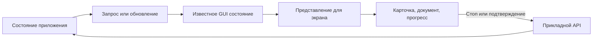

### Опрос, подписка и журнал — не равноценные по цене решения 📡

Для небольшого списка задач периодический запрос состояния может быть достаточным. Он проще восстановления потоковой подписки, хотя создаёт задержку отображения и дополнительное чтение.

Подписка уменьшает необходимость постоянного опроса, но требует обработки разрыва связи, пропущенного последнего сообщения и медленного клиента. Журнал с курсором позволяет продолжать поток после переподключения, но добавляет хранение, сроки жизни и согласование снимка с позицией журнала.

| Механизм | Что упрощает | Что добавляет |
|---|---|---|
| **Локальное уведомление** | Быстрое обновление в одном экземпляре | Управление временем жизни подписки |
| **Периодический запрос снимка** | Простое восстановление актуальных данных | Задержку и стоимость повторного чтения |
| **Подписка плюс пересинхронизация** | Живое отображение без постоянного полного опроса | Обработку потерь и переподключений |
| **Снимок плюс воспроизводимый поток** | Продолжение с известной позиции | Согласованную границу, журнал и политику его хранения |

Согласованный подход list/watch с версией ресурса существует, например, в [Kubernetes API][list-watch]. Для локальной утилиты важен принцип отсутствия разрыва между снимком и изменениями, а не необходимость повторять инфраструктуру Kubernetes.

### Потеря наблюдения должна быть видимой 📶

При разрыве соединения окно знает только последнее подтверждённое состояние. Оно не вправе автоматически заменить его на «ошибка задачи» или «отменено».

В предлагаемой модели состояние соединения отображается отдельно. Кнопка остановки может стать недоступной либо отправлять запрос после восстановления, но GUI не изображает выполненную отмену до подтверждения. Если управление недоступно, это должно быть заметно человеку.

Точно так же устаревшее событие не должно возвращать карточку из «Готово» в «Выполняется». Версия ресурса помогает отсеивать старое состояние. Однако она не доставляет потерянный итог; для этого нужен запрос или предусмотренное восстановление потока.

### Активность агента — представление фактов, а не симуляция человека 🎛️

Карточка может показывать, что работу инициировала агентная сессия, какой объект затронут и какие результаты появились. Подсветка изменённых объектов и журнал действий также полезны.

Но автоматическое открытие экранов, анимация нажатий и движение курсора не являются условием наблюдаемости. Для фонового режима они часто создают конфликт с человеком. Прикладное действие и политика показа остаются разными механизмами.

Режим «следовать за агентом» может включаться отдельно. Он меняет фокус и отображение, но не должен менять смысл самой операции или давать агенту дополнительные права.

### Состояние должно быть достаточно информативным для контроля 🧾

Надпись «Агент работает» почти ничего не объясняет. Для безопасного вмешательства полезны цель, инициатор, текущий этап, уже созданные результаты и предел доступной остановки.

При этом детализация соразмерна задаче. Показ каждого внутреннего callback превращает интерфейс в технический шум. Промежуточный прогресс допускается объединять; важные изменения состояния и необходимость решения человека теряться не должны.

> [!important] Живой GUI — не отдельная реализация сценария
> Все карточки и индикаторы строятся из прикладного состояния. Обработчик кнопки не создаёт свою независимую правду о выполнении. Благодаря этому работа агента становится видимой без специальной «агентной версии» каждого экрана.

---
## 14. Кнопка «Стоп»: выбор силы гарантии 🛑

Одинаковая кнопка может скрывать разные контракты. В одном приложении она только прекращает ожидание. В другом — устанавливает сигнал отмены. В третьем — запрещает следующие элементы пакета. В четвёртом — координируется с публикацией результатов.

Поэтому архитектурное решение начинается не с метода `cancel`, а с формулировки: **какой именно факт должен стать истинным после ответа на нажатие**.

### Несколько разных обещаний ⚖️

| Обещание | Что приложение действительно гарантирует | Чего из него не следует |
|---|---|---|
| **Ожидание прекращено** | Клиент больше не ждёт этот ответ | Исполнитель остановлен |
| **Отмена принята** | Владелец зарегистрировал намерение остановки | Работа уже прекратилась |
| **Новые элементы не запускаются** | После выбранной границы планировщик не начинает следующие элементы | Текущий элемент не завершится |
| **Публикация ограничена** | Выполнено конкретное правило допуска к новым эффектам | Любой ранее начатый внешний эффект исчезнет |
| **Исполнитель завершён принудительно** | Изолированная вычислительная среда больше не выполняет этот код в установленных границах | Все её последствия откатились |

Это не линейная лестница от слабого к сильному. Принудительное завершение процесса может быстрее прекратить вычисление, но хуже гарантировать корректность результата. Кооперативная остановка может быть медленнее, но дать возможность закончить безопасную очистку.

Различие между отменой самой операции и прекращением ожидания отдельно объясняется в [документации Microsoft][cancel-wait]. Для архитектуры важно не смешивать эти эффекты в одном успешном ответе.

### Кооперативная остановка подходит большинству управляемых задач 🔄

Владелец фиксирует запрос отмены. Исполнитель обнаруживает сигнал на допустимой границе, прекращает дальнейшую работу и сообщает итог. Для пакета такой границей может быть переход к следующему элементу. Для алгоритма — проверяемый внутренний этап.

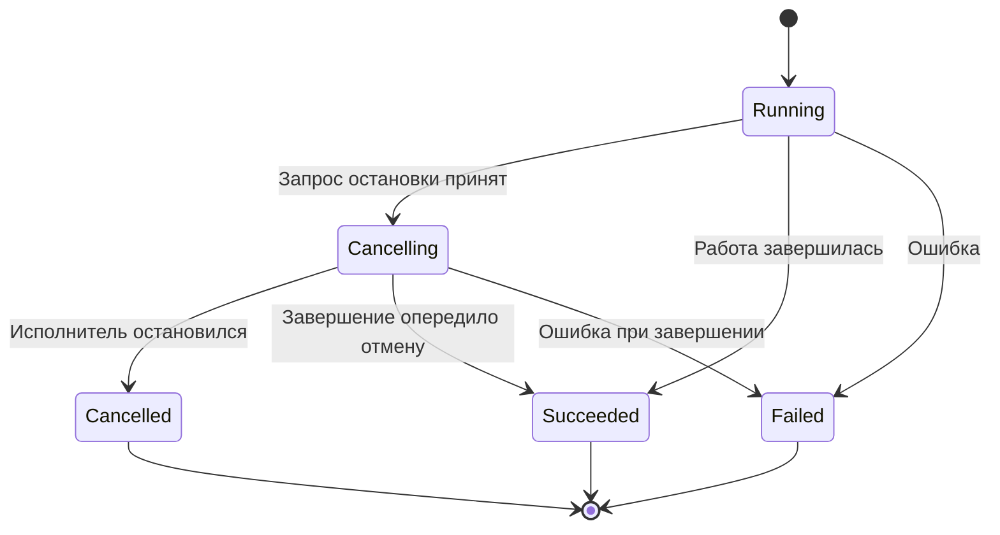

*Показана выполняющаяся задача. Очередь и восстановление опущены. Допустимость переходов является правилом приложения, а не автоматически следует из названий статусов.*

Состояние `cancelling` необходимо именно потому, что принятие запроса и остановка — разные моменты. GUI может немедленно показать «Запрашивается остановка», затем «Останавливается», но не должен объявлять `cancelled` по факту отправки сообщения.

Система также должна определить, как поступить с повторным нажатием. Повтор отмены не должен создавать новую задачу очистки каждый раз или возвращать уже завершённую работу в промежуточное состояние.

### Запрет запуска следующих элементов дешевле запрета всех будущих эффектов 🚧

Для пакетной работы практичным контрактом бывает: текущий элемент может закончиться, новые не начинаются. Он сохраняет простоту, если отдельное преобразование не поддерживает прерывание.

Более сильное обещание — не публиковать новые результаты после подтверждения остановки — требует координации с самим местом публикации. Проверить флаг перед записью недостаточно: между проверкой и записью флаг может измениться.

Возможна управляемая граница, где решение о публикации и решение об остановке принимаются последовательно. Но даже здесь нужно учитывать **уже выданные разрешения**. Если исполнитель получил разрешение и ещё не применил эффект, закрытие входа для новых разрешений не отменяет старое автоматически.

Для строгого подтверждения барьера необходимо либо дождаться завершения ранее допущенных публикаций, либо обеспечить отклонение устаревшего разрешения непосредственно ресурсом, принимающим эффект. Пока это не выполнено, корректный ответ — «барьер устанавливается» или «новые публикации больше не допускаются, ранее начатые ещё завершаются», а не обещание полного отсутствия последующих изменений.

### Управляющий контур не должен ждать за вычислением 🛤️

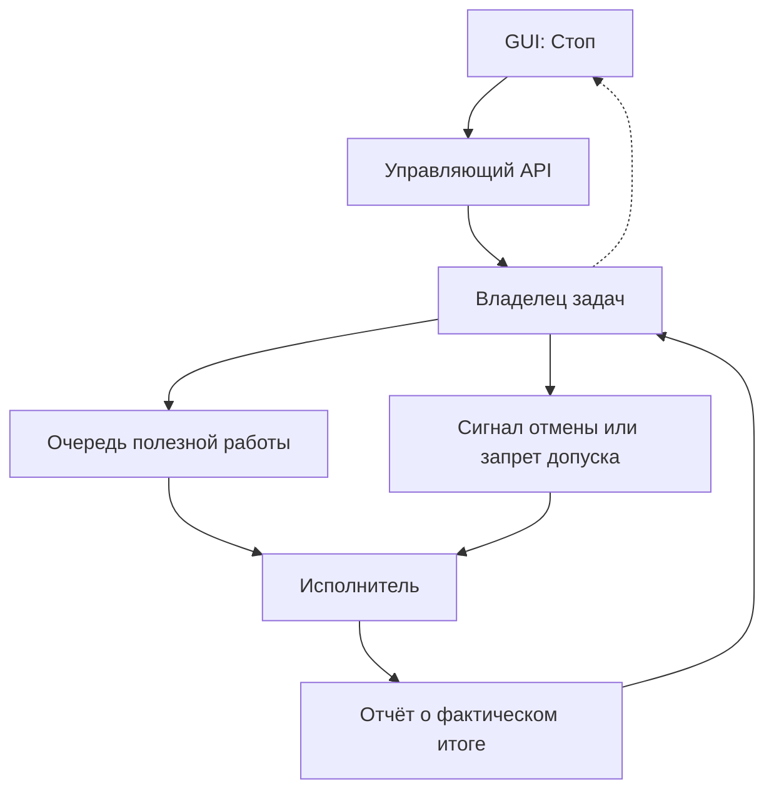

Две стрелки к исполнителю выражают разные обязанности. Управляющий запрос не должен оказаться обычным элементом после часовой обработки в той же заблокированной последовательности.

Это не обязательно два сокета или два сервера. Но должны оставаться ресурсы для приёма запроса, изменения состояния и передачи сигнала. Общий замок, удерживаемый на всё время работы, способен сделать отдельный поток управления бесполезным.

### Время остановки — измеряемое свойство, а не слово в API ⏱️

Задержка складывается из доставки управляющего запроса, достижения точки проверки, завершения неотменяемого участка и очистки. Если один из этих компонентов не имеет известной верхней границы, обещание «остановится не позднее заданного срока» требует дополнительного механизма либо не должно даваться.

У обычного desktop-приложения полезно измерять эти задержки на типичных и тяжёлых случаях. Но среднее значение или хороший результат одного теста не превращается в жёсткую гарантию.

Если сторонняя библиотека не поддерживает отмену, архитектура должна это признавать. Возможны остановка между вызовами, работа только с временными результатами или отдельный процесс для аварийного завершения. Скрывать ограничение за мгновенно исчезающим спиннером — не решение.

### Принудительное завершение требует изоляции и восстановления 🧯

Если работа выполняется в отдельном процессе, аварийное завершение может ограничить дальнейшее исполнение этого процесса. Но дочерние процессы, внешние сервисы и ранее начатые побочные эффекты требуют отдельного контроля.

После такого завершения состояние результата может быть неизвестным или частичным. Поэтому надёжнее сначала зафиксировать прерывание и провести проверку, а уже затем сообщать итог. Статус «процесс исчез» сам по себе не доказывает ни успех, ни безопасную отмену.

> [!warning] Отмена — контракт исполнения, а не обещание библиотеки интерфейса
> Красиво оформленная кнопка не добавляет прерываемости кодеку и не делает внешнюю запись обратимой. GUI должен показывать фактическую поддержку: немедленное принятие запроса, ожидаемую границу остановки и судьбу уже созданного результата.

---

## 15. Остановить задачу, пакет или агентную сессию — разные решения 🤖

Человек может захотеть прекратить одну операцию, весь пакет или дальнейшую деятельность агента в приложении. Эти намерения затрагивают разные области управления.

Один `job_id` не способен выразить их все.

### Область управления должна быть явной 🎯

| Область | Пример намерения | Что требуется найти и контролировать |
|---|---|---|
| **Попытка** | Прекратить конкретного зависшего исполнителя | Текущую попытку и её ресурсы |
| **Задача** | Остановить эту работу | Активную попытку, отложенные повторы и итог задачи |
| **Пакет** | Не обрабатывать остальные элементы | Дочерние работы и политику частичного результата |
| **Процесс** | Прекратить весь сценарий публикации | Текущий этап, ожидаемые действия и связанные задачи |
| **Агентная сессия** | Не принимать дальнейшие изменения от этого участника | Допуск, очередь и активные действия сессии |
| **Выданное полномочие** | Отозвать разрешение на автоматизацию ресурса | Все обращения и работы, использующие это разрешение |

Последние две строки особенно важны. Блокировка одной сессии не должна выдавать себя за запрет всех будущих сессий того же внешнего агента. Если требуется прекратить автоматизацию шире, отзывается соответствующее доверенное разрешение, а создание новой сессии не должно обходить это решение.

### Иерархия работы не создаёт отмену автоматически 🌳

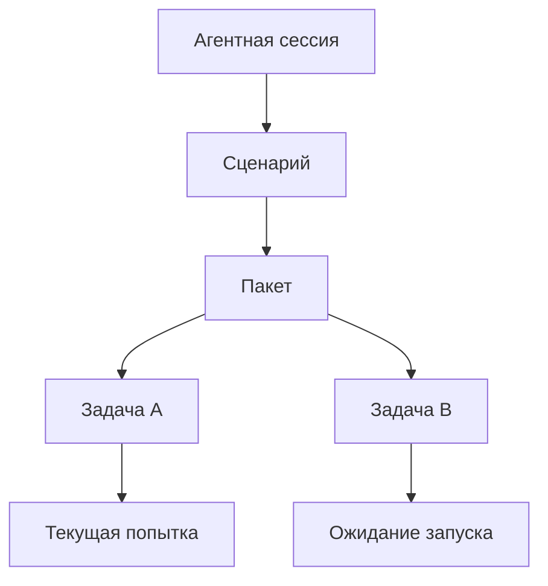

Такая структура позволяет определить область вмешательства, но не задаёт политику. Отмена родителя может отменять дочерние работы, оставлять уже опубликованное и запрещать новые этапы. Либо некоторые дочерние операции могут быть независимыми и продолжаться.

Контракт должен выбрать поведение явно. Иначе родительская карточка станет «Отменено», пока несколько дочерних исполнителей всё ещё меняют данные.

Для итогового состояния пакета полезно различать завершённые, отменённые, ошибочные и не начатые элементы. Один процент готовности не объясняет, что осталось после вмешательства.

### Блокировка сессии начинается с допуска, а не с карточек 🚪

В предлагаемой модели команда ограничения сессии сначала запрещает новые изменяющие запросы. Затем планировщик прекращает выдавать ещё не начатые работы, а активным исполнителям передаётся остановка по их контракту.

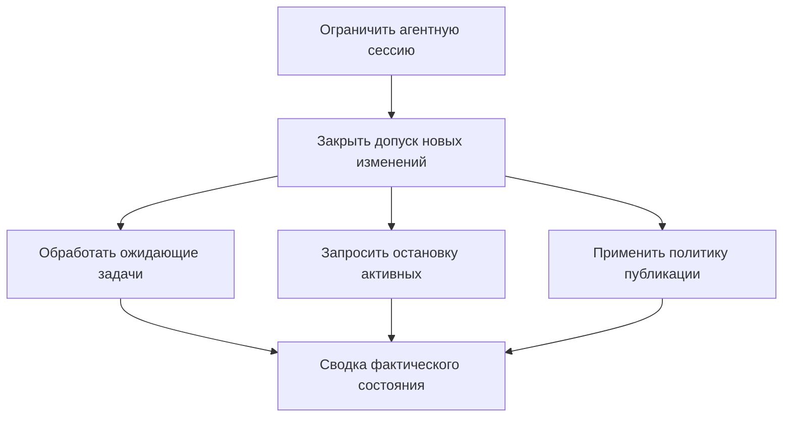

Проверки нужны не только в момент приёма. Давно принятая задача может попасть к исполнителю уже после блокировки. Отложенный повтор способен запуститься ещё позже. Поэтому планировщик и значимые точки применения должны учитывать актуальный допуск согласно выбранной гарантии.

Если активные операции ещё завершаются, ответ должен сообщать это отдельно. «Сессия больше не принимает новые изменения» и «все её действия завершены» — разные факты.

### Отменённая работа не должна воскресать после перезапуска 🔁

При устойчивом выполнении намерение остановки сохраняется вместе с необходимым состоянием. Иначе после перезапуска очередной планировщик увидит незавершённую задачу и повторит её, хотя человек уже запретил продолжение.

Аналогично возобновление сессии не должно автоматически превращать все отменённые задачи в выполняющиеся. Отмена — терминальное решение для выбранной работы, если контракт не предусматривает иного. Новый запуск может использовать прежние параметры, но должен быть различимым новым намерением или явно определённым продолжением.

Пауза — отдельная возможность. Она требует сохранённой точки продолжения и правил освобождения ресурсов. Наличие отмены не означает, что любая задача может быть безопасно приостановлена и продолжена.

### Приложение контролирует свои границы, а не внешний интеллект 🧱

Блокировка доступа через API не останавливает саму языковую модель и не прекращает её действия через другие инструменты. Если агент имеет отдельный доступ к терминалу и тем же файлам, он может действовать в обход приложения.

Для более сильного ограничения нужны полномочия среды запуска, файловая изоляция или другие механизмы вне прикладного API. Здесь важно не обещать больше, чем контролируется.

Идентичность сессии должна происходить из доверенного контекста. Поле `actor_id`, присланное агентом, не является доказательством его личности и не должно позволять перемещать задачи между областями управления.

> [!important] Контроль человека — отдельный прикладной сценарий
> Право наблюдать, право остановить задачу и право отозвать полномочие могут различаться. GUI показывает доступные действия, но окончательное решение принимает доверенная часть приложения, учитывающая актуальное состояние.

---

## 16. Что остаётся после остановки: результаты, Undo и компенсация 🔄

Остановка отвечает на вопрос о дальнейшем выполнении. Она не определяет автоматически судьбу уже созданных файлов, изменённого документа или отправленного сообщения.

Поэтому при выборе архитектуры нужно отдельно решить, **какие последствия допустимо сохранять** и **какие механизмы восстановления обещаны**.

### Четыре стратегии результата 📦

| Стратегия | Поведение после остановки | Цена |
|---|---|---|
| **Сохранить готовые результаты** | Подтверждённые элементы остаются, остальные не выполняются | Учёт частичного результата |
| **Подготовить в изоляции** | Незавершённый черновик не становится основным результатом | Временное хранилище и стадия публикации |
| **Предусмотреть Undo** | Допустимые изменения модели отменяются отдельной операцией | История, обратные действия, проверка конфликтов |
| **Компенсировать внешние эффекты** | Выполняются специально предусмотренные исправляющие действия | Сохранённые сведения, собственные ошибки и повтор компенсации |

Для независимой файловой обработки первая или вторая стратегия часто даёт понятную границу. Для редактора важна третья. Для процесса с внешними сервисами может понадобиться четвёртая. Их можно сочетать, но нельзя выдавать одну за другую.

### Подготовка и публикация снижают область риска 🧪

Вместо немедленной записи поверх рабочего результата система может сначала подготовить артефакт отдельно, проверить его и только затем сделать видимым как основной.

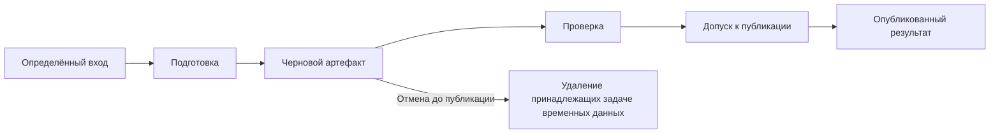

До публикации остановка может не затронуть прежний результат. После публикации для восстановления уже нужен другой сценарий.

Такая конструкция не гарантирует мгновенной атомарной замены всего набора ресурсов. Один файл, несколько файлов и запись в БД имеют разные границы фиксации. Система должна либо выбрать поддерживаемую атомарную область, либо описать частичный исход и сверку.

### Очистка должна знать принадлежность данных 🧹

Удаление «всех файлов в выходном каталоге» после отмены опасно: там могут находиться результаты других задач или изменения человека. Безопаснее связывать временные и опубликованные артефакты с конкретной задачей и проверять их актуальность перед удалением.

Если человек успел отредактировать созданный файл, автоматическая очистка не должна молча считать его неизменным продуктом старой задачи. Возможны отказ от удаления, подтверждение или сохранение новой версии — в зависимости от требований.

Та же проблема возникает при восстановлении резервной копии. Наличие старого файла ещё не даёт права заменить им более новый, созданный после работы агента.

### Undo в совместном редакторе не равно возврату снимка 📝

Для одиночной последовательной работы восстановление предыдущего состояния может быть приемлемым. При совместной работе требуется учитывать чужие последующие изменения.

Выборочная отмена может применяться только к определённому происхождению операций. Например, [Yjs UndoManager][yjs-undo] поддерживает ограничение отслеживаемых изменений через `trackedOrigins`. Это пример готового механизма выборочной истории, а не доказательство автоматической корректности любого предметного Undo.

Приложение всё равно определяет смысл группы, допустимость обратного изменения и поведение при исчезнувшей цели. Отмена изменения страницы не должна нарушить связи, созданные позднее другим участником.

### Компенсация — новая работа, а не путешествие во времени 🌐

Если результат уже отправлен во внешнюю систему, локальный rollback ничего не отменяет там. Нужна разрешённая внешняя операция: удалить публикацию, пометить её отменённой, восстановить прежнюю версию или выполнить другое предметное исправление.

[Compensating Transaction][compensation] прямо учитывает, что восстановление зависит от предметной области, может взаимодействовать с чужими изменениями и само может завершиться ошибкой. Поэтому компенсация нуждается в наблюдении и собственном результате.

В предлагаемой модели процесс не объявляется «полностью восстановленным», пока это не подтверждено. Возможен отдельный итог: исходная работа остановлена, но часть последствий требует внимания человека.

### «Всё или ничего» — дорогое и локальное обещание ⚖️

Полная атомарность полезна внутри подходящей транзакционной границы. Но её нельзя получить простым объединением команд в массив.

Для большой пакетной обработки часто разумнее явно разрешить частичные результаты, чем пытаться имитировать глобальную транзакцию на файлах и внешних сервисах. Для опасного изменения одного документа, наоборот, атомарная ограниченная группа может быть естественным выбором.

> [!warning] Возврат прежнего состояния — отдельная гарантия
> Статус `cancelled` говорит о завершении работы по правилам отмены. Он не должен подразумевать, что приложение никогда ничего не меняло. Частичные результаты и невосстановленные последствия должны оставаться видимыми.

---

## 17. Конкуренция: владение, версии и совместное редактирование 🤝

Когда несколько участников изменяют одни ресурсы, архитектура должна определить, какие пересечения допустимы. Увеличение числа потоков или переход к серверу сами по себе этого не решают.

Выбор механизма зависит от характера изменений, допустимости конфликтов и необходимости работать без постоянной связи.

### Основные варианты согласования 🔀

| Механизм | Когда полезен | Ограничение |
|---|---|---|
| **Разделение ресурсов** | Задачи работают с независимыми входами и выходами | Требуется действительно исключить пересечение целевых ресурсов |
| **Последовательный владелец** | Изменения документа короткие и применяются через одну границу | Старые намерения всё равно могут быть смыслово конфликтными |
| **Оптимистическая версия** | Конфликт допустимо обнаружить и пересмотреть | Клиент обязан корректно обработать отказ |
| **Ограниченная блокировка** | Операция требует исключительного доступа к небольшому участку | Длительное удержание ухудшает отзывчивость и создаёт ожидания |
| **Предметное слияние** | Изменения можно совместить по известным правилам | Правила зависят от смысла данных |
| **Реплицируемая модель** | Необходимы конкурентные правки и работа без постоянного центрального соединения | Сложность синхронизации, семантики и управления доступом |

Условная запись по версии имеет хорошо известный аналог в HTTP: [RFC 9110 описывает `If-Match`][http-semantics] как предусловие применения запроса, в том числе для предотвращения потерянных обновлений. Внутренний API может использовать другой транспорт и собственное поле версии, сохраняя ту же проектную цель.

### Самая дешёвая защита — не создавать конфликт без необходимости 🎯

Если независимые задачи пишут в разные временные области и публикуют результаты через контролируемый механизм, многие конфликты можно исключить конструктивно. Это проще, чем позволить всем изменять один общий файл и затем пытаться восстановить порядок.

Для длительной работы снимок входа также уменьшает область согласования. Исполнитель не держит документ заблокированным, а результат явно связан с определённой версией.

Но снимок не освобождает от проверки при обратном применении. Если вычисление подготовило изменения для старой версии, приложение должно проверить, допустимы ли они в текущем документе.

### Блокировка не должна охватывать размышление агента ⏳

Агент может долго выбирать следующую операцию. Удерживать на это время транзакцию, исключительный доступ к документу или общий замок задач обычно означает блокировать человека без необходимости.

В предлагаемой модели агент получает снимок, формирует намерение вне критической секции и отправляет ограниченную команду с предусловиями. Приложение быстро проверяет и применяет её либо возвращает конфликт.

Чем крупнее такая команда, тем важнее заранее определить область атомарности и ограничения размера. Бесконечная «транзакция агентного сценария» между десятками отдельных вызовов затрудняет управление и восстановление.

### Offline-first — отдельная развилка, а не бесплатная функция C 🌍

При требовании полноценного редактирования без связи один центральный владелец перестаёт быть единственным доступным местом изменения. Появляются локальные реплики и правила последующего согласования.

[Yjs][yjs] является примером CRDT-системы для конкурентного изменения общих типов данных. Такие механизмы помогают согласовать реплики, но выбор структуры и правил приложения остаётся самостоятельной задачей.

Сходимость данных не означает автоматического сохранения всех предметных инвариантов и правильного намерения пользователя. Например, две технически совместимые правки могут вместе нарушить бизнес-правило. Также синхронизация не решает сама по себе, кто имеет право публиковать результат или отзывать полномочия.

Для локального взаимодействия человека и агента CRDT может быть совершенно излишним. Последовательный владелец и проверка версии часто проще, если полноценная автономная работа нескольких реплик не требуется.

### Единая версия может быть слишком грубой, но это проверяется на практике 📐

Версия всего документа проста: любое чужое изменение делает старый запрос конфликтным. При независимых правках разных объектов это может приводить к лишним отказам.

Тогда возможны версии объектов, проверка только затронутых полей или предметные операции, допускающие совместное применение. Однако более тонкая гранулярность усложняет зависимости и историю.

Усложнение оправдано наблюдаемой проблемой: реальные конфликты мешают работе, а их можно безопасно различать. Заранее вводить сложную модель слияния ради гипотетического будущего необязательно.

---
## 18. Нагрузка и ресурсы: очередь не заменяет ограничений 🚦

Количество запросов — ещё одна независимая ось сложности. Приложение может не иметь сложного документа или многоэтапного процесса, но всё равно нуждаться в защите от чрезмерного параллелизма. Особенно заметной эта проблема становится при программном управлении: клиент способен отправить следующий запрос раньше, чем человек успел бы найти следующую кнопку.

В предлагаемой архитектуре производительность рассматривается не как обещание «запускать больше исполнителей», а как **управление ограниченным бюджетом ресурсов**. В этот бюджет входят память, процессорное время, дисковое пространство, пропускная способность хранилища, внешние лимиты и способность самого приложения принимать управляющие команды.

### Буфер сглаживает всплеск, но не создаёт вычислительную мощность 📥

Очередь позволяет отделить приём работы от её исполнения. Однако если работа устойчиво поступает быстрее, чем обрабатывается, очередь растёт, а ожидание увеличивается. Этот предел прямо рассматривается в описании [Queue-Based Load Leveling][queue-leveling].

Для учебного приложения из этого следует конкретное решение: очередь имеет предел, а принятие задачи — собственную политику. При исчерпании допустимого объёма приложение либо отклоняет новый запрос с понятной причиной, либо предлагает другой режим приёма. Оно не выдаёт безусловное обещание выполнить неограниченное количество работы.

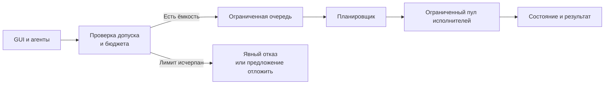

*Ограничение очереди и ограничение числа работающих исполнителей — разные решения. Небольшой пул не предотвращает бесконечного накопления ожидающих запросов.*

Проверка бюджета должна учитывать не только число записей. Сто небольших операций и одна операция с огромным входом способны иметь совершенно разную стоимость. Когда размер заранее неизвестен, полезны ограничение допустимого входа, резервирование доступного пространства и контролируемый отказ во время выполнения. Точность оценки не следует преувеличивать: прогноз остаётся прогнозом, а фактическое потребление требует наблюдения.

### Управление не должно конкурировать с обработкой на равных 🛑

Если все доступные ресурсы заняты тяжёлыми задачами, кнопка остановки может потерять практический смысл. Поэтому для управляющего пути важна не только отдельная функция `cancel`, но и возможность реально выполнить её при нагрузке.

Разделение ресурсов по классам работы соответствует идее [Bulkhead][bulkhead]: отказ или перегрузка одной группы не должны автоматически лишать работоспособности все остальные. Для локального приложения это может выражаться в независимом управляющем цикле, ограниченном числе рабочих процессов и коротких критических секциях.

Отдельный пул сам по себе не гарантирует отзывчивости, если все компоненты ждут один общий замок или исчерпали память всей машины. Поэтому проверяется весь путь: приём запроса, обращение к состоянию, передача сигнала и реакция исполнителя.

### Справедливость между участниками — проектное решение ⚖️

У общего менеджера задач полезно определить, как распределяется доступ между человеком и автоматизацией. Возможные политики включают ограничения на сессию, квоты рабочего пространства и приоритет интерактивных операций.

Но «человек всегда важнее» не является достаточным алгоритмом. Постоянный поток интерактивных запросов способен бесконечно отодвигать пакетную работу. Напротив, одна большая агентная серия может занять очередь на часы. Поэтому политика должна объяснять, когда задача получает шанс на выполнение и какие ограничения действуют на длинные серии.

Для небольшой утилиты достаточно фиксированного небольшого пула и общего лимита. Более сложное планирование оправдано, когда реальные участники мешают друг другу или появляются разные классы обслуживания. Оно не требуется только потому, что среди клиентов существует агент.

### Частота уведомлений тоже расходует ресурсы 📣

Менеджер может получать промежуточный прогресс чаще, чем GUI способен его отображать. В предлагаемой модели клиенту передаётся актуальное состояние с ограниченной частотой, а устаревшие промежуточные значения объединяются.

Это решение применяется именно к отображению прогресса. Подтверждение остановки, завершение, ошибка и записи обязательного аудита имеют другую семантику. Их нельзя бездумно отбросить вместе с промежуточными процентами.

Следовательно, архитектура различает как минимум два назначения сообщений: **показать последнее состояние** и **сохранить значимый факт**. Одна универсальная очередь «всех событий навсегда» редко одинаково хорошо обслуживает обе задачи.

### Хранение истории нуждается в сроках и объёмах 🗄️

Долгоживущее приложение накапливает задачи, результаты, временные файлы и диагностику. Даже если каждая отдельная операция устроена правильно, отсутствие политики хранения постепенно превращается в проблему доступности.

Для учебной системы полезно отдельно определить срок жизни карточки задачи, доступность её артефактов, хранение ключей повторного запроса и удаление диагностических данных. Эти сроки могут различаться. Удаление временного файла не обязано удалять историю выполнения, а очистка старой истории не должна неожиданно лишать пользователя опубликованного результата.

Здесь появляется ещё одна причина отделять `Job` от `Artifact`: завершение работы и окончание срока хранения её результата — разные события.

---

## 19. Хранение и доставка: какие факты должны пережить сбой 💾

После выбора профиля полезно отдельно составить карту долговечности. Вопрос «есть ли база данных» слишком груб. Существенно, **какие факты сохраняются, в какой момент и для какой гарантии**.

Одна и та же система может хранить документы постоянно, задачи — только до закрытия приложения, а положение панели — в локальных настройках. Это допустимо, если контракт не обещает другого.

### Сохраняются необходимые решения, а не все объекты подряд 📦

| Данные | Когда достаточно памяти | Когда нужно устойчивое хранение |
|---|---|---|
| **Запрос и параметры работы** | Задача явно привязана к текущему запуску | Принятая работа должна восстанавливаться |
| **Идентичность источника** | Вход удерживается в памяти до завершения | Исполнение может начаться позднее или повториться |
| **Намерение остановки** | После завершения процесса никакая работа не возобновляется | Отложенные и восстанавливаемые задачи могут стартовать снова |
| **Сведения о попытке** | Нет повторного назначения и переживающих владельца исполнителей | Возможны восстановление, переназначение и поздние отчёты |
| **План и подтверждение** | Действие выполняется немедленно в одной сессии | Между подготовкой, решением человека и применением есть длительное ожидание |
| **Факт публикации** | Побочный эффект не переживает исполнение или безопасно определяется заново | Повтор публикации опасен либо её результат может быть неизвестен |
| **Проекция GUI** | Можно восстановить из прикладного API | Нужен отдельный офлайн-кэш с собственной политикой актуальности |
| **Промежуточный прогресс** | Он нужен только для текущего отображения | Определённые значения являются контрольными точками восстановления |

Таблица описывает выбор, а не универсальное требование сохранять всё. Например, процент прогресса обычно не позволяет продолжить вычисление. Контрольная точка должна содержать данные, достаточные для корректного продолжения или повторного выполнения определённой части работы.

### Истина о задаче не обязана жить в очереди сообщений 📨

Очередь помогает доставить работу исполнителю. Но удаление сообщения после получения не отвечает на вопросы GUI: что было запущено, кем, на каком входе и с каким результатом.

Поэтому в предлагаемом профиле B состояние задачи хранится у менеджера, а очередь выступает механизмом назначения. В простом варианте обе роли может выполнять одна таблица с ограниченным протоколом захвата работы. В другом варианте очередь внешняя. Архитектурная роль остаётся различимой независимо от числа технологий.

Если используются и БД, и отдельный транспорт, необходимо учитывать окно между сохранением задачи и отправкой сообщения. Наличие двух надёжных компонентов само по себе не делает согласованной последовательность двух записей.

### Когда достаточно перечитать состояние, а когда нужен outbox 🔁

Для панели активности потерянное промежуточное уведомление может быть исправлено запросом актуального списка задач. Для обязательного следующего этапа потеря сообщения способна остановить весь процесс.

Во втором случае возможен [transactional outbox][outbox]: изменение состояния и запись о будущем сообщении фиксируются одной транзакцией, а доставка выполняется отдельно. Получатель учитывает повторы, поскольку повторная отправка остаётся возможной.

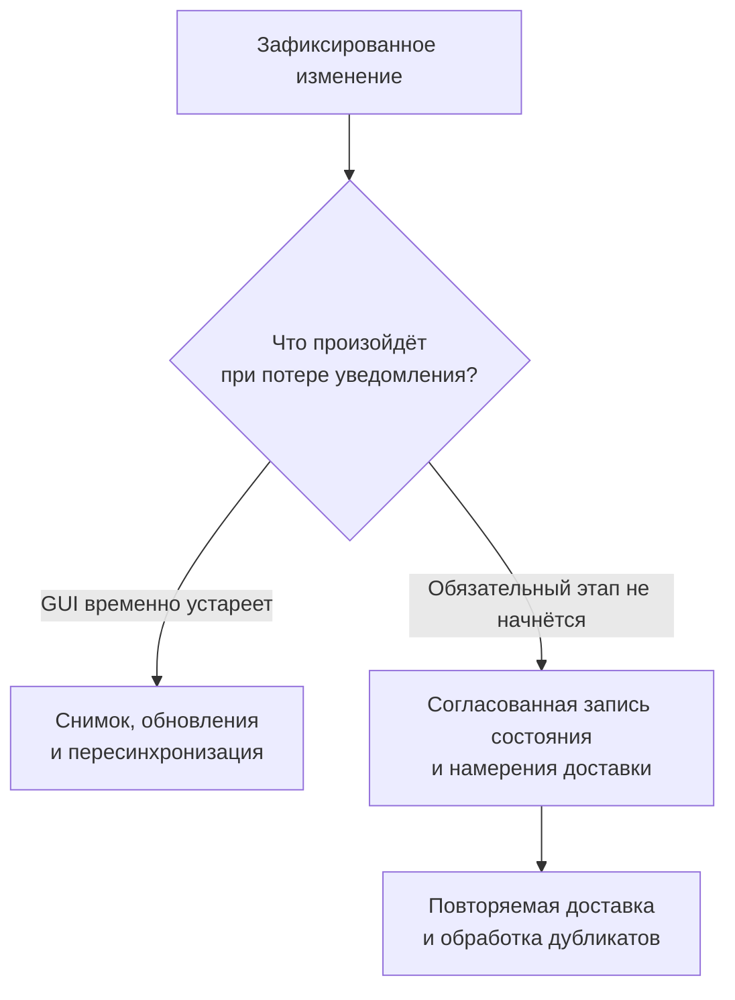

*Это критерий выбора гарантии, а не требование использовать именно outbox в каждой сохраняемой системе. Внутренний планировщик может читать принятые работы непосредственно из того же авторитетного хранилища.*

Добавлять outbox только ради анимации спиннера необязательно. Но нельзя обещать обязательную реакцию другой подсистемы, если единственное основание этой реакции — неповторяемое уведомление в памяти.

### Повтор приёма и повтор внешнего эффекта — разные границы 🔐

Ключ идемпотентности на входе может обеспечить возвращение прежнего `job_id` вместо создания второй задачи. Для этого приложение согласованно хранит ключ, параметры намерения и результат принятия. Различие между повтором того же намерения и новым запросом с другими параметрами рассматривается в [AWS Builders’ Library][idempotency].

Однако одна задача способна иметь несколько попыток. Если первая попытка уже отправила результат во внешнюю систему, а подтверждение потерялось, защита от двойного создания задачи не решает вопрос повторной отправки.

В предлагаемой модели архитектурный паспорт поэтому отдельно фиксирует защиту **на входе**, **при выполнении** и **в точке эффекта**. Для внешней публикации может потребоваться поддерживаемый получателем ключ, запрос состояния по устойчивому идентификатору или остановка на ручной сверке. Абстрактное обещание «ровно один раз» заменяется описанием конкретной обеспеченной границы.

### Долговечность и доступность не тождественны 🧭

Сохранённая задача может пережить падение процесса, но оставаться недоступной, пока не запущен её владелец. Резервная копия помогает восстановить потерянные данные, но не гарантирует немедленного продолжения. Отдельный локальный сервис переживает закрытие окна, но не отключение компьютера без механизмов последующего восстановления.

Поэтому контракт должен называть событие, которое система переносит: закрытие представления, перезапуск процесса, аварийное завершение, потерю машины или недоступность внешнего сервиса. Фраза «задачи надёжно хранятся» без этой границы скрывает слишком много разных ожиданий.

---

## 20. Безопасность и полномочия — поперечное требование 🛡️

Ни один профиль не освобождает от проверки допустимости действия. Небольшая утилита, принимающая путь от внешнего клиента, уже имеет границу доверия. Сложная система только добавляет больше мест, где ранее принятое разрешение может устареть или быть ошибочно расширено.

Общие принципы минимальных полномочий, запрета по умолчанию и проверки доступа к каждому запросу сформулированы в [OWASP Authorization Cheat Sheet][authorization]. В этой серии они применяются к единой прикладной границе, а не только к экранным кнопкам.

### Профиль меняет форму делегирования, а не необходимость проверки 🔑

| Профиль | Характерная граница полномочий |
|---|---|
| **A** | Разрешение на конкретный вход, действие и целевой результат |
| **B** | Разрешение принять работу, исполнить её позднее и управлять созданной задачей |
| **C** | Право чтения и изменения определённой документной сессии и её объектов |
| **D** | Право продолжать этапы, принимать подтверждения и выполнять внешние эффекты после ожидания |

Для профиля A проверка часто находится рядом с немедленным выполнением. Для профилей B и D между приёмом и эффектом может пройти много времени. Поэтому требуется выбрать политику: задача получает ограниченную делегированную возможность на определённый срок либо повторно проверяет актуальные полномочия на значимых этапах.

Ни одна политика не должна возникать случайно из того, что в очередь сохранили весь объект пользовательской сессии. Контракт определяет, что произойдёт при отзыве доступа, выходе пользователя, блокировке агента и истечении срока разрешения.

### Подтверждение относится к плану, а не к произвольному следующему вызову 📝

Для опасной операции приложение может сначала подготовить план последствий. Человек одобряет конкретные ресурсы, параметры и область изменений. Затем применение проверяет, что план всё ещё актуален.

В этой модели подтверждение не передаётся как свободное `approved: true` от агента. Приложение хранит факт одобрения или проверяемое разрешение, связанное с планом. Изменение списка объектов или выходного назначения требует повторной оценки.

Слишком долго живущее общее разрешение «делать всё с этой папкой» может не соответствовать ожиданию человека, одобрившего одну конкретную операцию. Поэтому план имеет область, срок жизни и понятные условия повторного использования.

### Инструмент агента не является песочницей для самого агента 🧱

Если внешняя среда имеет независимый доступ к тем же файлам, ограничения MCP-адаптера действуют только на этот путь. Аналогично плагин с произвольным кодом внутри привилегированного процесса способен обойти прикладные методы, если среда не ограничивает его технически.

Поэтому решение о плагинах или сторонних исполнителях может потребовать отдельной процессной и системной изоляции. Реестр команд позволяет контролировать разрешённые операции через API, но не отменяет полномочия операционной системы.

Это ещё один пример независимой оси: небольшое по предметной логике приложение с недоверенными плагинами может нуждаться в более строгой изоляции, чем большой локальный редактор без стороннего кода.

### Человек должен видеть значимые действия, но не подтверждать каждый процент 👤

В [описании MCP Tools][mcp-tools] отдельно обсуждаются видимость вызовов инструментов и участие человека в принятии решений. Конкретная политика остаётся за приложением и агентной средой.

Для предлагаемой системы полезно различать безопасное чтение, ограниченные изменения, дорогие работы и необратимые последствия. Первые могут выполняться без отдельного диалога. Последние требуют более сильного допуска, предварительного плана или ручного решения.

Избыточные подтверждения способны превратить управление в механическое нажатие «Разрешить». Поэтому место подтверждения выбирается по последствиям, а не по самому факту, что запрос пришёл от агента. Кнопка «Стоп» остаётся дополнением, но не заменой контроля до быстрого необратимого действия.

---

## 21. Матрица выбора: требование → механизм → цена 🗺️

После разбора отдельных механизмов выбор можно собрать в практическую матрицу. Её назначение — не выдать единственный правильный стек, а показать связь между обещанием и необходимой ответственностью.

### Основная матрица решений 📐

| Наблюдаемое требование | Минимально необходимая ответственность | Цена и ограничения | Что не возникает автоматически |
|---|---|---|---|
| **Операция доступна GUI, CLI и агенту** | Общий прикладной API и адаптеры | Контракты, преобразование ошибок, проверки доступа | Реестр всех внутренних функций, отдельный сервер |
| **GUI показывает работу, начатую агентом** | Общий владелец работы и доступное состояние | Подключение к правильной сессии, обновление представления | Имитация нажатий мыши |
| **Одна текущая работа имеет «Стоп»** | Управляемый исполнитель и сигнал отмены | Безопасные точки, очистка, честное состояние остановки | Постоянная очередь и workflow |
| **Несколько работ имеют карточки и независимое управление** | Идентифицируемые задачи и менеджер жизненного цикла | Согласование переходов, ограничение очереди, результаты | Брокер сообщений |
| **Окно открывается после старта задачи** | Запрос состояния и последующее наблюдение | Восстановление проекции и обнаружение разрыва связи | Хранение всех событий за всё время |
| **Работа продолжается после закрытия окна** | Владелец с независимым временем жизни | Управление фоновым процессом, подключение GUI | Переживание падения этого процесса |
| **Принятая работа восстанавливается после перезапуска** | Сохраняемые параметры, состояние и процедура восстановления | Фиксация входа, сверка эффектов, правила повторов | Продолжение с произвольной инструкции программы |
| **Человек и агент меняют общий документ** | Владелец документной модели и согласование изменений | Конфликты, версии, история, границы атомарности | CRDT и автономная работа реплик |
| **Отмена должна предотвратить публикацию после подтверждённого барьера** | Согласование остановки с точкой эффекта | Учёт ранее допущенных публикаций и внешних ограничений | Достаточность одного булевого флага |
| **Нужно запретить дальнейшие действия агента** | Отзыв допуска сессии или делегированного разрешения | Проверки при приёме, выдаче и фиксации по выбранной гарантии | Остановка внешней модели и её других инструментов |
| **Процесс ждёт человека и продолжается через несколько запусков** | Сохраняемая координация этапов | Версии сценария, длительные ожидания, актуальность одобрений | Необходимость микросервисов |
| **Несколько клиентов редактируют без связи** | Локальные реплики и политика согласования | Конфликты, синхронизация, права и предметные ограничения | Достаточность обычной подписки на события |
| **Один клиент способен перегрузить приложение** | Ограничение допуска и ресурсов | Квоты, отказы, справедливость и мониторинг | Бесконечная ёмкость очереди |
| **Сторонний код не должен иметь доступ ко всему приложению** | Техническая граница изоляции и ограниченные возможности | Межпроцессное взаимодействие и управление полномочиями | Безопасность от одного Command Registry |

Таблица показывает, почему одно требование редко выбирает всю архитектуру. Работа после закрытия окна определяет время жизни владельца, но не обязательно модель документа. Общая сессия определяет доступ к состоянию, но не гарантирует восстановление после аварии. Каждая гарантия добавляет собственную обязанность.

### Профиль и дополнительные оси выбираются отдельно 🧭

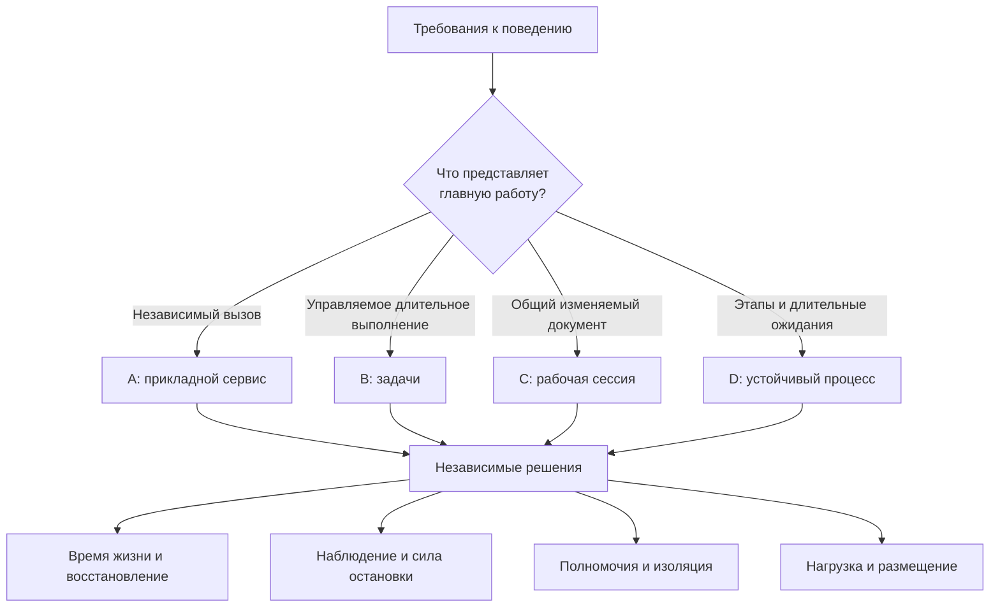

*Выбор основной ветви не запрещает сочетание профилей. Редактор может использовать C для документа, B для экспорта и D для согласования публикации.*

### Цена механизма включает сопровождение 🔧

Оценка «это всего один дополнительный класс» обычно неполна. У механизма появляются состояния, отказные ситуации и обязательства перед клиентами.

Например, сохраняемая очередь требует определить судьбу задачи при обновлении программы. Система подтверждений — срок действия плана и реакцию на изменение ресурсов. Поток событий — восстановление подписки. Отдельный процесс — запуск, завершение, обнаружение и совместимость протокола.

Поэтому сравнивается не только количество строк реализации. Важны количество новых состояний, границы отказа, необходимые тесты и стоимость эксплуатации. Иногда десять строк прямого вызова и явное ограничение продукта полезнее универсального механизма, реальная семантика которого ещё не определена.

### Отложенное решение должно иметь условие пересмотра 📌

Отказ от механизма становится управляемым, когда зафиксирована причина и наблюдаемый повод вернуться к вопросу.

Например: очередь пока хранится в памяти, потому что работа привязана к текущему запуску, а потерянное выполнение безопасно повторяется. Решение пересматривается при появлении требования продолжать принятые задачи после перезапуска. Здесь нет скрытого обещания надёжности, которое реализация пока не выполняет.

Аналогично отказ от CRDT оправдан общей доступной документной сессией и отсутствием автономного редактирования. Поводом к пересмотру становится конкретная потребность в работе нескольких реплик без связи, а не появление ещё одной панели в интерфейсе.

> [!tip] Признак достаточной архитектуры
> Каждый введённый механизм отвечает на существующее требование. Каждая обещанная гарантия имеет владельца, контракт и проверку. Отсутствующие механизмы обозначены как сознательные ограничения, а не скрытые пробелы.

---
## 22. Четыре разобранных архитектурных решения 🔬

Профили полезны как словарь, но выбор становится яснее на конкретных ограничениях. Ниже приведены четыре условных приложения. Для каждого важны не только принятые механизмы, но и **то, от чего архитектура сознательно отказывается**.

Эти сценарии не являются спецификацией практического конвертера из четвёртой статьи. Они показывают метод принятия решений на разных предметных задачах.

### Сценарий 1. Проверка архива перед загрузкой 🔎

**Задача продукта.** Небольшая утилита проверяет структуру архива, допустимые имена и суммарный размер содержимого. Она не изменяет исходник. Результат — отчёт. GUI, CLI и агент должны получать одинаковые выводы.

Проверка иногда занимает заметное время, поэтому окно должно оставаться отзывчивым. Человек может прекратить текущую проверку. Продолжение после перезапуска не обещается, история запусков не является самостоятельной функцией.

**Выбранная основа — профиль A с управляемым исполнением.** Прикладной сервис принимает источник и политику проверки. Рабочий исполнитель читает архив и сообщает о проверенных элементах. GUI отображает состояние текущей операции. Сигнал отмены проверяется между допустимыми единицами обработки.

При агентном запуске из открытого приложения адаптер обращается к тому же экземпляру сервиса. Независимый CLI-запуск остаётся отдельной сессией и не выдаётся за работу внутри этого окна. Это ограничение отражается в описании режимов.

| Решение | Обоснование |
|---|---|
| Общий сервис проверки | Правила архива не повторяются в трёх интерфейсах |
| Небольшой идентификатор текущей операции | Позволяет связать прогресс и остановку без сохраняемой системы задач |
| Работа вне блокирующего GUI-пути | Окно принимает вмешательство во время чтения |
| Неопределённый индикатор там, где размер работы ещё неизвестен | Не требуется выдумывать процент |
| Отсутствие постоянной очереди | Нет требования переживать завершение приложения |

Отмена прекращает дальнейшую проверку и возвращает явно неполный отчёт либо не выдаёт итоговый отчёт вовсе — конкретная политика выбирается продуктом. В этом сценарии нельзя пометить частично проверенный архив как полностью безопасный только потому, что обработчик остановки завершился без исключения.

**Что не вводится.** Workflow, отдельный сервис, Event Sourcing, долговременные `Attempt` и универсальная шина всех операций. Предметные правила могут быть обычными функциями без иерархии сущностей.

**Проверка решения.** Агент начинает проверку; GUI показывает ту же операцию. Человек нажимает «Стоп»; новые элементы перестают проверяться на следующей согласованной границе. Итог обозначен как прерванный, а исходный архив не изменён.

**Повод пересмотреть архитектуру.** Появились очередь из многих архивов, позднее подключение к истории или необходимость продолжать после перезапуска. Тогда вводится самостоятельная модель задач, а не маскируется очередь внутри переменной `current_operation`.

### Сценарий 2. Локальное индексирование коллекции документов 🗂️

**Задача продукта.** Приложение строит поисковый индекс по выбранной коллекции. Пользователь и агент могут запускать обновления, наблюдать прогресс и останавливать пакет. Закрытие окна не должно прекращать принятую работу. После перезапуска компьютера приложение должно определить, какие элементы обработаны, и продолжить допустимые операции.

**Выбранная основа — профиль B с сохраняемой очередью и локальным владельцем вне окна.** GUI подключается к сервисной части. У неё находятся менеджер задач, состояние пакетов, идентичность входных файлов и ограниченный пул исполнителей.

Для каждого элемента сохраняется достаточно сведений, чтобы отличить обработанную версию от нового содержимого. Сам путь не считается доказательством неизменности файла. Изменившийся источник либо обрабатывается как новое намерение, либо явно обновляет соответствующий элемент по правилам индексатора.

```mermaid
flowchart LR
    GUI["GUI"] --> API["Локальный прикладной API"]
    MCP["MCP-адаптер"] --> API
    API --> JOBS["Менеджер индексации"]
    JOBS <--> DB["Задачи, версии источников<br/>и индекс"]
    JOBS --> WORKERS["Ограниченные исполнители"]
    WORKERS -->|"Подготовленные записи"| JOBS
    JOBS -.->|"Состояние"| GUI
```

**Почему здесь ещё не нужен профиль D.** Элементы в основном независимы; нет многодневного согласования, внешней публикации и сложного ветвления. После сбоя достаточно определить уже завершённые версии, проверить неоднозначные элементы и повторить безопасные части.

Для клиента индексирование имеет один `job_id`, но внутренняя организация может использовать записи элементов, а не публичную задачу на каждую страницу. Такая гранулярность снижает количество внешних объектов, сохраняя необходимую отчётность.

**Остановка.** Отмена пакета запрещает выдачу следующих элементов. Активные исполнители завершают работу по выбранным точкам отмены. Уже опубликованные индексные записи сохраняются. Если продукт обещает, что отменённый пакет не делает новую версию индекса видимой, требуется иной режим: подготовка отдельного поколения и переключение после завершения. Это уже другая гарантия и дополнительная стоимость хранения.

**Что не вводится.** Микросервисы, универсальный движок workflow, сложное согласование реплик. Один локальный владелец и одно согласованное хранилище могут быть достаточны.

**Проверка решения.** Окно закрывается, работа продолжается. После повторного открытия отображаются существующие задачи. После аварии менеджер не считает все ранее `running` элементы ни автоматически успешными, ни автоматически безопасными для повтора: он применяет правило восстановления. Отмена, зафиксированная до аварии, не теряется.

**Повод пересмотреть архитектуру.** Добавились удалённые исполнители, этап ручного одобрения, несколько зависимых поколений или внешние платные действия. Тогда новые гарантии рассматриваются отдельно, а не выводятся из уже существующей очереди.

### Сценарий 3. Совместная работа в редакторе структуры документа 📝

**Задача продукта.** Редактор хранит страницы, разделы и ссылки между ними. Человек и агент могут изменять открытый несохранённый документ. GUI должен сразу показывать результат. Действия агента должны быть различимы в истории, а экспорт — выполняться без блокировки редактирования.

**Выбранная основа — профиль C для документа и профиль B для экспорта.** У каждого открытого документа есть авторитетная сессия. Изменения выполняются через общий API с явными идентификаторами и условиями версии. Экспорт получает фиксированный снимок, а не изменяемую ссылку на живой документ.

В этой системе локальная история — часть предметного взаимодействия, а не просто журнал вызовов. Операция удаления раздела проверяет ссылки и определяет судьбу вложенных объектов. Агент не получает универсальное право менять внутренние поля в обход этих правил.

| Область | Выбранная политика |
|---|---|
| Содержимое документа | Общая авторитетная модель |
| Выделение и положение просмотра | Локальное состояние участника |
| Короткое изменение | Проверка предусловий и ограниченное атомарное применение |
| Серия действий агента | Явная группировка истории там, где допустима общая отмена |
| Экспорт | Отдельная задача из снимка определённой версии |
| Конфликт устаревшего намерения | Отказ с возможностью перечитать состояние |

**Почему не CRDT сразу.** Участники работают через доступного общего владельца. Требования редактировать автономно без связи нет. Сложный механизм репликации добавил бы новые вопросы согласования, не решая необходимую сейчас задачу лучше простого контролируемого применения операций.

**Остановка.** Короткая операция может закончиться до нажатия кнопки. Поэтому для неё полезнее ограничение масштаба и история. «Остановить агента» запрещает новые изменяющие запросы его сессии и обрабатывает ещё не применённую работу. Уже выполненные правки отменяются отдельным сценарным действием, которое не должно стирать последующие изменения человека.

**Что не вводится.** Единый долгий Job на всю жизнь документа, очередь для каждого изменения одного свойства и автоматическое переключение человеческого фокуса вслед за агентом.

**Проверка решения.** Человек меняет раздел после чтения агентом. Запрос агента со старым предусловием не перезаписывает изменение молча. Экспорт продолжает работать со своим снимком. Отмена группы агентных изменений либо безопасно применяется в своей области, либо сообщает конфликт, но не восстанавливает весь документ поверх чужих правок.

**Повод пересмотреть архитектуру.** Появилось настоящее офлайн-редактирование, недопустимо много ложных конфликтов общей версии либо потребовалась серверная совместная сессия. Тогда уточняются гранулярность версий, размещение владельца и модель согласования.

### Сценарий 4. Подготовка отчёта с одобрением и внешней публикацией 📤

**Задача продукта.** Программа собирает материалы, готовит отчёт, показывает предварительный результат, ждёт одобрения и публикует его во внешнем сервисе. Ожидание может переживать несколько запусков приложения. Повторная публикация нежелательна, а отказ внешнего сервиса иногда оставляет исход неизвестным.

**Выбранная основа — профиль D с задачами для отдельных вычислений.** Координатор хранит этап процесса, входные версии, артефакт, решение человека и состояние внешней публикации. Подготовка отчёта выполняется исполнителем B, а ожидание одобрения не занимает рабочий слот и не держит блокировку документов.

```mermaid
flowchart TD
    SOURCE["Зафиксировать входные материалы"] --> BUILD["Подготовить артефакт"]
    BUILD --> WAIT["Ожидать одобрения"]
    WAIT --> CHECK["Проверить актуальность<br/>плана и полномочий"]
    CHECK --> PUBLISH["Запросить внешнюю публикацию"]
    PUBLISH --> RESULT{"Исход подтверждён?"}
    RESULT -->|"Да"| DONE["Завершить процесс"]
    RESULT -->|"Нет"| RECONCILE["Сверить внешний результат"]
    RECONCILE -->|"Нельзя установить автоматически"| HUMAN["Ручное решение"]
```

Подтверждение связывается с конкретным артефактом и назначением. Если после одобрения отчёт перестроен из других материалов, публикация нового содержимого не прикрывается прежним решением человека.

**Остановка.** До внешней отправки можно запретить публикацию и сохранить подготовленный результат. Во время уже отправленного запроса остановка не доказывает, что внешний сервис ничего не сделал. Координатор переходит к выяснению исхода либо фиксирует известный состоявшийся эффект. Если поддерживается удаление публикации, оно оформляется как отдельное действие с собственным результатом.

**Почему сохраняемой очереди недостаточно.** Здесь важны зависимости между этапами, длительное ожидание человека, актуальность разрешения и восстановление неоднозначного эффекта. Простого списка независимых элементов с флагом «готово» уже недостаточно для выражения обещаний продукта.

**Что не вводится автоматически.** Отдельный микросервис на каждый этап, самостоятельный брокер для каждого перехода и универсальное обещание exactly-once. Для небольшого развёртывания координатор может оставаться модулем одного приложения, если его хранение и восстановление реализуют необходимые гарантии.

**Проверка решения.** Процесс перезапускается после одобрения и сохраняет связь решения с артефактом. Потеря ответа на публикацию не вызывает слепую повторную отправку. Изменение назначения после одобрения требует новой проверки. При блокировке агентного доступа дальнейшее поведение определяется политикой уже делегированного процесса, а не случайно сохранённым токеном.

**Повод пересмотреть архитектуру.** Масштаб, количество независимых процессов и сложность обновлений делают собственную координацию дороже специализированной платформы. Выбор платформы тогда оценивается по реальным требованиям восстановления, сопровождения и эксплуатации, а не по одному слову «workflow».

### Что показывает сравнение сценариев 🧭

Во всех четырёх случаях существует общий прикладной язык операций. Но главные архитектурные объекты различаются: результат проверки, задача индексирования, живая модель документа и устойчивый процесс публикации.

Ни один вариант не является «недоделанным» относительно другого. Неполноценной становится система, которая обещает свойства одного профиля, а реализует только механизмы другого. Например, хранит задачи лишь в памяти, но показывает их как гарантированно принятые на последующее восстановление.

---

## 23. Эволюция без полного переписывания 🌱

Выбор архитектуры не обязан происходить однажды навсегда. Полезнее сохранить устойчивый прикладной смысл и постепенно менять механизмы там, где появились новые требования.

Идея постепенной замены отдельных частей вместо одномоментного переписывания соответствует подходу [Strangler Fig Application][strangler]. В контексте этой серии она применяется к выделению сценариев и переключению клиентов на общий API, а не требует специальной платформы миграции.

### Первый переход: вынести один сценарий из интерфейса 🚪

В существующем приложении обработчик кнопки может выполнять все действия сам. Первый разумный срез — выбрать одну законченную операцию и отделить её параметры, результат и ошибки от виджетов.

Существующий GUI становится первым клиентом нового сценария. Затем подключается тест или CLI. Если для второго способа управления приходится заново реализовать проверки и правила, граница выделена недостаточно хорошо.

Так проверяется практическая ценность общего ядра до создания универсального реестра. Рефакторинг не обязан одновременно менять дизайн окна, формат хранения и все остальные функции.

### Второй переход: отделить принятие работы от выполнения ⏳

Когда несколько длительных операций перестают помещаться в модель «одна текущая работа», появляется публичный `Job` и менеджер состояния.

У существующего синхронного API нельзя молча изменить смысл результата. Вместо готового файла он не должен внезапно возвращать идентификатор, который старый клиент принимает за завершённую работу. Возможны новая операция запуска, новая версия контракта или совместимый синхронный адаптер, который ждёт завершения новой задачи.

Внутреннее выполнение при этом может использовать прежнюю проверенную функцию. Меняется организация её жизни, а не обязательно сам алгоритм.

### Третий переход: добавить долговечность на определённой границе 💾

После появления требования восстановления сохраняются задача, идентичность входа, намерение остановки и сведения о результате. Дополнительно вводится стартовая процедура сверки прерванных попыток.

Само переключение репозитория с памяти на БД не завершает переход. Нужно определить, когда возвращается `accepted`, что происходит со старой очередью, какие результаты можно повторить и как обрабатываются записи прежней версии программы.

Миграция полезна как отдельное изменение с испытанием аварийных точек. Иначе приложение приобретёт постоянные таблицы, но сохранит прежние неявные предположения о непрерывном процессе.

### Выделение процесса следует за временем жизни или изоляцией 🏠

Локальный сервис оправдан, когда работа должна жить независимо от окна либо несколько клиентов должны обращаться к одному владельцу. Отдельный рабочий процесс оправдан изоляцией нагрузки, сбоев или недоверенного кода.

Передача ответственности новому процессу требует исключить двух одновременно активных владельцев одного ресурса. На время перехода определяется, где принимаются изменения, как маршрутизируются старые клиенты и как завершаются уже начатые операции.

Нельзя считать миграцию завершённой, если GUI продолжает менять локальную модель, а новый MCP-сервер — отдельную копию в сервисе. Общий формат DTO не устраняет раздвоение авторитетного состояния.

```mermaid
flowchart TB
    START["Логика внутри GUI"] --> CORE["Общий прикладной сценарий"]
    CORE --> API["Явные контракты и несколько адаптеров"]

    API -->|"Нужны самостоятельные работы"| JOBS["Менеджер задач"]
    API -->|"Нужен общий документ"| SESSION["Документная сессия"]

    JOBS -->|"Нужно переживать перезапуск"| PERSIST["Сохраняемое выполнение"]
    PERSIST -->|"Нужны зависимые этапы и ожидания"| FLOW["Координатор процесса"]

    JOBS -.->|"Независимое время жизни"| SERVICE["Отдельный владелец-процесс"]
    SESSION -.->|"Общая доступная сессия"| SERVICE
```

*Ветви отражают возможные требования. Они не предписывают каждому приложению пройти всю схему.*

### Сложный редактор развивается модулями, а не одним универсальным движком 🧩

В растущем редакторе полезно выделять документы, историю, экспорт и задачи вокруг собственных обязанностей. Каждый модуль имеет ограниченный прикладной интерфейс. Это облегчает проверку зависимостей и позволяет менять инфраструктуру без постоянного обхода правил соседних модулей.

Общий Command Registry может предоставлять каталог их операций, но не должен превращаться в место, где живут все правила и все данные. Аналогично единая база не делает допустимым прямое изменение любых таблиц из любого обработчика.

Такой модульный монолит сохраняет возможность дальнейшего разделения. При этом цена распределённого взаимодействия откладывается до появления необходимости, а не оплачивается заранее только ради потенциального будущего.

### При миграции сохраняется проверяемый смысл 🧪

Для каждой переносимой операции полезен набор одинаковых контрольных сценариев: корректный запрос, недоступный ресурс, конфликт, частичная ошибка, повтор и отмена там, где она поддерживается.

Новый адаптер может по-другому упаковывать ответ, но не должен случайно менять предметные правила. Вместе с тем транспортные сбои становятся отдельной реальностью. Удалённый вызов не обязан притворяться безошибочной локальной функцией.

Сравнение наблюдаемого поведения помогает отличить полезное изменение архитектуры от незапланированного изменения продукта. Сохранить прежний баг навсегда не требуется, но исправление семантики должно быть осознанным и совместимым с клиентскими ожиданиями.

### Удаление ненужного механизма тоже является развитием ✂️

Если первоначально введённый брокер, универсальный диспетчер или слой прокси не обслуживает ни одной актуальной гарантии, его удаление может упростить систему без потери свойств.

Перед удалением проверяются реальные обязанности: возможно, через компонент проходит дедупликация, проверка прав или восстановление. Убирается лишнее посредничество, а не случайно исчезает важная гарантия.

Эволюционная архитектура допускает и добавление, и сокращение механизмов. Её устойчивость определяется ясностью контрактов и владельцев состояния, а не запретом менять количество прямоугольников на первоначальной схеме.

---
## 24. Проверка архитектуры: сценарии на границах гарантий 🧪

Архитектурное решение полезно тогда, когда его можно испытать. Проверка «существует класс `JobManager`» почти ничего не говорит о контроле человека. Проверка «задача агента видна в GUI и останавливается по документированной границе» проверяет обещанное поведение напрямую.

Для каждого выбранного механизма полезен тест, который перестаёт проходить при исчезновении соответствующей гарантии. Это помогает отличать важную ответственность от декоративной абстракции.

### Набор испытаний выбирается по профилю 🔬

| Ситуация | Что должна доказать проверка | Где особенно важна |
|---|---|---|
| Операция запускается без GUI | Прикладная логика не зависит от виджетов | A–D |
| GUI и агент передают одинаковое намерение | Предметные правила и смысл результата совпадают | A–D |
| Агент запускает работу до открытия окна | GUI восстанавливает существующее состояние | B, C, D при таком обещании |
| Последнее уведомление о завершении потеряно | Проекция получает итог через восстановление или сверку | B–D |
| При высокой нагрузке нажимается «Стоп» | Управляющий путь остаётся доступным | Любой профиль с отменой |
| Остановка поступает до выдачи из очереди | Отменённая работа не начинает выполняться вопреки политике | B, D |
| Остановка конкурирует с публикацией | Результат соответствует выбранной силе гарантии | B–D |
| Соединение потеряно после принятия работы | Клиент может выяснить исход, не создавая дубликат вслепую | B–D |
| Процесс падает после внешнего эффекта | Восстановление различает известный и неизвестный исход | Сохраняемый B, D |
| Старый исполнитель продолжает работу | Он не получает права публиковать результат новой попытки | B, D с переназначением |
| Человек меняет документ после чтения агентом | Не происходит незаметного уничтожения чужого изменения | C |
| Подтверждённый план устаревает | Применяется правило повторной проверки или нового одобрения | C, D и опасные операции A/B |
| Сессия агента блокируется при заполненной очереди | Новые и ожидающие действия обрабатываются согласно области блокировки | B–D |
| Приложение запускается после сохранённой отмены | Отменённая работа не возобновляется автоматически | Сохраняемый B, D |
| Обновляется программа с незавершённым процессом | Старые данные и этапы интерпретируются по выбранной политике версии | Сохраняемый B, D |

Не каждой системе нужен весь набор. Но отсутствие проверки не должно маскироваться общим заявлением о «надёжной агентной архитектуре».

### Сбой следует вносить в конкретную точку 🧨

Остановка приложения в случайный момент полезна, но не заменяет испытания границ. Для задачи с публикацией особенно важны моменты до фиксации принятия, после принятия до выдачи, после подготовки результата, после внешнего эффекта до записи подтверждения и после завершения до уведомления клиента.

У каждой точки есть ожидаемое восстановление. Например, после зафиксированного принятия задача либо будет исполнена, либо получит объяснимый отказ. После неопределённой публикации не следует без проверки повторять опасный эффект. После потери уведомления GUI должен восстановить готовый результат, а не бесконечно показывать спиннер.

В тестовой модели эти ситуации задаются управляемыми задержками и остановками компонентов. Для проверки настоящей долговечности дополнительно используется реальное хранилище и аварийное завершение процесса. Один fake-репозиторий в памяти не доказывает сохранение после сбоя.

### Проверка отчёта недостаточна для проверки эффекта 📤

Старый исполнитель может прислать сообщение, которое менеджер правильно отвергнет. Но если он уже записал файл по целевому пути, предметная гарантия всё равно нарушена.

Поэтому тестируется не только состояние задачи, но и ресурс, который должен быть защищён. Для строгого запрета публикации проверяется реальное отсутствие запрещённого изменения после установленной границы, включая ранее допущенные действия.

Аналогично тест «после отмены статус стал `cancelled`» не доказывает остановку. Исполнитель может продолжать работать за пределами учёта. Проверка связывает статус с фактическим жизненным циклом и известными остаточными эффектами.

### Полезные измерения связаны с обещаниями 📊

Для управляемого приложения важно различать время принятия команды остановки, время доставки сигнала, время фактического завершения и время появления нового состояния в GUI. Одно общее число «скорость отмены» скрывает причину задержки.

Подобным образом время до начала задачи отличается от времени её обработки, а свежесть карточки — от состояния самого исполнителя. В предлагаемой системе эти величины наблюдаются отдельно, если от них зависит качество продукта.

Конкретные допустимые значения определяются требованиями и измерениями целевой среды. Их нельзя честно вывести из архитектурной схемы. Если зависимость допускает неограниченное ожидание, фиксированная верхняя граница остановки требует дополнительных механизмов или должна быть снята из обещаний.

### Приёмка человеком проверяет объяснимость состояния 🖥️

Даже корректная внутренняя модель может быть непонятно показана. «Останавливается», «Отменено», «Связь потеряна» и «Исход публикации уточняется» должны восприниматься как разные ситуации.

Для каждого состояния интерфейс объясняет, что известно, что ещё происходит и какие действия доступны. Он не предлагает повтор опасной работы как безусловно безопасную кнопку только потому, что первый ответ не получен.

Поэтому архитектурная приёмка включает сценарий наблюдения: человек видит инициатора, предмет работы, актуальный этап и последствия вмешательства. Это проверка качества контракта в пользовательском представлении, а не только визуального оформления.

---

## 25. Паспорт архитектуры и записи решений 📓

После выбора механизмов полезно сохранить компактное описание того, **что именно гарантирует данная версия продукта**. Оно не заменяет документацию контрактов, но позволяет проверить согласованность общей модели.

Архитектурный паспорт описывает систему целиком. Отдельные значимые решения фиксируются в ADR — Architecture Decision Records. Исходное описание такого подхода предложено Michael Nygard в [Documenting Architecture Decisions][adr]: короткая запись удерживает контекст, принятое решение, статус и последствия, включая отрицательные. Заменённые решения сохраняются как история причин, а не исчезают бесследно.

### Шаблон паспорта приложения 🧾

Следующая таблица может использоваться как основа проектного документа. В ней фиксируются конкретные ответы, а не только названия выбранных библиотек.

| Поле | Что должно быть определено |
|---|---|
| **Назначение и границы** | Какие действия продукт выполняет и какие сознательно не поддерживает |
| **Основной профиль** | A, B, C, D либо их сочетание в терминах этой серии |
| **Владельцы состояния** | Кто изменяет документы, задачи, разрешения и опубликованные результаты |
| **Клиенты** | GUI, CLI, агентные адаптеры, другие программы; общая или независимая сессия |
| **Время жизни** | Что происходит при закрытии окна, соединения, процесса и перезапуске |
| **Смысл принятия** | Что уже зафиксировано к ответу `accepted` и какую ответственность приняло приложение |
| **Смысл успеха** | Какие постусловия выполнены к объявлению результата готовым |
| **Фиксация входа** | Какая версия данных обрабатывается и как она остаётся доступной |
| **Граница эффектов** | Какие ресурсы меняются и что считается публикацией |
| **Остановка** | Область, допустимые точки, смысл подтверждения и судьба частичного результата |
| **Повторы** | Где действуют ключи намерения и как определяется неизвестный исход |
| **Конкуренция** | Версии, последовательное владение, блокировки или правила согласования |
| **Наблюдение** | Снимки, обновления, свежесть и восстановление GUI после разрыва |
| **Полномочия** | Источник доверенной идентичности, область доступа, делегирование и отзыв |
| **Ресурсные пределы** | Приём, очередь, параллелизм, хранение и приоритет управления |
| **Обновление** | Совместимость контрактов и судьба незавершённых работ при новой версии |
| **Негарантируемые свойства** | Что система прямо не обещает |
| **Проверка и пересмотр** | Сценарии приёмки и требования, при которых решение меняется |

Паспорт не обязан быть длинным. Для небольшого приложения многие ответы занимают одну фразу. Например: «После завершения процесса незаконченная работа не возобновляется; исходный файл не изменяется; повтор запускается как новое действие». Такая конкретность полезнее расплывчатого описания «простой надёжный сервис».

### Пример заполненного фрагмента 📌

Для условного локального индексатора из предыдущего раздела часть паспорта могла бы выглядеть так:

```text
Профиль:
  B с сохраняемой очередью.

Владелец задач:
  Локальная сервисная часть, независимая от окна.

Принятие:
  Задача и её входные параметры сохранены до ответа accepted.
  Начало выполнения не гарантируется немедленно.

Источник:
  Каждый элемент связан с определённой версией содержимого.
  Изменившийся вход обрабатывается по политике повторного индексирования.

Остановка:
  После фиксации отмены новые элементы пакета не выдаются исполнителям.
  Активные элементы останавливаются на поддерживаемой границе.
  Уже опубликованные записи индекса сохраняются.

Восстановление:
  Незавершённые попытки сначала сверяются с сохранёнными результатами.
  Намерение отмены сохраняется и исключает автоматический перезапуск.

Наблюдение:
  GUI получает снимок задач и последующие обновления.
  После переподключения выполняется повторная сверка.

Не обещается:
  Откат всего пакета как одной транзакции.
  Продолжение с произвольной инструкции исполнителя.
  Мгновенная отмена любого внешнего библиотечного вызова.
```

Это не конфигурация готового продукта. Это формулировка решений, по которой можно проектировать реализацию и проверять её поведение.

### ADR фиксирует причину одного решения 🗃️

Пример отдельной записи:

> [!example] ADR — управление задачами вне жизненного цикла окна
> **Статус:** принято.
>
> **Контекст:** индексирование может продолжаться дольше интерактивной работы. Закрытие окна не должно прекращать принятую очередь. CLI и агент должны видеть те же задачи.
>
> **Решение:** владельцем очереди становится локальная сервисная часть. GUI подключается как клиент и восстанавливает состояние из прикладного API.
>
> **Рассмотренная альтернатива:** хранить менеджер в процессе окна и запрещать его закрытие при активных задачах. Она отклонена, поскольку противоречит ожидаемому поведению продукта.
>
> **Последствия:** появляется протокол подключения, управление временем жизни сервиса и совместимость клиента с владельцем состояния. Закрытие GUI перестаёт быть сигналом отмены.
>
> **Проверка:** после закрытия и повторного открытия окна задача сохраняет идентичность, а её актуальное состояние доступно клиенту.
>
> **Пересмотр:** потребность в работе с нескольких машин требует отдельно оценить серверное размещение; сама по себе она не меняет смысл задачи.

Пример включает дополнительные поля проверки и пересмотра, полезные для данной серии. Он не объявляется единственной допустимой формой ADR.

### Явные ограничения защищают архитектуру от ложных ожиданий 🧭

Документ должен описывать не только преимущества. Отказ от восстановления, офлайн-редактирования или выборочной отмены истории — тоже важное решение.

Если ограничение известно, его можно согласовать, проверить и позднее изменить. Если оно скрыто за общей фразой «приложение поддерживает агентов», участники начинают ожидать несовместимых свойств: один считает, что закрытие окна всё отменяет, другой — что ничего не останавливается, третий — что любой эффект можно вернуть назад.

Хороший паспорт устраняет именно эту неоднозначность. Он связывает архитектуру с поведением, которое реально наблюдает человек и на которое опирается автоматизация.

---

## 26. Итог: достаточная архитектура вместо максимальной 🧭

Command-first не предписывает размер системы. Он задаёт полезную отправную точку: значимые действия имеют самостоятельный программный смысл, а GUI, CLI и агентные адаптеры обращаются к общей прикладной границе.

Дальнейшие различия определяются тем, что приложение обязуется делать со временем, состоянием и последствиями этих действий.

**Профиль A** сохраняет простоту независимой операции. **Профиль B** добавляет жизнь задачи, отделённую от вызывающего запроса. **Профиль C** организует общую изменяемую рабочую сессию. **Профиль D** удерживает смысл процесса через этапы, ожидания и сбои. Эти роли могут сосуществовать в одном продукте и не образуют обязательную лестницу зрелости.

### Ошибки выбора, которые особенно дорого обходятся ⚠️

| Ошибка | Почему она опасна | Более точное решение |
|---|---|---|
| Общая библиотека считается общей сессией | Клиенты меняют разные экземпляры состояния | Явно выбрать владельца и способ подключения |
| Каждое действие оформляется как длительная задача | Короткие изменения перегружаются жизненным циклом и очередью | Разделить короткие команды и настоящие фоновые работы |
| Постоянная таблица считается готовым восстановлением | Не определены вход, незавершённые попытки и состоявшиеся эффекты | Спроектировать процедуру сверки и продолжения |
| События считаются единственным источником состояния GUI | Поздний клиент и потерянное уведомление оставляют неверный экран | Добавить чтение состояния и восстановление |
| Отмена называется откатом | Пользователь ошибочно считает результаты исчезнувшими | Отдельно описать остановку, сохранённые эффекты и восстановление |
| Блокировка новых публикаций выдаётся за запрет уже допущенных | После подтверждения ещё могут завершиться старые действия | Согласовать барьер с действиями в полёте и точкой эффекта |
| Остановка одной задачи считается остановкой агента | Следующий запрос запускает ту же ошибочную работу | Управлять допуском сессии или делегированного разрешения |
| Микросервисы вводятся как признак серьёзности | Добавляются границы отказа без необходимой выгоды | Сначала выделить ответственность и модули |
| Права проверяются только кнопкой | Другой адаптер обходит защиту | Проверять действие у доверенной прикладной границы |

### Три решения, которые нужно принять раньше остальных 🔑

В любом профиле сначала определяется **владелец состояния**: кто вправе объявить факт изменения, начала и завершения работы. Затем определяется **граница эффекта**: когда результат действительно становится доступным или необратимым. После этого формулируется **способ вмешательства человека**: что именно он может остановить, подтвердить или запретить.

Уже из этих решений выводятся подходящие DTO, интерфейсы, события и размещение компонентов. Обратный путь — сначала выбрать шину, брокер и систему задач, а затем придумать их смысл — часто приводит к лишней инфраструктуре и неясным гарантиям.

```mermaid
flowchart LR
    PROMISE["Обещанное поведение"] --> OWNER["Владельцы состояния"]
    OWNER --> EFFECT["Границы изменений<br/>и последствий"]
    EFFECT --> CONTROL["Наблюдение<br/>и вмешательство"]
    CONTROL --> MECHANISMS["Достаточные механизмы"]
    MECHANISMS --> TEST["Проверяемая реализация"]
```

### Живой GUI не является привилегией сложной архитектуры 👀

Даже небольшая программа способна показать текущую работу агента, отобразить этап и принять запрос остановки. Для этого не требуется воспроизводить большой редактор или распределённую платформу.

Но интерфейс должен показывать реальные факты, а не только действия собственных кнопок. Исполнение должно быть управляемым, а остановка — иметь определённый смысл. По мере усиления требований добавляются идентифицируемые задачи, сохраняемое состояние, согласование документов и координация процессов.

Таким образом, усложнение остаётся управляемым: **новый механизм появляется в ответ на новое обещание**, а не потому, что он встречается на чужой архитектурной схеме.

> [!summary] Главный результат выбора
> Простому приложению достаточно общего прикладного сервиса и тонких адаптеров. Несколько длительных работ требуют управления задачами. Общая несохранённая модель требует владельца документа и согласования изменений. Продолжение через сбои и ожидания требует сохраняемых решений и восстановления. Во всех вариантах человек может наблюдать работу агента и вмешиваться в неё — в пределах явно определённых полномочий и гарантий.

### Переход к практическому приложению 📘

Следующий материал переносит выбранные принципы в конкретный конвертер изображений. Его архитектура должна определяться отдельной спецификацией: видами операций, правилами файлов, пакетной обработкой, временем жизни задач, требованиями к GUI и допустимыми последствиями остановки.

Этот материал намеренно не фиксирует заранее его стек и полный набор подсистем. Сначала определяются требования продукта, затем выбирается достаточное сочетание рассмотренных механизмов.

Итоговый README связывает материалы после завершения основных статей. Пока самостоятельными точками входа остаются [введение в command-first](01_Command_First_Introduction.md) и [разбор слоёв, контрактов и управляемого выполнения](02_Command_First_Architecture_and_Contracts.md).

---

## Источники и границы применимости 🔗

Статья сочетает первичные описания архитектурных принципов с самостоятельной учебной моделью. Профили A–D, таблицы выбора, паспорта гарантий, схемы приложения и имена приведённых операций являются авторскими примерами. Они не объявляются стандартом MCP, документацией FigCraft или готовой реализацией конкретного продукта.

**Дата проверки источников: 23 октября 2026 года.** Страницы без закреплённой версии могут изменяться. Ссылка на определённую спецификацию MCP описывает её возможности, но не подтверждает поддержку во всех клиентах. Упоминания Temporal, SQLite, Kubernetes и Yjs иллюстрируют отдельные механизмы; они не составляют обязательный технологический стек.

### Архитектурные границы и цена усложнения 🧱

| Первичный источник | Что он поддерживает в статье |
|---|---|
| [Alistair Cockburn — Hexagonal Architecture][ports] | Независимость приложения от интерфейсов и технических адаптеров |
| [Randy Stafford — Service Layer][service-layer] | Общая прикладная граница и координация операций |
| [Martin Fowler — Microservice Premium][microservice-premium] | Дополнительная стоимость сервисного разделения |
| [Martin Fowler — Monolith First][monolith-first] | Осознанное сохранение монолита и устойчивых границ до распределения |
| [Martin Fowler — CQRS][cqrs] | Отдельный смысл разделения моделей чтения и записи |
| [Martin Fowler — What do you mean by “Event-Driven”?][event-driven] | Различие уведомлений, передачи состояния и Event Sourcing |
| [Martin Fowler — Presentation Model][presentation-model] | Модель представления, независимая от конкретных виджетов |
| [Martin Fowler — Strangler Fig Application][strangler] | Постепенное изменение системы вместо обязательного полного переписывания |
| [Michael Nygard — Documenting Architecture Decisions][adr] | Сохранение причин и последствий значимых решений |

### Задачи, остановка и устойчивое выполнение ⚙️

| Первичный источник | Что он поддерживает в статье |
|---|---|
| [Microsoft — Asynchronous Request–Reply][async-request-reply] | Разделение принятия работы и получения её результата |
| [Microsoft — Cancellation in Managed Threads][cancellation] | Кооперативное взаимодействие отправителя и обработчика отмены |
| [Microsoft — Cancel Non-Cancelable Async Operations][cancel-wait] | Отличие отмены ожидания от отмены самой операции |
| [Microsoft — Compensating Transaction][compensation] | Отдельный смысл исправления уже состоявшихся эффектов |
| [SQLite — Atomic Commit][sqlite-atomic] | Граница атомарности записи внутри выбранного хранилища |
| [Temporal — Workflow Execution][temporal-workflow] | Устойчивое выполнение и восстановление с использованием истории |
| [Temporal — Activity Definition][temporal-activity] | Требования к побочным действиям и идемпотентности при повторах |
| [AWS Builders’ Library — Making retries safe with idempotent APIs][idempotency] | Идентичность намерения и безопасное повторение запросов |
| [AWS — Transactional Outbox][outbox] | Согласование сохранения состояния с последующей доставкой сообщения |

### Согласованность, наблюдение и ресурсные ограничения 📡

| Первичный источник | Что он поддерживает в статье |
|---|---|
| [IETF — RFC 9110, HTTP Semantics][http-semantics] | Условные изменения и предотвращение потерянных обновлений |
| [Kubernetes — API Concepts][list-watch] | Связь согласованного списка состояния и наблюдения за изменениями |
| [Yjs — Documentation][yjs] | Реплицируемые общие типы данных как отдельный вариант совместной работы |
| [Yjs — UndoManager][yjs-undo] | Выборочная история отмены и учёт происхождения изменений |
| [Microsoft — Queue-Based Load Leveling][queue-leveling] | Сглаживание всплесков и пределы очереди при устойчивой перегрузке |
| [Microsoft — Bulkhead][bulkhead] | Изоляция ресурсов и ограничение распространения отказов |

### Полномочия и агентная интеграция 🛡️

| Первичный источник | Что он поддерживает в статье |
|---|---|
| [OWASP — Authorization Cheat Sheet][authorization] | Минимальные полномочия, запрет по умолчанию и проверка доступа |
| [MCP 2026-07-28 — Tools][mcp-tools] | Описание инструментов, видимость вызовов и участие человека |
| [MCP — Tasks extension][mcp-tasks] | Протокольный дескриптор длительной работы и отдельное управление её состоянием |

[ports]: https://alistair.cockburn.us/hexagonal-architecture
[service-layer]: https://martinfowler.com/eaaCatalog/serviceLayer.html
[microservice-premium]: https://martinfowler.com/bliki/MicroservicePremium.html
[monolith-first]: https://martinfowler.com/bliki/MonolithFirst.html
[cqrs]: https://martinfowler.com/bliki/CQRS.html
[event-driven]: https://martinfowler.com/articles/201701-event-driven.html
[presentation-model]: https://martinfowler.com/eaaDev/PresentationModel.html
[strangler]: https://martinfowler.com/bliki/StranglerFigApplication.html
[adr]: https://www.cognitect.com/blog/2011/11/15/documenting-architecture-decisions
[async-request-reply]: https://learn.microsoft.com/en-us/azure/architecture/patterns/asynchronous-request-reply
[cancellation]: https://learn.microsoft.com/en-us/dotnet/standard/threading/cancellation-in-managed-threads
[cancel-wait]: https://learn.microsoft.com/en-us/dotnet/standard/asynchronous-programming-patterns/cancel-non-cancelable-async-operations
[compensation]: https://learn.microsoft.com/en-us/azure/architecture/patterns/compensating-transaction
[sqlite-atomic]: https://sqlite.org/atomiccommit.html
[temporal-workflow]: https://docs.temporal.io/workflow-execution
[temporal-activity]: https://docs.temporal.io/activity-definition
[idempotency]: https://aws.amazon.com/builders-library/making-retries-safe-with-idempotent-APIs/
[outbox]: https://docs.aws.amazon.com/prescriptive-guidance/latest/cloud-design-patterns/transactional-outbox.html
[http-semantics]: https://www.rfc-editor.org/rfc/rfc9110.html
[list-watch]: https://kubernetes.io/docs/reference/using-api/api-concepts/
[yjs]: https://docs.yjs.dev/
[yjs-undo]: https://docs.yjs.dev/api/undo-manager
[queue-leveling]: https://learn.microsoft.com/en-us/azure/architecture/patterns/queue-based-load-leveling
[bulkhead]: https://learn.microsoft.com/en-us/azure/architecture/patterns/bulkhead
[authorization]: https://cheatsheetseries.owasp.org/cheatsheets/Authorization_Cheat_Sheet.html
[mcp-tools]: https://modelcontextprotocol.io/specification/2026-07-28/server/tools
[mcp-tasks]: https://modelcontextprotocol.io/extensions/tasks/overview
