## 04 — Конвертер изображений: практическая command-first-архитектура 🖼️

*Целостный проект настольного приложения, которое принимает изображения и каталоги, преобразует файлы в один из четырёх выходных форматов, изменяет размеры с сохранением пропорций и одинаково управляется человеком, командной строкой и ИИ-агентом.*

Конвертер изображений кажется небольшой программой: открыть файл, изменить размер, сохранить результат. Но удобное приложение должно решить гораздо больше вопросов. Оно принимает папки с вложенными каталогами, встречает одинаковые имена, различает прозрачность и цветовые профили, сообщает прогресс, не теряет оригиналы и позволяет человеку остановить работу, запущенную автоматизацией.

Сложность появляется не в количестве кнопок. Она возникает на границах: между намерением и готовым планом, между кодеком и файловой системой, между выполнением и публикацией результата, между работающим приложением и наблюдающим его GUI.

В этом материале проектируется **ImageConverter** — учебное имя самостоятельной системы. Материал описывает законченное архитектурное решение для приложения этого класса. Функциональная постановка включает выбор файлов и папок, пакетную обработку, параметры кодирования, сохранение либо контролируемое удаление оригиналов, изменение размеров, наблюдение и остановку. Механизмы общего API, планов, задач, публикации и агентного доступа определяются в статье как проектные решения.

> [!abstract] Центральное решение
> Программа сначала определяет, **какие файлы и каким образом будут преобразованы**, затем принимает управляемую задачу, выполняет обработку во временной области и отдельно публикует проверенные результаты. GUI, CLI и MCP используют один прикладной интерфейс. Человек наблюдает реальное состояние этой же работы и может вмешаться через тот же управляющий слой.

### Место статьи в серии 📚

| Материал | Его роль |
|---|---|
| [01. Знакомство](01_Command_First_Introduction.md) | Приложение как программируемая система, а не только набор экранов |
| [02. Архитектура и контракты](02_Command_First_Architecture_and_Contracts.md) | Слои, DTO, порты, владение состоянием и управляемое выполнение |
| [03. Вариации архитектуры](03_Command_First_Architecture_Variants.md) | Выбор достаточных механизмов по требованиям и гарантиям |
| **04. Практическое приложение** | Применение этих принципов к конкретной предметной задаче — обработке изображений |
| **00. README** | Итоговая навигационная карта серии; оформляется отдельно |

В первых трёх статьях рассматривались принципы и варианты. Здесь принимаются конкретные решения: выбирается архитектурный профиль, задаются состояния, именуются операции, определяются правила файлов и разбираются неприятные пограничные случаи.

### Как читать проект 🗺️

> [!info] Маршруты по материалу
> **Спецификация:** [[#1. Продуктовый контракт: что именно делает конвертер 🎯|Возможности и ограничения]] → [[#2. Выбранный архитектурный профиль и его гарантии 🧭|Профиль]] → [[#3. Слои, модули и физическое размещение 🧱|Карта системы]].
>
> **Изображения:** [[#5. Входные файлы: обнаружение не равно декодированию 📂|Входы]] → [[#6. Реальные возможности кодеков вместо фиксированного списка ✅|Кодеки]] → [[#7. Изменение размеров как самостоятельное предметное правило 📐|Геометрия]] → [[#8. Конвейер изображения: ориентация, цвет, прозрачность и метаданные 🎨|Преобразование]].
>
> **Файлы и выполнение:** [[#10. Политики имён, назначения и сохранения оригиналов 🗃️|Имена и оригиналы]] → [[#11. План преобразования: отдельный результат до начала записи 📋|План]] → [[#15. Исполнители: ограниченная параллельность и изоляция 🧵|Исполнение]] → [[#16. Публикация результата: отдельная граница ответственности 💾|Публикация]].
>
> **Совместная работа:** [[#18. Кнопка «Стоп»: точный контракт вмешательства 🛑|Остановка]] → [[#19. GUI: одна проекция для человека и агента 🖥️|Живой интерфейс]] → [[#21. MCP и CLI: адаптеры одного прикладного API 🤖|Агентное управление]].
>
> **Реализация и приёмка:** [[#23. Эскиз реализации на Python без привязки ядра к Qt 🐍|Python]] → [[#25. Проверка системы: от геометрии до аварийной остановки 🧪|Тесты]] → [[#27. Последовательность реализации вертикальными срезами 🛠️|Сборка продукта]].

Материал остаётся архитектурной статьёй, а не готовым комплектом исходников. JSON, псевдокод и небольшие исполняемые фрагменты фиксируют контракты и правила. Для полноценной программы потребуются реализации портов, интеграционные тесты кодеков, файловых операций и интерфейсов.

---

## 1. Продуктовый контракт: что именно делает конвертер 🎯

Основной сценарий — принять одно или несколько изображений, выбрать выходной формат, при необходимости изменить размеры и создать результаты по определённой файловой политике. Каталоги раскрываются в набор файлов; обработка вложенных каталогов включается явно. Пользователь и агент выполняют один и тот же сценарий, а не две похожие реализации.

### Четыре выходных формата должны быть зафиксированы явно 🧾

Для основной версии примера выбирается следующий профиль:

| Выходной формат | Расширение результата | Прикладной профиль |
|---|---|---|
| **WebP** | `.webp` | Кодирование изображения с выбранными параметрами; режим с потерями или отдельный режим без потерь |
| **PNG** | `.png` | Сохранение подготовленного растра без дополнительного кодирования с потерями |
| **AVIF** | `.avif` | Кодирование через доступный и проверенный AVIF-провайдер |
| **JPEG** | `.jpg` | Выход без альфа-канала, с явно определённой обработкой прозрачного входа |

Этот набор соответствует спецификации GUI в технических материалах. В них также встречается другой четырёхформатный профиль — **HEIF, WebP, AVIF, JPEG**. Чтобы не смешивать разные постановки, настоящая статья принимает первый профиль. HEIF/HEIC остаётся входным семейством; вариант с HEIF на выходе рассматривается отдельно как **замена PNG в выбранном профиле**, а не незаметное добавление пятого обязательного формата. Документальные основания и расхождение наборов приведены в конце статьи.[^input-spec]

> [!important] Граница проектного примера
> Далее выражение «четыре выходных формата» означает **WebP, PNG, AVIF и JPEG**. Это явное решение спецификации. Архитектура не зависит от того, какой из двух документированных профилей выбран, но схемы параметров, проверки возможностей и приёмочные тесты должны соответствовать именно выбранному набору.

### «Любое изображение» — цель удобства, а не безусловная гарантия 🌐

Приложение должно стремиться принимать разнообразные изображения, не заставляя клиента заранее заниматься перекодированием. Однако буквальное обещание «любой файл, который кто-либо считает изображением» технически непроверяемо.

В этой спецификации выражение означает **файл, который разрешён входной политикой, распознан доступным декодером и может быть преобразован без скрытой утраты неподдерживаемых свойств**.

Базовый входной набор включает JPEG, PNG, WebP, HEIC/HEIF и AVIF. Он подтверждается функциональными материалами.[^input-spec] Дополнительные растровые форматы подключаются после проверки декодера и политики: например, обычный одноизображенческий TIFF или BMP. Векторные документы, RAW, многослойные проекты и HDR не объявляются поддержанными только потому, что какая-либо библиотека способна прочитать их часть.

У приложения различаются три результата проверки входа: **поддерживается**, **требует явного решения о потере свойств**, **не поддерживается данным профилем**. Неподходящий файл получает объяснение, а не молча исчезает из списка.

### Функциональная рамка 🧩

| Область | Принятое требование |
|---|---|
| Выбор входа | Файлы, несколько файлов, каталоги, drag-and-drop в GUI |
| Обход | Опциональная рекурсия; фиксируемый состав пакета |
| Кодирование | Один выходной профиль на пакет; индивидуальные планы для каждого файла |
| Масштабирование | Уменьшение и обычное увеличение с сохранением пропорций |
| Геометрия | Без обрезки и растягивания; рамка задаёт ограничения, а не обязательный размер холста |
| Назначение | Рядом с источником или в выбранный выходной каталог |
| Оригиналы | Сохранение по умолчанию; замена или удаление только по отдельной политике |
| Наблюдение | Состояние пакета и файлов, прогресс, предупреждения, итоговый отчёт |
| Управление | Остановка задачи и отдельно блокировка дальнейших действий агентной сессии |
| Интерфейсы | GUI, CLI, MCP; одинаковые правила и разные представления |

Увеличение здесь означает ресэмплинг изображения до большего числа пикселей. Генеративное восстановление деталей и нейросетевой super-resolution не включаются в базовый сценарий: это иной исполнитель, иной набор рисков и иной контракт результата.

### Что намеренно не входит в первую архитектуру 🚧

Пример не обещает совместное рисование, редактирование слоёв, распределённую очередь, автоматическое продолжение любого нативного кодека с середины файла или полную транзакцию над всей папкой. Он также не обещает, что каждый результат обязательно окажется меньше источника по размеру файла.

Эти ограничения существенны. Они позволяют построить управляемый конвертер, а не случайно спроектировать графический редактор, файловый архиватор и распределённую вычислительную платформу одновременно.

---

## 2. Выбранный архитектурный профиль и его гарантии 🧭

В терминах [третьей статьи](03_Command_First_Architecture_Variants.md) конвертер относится к **профилю B: приложение с управляемыми задачами**. Дополнительно используется сохраняемый журнал результатов, но не вводится полноценный механизм durable workflow.

Работа может длиться дольше одного обращения API. Пакет содержит независимые файлы, GUI должен видеть задачи других клиентов, а отмена должна доходить до реально выполняющейся работы. Эти требования уже оправдывают менеджер задач. Сложной общей модели редактируемого изображения здесь нет, поэтому архитектура интерактивного редактора не требуется.

### Паспорт выбранных гарантий 📓

| Вопрос | Решение примера |
|---|---|
| Где истина о выполнении? | У одного владельца прикладной сессии и его менеджера задач |
| Что подтверждает `accepted`? | Задача зарегистрирована в журнале и передана управляемому планированию; это не готовый файл |
| Сохраняется ли история? | Да: параметры, состояния, результаты и диагностические ссылки |
| Есть ли автоматический перезапуск после сбоя? | Нет для потенциально изменяющих файлы действий; сначала сверка результатов |
| Что происходит при закрытии приложения? | Новые работы не принимаются; активные завершаются или отменяются по явному решению |
| Переживает ли работа закрытие окна? | Только если процесс намеренно продолжает жить; отдельный сервис — расширение |
| Как действует «Стоп»? | Прекращает новые запуски и выдачу новых разрешений на публикацию; текущий необратимый участок может завершиться |
| Кто публикует результат? | Контролируемый компонент файловой публикации, а не произвольный кодек |
| Что остаётся после отмены? | Уже опубликованные результаты и явный отчёт о частичном выполнении |
| Что происходит с оригиналами? | По умолчанию не изменяются |

Принятие работы и окончательный результат разделяются по модели [Asynchronous Request–Reply][async-request-reply]. В приложении это выражается идентификатором задачи и отдельными запросами состояния; использовать HTTP для этого необязательно.

### Почему журнал нужен, а полноценный workflow пока нет 💾

После аварийного завершения важно показать, какие файлы уже созданы, какие остались временными и какие требуют проверки. Для этого достаточно сохранять состояния и квитанции публикации.

Но сохранённая строка `running` не позволяет автоматически продолжить произвольную операцию. Кодек мог записать файл, а приложение — не успеть записать подтверждение. Поэтому после запуска неопределённые элементы переходят в проверку, а не безусловно выполняются повторно.

Это промежуточный, осознанный уровень надёжности: **результаты не забываются, но восстановление не выдаётся за магическое продолжение вычисления**.

### Что не добавляется без отдельного требования ✂️

В основной системе нет брокера сообщений, сервиса оркестрации, распределённых блокировок и Event Sourcing. Состояние задач хранится обычными записями; события служат обновлению наблюдателей. Несколько модулей одного приложения вполне могут обеспечить выбранные гарантии.

Архитектура строится вокруг предметных границ: подготовка плана, выполнение, публикация и управление. Это не предписание создавать отдельный класс для каждого глагола.

---

## 3. Слои, модули и физическое размещение 🧱

У приложения четыре логические области: адаптеры и представление, прикладные сценарии, компактная предметная модель и инфраструктура. Геометрия, политики форматов и правила имён образуют достаточную предметную логику, чтобы выделить её отдельно, но ей не требуется тяжёлая объектная иерархия.

### Логическая карта приложения 🗺️

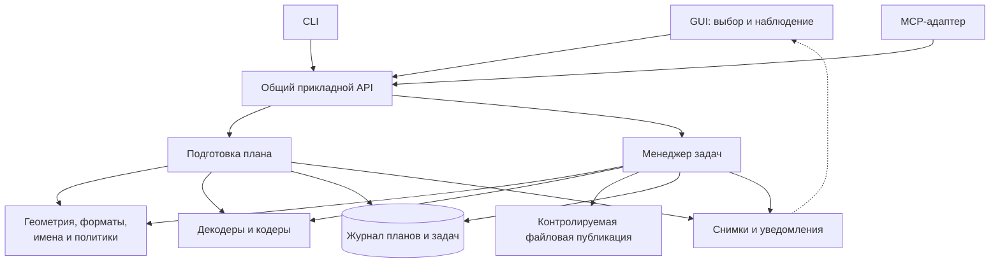

*Стрелки здесь означают взаимодействие. Они не означают, что GUI импортирует кодек или что каждый блок работает в отдельном процессе.*

Отделение прикладного смысла от способов управления следует принципу [Ports and Adapters][ports]. Общий прикладной API оформляет доступные сценарии, подобно [Service Layer][service-layer]. Дальнейшие имена компонентов — конкретизация этих принципов для конвертера.

### Ответственности модулей 🔍

| Модуль | Основная работа | Не должен делать |
|---|---|---|
| `intake` | Обнаружить и идентифицировать входные файлы | Кодировать результаты во время обхода |
| `planning` | Подготовить неизменяемый план каждого элемента | Считать предварительную проверку вечной гарантией доступа |
| `imaging` | Описать геометрию и смысл преобразования | Знать виджеты, MCP и путь журнала |
| `jobs` | Управлять задачами, попытками и остановкой | Самостоятельно реализовывать PNG или AVIF |
| `publication` | Проверить и опубликовать подготовленный файл | Доверять имени результата, выбранному кодеком без контроля |
| `presentation` | Построить карточки и формы из прикладных данных | Решать, когда удалить оригинал |
| `adapters` | Преобразовать внешний вызов и ответ | Создать альтернативные правила конвертации |

Обработчик задачи может вызывать предметную функцию геометрии напрямую. Между ними не нужны дополнительные `Manager`, `Facade` и `Service`, если они лишь пересылают одни и те же значения.

### Размещение в настольной версии 🖥️

В базовой топологии один desktop-процесс владеет сессией, журналом и управляющим API. GUI-поток рисует окно; операции с диском и тяжёлая обработка не должны блокировать его. Кодеки выполняются в ограниченном пуле рабочих процессов. Локальный канал управления позволяет внешнему CLI или MCP-мосту подключаться к этой сессии.

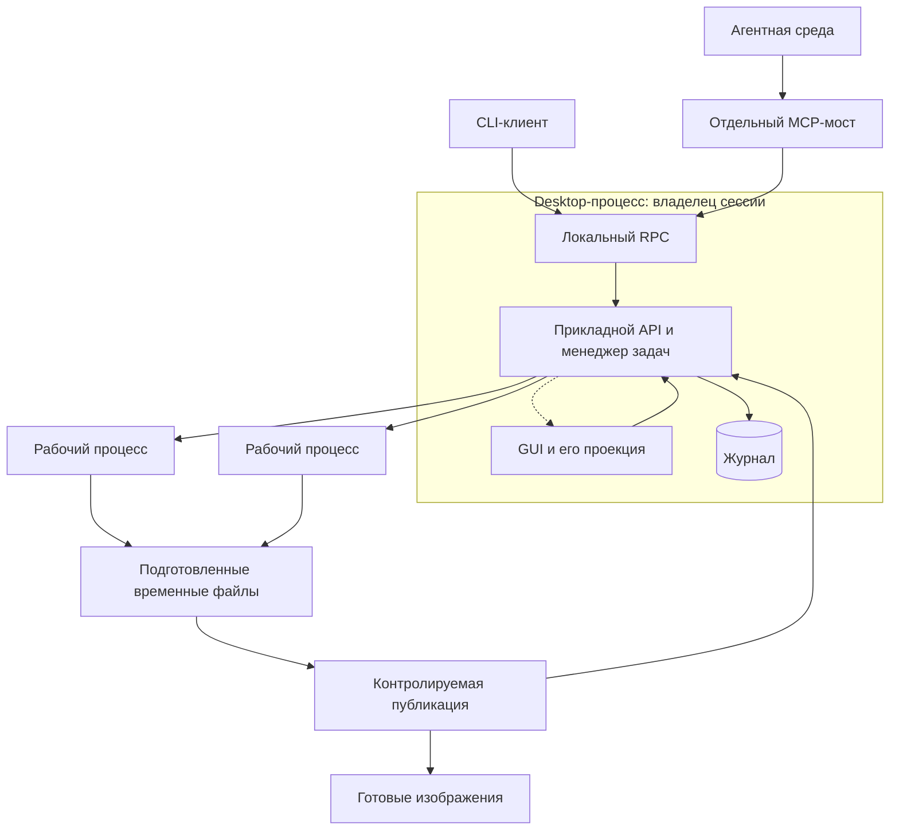

Это один выбранный вариант, а не требование постоянно держать два рабочих процесса. Фактический предел определяется доступной памятью, свойствами кодека и настройками планировщика.

Управляющий компонент может использовать отдельный поток или собственный цикл событий. Важно, чтобы ожидание кодека, хеширование большого файла и запись на медленный диск не происходили внутри обработчика рисования окна. Ограничения доступа к GUI из разных потоков описаны в [Qt Threads and QObjects][qt-threads].

### Attached по умолчанию не должен превращаться в скрытый Headless 🔗

В режиме Attached MCP-мост ищет конкретную рабочую сессию. Если её нет, возвращается `APP_NOT_RUNNING` или `SESSION_NOT_FOUND`. Он не запускает молча второе ядро, работу которого человек не увидит в открытом окне.

Headless остаётся явным режимом: создаётся отдельная сессия и выполняется собственная задача без GUI. Общий исходный код не делает её задачи частью другого процесса. Одновременный доступ двух владельцев к одному журналу предотвращается блокировкой экземпляра, а конкуренция за файлы всё равно обрабатывается файловым адаптером.

Если требуется продолжать обработку после завершения desktop-процесса, владелец сессии переносится в локальный сервис. Это изменение размещения, а не повод переписывать правила геометрии или форматов.

---

## 4. Предметные сущности: от выбора файлов к опубликованному артефакту 📦

Полезно заранее назвать объекты, у которых действительно разный смысл. Это уменьшает вероятность, что один словарь `settings` начнёт одновременно представлять форму GUI, разрешение на удаление и результат кодека.

| Сущность | Что означает | Основные свойства |
|---|---|---|
| **SourceSelection** | Какие входы требуется рассмотреть | Файлы, каталоги, рекурсия, разрешённые корни |
| **SourceRecord** | Какой конкретный файл обнаружен | Идентичность, относительный путь, размер, сведения о содержимом |
| **ImageFacts** | Что известно об изображении | Формат, ориентированные размеры, альфа, кадры, цветовые сведения |
| **ConversionSpec** | Какое преобразование запрошено | Выходной профиль, размер, метаданные, политика файлов |
| **ConversionPlan** | Что приложение намерено сделать с зафиксированным набором | Элементы, назначения, предупреждения, версия и условия запуска |
| **ItemPlan** | План одного входа | Источник, ожидаемые свойства, целевые размеры, имя результата |
| **Job** | Логическая пакетная работа | Инициатор, состояния, счётчики, остановка |
| **Attempt** | Конкретное исполнение элемента | Исполнитель, номер попытки, стадия, временные данные |
| **PreparedArtifact** | Проверенный, но ещё не опубликованный результат | Временный путь, формат, размеры, размер файла, контрольная сумма |
| **PublishedArtifact** | Результат, прошедший границу публикации | Итоговый путь, квитанция, сведения о сохранении источника |

### Выбор ещё не является планом 📝

Пользователь перетащил каталог. GUI знает только факт выбора. До сканирования неизвестно, какие файлы доступны, нет ли дубликатов и можно ли построить уникальные назначения.

План формируется после обнаружения, анализа свойств и применения политики. Он содержит конкретные элементы. Рабочий исполнитель не должен заново обходить каталог и тем самым выбирать другой состав пакета.

### План ещё не является замороженной копией всех байтов 🧊

Даже готовый план может ссылаться на изменяемые файлы. Между подготовкой и выполнением другая программа способна заменить источник. Поэтому в плане сохраняется ожидаемая идентичность и предусмотрен контроль актуальности.

Для обычного режима без удаления допускается повторная проверка источника при открытии и обработке с явным отказом при обнаруженной замене. Если требуется строгое воспроизведение именно подготовленных данных, используется отдельная приватная входная копия либо подтверждённый снимок файловой системы. Одного времени изменения файла для строгой гарантии недостаточно.

Разделение особенно важно для разрушительных режимов: исходный путь, который существует в момент удаления, может уже указывать не на тот файл, который был обработан.

### Результат кодека ещё не является успехом задачи 🏁

Кодек может успешно записать временный файл. Но впереди остаются проверка результата, конфликт назначения, разрешение на публикацию и запись итогового состояния.

Поэтому `encode()` возвращает `PreparedArtifact`, а не окончательное `succeeded`. Последнее определяет менеджер задачи после завершения полного прикладного сценария.

> [!note] Типы защищают смысл границ
> Разные имена нужны не ради увеличения количества классов. Они препятствуют ошибкам вроде «удалить источник после возврата из кодека» или «показать готовый результат, который ещё находится во временном каталоге и может быть отвергнут».

---

## 5. Входные файлы: обнаружение не равно декодированию 📂

Обработка каталога начинается не с `for file: save(...)`, а с отдельного этапа обнаружения. Он отвечает за состав пакета и не создаёт выходных изображений.

### Обход фиксирует состав, но не доверяет расширению 🔎

Расширения полезны как первичный фильтр и как информация для файлового диалога. Они не доказывают формат содержимого. В Pillow открытие изображения определяется распознающим механизмом, а декодирование может быть отложено до загрузки пикселей; поэтому успешное открытие заголовка ещё не доказывает успешной обработки всего файла.([Pillow Image][pillow-image])

Входная политика приложения сначала ограничивает допустимые пути, типы файлов и размеры. Затем разрешённый декодер распознаёт содержимое. После этого проверяются свойства изображения.

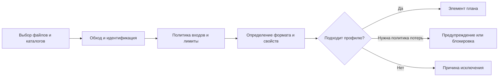

Список исключений сохраняется в отчёте подготовки. Если найдены девяносто изображений и десять неподдерживаемых файлов, GUI не должен показывать «обнаружено девяносто файлов», скрывая остальные. Он сообщает: рассмотрено сто, к обработке подготовлено девяносто, десять исключены по указанным причинам.

### Рекурсия не должна захватывать собственные результаты 🔁

Если выходной каталог находится внутри входного, он исключается из обхода по явному правилу. Аналогично исключаются служебная временная область, резервные копии и карантин оригиналов.

Сам состав пакета фиксируется до начала преобразования. Новые файлы, появившиеся во время выполнения, не добавляются в уже запущенную задачу автоматически. Для них требуется новый план.

Фиксация состава предотвращает очевидный цикл, когда приложение создаёт `.webp`, обнаруживает его при продолжающемся обходе и снова обрабатывает собственный результат. Однако одного исключения по расширению недостаточно: выходной формат может совпадать с входным.

### Дубликаты имеют несколько видов 🪞

Один файл может быть выбран непосредственно и одновременно попасть через каталог. Разные пути могут указывать на тот же объект файловой системы. Два разных файла могут иметь одинаковые байты, но разные имена и назначения.

В базовой модели устраняется повторное включение **одного файлового объекта**, когда платформа позволяет надёжно определить его идентичность. Побайтовая дедупликация разных файлов не включается автоматически: одинаковое содержимое не означает, что пользователь согласился потерять одну из записей в структуре каталогов.

Для символических ссылок и переходов между каталогами задаётся явная политика. Без отдельного требования обход ссылок отключён; разрешённый режим должен контролировать выход за корень и циклы. Жёсткие ссылки также учитываются при защите от перезаписи источников.

### Входные ограничения проверяются до больших выделений памяти 🧯

Файл в несколько мегабайт способен требовать гораздо больше памяти после декодирования. Документация безопасности Pillow отдельно рассматривает decompression bombs и ограничения пикселей; библиотечная защита дополняется политикой приложения, а не отключается ради лозунга «любое изображение».([Безопасность Pillow][pillow-security])

Планировщик ограничивает количество файлов, суммарный объём задания, размеры сообщения, максимальные ширину и высоту, число пикселей, количество кадров и объём метаданных. Конкретные значения являются настройками продукта и проверяются на целевых машинах. В статье не задаётся универсальное число мегапикселей, подходящее любому компьютеру.

Даже анализ заголовков запускается в контролируемом исполнителе: повреждённый либо сложный контейнер не должен надолго блокировать окно на этапе «добавление файла».

---

## 6. Реальные возможности кодеков вместо фиксированного списка ✅

Список форматов в интерфейсе должен происходить из подтверждённых возможностей конкретной сборки. Наличие имени пакета в зависимостях не доказывает, что нужный кодер доступен и правильно включён в распространяемый executable.

### Чтение и запись — разные возможности 📥

Провайдер может уметь читать формат, но не сохранять его. Поддержка контейнера также не означает поддержку всех цветовых режимов, битовых глубин и последовательностей изображений.

Поэтому `CapabilityRegistry` различает входные и выходные возможности:

```json
{
  "capability_revision": "caps-17",
  "input": [
    {"format": "JPEG", "read": true},
    {"format": "PNG", "read": true},
    {"format": "WEBP", "read": true},
    {"format": "HEIF", "read": true},
    {"format": "AVIF", "read": true}
  ],
  "output": [
    {"format": "WEBP", "write": true, "profile": "webp-v1"},
    {"format": "PNG", "write": true, "profile": "png-v1"},
    {"format": "AVIF", "write": true, "profile": "avif-v1"},
    {"format": "JPEG", "write": true, "profile": "jpeg-v1"}
  ]
}
```

Это условный ответ приложения, а не реальные результаты тестирования установленной сборки. В частности, `write: true` должно выставляться только после предусмотренных проверок.

### Проверка состоит не только из успешного импорта 🧪

На запуске приложение может проверить наличие нужных возможностей библиотеки, выбрать провайдера и выполнить небольшой цикл «закодировать контрольный растр → открыть результат → проверить свойства». Для альфа-канала используется отдельный контрольный образец.

В Pillow модуль [features][pillow-features] предоставляет сведения о доступных возможностях и библиотеках. Это один из источников диагностики, но проверка конкретного продуктового профиля остаётся обязанностью приложения.

Такой smoke test не доказывает работу с любым файлом. Он подтверждает более узкое условие: выбранная сборка действительно выполняет базовый путь нужного кодека. Пограничные режимы проверяются отдельным тестовым набором.

### AVIF не должен зависеть от случайного победителя регистрации 🧩

В техническом стеке может встречаться отдельный AVIF-плагин. При этом поддержка AVIF в стандартных бинарных сборках Pillow была добавлена в выпуске 11.3.0 с оговорёнными ограничениями платформ; это следует из [официальных release notes][pillow-avif-release]. Поэтому правило «AVIF всегда требует именно внешний плагин» не подходит как долговечный контракт.

Проект выбирает один проверенный путь для конкретной поставки: встроенный провайдер либо адаптер плагина. Одновременная регистрация нескольких обработчиков одного формата не должна оставлять итоговое поведение зависимым от порядка импортов.

Для HEIF регистрация через `register_heif_opener()` документирована в [pillow-heif][pillow-heif-plugin]. Инициализация выполняется в точке сборки каждого рабочего процесса до работы с изображениями, а не меняется параллельно при каждом вызове.

### Возможности отражаются и в GUI, и в MCP 🎛️

Если AVIF-кодер недоступен, пункт формата отображается недоступным с объяснением. Агент получает тот же факт через `capabilities.get`. Он не должен самостоятельно заменять AVIF на JPEG только ради успешного ответа.

План сохраняет выбранный профиль кодирования и версию его правил. Перед запуском проверяется совместимость с текущими возможностями. Если окружение изменилось, приложение просит подготовить новый план либо возвращает определённый отказ, а не использует другие параметры молча.

---

## 7. Изменение размеров как самостоятельное предметное правило 📐

Геометрия не должна быть спрятана внутри GUI или конкретного кодека. Она представляет чистое правило: из исходных размеров и спецификации получается однозначная пара целевых размеров.

Эту функцию можно проверить без файловой системы, Pillow и графического окна. Один и тот же результат используется в предварительном плане, в исполнителе и в проверке готового изображения.

### Ориентация учитывается до расчёта 🧭

Изображение может храниться как растр одной ориентации, а показываться иначе из-за метаданных. Целевые размеры рассчитываются по **визуально ориентированным размерам**, а не безусловно по сырой паре из заголовка.

В Pillow `ImageOps.exif_transpose()` применяет EXIF Orientation и удаляет соответствующее указание ориентации.([Pillow ImageOps][pillow-imageops]) Для HEIF дополнительно учитываются уже применённые контейнерные преобразования: адаптер сообщает нормализованные факты и не должен поворачивать изображение повторно.

### Базовые режимы размера 🧮

| Режим | Параметры | Смысл |
|---|---|---|
| `keep` | Нет | Сохранить размеры после нормализации ориентации |
| `fit_box` | Максимальная ширина и высота | Вписать всё изображение в рамку без обрезки |
| `width` | Целевая ширина | Вычислить высоту из исходной пропорции |
| `height` | Целевая высота | Вычислить ширину из исходной пропорции |
| `scale_percent` | Положительный процент | Применить единый масштаб к обеим сторонам |

Операция `fit_box` не обязана создавать файл ровно указанного размера. Для изображения 4000 × 3000 рамка 1920 × 1080 даёт **1440 × 1080**. Получить 1920 × 1080 без потери пропорций можно только добавлением полей либо обрезкой, а это другие операции.

В базовом продукте режимы растягивания, crop и расширения холста отсутствуют. Слово «увеличение» означает увеличение растра, а не генерацию нового содержимого вокруг него.

### Формула вписывания в рамку 📏

Пусть исходный размер равен `W × H`, а рамка — `Bw × Bh`. Все четыре значения положительны.

$$
s = \min\left(\frac{B_w}{W},\frac{B_h}{H}\right)
$$

При разрешённом изменении в обе стороны используется `s`. Если разрешено только уменьшение:

$$
s_{effective} = \min(1, s)
$$

Если выбран режим только увеличения, а изображение не помещается в рамку без уменьшения, возникает конфликт требований. В этом проекте возвращается `RESIZE_CONSTRAINT_CONFLICT`, а не создаётся файл, нарушающий рамку.

Это важное решение. Простая формула `max(1, s)` для режима «только увеличить» оставила бы слишком большое изображение без изменения и тем самым нарушила обещание «вписать в рамку».

### Направление масштаба должно быть видно в контракте ↕️

```json
{
  "mode": "fit_box",
  "width": 1920,
  "height": 1080,
  "direction": "shrink_only"
}
```

Возможные значения `direction` — `shrink_only`, `enlarge_only` и `both`. Для `width`, `height` и `scale_percent` применяется аналогичная проверка направления. Если задан точный целевой размер по одной стороне, но политика запрещает необходимое уменьшение, получается конфликт, а не скрытая смена цели.

Для `fit_box + shrink_only` размер является верхней границей, поэтому маленькое изображение законно остаётся исходным. В режиме точной ширины значение `width` является целью, поэтому молчаливое игнорирование цели недопустимо. Эта разница закрепляется в контракте режимов.

### Пиксели требуют правила округления 🔢

Идеальный масштаб часто даёт дробную сторону. В проекте используется округление до ближайшего целого с половиной вверх. До округления обе идеальные стороны проверяются: если какая-либо меньше одного пикселя, возвращается `RESIZE_SUBPIXEL_DIMENSION`. Принудительное растягивание такой стороны до одного пикселя не применяется, поскольку оно может существенно исказить пропорцию очень узкого изображения. Для рамки дополнительно проверяется отсутствие выхода за обе границы.

Идеальная пропорция сохраняется до округления; целочисленный растр может иметь небольшое неизбежное отклонение. Нельзя обещать одновременно точное произвольное соотношение сторон и любые целые размеры. В отчёте фиксируются реальные `width` и `height`, а не только коэффициент.

| Исходник | Запрос | Результат по принятой политике |
|---|---|---|
| 4000 × 3000 | Рамка 1920 × 1080, уменьшение | 1440 × 1080 |
| 3000 × 4000 | Та же рамка | 810 × 1080 |
| 800 × 600 | Та же рамка, только уменьшение | 800 × 600 |
| 800 × 600 | Та же рамка, обе стороны масштаба | 1440 × 1080 |
| 1200 × 800 | Ширина 1800, увеличение разрешено | 1800 × 1200 |
| 1200 × 800 | Масштаб 50% | 600 × 400 |
| 4000 × 3000 | Рамка 1920 × 1080, только увеличение | `RESIZE_CONSTRAINT_CONFLICT` |

Эти значения выведены из указанной формулы, а не являются результатами измерения качества кодека.

### Ресэмплинг и смысл увеличения 🔍

После расчёта геометрии исполнитель выбирает оговорённый фильтр. Например, адаптер Pillow может использовать `Image.Resampling.LANCZOS`, поддерживаемый методом `resize()`.([Pillow Image][pillow-image]) При этом `thumbnail()` не является универсальной заменой всех режимов: оно предназначено для ограничивающего уменьшения, тогда как проект предусматривает и увеличение.

Приложение не должно сообщать, что увеличение «восстановило детали». Оно сообщает точные размеры и предупреждает, что включён upscale. Нейросетевой исполнитель, если появится, получит отдельный профиль и не будет скрываться за обычным переключателем масштаба.

### Геометрия проверяется и до, и после кодирования ✅

На этапе плана проверяются допустимые размеры и оценка ресурсов. На этапе исполнения используется тот же расчёт. При проверке временного результата считываются фактические размеры и сопоставляются с планом.

Это три применения одного правила, а не три независимые формулы. Иначе GUI способен обещать 1440 × 1080, кодек — создать другой размер, а проверка — принять его по случайному допуску.

---

## 8. Конвейер изображения: ориентация, цвет, прозрачность и метаданные 🎨

Преобразование нельзя свести к последовательности `open → resize → save`, если результат должен иметь определённые визуальные свойства. Формат контейнера, размер растра, цветовое пространство, прозрачность и служебные данные — независимые характеристики.

Для базового профиля принимается **статическое SDR-изображение с выходным растром 8 бит на канал**. Это ограничение продукта, а не утверждение о предельных возможностях WebP, PNG, AVIF или HEIF как стандартов.

### Порядок обработки выражает смысл результата 🛤️

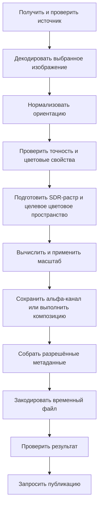

Порядок не означает, что каждая стадия обязана создавать полную дополнительную копию изображения. Оптимизация может объединять операции, если сохраняется контракт. Однако изменение порядка цветового преобразования, ресэмплинга и композиции требует проверки визуального результата, а не только сравнения размеров файла.

### Цветовой профиль — не декоративная метка 🌈

Если вход содержит поддерживаемый ICC-профиль, основной профиль приложения преобразует пиксели в sRGB и прикладывает корректное описание выходного пространства. Простое копирование исходного ICC после изменения цветовых значений недопустимо.

Pillow предоставляет средства преобразования по ICC в модуле [ImageCms][pillow-cms]. Это отдельный механизм от `convert("RGB")`: смена режима хранения каналов сама по себе не задаёт полноценную политику цветоуправления.

Для RGB без профиля выбирается явно документированное допущение «трактовать как sRGB», отражённое в плане. Для CMYK без пригодного профиля базовая политика возвращает `COLOR_PROFILE_REQUIRED`, если адаптер не предоставляет проверенный способ интерпретации. Такой отказ лучше непредсказуемого изменения цветов.

Конвертер не заявляется инструментом допечатной подготовки. Точное воспроизведение печатных цветов, особые rendering intents и профессиональные режимы относятся к отдельным профилям, которые требуют собственных эталонных изображений.

### HDR и высокая битовая глубина требуют отдельного решения ☀️

Некоторые контейнеры способны хранить более богатые данные, чем базовый рабочий растр. В частности, документация Pillow описывает ограничения своего AVIF-пути, а pillow-heif отдельно указывает особенности режимов, доступных через Pillow-плагин.([Форматы Pillow][pillow-formats]) ([Плагин pillow-heif][pillow-heif-plugin])

Из этого следует проектное правило: **нельзя узнавать исходную точность только после того, как декодер уже привёл её к 8 битам**. Адаптер анализа должен сообщать свойства оригинального представления либо честно возвращать, что они неизвестны.

В основной версии подтверждённый HDR, неподдерживаемая глубина и неизвестная критичная цветовая интерпретация блокируют автоматическое преобразование. Будущий режим `allow_precision_reduction` может разрешить конкретное понижение точности, но только с описанным преобразованием и предупреждением. Приведение типа числа или простое отбрасывание старших разрядов не является контрактом корректного tone mapping.

Это ограничение не противоречит широкой поддержке входных форматов: формат может распознаваться, но конкретный файл — не соответствовать выбранному продуктовому профилю.

### Прозрачность должна иметь явную политику 🫧

Внутренняя модель различает наличие альфа-канала и фактическое наличие прозрачных пикселей. Прозрачность может быть представлена не только отдельным каналом, но и палитрой или специальными значениями контейнера. Адаптер нормализует эти варианты до понятных фактов о растре.

Для выхода с поддерживаемой прозрачностью основная политика — сохранить её. Для JPEG требуется отдельное решение:

```text
AlphaPolicy =
    preserve
  | flatten(background_rgb)
  | reject_if_transparent
```

`flatten` означает композицию на заданном непрозрачном фоне. В GUI цвет выбирается человеком; агент передаёт его в запросе. Значение по умолчанию должно быть видно в плане, а не возникать в глубине `image.convert("RGB")`.

Ресэмплинг прозрачного изображения проверяется на контрольных образцах с полупрозрачными краями. Адаптер обязан согласованно обрабатывать значения цвета и альфа-канала; иначе вокруг объектов могут появиться артефакты. В проекте это обязательный визуальный тест, а не обещание конкретного алгоритма исключительно по названию фильтра.

### Статическое изображение не означает «всегда взять кадр ноль» 🎞️

Анимированное изображение, многостраничный файл и HEIF-контейнер с основным изображением и вспомогательными данными — разные случаи. Они не должны обрабатываться одним правилом `n_frames > 1 → взять первый`.

Базовый режим отвергает анимации и многостраничные документы, если выбранный адаптер не определил поддерживаемый сценарий. Для HEIF разрешено основное изображение, если адаптер умеет корректно определить его и отделить от миниатюр и вспомогательных представлений. При неоднозначности требуется явный выбор.

Расширение `frame_selection` может задавать конкретный кадр или страницу. Тогда план показывает, что остальные изображения не попадут в результат. Это осознанное извлечение одного изображения, а не скрытая «конвертация всего файла».

### Метаданные: политика сохранения, а не слепое копирование 🏷️

В основном профиле используется `metadata_policy = privacy`: персональные EXIF/XMP/IPTC, комментарии и встроенные миниатюры не переносятся. При этом выходной ICC, необходимый для описания полученных пикселей, формируется отдельно. Ориентация после физической нормализации не должна повторно поворачивать результат.

Безопаснее собирать разрешённый набор выходных метаданных по белому списку, чем копировать всё и удалять несколько известных полей. Дополнительные адаптеры обязаны учитывать свои контейнерные механизмы.

Это продуктовая политика, а не гарантия удаления всех возможных скрытых данных из произвольного формата. Поддерживаемые контейнеры проверяются тестами, а неизвестные расширения метаданных не переносятся автоматически. Режим сохранения технических или авторских сведений может быть отдельной настройкой с перечислением того, что именно поддерживается.

> [!warning] Lossless относится к определённой границе
> PNG может сохранить подготовленный растр без потерь кодирования. Это не означает, что весь исходный файл сохранён без изменений: до кодирования могли произойти масштабирование, нормализация цвета, выбор одного кадра или удаление метаданных. Утверждение «без потерь» всегда должно уточнять, относительно каких данных оно сделано.

---

## 9. Параметры кодирования: один интерфейс не означает один `quality` 🎚️

Форма с единственным слайдером «Качество 80%» выглядит удобно, но создаёт неправильное ожидание: будто одинаковое число имеет одинаковый визуальный смысл для разных форматов.

В проекте параметр качества называется **индексом качества кодера**, а не процентом сохранённой информации. Он не обещает конкретный размер файла, измеренную визуальную точность или одинаковый результат между кодеками.

### Настройки различаются по типу выходного профиля 📋

| Профиль | Основные параметры API | Что показывает GUI |
|---|---|---|
| `webp_lossy` | `quality`, `effort` | Качество и усилие кодирования |
| `webp_lossless` | Отдельный профиль, параметры усилия | Режим без потерь; без ложного слайдера визуального качества |
| `png_lossless` | `compression_level`, при поддержке — `optimize` | Уровень сжатия и стоимость обработки |
| `avif_lossy` | `quality`, `speed`, поддерживаемая субдискретизация | Параметры выбранного AVIF-провайдера |
| `jpeg_lossy` | `quality`, `subsampling`, `progressive` | Качество, параметры цвета и прогрессивный режим |

Несколько профилей WebP не добавляют новый выходной формат. Формат отвечает на вопрос о типе файла, профиль — о способе его получения.

В Pillow PNG использует `compress_level` в диапазоне 0–9, а JPEG и AVIF имеют собственные параметры качества; для JPEG документация отдельно предостерегает от бездумного использования значений выше 95.([Форматы Pillow][pillow-formats]) Поэтому передавать `quality=80` во все кодеры как универсальную настройку — недостаточная спецификация.

### Входной DTO должен исключать бессмысленные сочетания 🧬

```text
EncoderSpec =
    WebpLossy(quality, effort)
  | WebpLossless(effort)
  | PngLossless(compression_level, optimize)
  | AvifLossy(quality, speed, subsampling)
  | JpegLossy(quality, subsampling, progressive)
```

Если выбран PNG, поле `quality` отвергается, а не молча игнорируется. Если `optimize` в выбранном адаптере переопределяет уровень сжатия, контракт либо запрещает конфликтующие настройки, либо показывает эффективное значение в плане.

Диапазоны и defaults закрепляются в версии профиля. Изменение значения по умолчанию не должно менять уже подготовленный план. В журнале сохраняются нормализованные параметры, а не только ссылка на текущий пресет GUI.

### Пресет — удобный ввод, а не скрытый исполнитель 🧰

Пресет «Для публикации» может выбирать WebP, ограничивающую рамку, удаление персональных метаданных и сохранение оригинала. На этапе подготовки он разворачивается в полную `ConversionSpec`.

Если пресет затем изменён, существующая задача не меняется. Для воспроизводимости полезно сохранить имя и версию пресета как происхождение параметров, но выполнять именно зафиксированную спецификацию.

Автоматический подбор качества под целевой размер файла — другой сценарий. Он может потребовать нескольких кодирований и критерия приемлемого качества. В базовой модели его нет; добавление такого режима не должно прятать многократную обработку за прежней семантикой одного вызова кодера.

### Размер результата — измерение, а не обещание 📏

После публикации приложение знает точный размер исходного файла и результата. Оно может вычислить разницу:

$$
\Delta = bytes_{result} - bytes_{source}
$$

Отрицательное значение означает уменьшение объёма, положительное — увеличение. Успешная конвертация с положительной разницей остаётся успешной, если не задано отдельное требование к размеру. GUI честно показывает «файл стал больше», а не рисует фиктивный процент экономии.

При многокадровом входе и извлечении одного кадра сравнение объёма особенно условно: сравниваются файлы с разным содержимым. Такой результат помечается отдельно.

---

## 10. Политики имён, назначения и сохранения оригиналов 🗃️

Файловая логика — полноценная часть прикладного сценария. Она не должна жить в обработчике кнопки и не должна определяться каждым кодеком заново.

В функциональной постановке присутствуют сохранение оригиналов, настраиваемый постфикс и режим удаления или замены источника. Эти сценарии описаны в технических руководствах.[^file-policy] Здесь они превращаются в явные контракты назначения и последствий.

### Назначение и судьба источника — разные настройки 🧭

```text
DestinationSpec =
    AlongsideSource(suffix, conflict_policy)
  | OutputDirectory(root, relative_path, layout, conflict_policy)

OriginalPolicy =
    keep
  | remove_after_verified_publication
  | replace_same_target
```

Режим `replace_same_target` применим только там, где источник и назначение действительно совпадают по смыслу запланированной операции. Он не означает разрешения перезаписывать любой уже существующий файл с подходящим именем.

Для основного безопасного режима используется `keep`. Разрушительные варианты требуют дополнительного допуска и рассматриваются отдельно.

### Таблица типовых имён 📁

| Вход | Выход | Политика | Планируемый результат |
|---|---|---|---|
| `photo.jpg` | WebP | Рядом, сохранить | `photo.webp`; исходник остаётся |
| `photo.jpg` | JPEG | Рядом, сохранить, постфикс `_compressed` | `photo_compressed.jpg` |
| `photo.jpeg` | JPEG | Рядом, сохранить | `photo_compressed.jpg` по правилу одинакового семантического формата |
| `photo.jpg` | WebP | В каталог результатов | Путь в выходном дереве; исходник остаётся |
| `photo.jpg` | WebP | Удалить после подтверждённой публикации | `photo.webp`, затем отдельная проверенная очистка источника |
| `photo.jpg` | JPEG | Разрешённая замена того же назначения | Подготовка во временный файл и контролируемая замена |

Важна разница между расширением и форматом. `.jpg` и `.jpeg` относятся к одному выходному семейству; регистр имени и расширения также не должен создавать обход правил.

Конкретное правило постфикса является выбором продукта. В этой статье постфикс в режиме «рядом и сохранить» применяется при совпадении семантического формата или при совпадении вычисленного пути с источником. Для разных форматов при отсутствии конфликта сохраняется базовое имя.

### Конфликт назначения не всегда связан с оригиналом ⚠️

В каталоге могут одновременно находиться `photo.jpg` и `photo.png`. Оба при конвертации в WebP претендуют на `photo.webp`.

Это конфликт **между двумя элементами одного пакета**. Он должен быть обнаружен при подготовке плана, даже если целевого файла пока не существует.

Другой случай: `photo.webp` уже существует, но не является источником текущего элемента. Разрешение удалить оригинал `photo.jpg` не даёт права затереть этот посторонний файл.

```text
DestinationConflictPolicy =
    fail
  | skip
  | allocate_unique_name
```

Произвольная перезапись постороннего результата не включена в базовый контракт. Если такой режим необходим, он оформляется отдельно с предварительным планом и подтверждением.

### Уникальное имя определяется планом, но проверяется при публикации 🔒

`allocate_unique_name` может сформировать `photo_2.webp` на этапе подготовки. Однако другая программа способна занять это имя позже.

В выбранной политике результат публикуется по имени, показанному в готовом плане. Если оно занято к моменту применения, возвращается `DESTINATION_CHANGED` либо требуется новый план. Исполнитель не должен молча выбирать другое имя после подтверждения, особенно если действие опасное.

Для безопасного автоматического режима можно отдельно разрешить динамическое добавление числового суффикса, но тогда это свойство должно быть явно отражено в контракте и фактическом результате. Основной пример использует фиксированное назначение.

### Сохранение дерева предотвращает часть конфликтов 🌳

При обработке каталога `layout = preserve_tree` сохраняет относительную структуру внутри выбранного корня. Для нескольких исходных корней добавляются согласованные пространства имён, чтобы одинаковые относительные пути не сливались.

Плоский вывод допустим, но требует отдельного правила коллизий. Нельзя объявить его эквивалентным сохранению структуры и затем рассчитывать на случайно уникальные имена.

Все итоговые пути проверяются на пересечение с источниками **всего пакета**, а не только текущего элемента. Результат одного файла не должен затереть вход другого, который ещё ожидает обработки.

### Проверка существования не является защитой от гонки 🕳️

Последовательность «проверить `exists` → записать» оставляет окно, в котором путь может занять другой процесс. Для режима «не перезаписывать» нужен соответствующий механизм публикации, а не только ранняя проверка.

Это не означает, что любой локальный конвертер обязан решать все угрозы враждебной файловой системы. Он обязан **честно определить свою модель доступа** и не называть строковую проверку пути абсолютной гарантией безопасности.

---

## 11. План преобразования: отдельный результат до начала записи 📋

План нужен не только для подтверждения опасных действий. Он делает поведение видимым до выполнения: показывает набор файлов, целевые размеры, выходные имена, предупреждения и ожидаемые последствия.

Для небольшого конвертера это может быть компактная структура. Её ценность в неизменяемости и ясной семантике, а не в обязательном наличии сложного движка планирования.

### Подготовка плана может быть длительной задачей ⏳

Сканирование большой папки и анализ контейнеров способны занять заметное время. Поэтому `plans.prepare` не обязано синхронно возвращать готовый список.

В этом проекте подготовка выполняется через тот же исполнительный механизм, но с другим видом задачи: `kind = prepare_plan`. Она может читать входы и создавать внутренние временные данные, но не публикует выходные изображения и не удаляет источники.

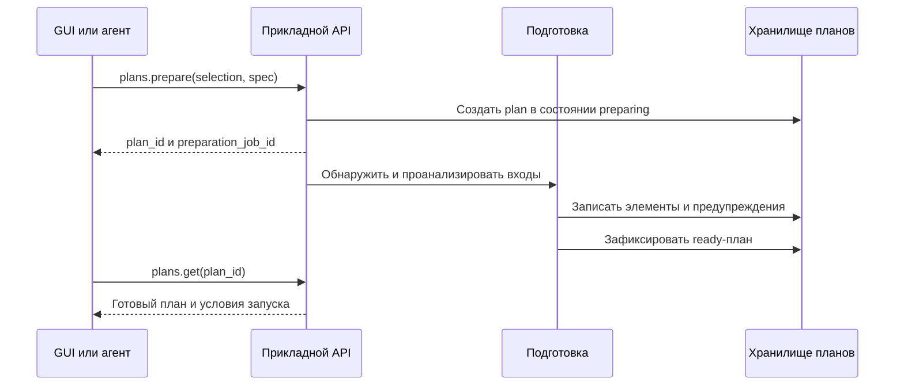

Подготовка и конвертация — разные работы. Окончание подготовки не означает появления готовых изображений. GUI может показывать их как последовательные фазы одного пользовательского сценария, но API сохраняет различие.

### Содержимое готового плана 📦

```text
ConversionPlan
    plan_id
    schema_version
    plan_revision
    status
    effective_spec
    capability_revision
    policy_revision
    source_manifest
    item_plans
    excluded_entries
    warnings
    approval_requirement
    expires_at
```

`effective_spec` содержит уже развёрнутые defaults и параметры профиля. `source_manifest` фиксирует состав. `item_plans` определяет конкретные пути и размеры. `approval_requirement` указывает необходимость доверенного решения человека, но само по себе не является разрешением.

Готовый план не редактируется на месте. Изменение качества, рамки, назначения или списка входов создаёт новый план либо новую явно адресуемую ревизию, которая проходит подготовку заново. Нельзя подтвердить одно действие, затем незаметно заменить его параметры.

### Что действительно проверено на этапе подготовки 🔍

План может проверить существование источника на этот момент, распознанный формат, вычислимость геометрии, доступный кодер, явные конфликты имён и очевидные ограничения.

Он не может гарантировать, что диск не заполнится позже, права не изменятся, источник не будет заменён и кодек справится с каждым повреждением в ещё не прочитанной части файла.

Поэтому план является **проверяемым намерением с условиями актуальности**, а не обещанием невозможности ошибки.

### Запуск повторно проверяет изменяемые предпосылки 🔁

Перед принятием конвертации приложение проверяет состояние и срок плана, доступ вызывающей стороны, актуальность требуемого подтверждения, совместимость профиля кодирования и возможность занять внутренние ресурсы.

При выдаче каждого элемента исполнителю и при публикации результата проверяются относящиеся к этому моменту условия: источник, назначение, разрешения и отмена.

Эти повторные проверки не являются дублированием формы JSON. Они защищают разные временные границы. Данные, корректные десять минут назад, не обязательно остаются такими сейчас.

### Превью не должно быть вторым конвертером 🖼️

Предварительный просмотр использует те же правила геометрии, цвета и прозрачности, но ограниченный размер результата и отдельный приоритет. Если он создан по уменьшенной копии, интерфейс прямо обозначает, что это превью, а не окончательное побайтовое предсказание выходного файла.

Сравнение «до/после» может быть полезным расширением, однако не должно влиять на основной план через скрытые изменения параметров. Вычислительные ресурсы превью ограничиваются, чтобы окно не запускало десятки тяжёлых кодирований при каждом движении слайдера.

---

## 12. Прикладной API: операции для GUI, CLI и агента 🔌

API формулируется в терминах приложения, а не кнопок. В нём нет `click_start_button`, `show_spinner` или `select_format_tab`.

### Основной каталог операций 🗂️

| Операция | Назначение | Результат |
|---|---|---|
| `capabilities.get` | Узнать форматы, профили, ограничения | `CapabilitiesSnapshot` |
| `plans.prepare` | Подготовить конкретный набор преобразований | `PlanPreparationAccepted` |
| `plans.get` | Прочитать план и его условия | `PlanSnapshot` |
| `plans.list_items` | Получить страницу элементов и исключений | Страница `ItemPlan` |
| `plans.start` | Принять выполнение готового плана | `JobAccepted` |
| `jobs.get` | Прочитать состояние работы | `JobSnapshot` |
| `jobs.list` | Восстановить список видимых задач | Снимок списка с границей обновлений |
| `jobs.list_items` | Получить состояния файлов | Страница `ItemSnapshot` |
| `jobs.cancel` | Запросить остановку задачи | `CancelDecision` |
| `artifacts.get` | Получить разрешённые сведения о результате | `ArtifactSnapshot` |
| `sessions.suspend` | Заблокировать новые действия выбранной сессии | `SessionControlResult` |

Последняя операция административная. Она не предоставляется обычному агенту автоматически только потому, что остальные команды доступны через MCP.

Подтверждение опасного плана также имеет отдельный доверенный интерфейс. Обычный инструмент запуска может передать идентификатор уже выданного разрешения, но не создать его утверждением `approved: true`.

### Пример подготовки безопасного пакета 📨

```json
{
  "operation": "plans.prepare",
  "operation_version": 1,
  "arguments": {
    "sources": [
      {
        "kind": "directory",
        "root_id": "input-root",
        "relative_path": "photos",
        "recursive": true
      }
    ],
    "conversion": {
      "encoder": {
        "profile": "webp_lossy",
        "quality": 82,
        "effort": 4
      },
      "resize": {
        "mode": "fit_box",
        "width": 1920,
        "height": 1080,
        "direction": "shrink_only"
      },
      "color_policy": "srgb_sdr8",
      "alpha_policy": {"mode": "preserve"},
      "metadata_policy": "privacy",
      "frame_policy": "single_or_unambiguous_primary"
    },
    "destination": {
      "kind": "directory",
      "root_id": "output-root",
      "relative_path": "webp-export",
      "layout": "preserve_tree",
      "conflict_policy": "fail"
    },
    "original_policy": "keep",
    "failure_policy": "continue_items"
  }
}
```

`root_id` — идентификатор уже разрешённой области файловой системы. Он не должен быть свободно создаваемым агентом доказательством доступа. GUI может выдавать такие области через доверенный выбор каталога, а локальная конфигурация — задавать разрешённые корни для автоматизации.

Пути интерпретируются относительно соответствующего корня на машине владельца файлов. Сетевой клиент не может предполагать, что его собственный относительный путь совпадает с путём сервиса.

### Ответ подготовки и отдельный запуск 📬

```json
{
  "outcome": "accepted",
  "plan_id": "plan-104",
  "preparation_job_id": "prepare-104"
}
```

После готовности плана клиент запускает его:

```json
{
  "operation": "plans.start",
  "operation_version": 1,
  "idempotency_key": "conversion-intent-104",
  "arguments": {
    "plan_id": "plan-104",
    "plan_revision": 1
  }
}
```

```json
{
  "outcome": "accepted",
  "job": {
    "job_id": "job-204",
    "revision": 1,
    "kind": "convert_batch",
    "status": "queued",
    "plan_id": "plan-104",
    "plan_revision": 1
  }
}
```

Эти сообщения — прикладная модель. MCP и локальный RPC добавляют собственную транспортную оболочку. Контракт не требует вручную воспроизводить JSON во внутренних вызовах Python или другого языка.

### Повтор запуска не должен создавать два одинаковых пакета 🔁

Ключ идемпотентности связывается с доверенным инициатором, операцией и нормализованным намерением. Повтор возвращает уже принятую задачу. Тот же ключ с другим планом означает конфликт.

Регистрация ключа и создание задачи должны быть согласованы в одной транзакционной границе. Иначе два параллельных запроса смогут оба создать работу. Подобные условия безопасного повтора рассматриваются в [AWS Builders’ Library][idempotency].

Срок хранения ключей и область их действия документируются. Ключ не заменяет авторизацию и не гарантирует «ровно один раз» для всех внешних файловых эффектов. Эти эффекты контролируются на собственной границе публикации.

---

## 13. Контракты между слоями: что передаётся и чему доверяет получатель 📜

В проекте используются три семейства контрактов: пользовательские запросы, внутренние планы исполнения и сообщения о фактах. Их не следует объединять в один изменяемый объект.

### Карта DTO и портов 🗺️

| Граница | Данные | Обязанность получателя |
|---|---|---|
| Адаптер → приложение | `PreparePlanRequest`, доверенный `RequestContext` | Проверить сценарий и разрешённые ресурсы |
| Планировщик → исполнитель | `ItemExecutionPlan`, контекст попытки | Выполнить ограниченное преобразование |
| Исполнитель → координатор | Прогресс, `PreparedArtifact`, ошибка | Проверить актуальность попытки и следующий переход |
| Координатор → публикация | Проверенный артефакт, цель, разрешение | Применить файловую политику и вернуть квитанцию |
| Владелец → GUI/MCP | Снимки задач, планов, элементов | Позволить восстановить известное состояние |
| Проекция → виджеты | `JobCardViewModel`, `ItemRowViewModel` | Отобразить состояние без собственной бизнес-логики |

### Внутренний план не содержит лишних полномочий 🧰

```text
ItemExecutionPlan
    job_id
    item_id
    attempt_id
    source_access
    expected_source_identity
    normalized_image_selection
    target_dimensions
    effective_encoder_spec
    color_and_alpha_policy
    metadata_policy
    staging_target
    resource_budget
```

Рабочий процесс получает доступ к конкретному входу и своей временной области. Ему не требуется право удалять оригиналы, разрешать конфликты назначения или публиковать результат в произвольный пользовательский каталог.

Ограничение в контракте не равно песочнице операционной системы. Если процесс запущен с теми же полными правами, вредоносный код всё ещё способен обращаться к другим файлам. Для сильной изоляции нужны соответствующие ограничения среды. Но узкий контракт уже устраняет случайную связанность и позволяет позднее усилить границу.

### Порты описывают способности, а не библиотеки 🔧

```text
SourceInspector
    inspect(source, inspection_policy) -> ImageFacts

GeometryPolicy
    calculate(oriented_dimensions, resize_spec) -> TargetDimensions

ImagePipeline
    execute(item_plan, execution_context) -> PreparedArtifact

ArtifactVerifier
    verify(staging_artifact, expected_result) -> VerifiedArtifact

ArtifactPublisher
    publish_new(verified_artifact, destination_claim) -> PublicationReceipt
    replace_source(verified_artifact, replacement_claim) -> PublicationReceipt

JobRepository
    persist_transition(expected_revision, next_state) -> StoredRevision
```

Эти интерфейсы обозначают разные ответственности. Необязательно превращать каждый из них в отдельный объект, если небольшая реализация сохраняет границы функций. Особенно важно, что `ArtifactPublisher` — не простая обёртка над `save`: он отвечает за другую стадию жизненного цикла.

### Что находится в доверенном контексте 🪪

Инициатор, сессия, разрешённые корни, право удаления, область видимости задач и право блокировки агента формируются доверенной принимающей стороной. Внешний запрос содержит намерение и идентификаторы, но не назначает себе роль администратора.

Контекст попытки выполнения отличается от контекста входного запроса. Он содержит сигнал остановки, дедлайн, бюджет ресурсов и средство сообщения прогресса. Сетевой вызов уже может завершиться, а работа продолжает существовать.

### Проверки распределяются по времени и смыслу 🔍

Схема DTO отвергает неизвестные поля, неправильные типы и отрицательные размеры. Предметная функция отвергает невозможную геометрию. Прикладной сценарий проверяет полномочия и допустимость разрушительного режима. Кодек проверяет фактическую возможность обработки содержимого. Публикация повторно проверяет назначение и право применить результат.

Ни один из этих уровней не заменяет остальные. Валидный JSON не доказывает безопасность файла, а успешно декодированное изображение не даёт права удалить его источник.

---

## 14. Задача, элементы пакета и честный итог выполнения 🔄

Пакетная работа имеет два уровня состояния. Задача описывает общий запуск, а элемент — конкретное преобразование одного файла. Смешение этих уровней делает прогресс и остановку неоднозначными.

Один файл может завершиться ошибкой, пока остальные продолжают выполняться. Пакет может быть отменён после нескольких успешных результатов. Подготовленный результат может быть опубликован, но требуемое удаление источника — отклонено. Для этих случаев нужны отдельные факты, а не один булев флаг `success`.

### Модель элемента 📄

```text
ItemState =
    Queued
  | Running(phase, attempt_id, progress)
  | Succeeded(artifact, source_disposition)
  | Partial(artifact, unmet_actions, warnings)
  | Failed(error)
  | Skipped(reason)
  | Cancelled(partial_details)
  | Uncertain(reconciliation_details)
```

`Partial` означает, что полезный результат опубликован, но не выполнена часть запрошенных действий. Например, оригинал сохранён из-за ошибки очистки. Это не следует обозначать ни безусловным успехом всего сценария, ни полным провалом без результата.

`Uncertain` нужен для восстановления после сбоя на границе публикации. Он не является обычным состоянием живого кодера: это признание, что приложение пока не установило фактический эффект.

### Фазы работы не заменяют состояние 🔬

Для `Running` используются фазы `opening`, `decoding`, `transforming`, `encoding`, `verifying`, `waiting_to_publish`, `publishing`, `source_cleanup`.

Фаза отвечает на вопрос, **чем занят исполнитель или координатор**. Состояние — на вопрос, **какой итог и какие переходы допустимы**. Ошибочно считать завершение `encoding` успехом всего элемента: впереди остаётся публикация.

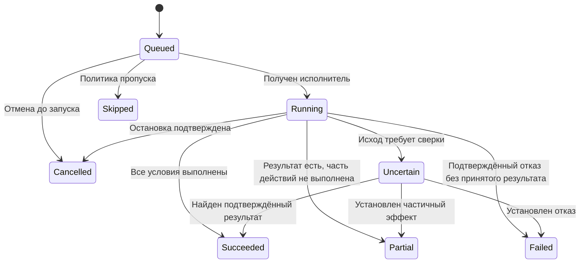

*Восстановление `Uncertain` не запускает произвольное повторение работы. Оно устанавливает факты по журналу и файловой системе.*

### Общий итог пакета 🧮

На уровне задачи используются `queued`, `running`, `cancelling`, `succeeded`, `completed_with_issues`, `failed`, `cancelled`, `interrupted`.

`succeeded` означает, что все требуемые действия завершены согласно контракту, с учётом заранее разрешённых пропусков. `completed_with_issues` означает завершённый пакет с отдельными ошибками, частичными результатами или невыполненными условиями. `failed` используется для общей ошибки либо полного неуспеха, а отчёт объясняет детали. `cancelled` сохраняет сведения об уже выполненных элементах. `interrupted` обозначает прекращение исполнения без установленного полного итога.

Если отмена пришла слишком поздно и все элементы штатно завершились, задача получает обычный итог, а не искусственное `cancelled`. Если остановка действительно предотвратила выполнение оставшихся элементов, итог — `cancelled`, даже если некоторые файлы ранее были обработаны успешно.

### Счётчики должны образовывать проверяемую сумму 📊

Для принятого плана фиксируется `N` элементов конвертации. В каждый момент выполняется:

```text
N = queued + active + succeeded + partial
    + failed + skipped + cancelled + uncertain
```

Исключённые на этапе подготовки файлы считаются отдельно: они не превращаются задним числом в ошибки принятого пакета.

Процент завершения по элементам можно рассчитывать по числу установленных терминальных исходов. Но он должен называться долей разобранных элементов, а не долей времени. Один большой HEIF может обрабатываться дольше десятков небольших JPEG.

Прогресс отдельного нативного кодера не выдумывается. Если доступна только текущая фаза, показывается неопределённый индикатор. При `uncertain` финальный отчёт остаётся неполным и явно требует сверки.

### Политика ошибок выбирается заранее 🚦

В примере доступен `continue_items`: ошибка отдельного файла не отменяет остальные. Альтернатива `stop_on_item_error` прекращает запуск новых элементов и инициирует остановку остальных по выбранным правилам.

Общие ошибки ресурсов — недоступный журнал, отказ каталога назначения, критическое исчерпание места — могут останавливать пакет независимо от локальной политики. Приложение отличает повреждённый файл от отказа общей инфраструктуры.

Повтор не должен бесконечно возвращать элемент в очередь. Допустимые причины, число попыток и проверка уже созданного эффекта определены явно. Изменение формата или качества — новая работа, а не техническая повторная попытка прежнего намерения.

---

## 15. Исполнители: ограниченная параллельность и изоляция 🧵

Многопоточность или многопроцессность сама по себе не является целью. Требуются отзывчивый GUI, доступный управляющий канал и предсказуемое потребление ресурсов.

Для выбранной настольной архитектуры кодирование выполняется в ограниченном пуле рабочих процессов. Это позволяет отделить тяжёлую обработку от интерфейса и ограничить последствия падения одного нативного кодека. Сама по себе граница процесса не является песочницей и не гарантирует безопасного принудительного завершения любых внешних эффектов.

### Планировщик выдаёт работу, а не запускает всё сразу ⚙️


У каждого исполнителя есть `attempt_id`. Сообщения от завершённой либо заменённой попытки не меняют состояние актуальной. Временные артефакты также связываются с попыткой, чтобы старый процесс не смог подставить результат новой работе.

Долгие вычисления не выполняются под общей блокировкой менеджера задач. Защищаются короткие переходы состояния, а не весь вызов кодера.

### Размер сжатого файла плохо описывает потребление памяти 🧠

Для растра 6000 × 4000 с четырьмя 8-битными каналами один плотно упакованный буфер содержит:

```text
6000 × 4000 × 4 = 96 000 000 байт ≈ 91,6 MiB
```

Это арифметическая оценка одного буфера, а не измерение всей операции. Одновременно могут существовать исходный растр, преобразованный растр, выходные данные, внутренние структуры кодера и метаданные. Увеличение до большего разрешения повышает стоимость ещё до кодирования.

Поэтому ограничение «по одному процессу на каждое ядро» недостаточно. Планировщик использует оценку памяти и общий бюджет. Консервативный коэффициент дополнительных буферов выбирается по измерениям реальных адаптеров и отмечается как оценка, а не точная гарантия.

### Внешний и внутренний параллелизм могут перемножаться 🧮

Несколько рабочих процессов способны запускать кодеры, каждый из которых использует собственные потоки. Поэтому число элементов в параллельной обработке и число потоков кодека на элемент согласуются отдельно.

Возможности ограничения потоков зависят от провайдера. Прикладная политика не должна обещать жёсткий предел там, где конкретный кодер не предоставляет соответствующей настройки. В таком случае уменьшается внешняя параллельность либо выбирается другой исполнитель.

Превью и подготовка планов также расходуют ресурсы. Они получают отдельный приоритет и лимиты, чтобы автоматические обновления миниатюр не вытесняли принятую пакетную работу.

### Отмена должна доходить вне очереди тяжёлых вычислений 🛑

Если после команды «обработать тысячу файлов» в ту же последовательную очередь поставить «отменить», управление сработает слишком поздно.

Внутренний контракт исполнения предоставляет отдельный сигнал отмены. Исполнитель проверяет его до открытия источника, после декодирования, после преобразования, перед кодированием и после возврата кодера. Контроль публикации дополнительно выполняется владельцем задачи.

Если нативное кодирование не поддерживает прерывание, оно может продолжаться до возврата. Приложение показывает это честно и не запускает следующий элемент. Отсутствие мгновенного завершения вычисления не должно приводить к новой публикации, если разрешение на неё ещё не выдано.

### Принудительная остановка — аварийный режим 🧯

Рабочий процесс без права окончательной публикации можно завершить с меньшим риском, чем процесс, который напрямую перезаписывает источники. Но остаются временные файлы, открытые ресурсы и необходимость проверить состояние.

Принудительное завершение не используется для операции, уже выполняющей контролируемую публикацию или очистку оригинала, без отдельного протокола восстановления. Кнопка обычной отмены и аварийное действие имеют разные названия и последствия.

Если выбран вариант на потоках Qt, `requestInterruption()` является запросом, который работа должна проверять; `terminate()` документирован как опасный механизм.([Qt QThread][qt-qthread]) Эти ограничения нельзя скрыть тем, что GUI показывает кнопку «Стоп».

---

## 16. Публикация результата: отдельная граница ответственности 💾

Одна из главных гарантий проекта — **результат не записывается поверх источника во время кодирования**. Сначала создаётся отдельный временный артефакт, затем проверяется, и только после этого принимается решение о его публикации.

### Подготовка и публикация разделены 🧱

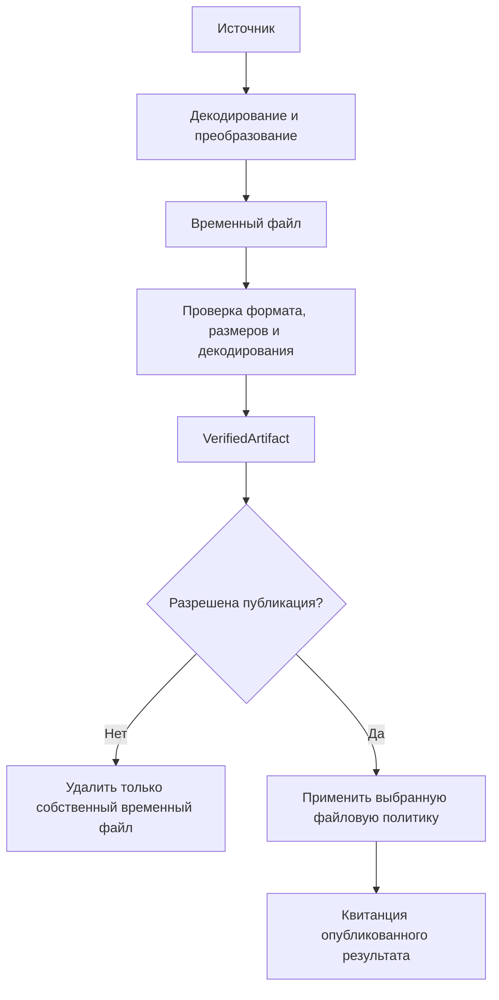

Временное имя уникально для попытки и не строится только из пользовательского имени. Служебная область исключается из входного обхода. Для замены через переименование временный файл создаётся на подходящей файловой системе, обычно рядом с целевым каталогом в защищённой служебной области.

### Проверка результата не ограничивается размером больше нуля 🔍

Проверяются распознанный формат, ожидаемые размеры, допустимая модель каналов и возможность декодировать весь результат. Дополнительно проверяются выбранные требования к альфа-каналу и метаданным.

Проверка средствами того же декодера не доказывает совместимости со всеми программами. Поэтому релизные тесты включают независимые целевые просмотровые средства либо дополнительные валидаторы там, где это важно. В рабочем сценарии проверка прежде всего предотвращает публикацию очевидно повреждённого или не соответствующего плану результата.

Проверенный файл получает размер, контрольную сумму и собственный идентификатор. Это позволяет связать последующую публикацию с теми байтами, которые действительно проверялись.

### Создать новый файл и заменить существующий — разные примитивы 🔐

Для нового результата требуется семантика **создать только при отсутствии назначения**. Для разрешённой замены источника требуется другая операция, которая заменяет заранее определённый объект в заданной модели доступа.

Обычный `os.replace()` заменяет существующее назначение и не подходит в качестве реализации `no_overwrite`. Документация Python также оговаривает условия переименования и границу файловых систем.([Файловые операции Python][python-os])

Контракт инфраструктурного адаптера должен разделять:

```text
publish_new_no_replace(prepared, claim) -> PublicationReceipt
replace_authorized_source(prepared, claim) -> PublicationReceipt
```

Первый метод обязан использовать подходящий атомарный либо эксклюзивный механизм целевой платформы. Предварительное `exists()` таким механизмом не является. Если выбранная файловая система не позволяет обеспечить требуемую гарантию, операция возвращает `PUBLICATION_GUARANTEE_UNAVAILABLE`, а не имитирует её.

Для некоторых локальных файловых систем возможны специализированные операции переименования без замены или публикация через создание ссылки на подготовленный файл. Конкретный вариант выбирается и тестируется адаптером. Статья не объявляет один низкоуровневый вызов переносимым решением для всех Windows-, POSIX- и сетевых файловых систем.

### Атомарная видимость и долговечность различаются ⚖️

Читатель не должен увидеть половину итогового файла. Но это не то же самое, что гарантия сохранения результата после отключения питания.

Если продукт обещает устойчивую публикацию, адаптер определяет необходимые операции синхронизации файла и каталога с учётом платформы и файловой системы. Настройки хранилища и его реальные гарантии входят в эксплуатационный контракт.

В базовом режиме приоритет — не повредить источник и не публиковать незавершённый файл. Более сильная гарантия устойчивого удаления оригинала требует отдельного подтверждения, что новый результат действительно надёжно сохранён, а не только появился в каталоге.

### Квитанция фиксирует наблюдаемый эффект 🧾

```json
{
  "artifact_id": "artifact-501",
  "job_id": "job-204",
  "item_id": "item-3",
  "attempt_id": "attempt-3-1",
  "destination": {
    "root_id": "output-root",
    "relative_path": "webp-export/photo.webp"
  },
  "format": "WEBP",
  "width": 1440,
  "height": 1080,
  "size_bytes": 184523,
  "source_disposition": "retained",
  "publication_status": "published"
}
```

Число байтов здесь условно и показывает структуру сообщения, а не прогноз сжатия для конкретного изображения.

Квитанция записывается в журнал. Но запись файла и транзакция SQLite не становятся одной атомарной операцией только потому, что они вызваны из одного метода. Нужен журнал промежуточных стадий и процедура сверки после сбоя.

### Один файл — одна граница, пакет не становится транзакцией 📦

Десять опубликованных изображений не откатываются автоматически из-за ошибки одиннадцатого. Пакет имеет отчёт по элементам.

Если требуется принцип «весь набор появляется только после полной подготовки», возможен отдельный профиль публикации каталога. Но его поддержка зависит от способа назначения, файловой системы и требований к существующим данным. В базовой модели такое свойство не обещается.

---

## 17. Замена и удаление оригиналов: контролируемые опасные сценарии 🛡️

Сохранение оригинала — основной режим. Замена и удаление присутствуют как отдельные возможности, но не получают разрешение автоматически из выбора формата.

Политика «удалить после успешного создания» должна определить, что считается успешным созданием, как проверяется источник и что происходит при сбое между отдельными действиями. Без этого формулировка слишком слаба для безопасной реализации.

### Замена того же назначения 📝

При JPEG → JPEG с разрешённой заменой источник читается и преобразуется отдельно. Подготовленный результат проверяется. Затем компонент публикации удостоверяется, что разрешение действительно относится к этому объекту и что исходный файл не изменился в пределах выбранной модели контроля.

Только после этого выполняется замена. Если требуется возможность восстановления, прежняя версия сохраняется как управляемая резервная копия. Наличие резервной копии и срок её хранения являются частью контракта, а не неявным обещанием кнопки.

### Новый формат и последующее удаление 🧹

При JPEG → WebP сначала публикуется новый файл. Затем отдельно решается судьба исходника.

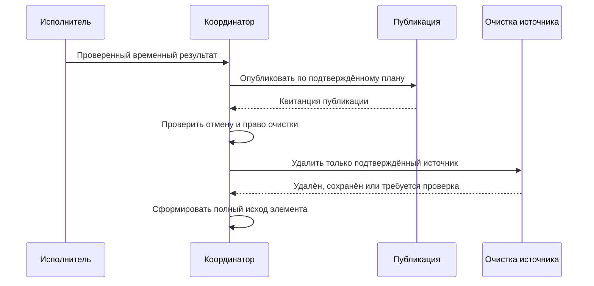

Если очистка не удалась, результат не удаляется автоматически, а исходник остаётся. Элемент получает `Partial` с пригодным артефактом и объяснением невыполненной очистки.

Это безопаснее, чем объявить ошибку всего преобразования и предложить слепо повторить его: повтор может создать дубликат или снова попытаться удалить уже изменённый файл.

### Проверка «файл тот же» имеет реальные ограничения 🔎

Размер и время изменения полезны для обнаружения обычных изменений, но не являются криптографическим доказательством идентичности. Контрольная сумма связывает содержимое, однако отдельная проверка перед удалением всё ещё оставляет временное окно.

Для строгого разрушительного режима требуется подтверждённый механизм исключительного доступа, контролируемое пространство имён или иной платформенный способ защитить именно объект, к которому применяется действие. Если адаптер не может обеспечить выбранную гарантию, разрушительный режим недоступен для этой области.

Нельзя обещать безопасную условную замену в произвольно изменяемом чужими процессами каталоге, реализовав её как «сравнить хеш → вызвать `replace`». Между действиями источник способен измениться. В обычном локальном режиме с предположением об отсутствии конкурентного изменения это ограничение должно быть явно описано.

### Подтверждение связывается с планом 🔏

Доверенное подтверждение содержит ссылку на версию или отпечаток плана, набор разрешённых последствий, инициатора решения и срок действия. Если агент меняет параметры или список файлов, требуется другое подтверждение.

Проверка доступа выполняется при старте и на опасной границе. Принцип проверки каждого обращения и минимальных полномочий соответствует рекомендациям [OWASP Authorization][authorization].

В интерфейсе подтверждения показываются реальные последствия: какие источники заменяются, какие удаляются, какие резервные копии предусмотрены. Простая фраза «Уверены?» недостаточна для проверки масштаба агентного действия.

### Отмена не запускает автоматическое восстановление прошлого 🔄

Уже заменённый источник возвращается только при наличии предусмотренного восстановления. Если после операции человек изменил новый файл, безусловное восстановление старого поверх него может уничтожить более свежую работу.

Такой сценарий относится к компенсации, а не к остановке. [Compensating Transaction][compensation] подчёркивает зависимость обратных действий от предметной логики и последующих изменений. Для конвертера это означает отдельный план восстановления, а не скрытую рекурсивную очистку папки.

> [!warning] Отказ от опасного действия — нормальный результат
> Если нельзя доказать, что удаляется именно согласованный источник, приложение сохраняет его и объясняет причину. Оно не должно повышать агрессивность ради того, чтобы карточка стала зелёной.

---

## 18. Кнопка «Стоп»: точный контракт вмешательства 🛑

Человек должен иметь возможность остановить задачу, запущенную агентом. Для этого кнопка обращается к владельцу задачи по `job_id`, а не к локальному объекту, созданному обработчиком собственного запуска.

Кооперативная отмена разделяет запрос и реакцию исполнителя; это общая модель, подробно описанная в [документации Microsoft][cancellation]. В конвертере к ней добавляется контроль публикации файлов.

### Что именно обещает основная кнопка ⏹️

После принятия запроса приложение:

- не выдаёт новые элементы пакета исполнителям;
- запрещает выдачу новых разрешений на публикацию и последующую очистку источников;
- передаёт сигнал отмены активным исполнителям и ожидает определения их исходов.

Это одна из немногих последовательностей, где перечисление полезно: три обязанности относятся к разным частям системы и должны проверяться отдельно.

Уже выданное разрешение на короткий участок публикации может завершиться. Поэтому ответ `Requested` не обещает, что после него на диске не появится ни одного результата. Он сообщает, что новые участки публикации больше не будут допущены, а число уже начатых доступно в состоянии.

### Разрешение на публикацию и отмена сериализуются 🚦

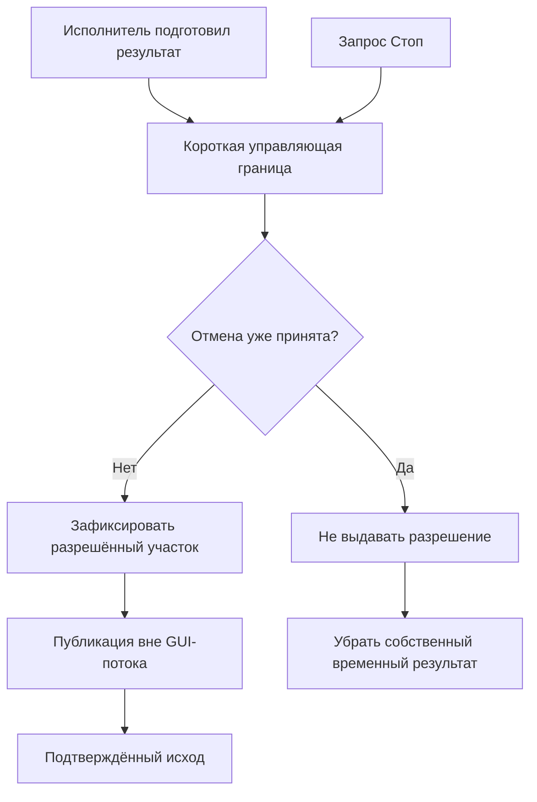

Критическая секция принимает решение и регистрирует участок. Она не должна удерживать общий замок на всё время файлового ввода-вывода. Уже допущенные участки учитываются отдельно, поэтому приложение знает, чего ещё ожидает при остановке.

Для удаления оригинала используется отдельное решение о допуске. Если отмена принята после публикации нового файла, но до разрешения очистки, исходник сохраняется. Если опасный участок уже начат, его итог честно отражается в отчёте.

### Ответ и окончательное состояние различаются 📬

```json
{
  "decision": "requested",
  "job_id": "job-204",
  "status": "cancelling",
  "active_encoders": 1,
  "publication_sections_in_flight": 1,
  "message": "Новые элементы не запускаются; уже начатые участки завершаются"
}
```

Приведённый `message` иллюстрирует отображение. Клиенты опираются на структурированные поля, а не распознают фразу.

Окончательное `cancelled` появляется после того, как известна судьба всех активных попыток и допущенных публикаций. Если какой-то эффект остаётся неопределённым, применяется `interrupted` или соответствующий элемент `Uncertain`, а не ложное подтверждение полной остановки.

### Остановить кодирование и запретить результат — разные возможности 🧠

Нативный кодер может не реагировать до завершения текущего файла. Но если ему запрещено публиковать напрямую, приложение способно не принять его поздний результат после отмены.

Это важное разделение: CPU ещё некоторое время занят, однако новые изменения пользовательских файлов не допускаются. GUI показывает фазу ожидания кодека и не обещает мгновенного освобождения ресурсов.

При необходимости аварийного завершения изолированного исполнителя удаляются только принадлежащие ему временные данные. Нельзя по одному `job_id` рекурсивно удалять всё в выходном каталоге: там могут находиться ранее опубликованные или чужие файлы.

### Остановка пакета не равна запрету новых действий агента 🤖

Агент может отправить новый запуск после отмены старого. Поэтому административная команда `sessions.suspend` запрещает новые изменяющие операции сессии и применяет заданную политику к её ожидающим и активным задачам.

Запрет проверяется при принятии запроса, при выдаче работы и на границах публикации. Идентификатор сессии устанавливается доверенной стороной.

Такое действие ограничивает агентный доступ через приложение. Оно не останавливает внешнюю языковую модель и не блокирует независимые возможности терминала. Это граница продукта, которую интерфейс не должен скрывать.

### Закрытие окна требует собственного решения 🚪

Закрытие окна не преобразуется автоматически в принудительное уничтожение работающих кодеков. Приложение предлагает завершить текущую работу, запросить остановку либо оставить процесс работать без видимого окна, если такой режим реализован.

В базовой поставке работа не обещает переживать завершение самого процесса владельца. После аварийного завершения журнал используется для проверки итогов, а не для автоматического повторного удаления источников.

---

## 19. GUI: одна проекция для человека и агента 🖥️

Графический интерфейс становится живым не потому, что агент нажимает кнопки, а потому, что окно отображает состояние приложения независимо от инициатора.

Если карточка создаётся только внутри `on_start_clicked`, задача MCP останется невидимой. Если карточки строятся из списка задач владельца сессии, обе формы запуска естественно выглядят одинаково.

### Три области интерфейса 🪟

Для конвертера достаточно трёх основных областей: подготовка, выполнение и результаты. Они могут быть вкладками или частями одного окна.

| Область | Содержимое | Источник данных |
|---|---|---|
| **Подготовка** | Выбранные входы, параметры, планируемые размеры и пути | Локальный черновик формы и `PlanSnapshot` |
| **Выполнение** | Карточки задач, текущие элементы, прогресс, остановка | `JobSnapshot`, `ItemSnapshot` |
| **Результаты** | Фактические пути, размеры, предупреждения, судьба оригиналов | `PublishedArtifact` и итоговый отчёт |

Локальный черновик формы не является общей спецификацией работающей задачи. Изменение слайдера качества во время выполнения не должно менять уже принятый пакет.

### Пример информационной карточки 🧾

```text
Преобразование фотографий                 Запущено агентной сессией
WebP · рамка 1920 × 1080 · только уменьшение
Оригиналы сохраняются

Завершены исходы: 18 из 40
Готово: 16   Ошибки: 1   Пропущено: 1
Активно: 2  В очереди: 20

Текущий файл: landscape.heic
Этап: кодирование
Точный процент этого этапа недоступен

[Стоп]    [Подробности]    [Показать план]
```

Это текстовый макет содержания, а не обязательный дизайн. Сумма терминальных исходов, активных и ожидающих элементов соответствует общему количеству.

Сведения об инициаторе полезны для объяснения работы, но не управляют стилем выполнения. Агентная задача не обязана получать отдельную копию списка или особый алгоритм прогресса.

### Проекция и ViewModel разделяют данные и оформление 🧩

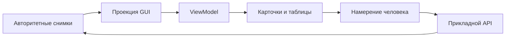

`JobsProjection` хранит известные задачи и версии. `JobCardViewModel` вычисляет подписи, вид индикатора и доступность действий. Виджеты отображают эти значения. Такое отделение соответствует [Presentation Model][presentation-model].

Доступность кнопки остановки учитывает состояние работы и разрешённые действия. Но итоговая проверка права выполняется в API повторно: состояние могло измениться после отрисовки.

### Изначально неизвестный процент не надо превращать в ложные 0% 📊

У подготовки может быть неизвестно общее число файлов до окончания обхода. У кодера может отсутствовать промежуточный прогресс. В этих случаях ViewModel выбирает неопределённый индикатор и текст этапа.

После фиксации плана известен состав пакета. Тогда можно показывать счётчики элементов. Объединять их с неизвестным временем кодирования в один «точный процент оставшегося времени» не следует.

При повторной попытке элемент не должен исчезать из общего количества. GUI показывает номер попытки в подробностях, сохраняя один логический элемент пакета.

### Потеря соединения не равна остановке обработки 📶

У интерфейса есть два независимых состояния: последнее известное состояние задачи и состояние связи с владельцем.

Если связь потеряна, карточка помечается как устаревшая. Она не объявляет работу завершённой, отменённой или неуспешной. Кнопка может предложить повторное подключение и сверку, а не отправлять новый пакет в надежде заменить исчезнувший ответ.

Аналогично после нажатия «Стоп» GUI сначала показывает локальное ожидание ответа. Подтверждённое `cancelling` и окончательное `cancelled` приходят из состояния приложения.

### Фокус человека остаётся локальным 🎯

Задача агента появляется в общем списке. Но это не обязывает окно переключать выбранный файл, прокрутку или вкладку человека. Для автоматического перехода можно добавить отдельный режим «Следовать за активной задачей».

Такой режим меняет представление, а не семантику операции. Отказ от автоматического переключения не делает выполнение менее наблюдаемым: карточка и уведомление остаются доступными.

---

## 20. События и восстановление наблюдения 📡

Для небольшого приложения достаточно локальных подписок. Для внешнего окна или MCP-клиента может понадобиться IPC. В обоих случаях надёжное наблюдение должно включать запрос состояния, а не только поток сообщений.

### Событие несёт факт, а не команду виджету 📣

```json
{
  "event_type": "conversion.job.snapshot.v1",
  "event_id": "event-901",
  "session_epoch": "app-session-18",
  "stream_cursor": "cursor-901",
  "snapshot": {
    "job_id": "job-204",
    "revision": 12,
    "status": "running",
    "plan_id": "plan-104",
    "initiator": {"kind": "agent", "session_id": "agent-session-7"},
    "counts": {
      "total": 6,
      "queued": 2,
      "active": 1,
      "succeeded": 3,
      "partial": 0,
      "failed": 0,
      "skipped": 0,
      "cancelled": 0,
      "uncertain": 0
    }
  }
}
```

Состояние показывает реальные элементы пакета. В нём нет `spinner_visible` или `button_color`. Эти свойства производит ViewModel.

Приведённые идентификаторы условны. `revision` относится к задаче, `stream_cursor` — к потоку доставки, `session_epoch` — к поколению работающего владельца. Их роли не смешиваются.

### Подключение начинается со согласованной границы 🧷

В локальном варианте подписка устанавливается до чтения снимка и буферизует изменения до завершения чтения. Затем снимок и накопленные сообщения объединяются по версиям. Переполнение буфера означает необходимость новой синхронизации, а не разрешение незаметно потерять окончание задачи.

Если реализован сохраняемый поток, API может вернуть список задач вместе с курсором и позволить продолжить наблюдение после него. Но произвольный номер последнего события рядом с несогласованным списком такой гарантии не создаёт.

Для базовой desktop-версии достаточно первого механизма с явной пересинхронизацией. Повторение подробного протокола не требуется: его условия уже разобраны во [второй статье](02_Command_First_Architecture_and_Contracts.md).

### Повторы и запоздавшие снимки безопасно игнорируются 🔁

Снимок версии 11 не должен возвращать карточку в работу после полученной версии 12. Полный снимок можно применить без промежуточных версий, если контракт действительно содержит всё нужное состояние данного объекта.

Но если последнее сообщение потеряно, новые версии сами не появятся. Поэтому после переподключения выполняется повторное чтение. Для длительного периода без событий возможна контрольная сверка.

Удаления из истории, изменение области видимости и отзыв доступа также должны отражаться в проекции. Отсутствие новых сообщений о скрытом объекте не является достаточной командой убрать его с экрана.

### Частый прогресс объединяется, итог не теряется 🚦

Обновления нескольких файлов могут приходить чаще частоты отрисовки. Промежуточные снимки прогресса объединяются: сохраняется последнее известное состояние каждого элемента.

Поток диагностических журналов и окончательные результаты имеют другую политику. Нельзя отбросить публикацию артефакта только потому, что рядом пришло более свежее числовое значение прогресса. В простом варианте каждое терминальное изменение фиксируется в хранилище, а GUI при сомнении перечитывает данные.

Снимки не должны включать растровые буферы и большие двоичные файлы. Превью и результаты адресуются идентификаторами и выдаются отдельным ограниченным способом.

---

## 21. MCP и CLI: адаптеры одного прикладного API 🤖

Агентная интеграция не содержит собственного алгоритма обхода файлов, ресэмплинга или удаления оригиналов. Она переводит вызов инструмента в прикладной запрос и возвращает структурированный результат.

MCP описывает обнаружение и вызов инструментов через схемы. Полезное поведение и ограничения остаются за приложением.([MCP Tools][mcp-tools]) Поэтому один и тот же план должен означать одно и то же независимо от того, был ли он создан через GUI, терминал или агентный адаптер.

### Небольшое число явных инструментов полезнее универсального доступа ко всему 🧰

Для такого продукта достаточно набора специализированных инструментов:

| Инструмент агента | Прикладной сценарий |
|---|---|
| `converter_capabilities` | Прочитать доступные профили и ограничения |
| `converter_prepare` | Создать подготовку плана |
| `converter_get_plan` | Прочитать итог подготовки |
| `converter_start` | Запустить разрешённый готовый план |
| `converter_job_status` | Узнать состояние принятой работы |
| `converter_job_items` | Получить подробности по файлам |
| `converter_cancel` | Запросить остановку доступной задачи |

Страница элементов и ограничение размера ответа важны для больших папок. Агенту не требуется получать десятки тысяч полных строк за каждый запрос состояния.

Административное управление чужими сессиями, произвольный запуск команд ОС и выдача новых файловых разрешений не включаются в этот набор. Возможность конвертации не означает возможность выполнять любой код на машине.

### Attached-путь сохраняет общий владелец 🏠

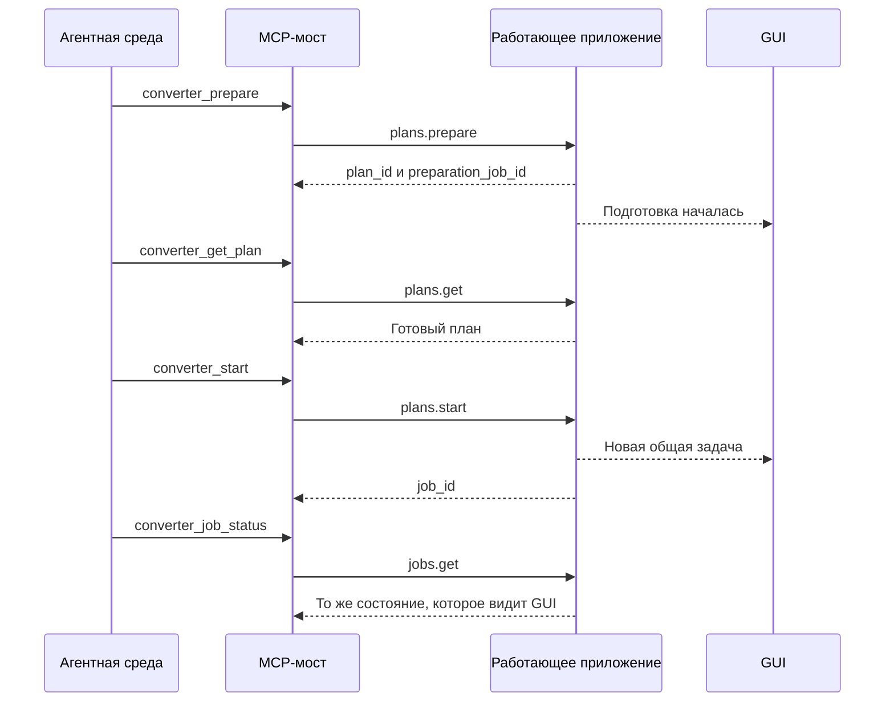

Промежуточные опросы показаны схематично: реальный клиент ожидает готовность, не создавая бесконечный частый цикл. Интервал опроса и подписка определяются возможностями интеграции.

Завершение вызова `converter_start` не означает завершения конвертации. Прекращение ожидания одного протокольного вызова также не следует автоматически трактовать как отмену уже принятого прикладного `Job`. Адаптер явно связывает протокольные механизмы с `jobs.cancel`, когда это предусмотрено его контрактом.

### Локальное соединение тоже имеет границу доверия 🔐

IPC-сервер не считается доверенным только потому, что слушает локальную машину. Другой локальный процесс не должен получать управление конвертером без предусмотренного допуска. В выбранной реализации используется ограниченный локальный транспорт и привязка соединения к подтверждённой сессии; способ проверки — права доступа к сокету или каналу, секрет подключения либо другой механизм среды — фиксируется отдельно для поддерживаемой платформы.

После установления соединения приложение всё равно проверяет разрешения для конкретной операции и `root_id`. Доступ к транспорту не равен праву удалять источники или останавливать чужие задачи. Такой подход соответствует проверке полномочий на каждом обращении, описанной в [OWASP Authorization][authorization].

Входной адаптер ограничивает размер сообщений и число одновременных запросов. Он передаёт пути и параметры как данные, а не собирает из них строку команды оболочки. Логи соединения не должны раскрывать секрет допуска. Эти меры относятся к адаптеру и политике безопасности; предметной геометрии не требуется знать ни порт, ни имя локального канала.

### CLI предоставляет те же сценарии без интерактивных сюрпризов ⌨️

Следующие команды — иллюстрация проектируемого CLI, а не утверждение о наличии готового пакета с таким именем.

Получение возможностей работающего приложения:

```bash
image-converter capabilities --attach --json
```

Подготовка плана по файлу спецификации:

```bash
image-converter plan prepare --attach --spec conversion.json --json
```

Чтение готового плана:

```bash
image-converter plan get --attach --id plan-104 --json
```

Запуск:

```bash
image-converter plan start --attach --id plan-104 --revision 1 --idempotency-key conversion-intent-104 --json
```

Запрос остановки:

```bash
image-converter job cancel --attach --id job-204 --json
```

В машинном режиме stdout содержит только согласованный формат результата. Диагностика направляется отдельно. Команда не должна неожиданно зависнуть на `input()` с вопросом о перезаписи: необходимость подтверждения возвращается структурированно либо обрабатывается отдельным интерактивным режимом.

Headless запускается явно, например отдельным флагом или подкомандой. Отсутствие работающего приложения при `--attach` не приводит к скрытому созданию новой независимой сессии.

### GUI может появиться позже без изменения ядра 🪟

Поскольку состояние и управление доступны через API, минимальную программу можно сначала проверить через CLI. Затем GUI подключается к тем же планам и задачам.

Обратный порядок также допустим: сначала настольное окно, затем MCP-мост. Критично лишь не закрепить бизнес-логику внутри обработчиков окна. Появление очередного адаптера не должно добавлять четвёртую версию алгоритма имён файлов.

---

## 22. Хранение, ошибки и восстановление после сбоев 🗄️

Журнал нужен для фактов: какой план принят, какие элементы выполнялись, какие результаты опубликованы и что осталось неопределённым. Он не обязан быть хранилищем всех пикселей и каждой промежуточной строки диагностики.

### Минимальная схема хранения 📚

| Набор записей | Что хранит |
|---|---|
| `plans` | Нормализованную спецификацию, версию, состояние и условия подтверждения |
| `plan_items` | Источники, назначения, размеры и предупреждения |
| `jobs` | Жизненный цикл пакета, инициатора, запрос отмены, итог |
| `job_items` | Состояние и результат каждого элемента |
| `attempts` | Конкретные запуски исполнителей и их диагностические сведения |
| `artifacts` | Проверенные и опубликованные результаты, квитанции и контрольные суммы |
| `operation_keys` | Записи идемпотентности в определённой области |
| `approvals` | Доверенные решения для конкретных опасных планов |

Не каждой строке таблицы соответствует обязательный отдельный файл или класс. Некоторые структуры можно хранить вместе, пока сохраняются запросы, ограничения и корректность обновлений.

Растры во время обработки находятся у исполнителей, результаты — в файловой системе. В журнал попадают ссылки и метаданные. Секреты локального соединения и полный текст персональных метаданных не записываются в каждую задачу.

### Транзакция БД не охватывает произвольный файл результата ⚖️

SQLite обеспечивает атомарность изменений в своей транзакционной области при оговорённых предпосылках.([Атомарность SQLite][sqlite-atomic]) Это не превращает запись `.webp`, удаление `.jpg` и обновление строки `job_items` в одну транзакцию.

Поэтому для публикации фиксируются промежуточные стадии, например:

```text
prepared → publication_authorized → filesystem_applied → receipt_recorded
```

После сбоя приложение сопоставляет журнал, временный файл, конечное назначение и ожидаемую контрольную сумму. Отсутствующее подтверждение не считается доказательством отсутствия результата.

### Восстановление устанавливает факты, а не повторяет всё подряд 🔎

| Момент сбоя | Безопасная реакция после запуска |
|---|---|
| До начала элемента | Предложить новый запуск ожидающей работы |
| Во время кодирования | Считать попытку прерванной; проверить и убрать её временные данные |
| После подготовки до публикации | Не публиковать автоматически без проверки допуска и актуальности плана |
| После изменения файловой системы до записи квитанции | Сверить назначение и идентичность результата |
| После публикации до удаления источника | Сохранить источник до отдельной проверки |
| Во время опасной замены или очистки | Отметить неопределённость и запретить слепой повтор |

Запрос отмены и блокировка агентной сессии не должны теряться при восстановлении журнала. Но базовая система всё равно не продолжает опасные действия безусловно: она показывает установленный результат и требует корректного решения о дальнейшем ходе.

Временная очистка удаляет только файлы, принадлежность которых подтверждается журналом и безопасной служебной областью. Чужой файл с похожим суффиксом не считается мусором автоматически.

### Каталог ошибок описывает дальнейшее действие 🧯

| Код | Смысл | Обычная реакция |
|---|---|---|
| `UNSUPPORTED_INPUT` | Нет разрешённого пути чтения | Исключить с объяснением |
| `UNSUPPORTED_IMAGE_PROPERTIES` | Формат распознан, свойства не входят в профиль | Выбрать отдельный допустимый сценарий |
| `SOURCE_CHANGED` | Источник не соответствует плану | Подготовить новый план |
| `RESIZE_CONSTRAINT_CONFLICT` | Направление масштаба противоречит цели | Исправить геометрию |
| `RESIZE_SUBPIXEL_DIMENSION` | Идеальная сторона результата меньше одного пикселя | Выбрать большую рамку или другой явный режим |
| `ENCODER_UNAVAILABLE` | Нужный провайдер не готов | Исправить окружение или явно выбрать другой формат |
| `DESTINATION_CONFLICT` | Назначение занято или совпадает с другим элементом | Выбрать другую политику или имя |
| `DESTINATION_CHANGED` | Условия назначения изменились после плана | Повторно подготовить план |
| `ACCESS_DENIED` | Недостаточно полномочий | Не повторять с расширенными правами самовольно |
| `APPROVAL_REQUIRED` | Нет доверенного подтверждения | Показать конкретный план человеку |
| `RESOURCE_LIMIT` | Превышен бюджет | Снизить нагрузку или изменить разрешённые лимиты |
| `ENCODING_FAILED` | Кодер не выполнил преобразование | Сохранить источник, отразить ошибку элемента |
| `PUBLICATION_UNCERTAIN` | Эффект публикации пока не установлен | Сверить журнал и файлы |
| `SOURCE_CLEANUP_FAILED` | Результат есть, источник не удалён | Показать частичное выполнение |

Внешняя ошибка содержит стабильный код, безопасное объяснение, идентификатор диагностики и допустимый путь восстановления. Полный стек нативной библиотеки не обязательно доступен агенту.

### Неизвестный исход не должен превращаться в автоматический retry 🌫️

Потеря IPC-ответа после `plans.start` не означает, что задача не создана. Клиент повторяет запрос с прежним ключом либо проверяет соответствующую запись.

Потеря ответа после публикации ещё опаснее: повтор может затронуть уже существующий результат. Поэтому журнал и идемпотентность связывают намерение, попытку и файловую квитанцию, но не подменяют их одним идентификатором.

Диагностика должна позволять восстановить последовательность, не записывая без необходимости содержимое самих изображений. Для обычного разбора достаточно идентификаторов, версий, стадий и кодов ошибок.

---

## 23. Эскиз реализации на Python без привязки ядра к Qt 🐍

Архитектура не зависит от языка, но для практического воплощения подходит следующий состав: Python, PyQt6, Pillow с выбранными провайдерами форматов, типизированные контракты и локальное хранилище. GUI и библиотеки обработки соответствуют технической постановке; Pydantic и прикладные модули ниже — варианты реализации проектируемых контрактов.[^stack]

Здесь не приводится «полный конвертер в пятидесяти строках». Такой фрагмент неизбежно пропустил бы публикацию, остановку и проверку источников. Вместо этого показаны небольшие части, у которых есть ясная граница и проверяемый результат.

### Структура проекта следует обязанностям 📁

```text
image_converter/
├── contracts/
│   ├── requests.py         # Входные DTO и варианты спецификаций
│   ├── plans.py            # Снимки планов
│   ├── jobs.py             # Состояния и результаты
│   └── capabilities.py     # Доступные профили
│
├── domain/
│   ├── geometry.py         # Чистый расчёт размеров
│   ├── encoding.py         # Смысл выходных профилей
│   ├── naming.py           # Правила имён и конфликтов
│   └── policies.py         # Альфа, кадры, оригиналы
│
├── application/
│   ├── api.py              # Публичные сценарии
│   ├── planning.py         # Подготовка неизменяемого плана
│   ├── jobs.py             # Жизненный цикл и управление
│   ├── publication.py      # Координация разрешений и результата
│   └── ports.py            # Потребности во внешних механизмах
│
├── infrastructure/
│   ├── pillow_pipeline.py  # Работа с растровыми данными
│   ├── codecs.py           # Инициализация и проверка провайдеров
│   ├── filesystem.py       # Реализация безопасной публикации
│   ├── repository.py       # Журнал планов и задач
│   └── workers.py          # Исполнители и их жизненный цикл
│
├── presentation/
│   ├── projections.py      # Восстанавливаемые данные GUI
│   ├── view_models.py      # Тексты, индикаторы, доступные действия
│   ├── qt_bridge.py        # Доставка в GUI-поток
│   └── windows.py          # Виджеты и пользовательский ввод
│
├── adapters/
│   ├── cli.py
│   ├── mcp.py
│   └── local_rpc.py
│
├── bootstrap.py            # Сборка зависимостей
└── entrypoints/             # GUI, CLI, MCP, режим исполнителя
```

Для меньшего объёма программы несколько файлов могут быть объединены. Важны запреты зависимостей: `domain` не импортирует Qt, `pillow_pipeline` не меняет карточки, `windows` не удаляет источники, `mcp` не открывает собственную альтернативную очередь.

### Исполнимый пример чистой геометрии 📐

Следующий фрагмент рассчитан на Python 3.11+ и использует только стандартную библиотеку. Он реализует **один режим — вписывание в рамку**. Другие режимы используют те же предметные решения, но не объявляются реализованными этим фрагментом.

Для исключения неоднозначности округления используется рациональная арифметика `Fraction`, описанная в [документации Python][python-fractions]. При невозможности представить одну из идеальных сторон хотя бы одним пикселем выбран строгий отказ; нулевой размер или грубое принудительное растягивание не создаются.

```python
from dataclasses import dataclass
from fractions import Fraction
from typing import Literal


Direction = Literal["shrink_only", "enlarge_only", "both"]


class GeometryError(ValueError):
    """Отказ предметного правила геометрии со стабильным кодом."""

    def __init__(self, code: str) -> None:
        self.code = code
        super().__init__(code)


@dataclass(frozen=True, slots=True)
class Size:
    width: int
    height: int

    def __post_init__(self) -> None:
        # bool специально не считается размером, несмотря на родство с int.
        for value in (self.width, self.height):
            if type(value) is not int or value <= 0:
                raise GeometryError("INVALID_DIMENSIONS")


def round_half_up(value: Fraction) -> int:
    if value < 0:
        raise GeometryError("NEGATIVE_GEOMETRY_VALUE")
    return (2 * value.numerator + value.denominator) // (2 * value.denominator)


def fit_box(
    source: Size,
    bounds: Size,
    *,
    direction: Direction = "shrink_only",
) -> Size:
    if direction not in {"shrink_only", "enlarge_only", "both"}:
        raise GeometryError("INVALID_RESIZE_DIRECTION")

    scale = min(
        Fraction(bounds.width, source.width),
        Fraction(bounds.height, source.height),
    )

    if direction == "shrink_only":
        scale = min(scale, Fraction(1))
    elif direction == "enlarge_only" and scale < 1:
        raise GeometryError("RESIZE_CONSTRAINT_CONFLICT")

    ideal_width = source.width * scale
    ideal_height = source.height * scale

    if min(ideal_width, ideal_height) < 1:
        raise GeometryError("RESIZE_SUBPIXEL_DIMENSION")

    result = Size(
        width=round_half_up(ideal_width),
        height=round_half_up(ideal_height),
    )

    if result.width > bounds.width or result.height > bounds.height:
        raise GeometryError("RESIZE_BOUNDS_VIOLATION")

    return result
```

`Size` проверяет собственный минимальный инвариант. Ограничения продукта на число пикселей и память выполняются дополнительно до выделения растра. Функция не открывает файл и не знает, кто запросил операцию.

`dataclass` облегчает определение значений, но не превращает все аннотации в автоматическую runtime-проверку; поэтому важные проверки здесь написаны явно.([Python dataclasses][python-dataclasses])

### Пример внешней схемы: не все поля существуют одновременно 🧾

Для границы JSON можно использовать Pydantic v2. Ниже показан намеренно небольшой фрагмент схемы: `keep` и `fit_box`. Он демонстрирует способ выражения вариантов, а не весь входной контракт приложения.

```python
from typing import Annotated, Literal

from pydantic import BaseModel, ConfigDict, Field, TypeAdapter


class DTO(BaseModel):
    model_config = ConfigDict(
        extra="forbid",
        frozen=True,
        validate_default=True,
    )


class KeepResize(DTO):
    mode: Literal["keep"]


class FitBoxResize(DTO):
    mode: Literal["fit_box"]
    width: int = Field(gt=0, strict=True)
    height: int = Field(gt=0, strict=True)
    direction: Literal["shrink_only", "enlarge_only", "both"] = "shrink_only"


ResizeDTO = Annotated[
    KeepResize | FitBoxResize,
    Field(discriminator="mode"),
]

resize_adapter = TypeAdapter(ResizeDTO)

request = resize_adapter.validate_python({
    "mode": "fit_box",
    "width": 1920,
    "height": 1080,
})
```

Вариант `keep` не принимает бессмысленные размеры. Неизвестные поля отвергаются. Дальше DTO превращается в предметные значения, а геометрия проверяется общей функцией.

Pydantic обеспечивает проверку и сериализацию данных согласно модели.([Модели Pydantic][pydantic-models]) Поведенческие зависимости удобно выразить через `Protocol`: он описывает требуемые методы, но не выполняет авторизацию и не заменяет проверку входного JSON.([Python typing][python-typing])

### Исполнитель не пишет в окончательное назначение 🧪

Прикладная последовательность одного элемента может быть выражена следующим псевдокодом:

```text
execute_item(item_plan, execution_context):
    verify_attempt_is_current()
    check_cancellation()

    source = open_authorized_source(item_plan.source_access)
    verify_source_matches_plan(source)

    image = decode_selected_image(source)
    image = normalize_orientation_and_color(image, item_plan)
    image = apply_geometry_and_alpha_policy(image, item_plan)

    check_cancellation()
    prepared = encode_to_owned_staging(image, item_plan.encoder)
    verified = verify_prepared_artifact(prepared, item_plan)

    check_cancellation()
    report_prepared_artifact_to_coordinator(verified)
```

Разрешение на публикацию не выдаётся рабочим процессом самому себе. Координатор проверяет попытку, отмену, сессию и назначения, после чего обращается к файловому адаптеру.

В кодеке нет `print("Готово")`, который GUI должен разбирать как событие. Отчёты передаются типизированным каналом. Диагностический журнал остаётся отдельным.

### Qt-мост не должен становиться ядром приложения 🧵

В PyQt6 используются `pyqtSignal` и `pyqtSlot` для доставки данных в объекты представления; соответствующие механизмы описаны в [официальной документации PyQt6][pyqt-signals].

Но `JobSnapshot` не наследуется от `QObject`, а менеджер задач не получает ссылку на `QProgressBar`. Мост принимает сообщение и передаёт его в проекцию на правильном потоке. Представление обновляется уже из неё.

Отключение окна завершает его подписки, но не уничтожает произвольно общую задачу. Время жизни работы определяется владельцем сессии и принятой политикой закрытия.

### Та же архитектура допускает другой frontend 🌐

Вместо PyQt6 может появиться веб-представление или другой desktop-клиент. Оно использует те же операции, снимки и правила остановки.

В такой замене не требуется переносить Python-кодек в браузер только потому, что интерфейс написан на TypeScript. Контракты становятся границей между языками; вычислительное ядро остаётся там, где оправдано его исполнение.

Это практический смысл независимых слоёв: меняется способ взаимодействия, а не определение того, когда разрешено удалить оригинал.

---

## 24. Сквозные сценарии: как система ведёт себя целиком 🎬

Архитектура проверяется не отдельными названиями компонентов, а последовательностями действий. Ниже приведены проектные сценарии с конкретными исходами.

### Безопасная обработка смешанной папки 📂

Агент выбирает каталог и профиль WebP с рамкой 1920 × 1080, только уменьшением и сохранением оригиналов. Подготовка рассматривает семь файлов. Шесть подходят выбранному профилю; один анимированный файл исключается с объяснением.

План содержит шесть элементов конвертации. Для изображения 4032 × 3024 вычисляется 1440 × 1080. Для 1600 × 900 размер сохраняется. Для портретного 3000 × 4000 получается 810 × 1080. HEIF-вход принимается только после подтверждения подходящих свойств основного изображения.

Агент запускает план. GUI получает ту же задачу и показывает шесть элементов, не включая исключённый файл в прогресс конвертации. Исключение остаётся доступным в отчёте подготовки.

### Источник изменился после плана 📝

Пока первые файлы обрабатываются, один из ещё не открытых источников заменяется. Исполнитель обнаруживает несовпадение с планом и возвращает `SOURCE_CHANGED`.

При политике `continue_items` остальные файлы продолжают обрабатываться. Изменённый источник не конвертируется по устаревшим параметрам и не удаляется. В подробностях доступно предложение подготовить новый план именно для актуального входа.

### Человек останавливает оставшуюся работу 🛑

К моменту остановки три файла успешно опубликованы, один завершился отказом из-за изменения источника, два ещё не получили разрешение на публикацию.

После принятия отмены эти два элемента не публикуются. Итог пакета:

```json
{
  "job_id": "job-204",
  "status": "cancelled",
  "counts": {
    "total": 6,
    "queued": 0,
    "active": 0,
    "succeeded": 3,
    "partial": 0,
    "failed": 1,
    "skipped": 0,
    "cancelled": 2,
    "uncertain": 0
  },
  "originals_policy": "keep",
  "published_artifacts": 3
}
```

Три готовых изображения остаются доступны. Все оригиналы сохранены. Ошибка одного элемента не исчезает из отчёта только потому, что общий итог — отмена.

Агент получает тот же результат. Самовольный повтор всего пакета не нужен и может быть запрещён сессией. Новый план формируется только для реально требуемой дальнейшей работы.

### Увеличение малого изображения 🔎

Человек задаёт для 800 × 600 рамку 1920 × 1080 и направление `both`. План показывает результат 1440 × 1080 и предупреждение об увеличении.

Обработка выполняется обычным ресэмплингом. Ни план, ни карточка не утверждают, что восстановлены новые детали. Если выбран `shrink_only`, тот же вход остаётся 800 × 600.

Изменение этого переключателя создаёт новую спецификацию, а не влияет на уже работающий пакет.

### JPEG из прозрачного PNG 🫧

План обнаруживает прозрачные пиксели. При `reject_if_transparent` элемент не допускается. При `flatten` показывается конкретный цвет фона и итоговый JPEG без альфа-канала.

Если агент не указал требуемую политику, он получает понятный отказ или необходимость уточнения в пределах интерфейса приложения. Кодек не решает сам, что чёрный или белый фон «наверное подойдёт».

### Опасный режим остановлен между публикацией и очисткой 🧹

Для одного файла был подтверждён режим удаления оригинала после публикации. Новый результат уже появился, но разрешение на очистку источника ещё не выдано. В этот момент человек нажимает «Стоп».

Очистка блокируется. Оригинал сохраняется, результат также доступен. Элемент отражает неполное выполнение запрошенной очистки. Приложение не удаляет оригинал «для завершения красоты», потому что новая опасная стадия после отмены запрещена.

### Ответ запуска потерян 📬

Задача создана, но клиент не получил ответ. Повтор с прежним ключом возвращает тот же `job_id`. GUI уже мог увидеть карточку через общий поток состояния.

В результате потеря одного ответа не создаёт второй пакет и не заставляет человека разбираться, почему одинаковые изображения обрабатываются дважды.

---

## 25. Проверка системы: от геометрии до аварийной остановки 🧪

Приёмка должна проверять не наличие классов, а архитектурные обещания. Компилирующийся `CommandBus` ещё не доказывает, что GUI видит задачу агента или что исходники сохраняются при ошибке кодера.

### Геометрия проверяется отдельно от изображений 📐

Для функции из предыдущего раздела достаточно нескольких прозрачных примеров:

```python
assert fit_box(Size(4000, 3000), Size(1920, 1080)) == Size(1440, 1080)
assert fit_box(Size(3000, 4000), Size(1920, 1080)) == Size(810, 1080)
assert fit_box(Size(800, 600), Size(1920, 1080)) == Size(800, 600)
assert fit_box(
    Size(800, 600),
    Size(1920, 1080),
    direction="both",
) == Size(1440, 1080)
```

Кроме примеров проверяются свойства: положительные размеры, отсутствие выхода за рамку, отсутствие увеличения при `shrink_only`, явный конфликт при запрещённом уменьшении и оговорённая точность округления. Случайные наборы положительных размеров полезны для поиска граничных ошибок, но не заменяют тесты конкретных продуктовых режимов.

### Матрица форматов строится по свойствам, а не только расширениям 🧬

Каждый базовый вход проверяется с каждым выходом, но этого недостаточно. Нужны изображения с разной ориентацией, прозрачностью, палитрой, профилем цвета, повреждениями и особенностями контейнера.

| Образец | Ожидаемое поведение |
|---|---|
| Обычный RGB JPEG | Корректные четыре выхода при доступных кодерах |
| JPEG с EXIF Orientation | Правильная визуальная ориентация и расчёт размеров |
| PNG с прозрачностью | Сохранение альфа либо явная политика JPEG |
| Палитровый PNG с прозрачностью | Корректное обнаружение фактической прозрачности |
| Малое изображение | Отсутствие случайного upscale в режиме уменьшения |
| Высокое узкое изображение | Корректные границы и политика субпиксельной стороны |
| HEIF с основным и вспомогательными изображениями | Выбор основного по контракту адаптера |
| Анимированный WebP или APNG | Отказ либо отдельное подтверждённое извлечение кадра |
| HDR или неподдерживаемая точность | Явное ограничение, а не скрытая потеря свойств |
| CMYK без поддерживаемого профиля | Предсказуемый отказ цветовой политики |
| Файл с неверным расширением | Решение по допустимой политике распознавания |
| Повреждённые данные после корректного заголовка | Ошибка элемента, источник сохранён |
| Очень большое число пикселей | Ограничение до неконтролируемого выделения ресурсов |

Для PNG lossless можно сравнивать декодированные выходные пиксели с **подготовленным** растром. Для lossy-профилей побайтовое совпадение не является критерием. Используются проверка структуры, размеры, допустимые визуальные метрики и эталонный набор. Порог качества выбирается продуктом, а не выводится из числа `80`.

### Файловые сценарии требуют настоящей файловой системы 🗃️

| Сценарий | Проверяемая гарантия |
|---|---|
| Источник и выход совпадают в режиме `keep` | Создаётся другое имя либо возвращается отказ |
| `.jpg` и `.jpeg`, разный регистр | Политика не обходится особенностями расширения |
| Два входа претендуют на одно имя | Конфликт обнаружен до записи |
| Выход совпадает с другим входом пакета | Источник не перезаписывается |
| Файл назначения появляется после плана | `no_overwrite` действительно не затирает его |
| Источник заменён перед обработкой | План не применяется молча к другому файлу |
| Источник заменён перед удалением | Удаление отклоняется либо предотвращается выбранным механизмом |
| Нет места во время кодирования | Оригинал сохранён, временный файл учтён |
| Ошибка проверки результата | Публикация не выполняется |
| Ошибка удаления после публикации | Результат остаётся, исходник сохраняется, итог частичный |
| Выходной каталог внутри входного | Собственные результаты не попадают в этот же пакет |
| Символическая или жёсткая ссылка | Не обходятся ограничения цели и происхождения |
| Перезапуск после изменения файла до записи квитанции | Выполняется сверка, а не слепая повторная запись |

Тестовая in-memory-реализация файлового порта не доказывает атомарность конкретной платформы. Критические операции проверяются на реально поддерживаемых файловых системах. Сетевые каталоги получают отдельную матрицу гарантий либо исключаются из опасных режимов.

### Управление и агентный доступ проверяются сквозными сценариями 🤝

| Действие | Ожидаемый результат |
|---|---|
| Агент запускает пакет при открытом GUI | Карточка появляется без имитации кликов |
| GUI подключается после запуска | Текущая задача восстанавливается из API |
| Человек нажимает «Стоп» | Управляющий ответ приходит без ожидания конца очереди |
| Отмена принята до выдачи элемента | Элемент не начинает обработку |
| Отмена принята до разрешения публикации | Поздний артефакт не публикуется |
| Отмена конкурирует с уже начатой публикацией | Итог соответствует контракту допущенного участка |
| Старый исполнитель прислал результат | Его сообщение не изменяет актуальную попытку |
| Запрос запуска повторён | Не создаётся новая задача при том же намерении |
| Сессия агента заблокирована | Новые изменяющие действия отвергаются |
| Агент подставил чужой `root_id` | Доступ не расширяется |
| GUI получил старую версию задачи | Карточка не возвращается в прошлое |
| Потеряно последнее уведомление | Сверка восстанавливает итог |
| Соединение закрыто | GUI отличает отсутствие связи от ошибки задачи |

Проверки прав выполняются не только через UI. Прямой вызов прикладного API и MCP должен давать тот же отказ. Иначе скрытая кнопка создаст лишь иллюзию защиты.

### Точки искусственного сбоя особенно ценны 🧨

Для файловой безопасности полезны управляемые остановки после создания временного файла, после проверки, после выдачи разрешения, после изменения назначения и до записи квитанции.

В каждой точке фиксируется ожидаемое состояние источника, временного файла, назначения и журнала. Это позволяет проверить восстановление как часть контракта, а не надеяться, что процесс никогда не упадёт в неудобную миллисекунду.

Сбой подписчика GUI также тестируется отдельно. Если окно не смогло обработать уведомление, уже опубликованный результат не должен исчезать и не должен объявляться несостоявшимся.

### Граница приведённых примеров ✅

Чистая функция геометрии и фрагмент DTO в статье могут проверяться независимо. Они не доказывают работоспособность всего описанного продукта. Интеграционная приёмка кодеков, GUI, локального транспорта, публикации и сборки выполняется только на реализованном приложении и целевом окружении.

---

## 26. Поставка приложения: сборка тоже проверяет архитектуру 📦

Приложение может работать из исходников и при этом потерять формат в собранном executable. Причина может быть в регистрации плагина, отсутствующей нативной библиотеке или особенностях запуска рабочих процессов.

Поэтому поставка проверяется как самостоятельный продуктовый путь, а не как последняя команда после успешного теста в IDE.

### Зависимости фиксируются для проверяемой комбинации 🔒

В релизе фиксируются версии Python, GUI-библиотеки, Pillow, выбранных провайдеров и сборочного инструмента. Ограничения вида `>=` полезны для описания минимального требования, но сами по себе не задают воспроизводимую сборку.

Новая версия библиотеки не считается автоматически лучше подходящей конкретному контракту. Она проходит матрицу форматов, цветовых свойств, остановки и упаковки. Сведения о фактических провайдерах доступны через диагностический раздел `capabilities.get`.

### Один executable не означает один процесс 🖥️

PyInstaller способен упаковать приложение в единый запускаемый файл.([Режимы PyInstaller][pyinstaller-mode]) Это не отменяет рабочих процессов и не требует помещать все обязанности в один модуль.

При использовании `multiprocessing` в frozen-приложении необходимо правильно организовать точку входа и `freeze_support()`. PyInstaller отдельно документирует риск повторного запуска основной программы вместо рабочего режима и особенности процессов, переживающих родителя.([Особенности PyInstaller][pyinstaller-pitfalls])

Код создания окна, разбора интерактивных аргументов и регистрации сервера не должен выполняться безусловно при импорте модуля исполнителя. Иначе каждый рабочий процесс способен создать новое окно или попытаться занять тот же управляющий канал.

### GUI-поставка и stdio-инструмент могут быть разными входами 🔌

Для MCP через stdio необходим корректный двусторонний стандартный ввод-вывод. GUI-executable без консоли не следует автоматически считать подходящим носителем этого режима: PyInstaller описывает особенности стандартных потоков windowed-приложений.([Особенности PyInstaller][pyinstaller-pitfalls])

Практический вариант — общие пакеты ядра и контрактов, но отдельные entrypoint для GUI и консольного MCP-моста. Физически это могут быть разные executable либо явно проверенные режимы одной поставки. Выбор определяется упаковкой, а не архитектурой бизнес-логики.

Диагностические сообщения никогда не смешиваются с протокольным stdout MCP. Для GUI они направляются в журнал, для CLI — в соответствующий диагностический поток.

### Приёмка выполняется без среды разработки 🧪

В чистом тестовом окружении проверяются запуск окна, чтение каждого обязательного входного формата, запись четырёх выходов, появление задач агента, отмена, повторный запуск после сбоя и отсутствие зависимости от случайно установленного системного кодека.

Точный размер executable и скорость первого запуска не выводятся из этой архитектуры. Они измеряются на конкретной сборке. Значение, полученное для другой комбинации библиотек, не является контрактом поставки.

Если приложение распространяется с сторонними компонентами, условия их лицензий и уведомлений проверяются отдельно. Архитектурная статья не заменяет такую проверку и не переносит лицензию одного файла на все включённые библиотеки.

---

## 27. Последовательность реализации вертикальными срезами 🛠️

Система достаточно подробна, но не должна реализовываться методом «сначала все абстракции, потом когда-нибудь первая картинка». Разумная последовательность строится вокруг проверяемых пользовательских путей.

### Срез A: один безопасный файл через прикладной API 🌱

Сначала реализуются геометрия, один выходной профиль, сохранение оригинала и публикация нового файла. Операция вызывается напрямую в тесте, без GUI. Ошибка не повреждает источник.

Результат этого среза — не универсальная платформа, а работающий путь с правильными границами: запрос, обработка, проверка, публикация и структурированный итог.

### Срез B: план и пакет с предсказуемыми именами 📋

Добавляются входные каталоги, фиксируемый манифест, конфликты назначения и отчёт подготовки. Состав пакета больше не зависит от того, какие файлы появились во время преобразования.

На этом этапе особенно полезны тесты одинаковых имён, выходного каталога внутри входного и совпадений назначения с другим источником.

### Срез C: управляемая задача и остановка ⚙️

Появляются менеджер задач, ограниченный исполнитель, состояние элементов и сигнал отмены. Кнопка ещё не нужна: остановка проверяется прямым вызовом API.

Критерий готовности — новый элемент не запускается после принятой отмены, а результат без разрешения не публикуется. Просто завершить ожидание вызывающего теста недостаточно.

### Срез D: живой GUI как наблюдатель 🖥️

GUI подключается к снимкам и уведомлениям. Он показывает задачу, созданную не им самим, и отправляет `jobs.cancel`. Формы используют общие схемы и эффективный план.

Представление не создаёт собственную очередь. Это главный тест архитектурной независимости: приложение остаётся одним, даже когда появляется окно.

### Срез E: остальные форматы и свойства изображений 🎨

Подключаются остальные выходные профили, HEIF/AVIF-входы, прозрачность, ориентация, цвет и метаданные. Каждый профиль проходит свой набор образцов.

Полная поддержка обещанного набора означает проверку свойства «может выполнить нужный сценарий», а не только наличие названия формата в выпадающем списке.

### Срез F: внешняя автоматизация и восстановление 🔗

Добавляются CLI и MCP, подключение к текущей сессии, идемпотентный запуск, ограничения файловых корней и восстановление GUI после потери связи. Затем проверяются журнал и сверка незавершённых публикаций.

Разрушительные режимы вводятся после безопасного пути, а не одновременно с первым кодированием. Их готовность определяется отдельными тестами подтверждения, актуальности источника и отказа очистки.

### Критерий завершения каждого среза ✅

Каждый срез должен содержать работающий сценарий, определённые ошибки и тесты заявленных гарантий. Незавершённая возможность не маскируется универсальным методом `execute`, который пока только печатает сообщение.

Эта последовательность — план реализации описанной системы. Она не требует заранее создавать микросервисы, распределённую очередь или общий плагинный фреймворк.

---

## 28. Расширения, которые не должны менять смысл основного ядра 🌿

Хорошая граница позволяет добавлять возможности, но не делает их бесплатными. Каждое расширение меняет конкретные контракты и должно сохранять понятный набор гарантий.

### HEIF вместо PNG в четырёхформатном профиле 🧩

Альтернативный профиль продукта может использовать **HEIF, WebP, AVIF и JPEG**. Для него добавляется выходной HEIF-адаптер и схема его параметров, обновляется каталог возможностей и матрица приёмки. PNG при этом остаётся входом, но исключается из основного набора выходов данного профиля.

Если продукт решит поддерживать оба формата на выходе, это уже пять выходных форматов, и документация должна так и говорить. Нельзя сохранять обещание «четыре», одновременно перечисляя пять вариантов в разных разделах.

Менеджер задач, проекция GUI, планирование и остановка не требуют собственной HEIF-версии. Меняются только относящиеся к кодеру правила и проверки.

### Постоянный локальный сервис 🏠

Чтобы работа продолжалась независимо от окна, владелец задач переносится в отдельный сервис. GUI, CLI и MCP становятся его клиентами. Потребуются управление жизненным циклом сервиса, доступом, обновлениями и версиями протокола.

При этом геометрия, спецификации планов и правила исходников остаются прежними. Меняется граница процесса и время жизни, а не смысл конвертации.

### Возобновление пакета после перезапуска 💾

Для возобновления требуется устойчивый манифест, проверка источников, установленные результаты и определённая политика повторов. Элементы с подтверждённой публикацией не выполняются повторно.

Восстановление может продолжаться **между файлами**. Это не означает продолжения AVIF-кодирования с середины внутреннего алгоритма. Поддержка более тонких контрольных точек зависит от исполнителя и не выводится из сохранённого `progress`.

### Нейросетевое увеличение 🔬

Такой исполнитель потребует модели, профиля вычислений, более сложной оценки памяти и другого описания качества результата. Возможны новые детали, изменение структуры изображения и иная продолжительность работы.

Он получает отдельный тип операции либо явно отличающийся transformation profile. Обычный `fit_box` остаётся детерминированным расчётом размеров и не начинает тайно использовать модель.

### Целевой размер файла и несколько вариантов результата 📏

Подбор кодирования под ограничение в байтах может создавать несколько попыток с разными параметрами. Тогда план должен определить критерий остановки, допустимые изменения качества и поведение при невозможности достичь цели.

Экспорт нескольких форматов из одного источника также меняет модель: один элемент источника может иметь несколько выходных артефактов. Политика удаления оригинала обязана учитывать, какие из них должны быть готовы до очистки. Одного флага успеха первого кодера недостаточно.

### Плагины не должны обходить публикацию 🔐

Новый кодек может быть плагином. Но он должен возвращать подготовленный артефакт и соблюдать пределы контекста, а не получать возможность самостоятельно удалять исходники.

Если плагин выполняет недоверенный код, одного интерфейса `Encoder` недостаточно для защиты. Потребуется изоляция среды и ограничение полномочий. Архитектурный порт облегчает такую замену, но не предоставляет песочницу автоматически.

---

## 29. Карта принятых решений и критерии готовности 📓

После подробного разбора полезно свести проект к небольшому набору решений. Каждое из них связывает требование и проверяемое последствие.

| Решение | Причина | Признак корректной реализации |
|---|---|---|
| Четыре выхода зафиксированы профилем | Устранить неоднозначность форматов | GUI, API и тесты используют один набор |
| Кодеки обнаруживаются и проверяются | Состав сборки влияет на возможности | Недоступный формат не обещается клиентам |
| Геометрия — чистая функция | Единый результат плана и исполнения | Одинаковые размеры при одинаковом запросе |
| План готовится до записи результатов | Видимость последствий и фиксированный состав | Во время обхода не создаются выходные изображения |
| Один владелец задач | Общий контроль GUI и агента | Задача одного клиента видна и управляема другим по правам |
| Исполнитель не публикует напрямую | Контроль отмены и источников | Поздний артефакт не обходит запрет координатора |
| Сохранение оригиналов по умолчанию | Ограничение разрушительных эффектов | Любая обычная ошибка оставляет источник |
| Публикация и очистка разделены | Результат и удаление имеют разные риски | При отказе очистки новый файл не теряется |
| Снимки дополняют события | Позднее подключение и восстановление | GUI может восстановиться без разбора логов |
| Идемпотентность относится к намерению | Потеря ответа не должна дублировать пакет | Повтор запуска возвращает прежнюю задачу |
| Статус отмены не означает откат | Уже созданные эффекты сохраняют значение | Итог содержит частичные результаты |
| Журнал не обещает автоматический workflow | Избежать ложного восстановления | Неопределённые эффекты сначала сверяются |

### Минимальный законченный продукт 🧰

Минимальная пригодная версия включает безопасную обработку выбранных входов, все четыре заявленных выхода при наличии проверенных провайдеров, уменьшение и увеличение по контракту, планируемые имена, управляемые задачи, наблюдение в GUI и остановку через общий API.

Поддержка удаления оригиналов считается отдельной завершённой возможностью только после проверки её файловых гарантий. До этого она должна быть недоступна, а не присутствовать в интерфейсе с оптимистичным предупреждением.

### Что считается архитектурным дефектом 🚩

Если GUI напрямую вызывает удаление файла, MCP создаёт скрытый второй менеджер задач, кодек пишет в конечное имя до проверки или отмена стоит в очереди после всей обработки — нарушена выбранная архитектура независимо от того, как названы каталоги.

Если `quality` игнорируется для PNG, прозрачность теряется без политики, вход меняется между планом и удалением без проверки либо «готово» появляется до публикации — нарушен предметный контракт.

Эти нарушения обнаруживаются конкретными сценариями. Именно поэтому архитектурная приёмка опирается на тесты, а не на количество интерфейсов и диаграмм.

---

## 30. Итог: приложение управляет преобразованием, GUI делает его видимым 🧭

Описанный конвертер остаётся приложением обработки изображений. Он не превращается в универсальную агентную платформу. Его дополнительные механизмы обслуживают вполне конкретные свойства: ясные параметры, сохранность источников, управляемую длительную работу и общий контроль человека и автоматизации.

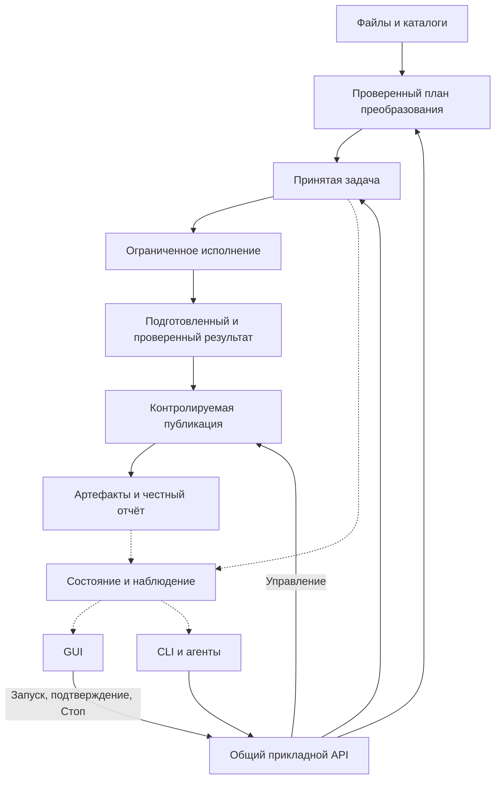

*Схема объединяет смысловые роли. Она не требует отдельного процесса для каждого блока.*

Входной адаптер отвечает за способ обращения. Предметная логика определяет геометрию и допустимость преобразования. Прикладной слой фиксирует план и управляет задачами. Исполнитель работает с изображением. Публикация контролирует файловые последствия. Проекция превращает состояние в понятный интерфейс.

Агент может запустить работу, не нажимая кнопок. Человек видит эту же работу, её параметры и результаты. Кнопка «Стоп» воздействует на настоящее выполнение, а не только скрывает спиннер. При этом приложение не обещает невозможного: произвольный формат не становится поддержанным от слова «любой», обычный upscale не восстанавливает детали, а отмена не возвращает уже изменённые файлы в прошлое.

> [!summary] Практический результат
> Command-first-конвертер строится не вокруг универсального диспетчера и не вокруг окна. Его центр — **проверяемое преобразование с явным планом, управляемым исполнением и контролируемой публикацией**. GUI, CLI и MCP получают равный доступ к смыслу операций, но действуют в пределах выданных полномочий. Именно это делает работу агента наблюдаемой, а вмешательство человека — реальным.

### Связь с остальной серией 📚

[Первая статья](01_Command_First_Introduction.md) объясняет принцип программируемого приложения. [Вторая](02_Command_First_Architecture_and_Contracts.md) раскрывает механизмы контрактов и состояния. [Третья](03_Command_First_Architecture_Variants.md) помогает выбрать достаточную сложность. Настоящий пример показывает, как эти решения соединяются вокруг одной предметной задачи без обязательного добавления всей возможной инфраструктуры.

---

## Источники, документальные основания и границы примера 🔗

Материал различает три категории сведений: функциональные основания конвертера, самостоятельно выбранную архитектуру и проверенные свойства библиотек. Первые определяют класс приложения; вторые составляют проект статьи; третьи ограничивают возможности конкретных адаптеров.

**Дата проверки внешней документации: 23 октября 2026 года.** Страницы `stable` и `latest` могут изменяться. Приведённые сведения не являются результатом запуска полного приложения: в статье спроектирована система, а не заявлена выполненная интеграционная приёмка продукта.

### Функциональные основания примера 📄

[^input-spec]: Функциональные материалы: `README(6).md`, разделы «Возможности», «Возможности GUI» и «Поддержка форматов»; `RELEASE_NOTES(1).md`, раздел «Поддерживаемые форматы»; `PROJECT_STATUS(1).md`, раздел о форматах. В GUI-спецификации перечислены WebP, PNG, AVIF и JPEG. В `classes.py`, `QUICK_GUIDE.txt` и `BUILD_README(1).md` встречается профиль HEIF, WebP, AVIF и JPEG. Общий ввод перечисляет JPEG, PNG, WebP, HEIC/HEIF и AVIF, но отдельные описания и код не образуют единого полного реестра. Статья явно выбирает GUI-профиль из четырёх выходов и не выдаёт это решение за отсутствие расхождений в материалах.

<!-- Документальная привязка: fileciteturn4file3L74-L80 fileciteturn4file3L164-L181 fileciteturn4file0L61-L62 -->

[^file-policy]: Основания файловых сценариев: `QUICK_GUIDE.txt`, разделы «Настройки обработки файлов» и «Примеры результатов»; `UPDATE_FEATURES(1).md`, разделы «Логика работы» и «Технические детали». Они описывают сохранение, постфикс, замену и удаление после создания результата. Журнал публикации, проверка идентичности источника, разрешения на опасные участки и процедуры сверки в этой статье являются отдельными проектными решениями, а не заявлением, что все эти механизмы уже следуют из краткой инструкции.

<!-- Документальная привязка: fileciteturn4file2L7-L48 fileciteturn4file6L12-L19 fileciteturn4file6L84-L88 -->

[^stack]: Техническая основа: `requirements.txt` и разделы о GUI и сборке в `README(6).md` описывают Pillow, pillow-heif, AVIF-плагин, PyQt6 и PyInstaller. Конкретные версии не переносятся в архитектурное обещание совместимости. Общий API, Pydantic-контракты, ограниченная модель задач и управляемая публикация — выбранный вариант построения системы.

<!-- Документальная привязка: fileciteturn4file5L4-L13 fileciteturn4file3L14-L18 -->

Операция пропорционального уменьшения присутствует в техническом описании обработки. **Увеличение, несколько режимов геометрии и точные правила округления в настоящем материале заданы как самостоятельная спецификация примера**. Они не приписываются функции, которая выполняет только ограничивающее уменьшение.

<!-- Документальная привязка: fileciteturn4file0L86-L117 -->

Планы, состояния, имена операций, лимиты, политики цвета и сценарии остановки являются авторскими архитектурными решениями учебной системы. Они не объявляются готовым API стороннего проекта, требованиями MCP или фактической реализацией какого-либо продукта.

### Архитектурная основа 🧱

| Первичный источник | Роль в материале |
|---|---|
| [Alistair Cockburn — Hexagonal Architecture][ports] | Независимость приложения от GUI и технических адаптеров |
| [Randy Stafford — Service Layer][service-layer] | Общая граница прикладных сценариев |
| [Martin Fowler — Presentation Model][presentation-model] | Отделение состояния представления от виджетов |
| [Microsoft — Asynchronous Request–Reply][async-request-reply] | Принятие длительной работы отдельно от результата |
| [Microsoft — Cooperative Cancellation][cancellation] | Разделение запроса остановки и реакции исполнителя |
| [Microsoft — Compensating Transaction][compensation] | Отличие остановки от восстановления уже совершённых эффектов |
| [AWS Builders’ Library — Idempotent APIs][idempotency] | Безопасные повторы одного намерения |
| [OWASP — Authorization Cheat Sheet][authorization] | Полномочия и проверка ресурсов |

### Изображения и кодеки 🎨

| Первичный источник | Роль в материале |
|---|---|
| [Pillow — Image file formats][pillow-formats] | Параметры JPEG, PNG, WebP и AVIF, ограничения конкретного адаптера |
| [Pillow — Image][pillow-image] | Чтение, декодирование, изменение размеров и методы изображения |
| [Pillow — ImageOps][pillow-imageops] | Ориентация и операции изменения геометрии |
| [Pillow — ImageCms][pillow-cms] | ICC-преобразования |
| [Pillow — features][pillow-features] | Проверка доступных возможностей сборки |
| [Pillow — Security][pillow-security] | Риски обработки недоверенных изображений и ограничения ресурсов |
| [Pillow 11.3.0 — AVIF support in wheels][pillow-avif-release] | Источник сведений о встроенном AVIF-пути в бинарных сборках |
| [pillow-heif — Pillow Plugin][pillow-heif-plugin] | Регистрация HEIF и ограничения плагинного представления |

### Реализация, процессы и поставка ⚙️

| Первичный источник | Роль в материале |
|---|---|
| [Python — dataclasses][python-dataclasses] | Внутренние значения и явные инварианты |
| [Python — fractions][python-fractions] | Рациональная арифметика геометрии |
| [Python — typing][python-typing] | Статические контракты и Protocol |
| [Pydantic — Models][pydantic-models] | Проверка и сериализация DTO |
| [Python — os][python-os] | Ограничения файловых примитивов и переименования |
| [SQLite — Atomic Commit][sqlite-atomic] | Область гарантий транзакционного журнала |
| [Qt — Threads and QObjects][qt-threads] | Разделение GUI и рабочих вычислений |
| [Qt — QThread][qt-qthread] | Запрос прерывания и риски принудительного завершения |
| [PyQt6 — Signals and Slots][pyqt-signals] | Доставка состояния в представление |
| [PyInstaller — Operating Mode][pyinstaller-mode] | Пакетирование приложения |
| [PyInstaller — Common Issues and Pitfalls][pyinstaller-pitfalls] | Рабочие процессы, frozen-режим и стандартные потоки |
| [MCP — Tools, спецификация 2026-07-28][mcp-tools] | Инструменты и роль протокольного адаптера |

[ports]: https://alistair.cockburn.us/hexagonal-architecture
[service-layer]: https://martinfowler.com/eaaCatalog/serviceLayer.html
[presentation-model]: https://martinfowler.com/eaaDev/PresentationModel.html
[async-request-reply]: https://learn.microsoft.com/en-us/azure/architecture/patterns/asynchronous-request-reply
[cancellation]: https://learn.microsoft.com/en-us/dotnet/standard/threading/cancellation-in-managed-threads
[compensation]: https://learn.microsoft.com/en-us/azure/architecture/patterns/compensating-transaction
[idempotency]: https://aws.amazon.com/builders-library/making-retries-safe-with-idempotent-APIs/
[authorization]: https://cheatsheetseries.owasp.org/cheatsheets/Authorization_Cheat_Sheet.html
[pillow-formats]: https://pillow.readthedocs.io/en/stable/handbook/image-file-formats.html
[pillow-image]: https://pillow.readthedocs.io/en/stable/reference/Image.html
[pillow-imageops]: https://pillow.readthedocs.io/en/stable/reference/ImageOps.html
[pillow-cms]: https://pillow.readthedocs.io/en/stable/reference/ImageCms.html
[pillow-features]: https://pillow.readthedocs.io/en/stable/reference/features.html
[pillow-security]: https://pillow.readthedocs.io/en/stable/handbook/security.html
[pillow-avif-release]: https://pillow.readthedocs.io/en/stable/releasenotes/11.3.0.html#avif-support-in-wheels
[pillow-heif-plugin]: https://pillow-heif.readthedocs.io/en/latest/pillow-plugin.html
[python-dataclasses]: https://docs.python.org/3/library/dataclasses.html
[python-fractions]: https://docs.python.org/3/library/fractions.html
[python-typing]: https://docs.python.org/3/library/typing.html
[pydantic-models]: https://docs.pydantic.dev/latest/concepts/models/
[python-os]: https://docs.python.org/3/library/os.html#os.replace
[sqlite-atomic]: https://www.sqlite.org/atomiccommit.html
[qt-threads]: https://doc.qt.io/qt-6/threads-qobject.html
[qt-qthread]: https://doc.qt.io/qt-6/qthread.html
[pyqt-signals]: https://www.riverbankcomputing.com/static/Docs/PyQt6/signals_slots.html
[pyinstaller-mode]: https://pyinstaller.org/en/stable/operating-mode.html
[pyinstaller-pitfalls]: https://pyinstaller.org/en/stable/common-issues-and-pitfalls.html
[mcp-tools]: https://modelcontextprotocol.io/specification/2026-07-28/server/tools
