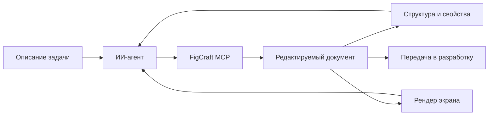
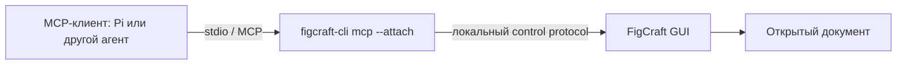
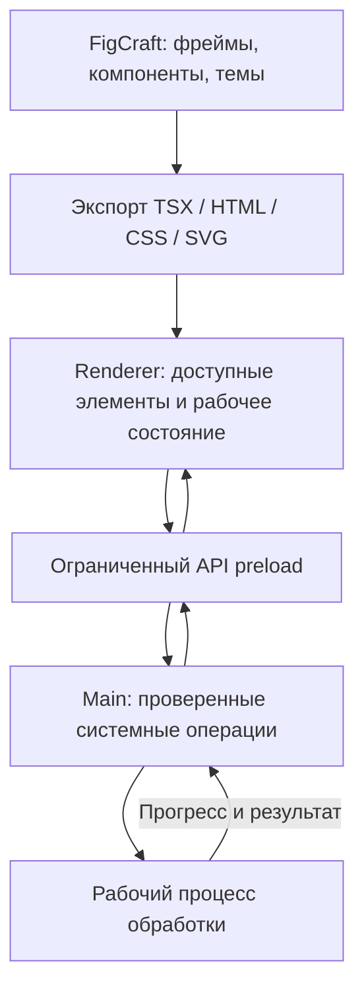
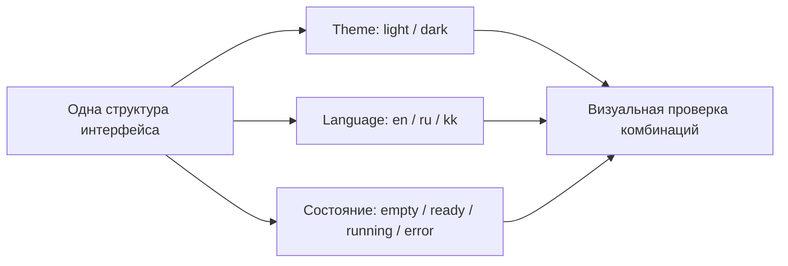
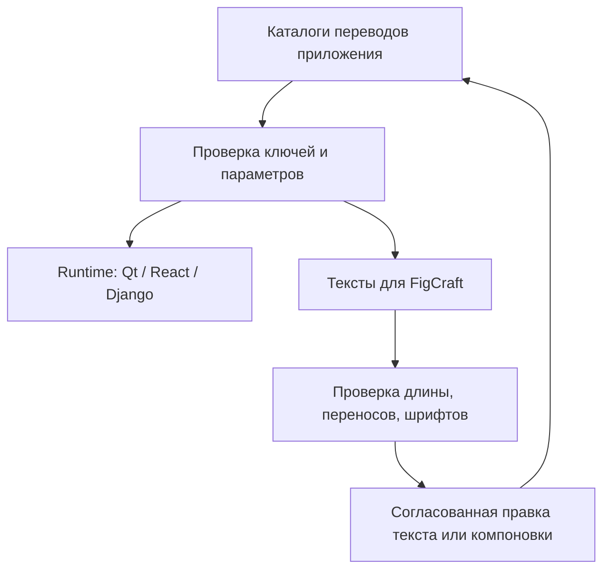
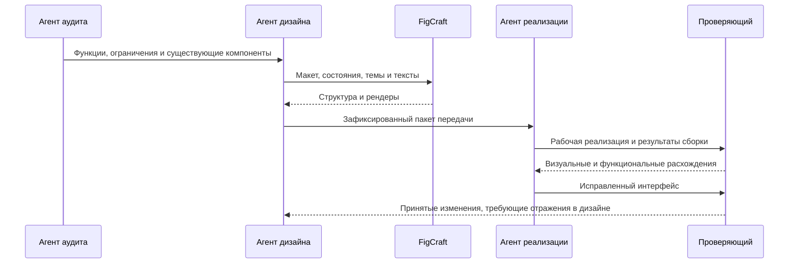

## FigCraft: от агентного макета до работающего интерфейса 🧩

**Подробное руководство по проектированию приложений с ИИ-агентом: установка без сборки, MCP, компоненты, экспорт кода, Electron, React, PySide6/PyQt6, Django и Bootstrap 5, темы оформления и локализация.**

FigCraft интересен не только как ещё один редактор прямоугольников, кнопок и экранов. Его сильная сторона — возможность дать ИИ-агенту настоящий инструмент проектирования: агент создаёт редактируемые объекты, строит вложенную компоновку, использует компоненты, рассматривает результат и исправляет его. Между описанием интерфейса словами и исходным кодом появляется отдельный, проверяемый дизайн-документ.

В небольшом практическом эксперименте эта цепочка действительно заработала: от простого экрана NoteBox удалось перейти к компонентному интерфейсу двух размеров, а затем — к кликабельному прототипу с красивыми переходами. Это убедительный результат для исследовательского знакомства. Однако создание хорошего макета, экспорт фрагментов кода и выпуск готового приложения — три разных этапа. Статья подробно разделяет их, чтобы полезный инструмент не превратился в источник неоправданных ожиданий.[^practice]

> [!abstract] Главная мысль
> FigCraft уже полезен как **редактор дизайна, управляемый агентом, источник структурированных данных и генератор начального веб-кода**. Для Electron и React перенос ближе всего к прямому использованию экспорта. Для Django + Bootstrap требуется адаптация HTML и CSS. Для Qt Widgets и QML готового встроенного экспортера в рассмотренной версии нет: агент переносит спецификацию в соответствующий UI-фреймворк.

**Дата проверки источников: 23 октября 2026 года.** Техническая база статьи — FigCraft **v0.10.0**. Этот релиз опубликован 22 октября 2026 года по UTC и на момент проверки указан официальным API как последний опубликованный релиз. Привязка к версии важна: документация ветки `main` и страницы сторонних фреймворков могут изменяться. Наличие опубликованного релиза не отменяет обозначение проекта как **early alpha** в README. [Релиз][fc-release] · [Репозиторий][fc-repo] · [API последнего релиза][fc-latest]

### Навигация по статье 🧭

| Часть | Содержание |
|---|---|
| [Возможности и границы](#scope) | Что представляет собой FigCraft и чем дизайн отличается от приложения |
| [Практический эксперимент](#practice) | NoteBox: простой экран, компоненты, два размера и прототип |
| [Установка и MCP](#installation) | Готовая Windows-сборка, безопасный запуск, подключение Pi |
| [Подготовка макета](#design-model) | Компоновка, компоненты, состояния и правила работы агента |
| [Экспорт и его ограничения](#export) | Какие данные доступны и что показало изучение генератора кода |
| [Electron](#electron) | Как использовать HTML/CSS и React в настольном приложении |
| [React](#react) | Компоненты, свойства, Code Connect и рабочее состояние интерфейса |
| [PySide6 и PyQt6](#qt) | Qt Widgets, QSS, QML и перенос без переписывания ядра |
| [Django и Bootstrap](#django) | Шаблоны, сетка, формы, CSS-переменные и серверные данные |
| [Светлая и тёмная темы](#themes) | Семантические цвета, системная тема и перенос токенов |
| [Многоязычность](#localization) | Переводы в макете, React, Django и Qt; длинные строки и RTL |
| [Шрифты и графика](#assets) | Эмодзи, SVG, встроенные шрифты и различия рендеринга |
| [Проверка качества](#quality) | Визуальные сравнения, доступность, DPI и проверка поведения |
| [Рабочий процесс](#workflow) | Структура файлов, безопасный редизайн и задания агентам |
| [Ограничения и выводы](#limits) | Где возникают реальные сложности и как оценивать пользу |
| [Первоисточники](#sources) | Официальные документы и исходный код |

<a id="scope"></a>
## Что такое FigCraft и почему он интересен для агентной работы 🎨

FigCraft — открытый редактор интерфейсов и прототипов из семейства ArtCraft. Он написан на Rust, работает с собственными документами `.figcraft` и предлагает привычные для такого класса инструментов сущности: фреймы, текстовые слои, векторную графику, Auto Layout, компоненты, варианты, стили, переменные и прототипы. Для локального редактирования не требуется учётная запись Figma. [Официальная страница][fc-site]

Ключевой архитектурный выбор заключается в том, что действия редактора доступны через командный интерфейс. Агент может создавать и менять объекты не только посредством имитации мыши, но и через MCP. Это принципиально отличается от генерации изображения интерфейса: результат состоит из отдельных объектов, которые затем можно редактировать, инспектировать и экспортировать. [Документация MCP][fc-mcp]



В такой схеме агенту доступны два вида обратной связи. Структура документа показывает, какие объекты действительно созданы, где расположены компоненты и какие свойства им назначены. Рендер показывает, не обрезался ли текст, достаточно ли контраста и не выглядит ли композиция случайной. Один вид проверки не заменяет другой.

### Два режима: с открытым редактором и без окна 🪟

| Режим | Запуск MCP | Что происходит | Для чего удобен |
|---|---|---|---|
| **Headless** | `figcraft-cli mcp` | Сервер работает с движком без графического окна | Пакетные операции, воспроизводимые экспорты, технические проверки |
| **Attached** | `figcraft-cli mcp --attach 7979` | Сервер управляет уже запущенным FigCraft с управляющим портом | Совместная работа человека и агента, наблюдение за изменениями на холсте |

В Attached человек видит реальные изменения документа. В Headless у сервера собственная сессия: это не скрытое подключение к произвольно открытому окну. Для первого знакомства Attached обычно нагляднее. Для автоматической обработки нескольких файлов Headless может оказаться удобнее. [Режимы MCP][fc-mcp]

### Что FigCraft не делает автоматически 🚧

Дизайн-документ не становится приложением только потому, что в нём есть кнопки и кликабельные переходы.

| Уровень | Что на нём появляется | Чего на нём ещё нет |
|---|---|---|
| Макет | Компоновка, типографика, цвета, состояния | Настоящей обработки данных |
| Прототип | Переходы, модальные окна, демонстрация сценария | Гарантированно работающих форм, файловых операций, сохранения |
| Экспорт кода | Начальная разметка, CSS, некоторые компонентные конструкции | Полного проекта, инфраструктуры, бизнес-логики и приёмки |
| Рабочее приложение | Состояние, события, данные, системные функции | Автоматической гарантии качества только на основании макета |

Например, кнопка «Сохранить» в прототипе может лишь переводить на другой фрейм. Это полезно для проверки сценария, но не означает, что заметка записывается в SQLite. Аналогично дроп-зона на макете не рекурсивно обходит папку, а полоса прогресса не знает о выполняющейся задаче.

> [!important] Экспорт дизайна и реализация поведения — разные операции
> FigCraft описывает внешний вид и помогает передать его в код. Разработчик или агент всё равно реализует работу с данными, валидацию, события, ошибки, отмену операций, доступность и упаковку приложения.

### Локальный редактор не означает полностью локальную ИИ-цепочку 🔐

Сам дизайн может храниться на компьютере. Однако если агент использует облачную модель, отправленные ему тексты, свойства объектов и изображения макета могут уйти провайдеру модели. Локальный MCP-сервер не отменяет этого канала передачи данных.

Поэтому для рабочих документов полезно отдельно определить, какие материалы разрешено показывать модели. В макетах обычно достаточно синтетических имён, тестовых файлов и вымышленных текстов. Реальные документы, секреты и персональные данные не нужны для того, чтобы проверить ширину карточки или цвет кнопки.

<a id="practice"></a>
## Небольшой практический эксперимент: от прямоугольников к прототипу 🧪

В демонстрационном кейсе FigCraft использовался на Windows вместе с агентом Pi через MCP. Эксперимент специально развивался небольшими шагами: сначала проверялось само управление документом, затем — его внутренняя структура, после этого — интерактивность.[^practice]

### Первый этап: один экран NoteBox 📝

Первый макет представлял собой тёмный экран размером **960 × 600**: название приложения, подзаголовок, карточка заметки и кнопка. Задача была не в том, чтобы сразу получить коммерческий продукт, а в том, чтобы проверить минимальную цепочку «создать объект → изменить свойства → увидеть результат».

На представленном изображении видны нормально отрисованные русские надписи, аккуратные скругления, единая палитра и кнопка с обновлённым текстом. Это подтверждает получение осмысленного визуального результата, но само изображение не доказывает каждый промежуточный MCP-вызов. Поэтому структурные выводы в таком эксперименте должны опираться ещё и на инспекцию документа.

### Второй этап: компоненты и изменение размера 🧱

Во второй версии интерфейс получил боковую навигацию, список из трёх заметок, область чтения, поиск и кнопку создания. Были подготовлены варианты **1280 × 800** и **960 × 600**.

В отчёте агента указано, что компоновка построена на вложенном Auto Layout, карточки являются экземплярами главного компонента `NoteCard`, а изменение заливки главного компонента распространяется на экземпляры без потери их индивидуальных текстов. Скриншот редактора показывает компоненты и соответствующую иерархию слоёв. После уменьшения общего фрейма текст в области чтения переносится на новые строки.[^practice]

Это более существенный результат, чем просто два красиво нарисованных экрана. Проверяется не только внешний вид, но и способность агента создавать систему, которую можно изменять без ручного перемещения каждого элемента.

### Третий этап: интерактивный прототип 🖱️

Следующее задание добавляло экраны списка, новой заметки и настроек, стартовый flow и переходы по кнопкам. Наблюдатель подтвердил, что интерфейс кликается и переключается с визуально приятной анимацией.

При этом на момент описания не представлен полный финальный отчёт третьего этапа. Следовательно, корректно считать наблюдавшимися клики и переходы, но не приписывать эксперименту неподтверждённую полную проверку всех связей после повторного открытия файла, всех необязательных overlay-сценариев или экспорта в готовое приложение.

| Возможность | На чём основан вывод | Статус в описанном эксперименте |
|---|---|---|
| Создание небольшого интерфейса | Представленные изображения | Наблюдалось |
| Русский текст | Изображения макетов | Наблюдалось |
| Компоненты и экземпляры | Дерево редактора и отчёт агента | Подтверждено в рамках кейса |
| Изменение главного компонента | Отчёт агента | Сообщено как успешно проверенное |
| Перестроение 1280 → 960 | Два макета и отчёт агента | Подтверждено для этих размеров |
| Сохранение и повторное открытие v2 | Отчёт агента | Сообщено как успешно проверенное |
| Кликабельные переходы v3 | Наблюдение за работающим прототипом | Наблюдалось |
| Финальная повторная приёмка v3 | Полный отчёт отсутствует | Не подтверждена материалами кейса |
| React/Electron из экспорта | Реализация не представлена | Не проверялось |
| Перенос в Qt или Django | Реализация не представлена | Не проверялось |

> [!success] Что действительно удалось доказать
> Агентный дизайн в FigCraft — не только обещание из документации. В небольшом эксперименте получился редактируемый компонентный интерфейс и работающий интерактивный прототип. Это хороший аргумент в пользу использования инструмента для реальных дизайн-задач, но ещё не измерение качества его генератора production-кода.

### Ошибка процесса, которую важно не повторить 🛟

В отчёте второго этапа отмечена процедурная проблема: в начале работы была отменена существовавшая несохранённая операция `Prototype settings`, а отдельная копия этого состояния заранее не создана. Исходный файл на диске, согласно отчёту, остался неизменным; однако несохранённое состояние — тоже работа, которую нельзя считать несущественной.

Практический вывод прост: агент не должен «приводить документ в порядок» через произвольный Undo, закрытие без сохранения или возврат к дисковой версии. До редактирования требуется проверить активный документ и сохранить рабочую копию текущего состояния. Копия файла на диске не защищает изменения, которые пока находятся только в памяти редактора.

<a id="installation"></a>
## Установка на Windows без компиляции 📦

Для знакомства с FigCraft не требуется устанавливать Rust, запускать Cargo или собирать приложение из исходников. В официальном релизе v0.10.0 опубликованы Windows-пакеты MSI и portable ZIP. В desktop-пакеты включён `figcraft-cli`; отдельная локальная сборка CLI не является обязательным условием подключения MCP. [Упаковка релиза][fc-releasing]

### Где брать приложение 🔗

| Ресурс | Назначение |
|---|---|
| [Официальная страница FigCraft][fc-site] | Общее описание проекта |
| [GitHub-репозиторий][fc-repo] | Исходники, документация, issues |
| [Все релизы][fc-releases] | Выбор опубликованной версии |
| [Релиз v0.10.0][fc-release] | Воспроизводимая версия для этой статьи |
| [Portable ZIP для Windows x64][fc-winzip] | Готовые бинарники без MSI |
| [Документация MCP][fc-mcp] | Подключение и работа агента |
| [Документация CLI][fc-cli] | Проверка, преобразование и экспорт файлов |

Portable-вариант удобен для эксперимента: приложение можно разместить в пользовательском каталоге, не подменяя другие установленные версии. Это не означает, что программа вообще не создаёт настройки или служебные файлы, — речь только о способе доставки бинарников.

### Воспроизводимая загрузка и проверка архива 🛡️

Ниже приведён пример установки **v0.10.0 для Windows x64**. Все PowerShell-блоки этой последовательности выполняются в одной сессии: последующие команды используют ранее определённые переменные. Для ARM64 нужен соответствующий asset, а не простое переименование x64-архива.

Сначала определяются версия, каталог установки и рабочая папка:

```powershell
$ErrorActionPreference = 'Stop'
$version = '0.10.0'
$installDir = Join-Path $env:LOCALAPPDATA "Programs\FigCraft\$version"
$project = Join-Path $HOME 'Projects\FigCraft-Lab'
$zipPath = Join-Path $env:TEMP "figcraft-$version-windows-x64-portable.zip"
```

Метаданные берутся из официального API конкретного релиза, а не из случайной ссылки на файловом обменнике:

```powershell
$release = Invoke-RestMethod `
    -Uri "https://api.github.com/repos/storytold/figcraft/releases/tags/v$version" `
    -Headers @{ 'User-Agent' = 'FigCraft-Setup' }

$matches = @($release.assets | Where-Object {
    $_.name -eq "figcraft-$version-windows-x64-portable.zip"
})

if ($matches.Count -ne 1) {
    throw 'Ожидаемый Windows x64 portable-архив не найден однозначно.'
}

$asset = $matches[0]
if ($asset.browser_download_url -notlike 'https://github.com/storytold/figcraft/releases/download/*') {
    throw 'Неожиданный адрес загрузки.'
}
```

Затем загружается архив:

```powershell
Invoke-WebRequest -Uri $asset.browser_download_url -OutFile $zipPath
```

Контрольная сумма сверяется с `digest` из метаданных релиза:

```powershell
if ([string]$asset.digest -notmatch '^sha256:[0-9a-fA-F]{64}$') {
    throw 'SHA-256 отсутствует в API. Нужна ручная проверка официального SHA256SUMS.txt.'
}

$expected = ([string]$asset.digest).Substring(7).ToLowerInvariant()
$actual = (Get-FileHash -LiteralPath $zipPath -Algorithm SHA256).Hash.ToLowerInvariant()

if ($actual -ne $expected) {
    throw 'Контрольная сумма архива не совпала. Распаковка отменена.'
}
```

Проверка суммы обнаруживает повреждение или несоответствие артефакта указанному релизу. Она не заменяет доверие к издателю и проверку цифровой подписи. При предупреждении Windows нельзя автоматически отключать защиту или добавлять всю папку в исключения.

Для предотвращения случайного смешивания версий пример отказывается распаковывать архив поверх существующего каталога:

```powershell
if (Test-Path -LiteralPath $installDir) {
    throw "Каталог уже существует: $installDir. Сначала необходимо проверить установленную копию."
}

New-Item -ItemType Directory -Path $installDir | Out-Null
Expand-Archive -LiteralPath $zipPath -DestinationPath $installDir
```

Исполняемые файлы определяются по фактическому содержимому архива:

```powershell
$guiMatches = @(Get-ChildItem -LiteralPath $installDir -Recurse -File -Filter 'figcraft.exe')
$cliMatches = @(Get-ChildItem -LiteralPath $installDir -Recurse -File -Filter 'figcraft-cli.exe')

if ($guiMatches.Count -ne 1 -or $cliMatches.Count -ne 1) {
    throw 'Не удалось однозначно найти GUI и CLI в распакованном пакете.'
}

$gui = $guiMatches[0].FullName
$cli = $cliMatches[0].FullName
```

Отдельная проверка подписи:

```powershell
Get-AuthenticodeSignature -FilePath $gui, $cli |
    Select-Object Path, Status, StatusMessage
```

Отдельная проверка версии GUI:

```powershell
& $gui --version
```

Отдельная проверка справки CLI:

```powershell
& $cli --help
```

При использовании MSI фактическое расположение бинарников нужно определить после установки. Путь `C:\Program Files\FigCraft\...` не стоит жёстко считать универсальным для каждой сборки и каждого способа установки.

### Рабочая папка и управляющий порт 📂

Для эксперимента создаётся отдельный каталог. Он не должен совпадать с папкой исходных фотографий, производственным репозиторием или директорией системных настроек.

```powershell
New-Item -ItemType Directory -Force -Path `
    $project, `
    (Join-Path $project 'designs'), `
    (Join-Path $project 'exports'), `
    (Join-Path $project 'handoff'), `
    (Join-Path $project 'reports') | Out-Null
```

Перед запуском проверяется порт:

```powershell
$port = 7979
$listener = Get-NetTCPConnection -LocalPort $port -State Listen -ErrorAction SilentlyContinue
if ($listener) {
    throw "Порт $port уже занят. Требуется другой свободный порт, без остановки чужого процесса."
}
```

Запуск GUI с ограничением доступных папок:

```powershell
$arguments = @(
    '--control', "$port",
    '--automation-read-root', ('"{0}"' -f $project),
    '--automation-write-root', ('"{0}"' -f $project)
)

Start-Process -FilePath $gui -ArgumentList $arguments
```

Кавычки в аргументах каталогов нужны на случай пробелов в пути. Чтение и запись ограничены рабочей папкой средствами FigCraft. Это полезная мера против случайных действий агента, но не замена операционной песочнице. Документация отдельно оговаривает исключения для собственных служебных папок приложения. [Ограничение файлового доступа][fc-control]

> [!warning] В Attached ограничения задаются графическому приложению
> Флаги `--automation-read-root` и `--automation-write-root` передаются **`figcraft.exe`**. Комбинация этих флагов с `figcraft-cli mcp --attach` является ошибкой использования. В Headless, наоборот, ограничения задаются самому CLI-серверу. Все указанные корневые каталоги должны существовать до запуска.

### Подключение к Pi 🔌

Для встроенного MCP в Pi сервер удобнее зарегистрировать в конфигурации проекта, а не глобально. Команды ниже предполагают, что установленный Pi действительно использует встроенную реализацию MCP. [Официальная документация Pi][pi-mcp]

Переход в рабочую папку:

```powershell
Set-Location -LiteralPath $project
```

Регистрация сервера:

```powershell
pi mcp add -l figcraft-app -- "$cli" mcp --attach "$port"
```

Проверка подключения:

```powershell
pi mcp list
```

Если сессия Pi уже была открыта, её конфигурация обновляется командой `/reload` внутри Pi. Состояние подключения можно посмотреть через `/mcp`.

Для других MCP-клиентов принцип тот же: запускается локальный исполняемый файл и ему передаются аргументы. Пример конфигурации с условным путём:

```json
{
  "mcpServers": {
    "figcraft-app": {
      "command": "C:\\Tools\\FigCraft\\figcraft-cli.exe",
      "args": ["mcp", "--attach", "7979"]
    }
  }
}
```

Путь в примере заменяется фактическим. Такой JSON — описание процесса, а не команда для PowerShell. Не следует предполагать, что любой клиент автоматически раскрывает внутри него `%LOCALAPPDATA%` или `$HOME`.

Если в Pi уже установлен MCP-адаптер, необходимо использовать его существующий способ подключения. Встроенный MCP и расширение могут обслуживать сессии по-разному; успешный `pi mcp list` не всегда доказывает, что конкретная интерактивная сессия использует тот же механизм. Дополнительный адаптер «на всякий случай» здесь не помогает. [Pi: замена встроенного MCP][pi-mcp]

### Что именно слушает порт 7979 🧠

Порт управляющего канала — не готовый HTTP endpoint MCP. Схема состоит из двух участков:



По документации управляющий сервер слушает `127.0.0.1`. Подставлять `http://localhost:7979/mcp` вместо запуска CLI нельзя: это другой протокол. Не требуется открывать порт во внешний интернет или настраивать облачный сервер совместной работы. [Control protocol][fc-control]

### Когда полезен Headless ⚙️

Пример запуска отдельного headless MCP-сервера с ограничением папки:

```powershell
& $cli mcp --automation-read-root "$project" --automation-write-root "$project"
```

При ручном запуске процесс может просто ждать ввода. Это нормальное поведение stdio-сервера: обычно его запускает MCP-клиент, который выполняет handshake и вызывает инструменты.

Headless-тест полезен для экспорта и проверки файлов, но его успех не следует выдавать за проверку живого редактирования в Attached.


<a id="design-model"></a>
## Как проектировать макет, который действительно удобно реализовать 🧱

Самый дорогой дизайн — не обязательно сложный внешне. Гораздо хуже макет, в котором каждый отступ выставлен независимо, кнопки собраны из несвязанных прямоугольников, а единственный правильный размер окна зашит во все координаты.

Для дальнейшей разработки полезен документ, который объясняет не только **где находится элемент**, но и **почему он занимает именно это место**. В этом смысле качество структуры часто важнее количества декоративных эффектов.

### Сначала определяется целевая технология 🧭

Один и тот же внешний образ можно реализовать в разных фреймворках, но стоимость деталей будет отличаться. Поэтому цель макета желательно зафиксировать до рисования.

| Цель | Какие решения естественны | Что лучше заранее ограничить |
|---|---|---|
| Electron + React | CSS-компоновка, компоненты, веб-типографика | Необоснованные глобальные эффекты и чрезмерная нагрузка на renderer |
| React-сайт | Гибкие размеры, несколько viewport, доступные формы | Жёсткая привязка к одному desktop-размеру |
| Django + Bootstrap 5 | Сетка, карточки, формы, стандартные компоненты Bootstrap | Параллельная самодельная система классов для всего подряд |
| Qt Widgets | Панели, таблицы, splitter, стандартные элементы ввода | Веб-эффекты, которые потребуют отдельной кастомной отрисовки |
| Qt Quick/QML | Состояния, анимации, гибкие визуальные компоненты | Предположение, что код QML уже сгенерирован редактором |

Это не запрет на выразительный дизайн. Это способ не создавать интерфейс, половина которого держится на эффектах, нехарактерных для выбранного стека.

### Auto Layout вместо координатной живописи 📐

В FigCraft Auto Layout описывает направление, отступы, промежутки и поведение размеров. В документированной модели имеются режимы `Fixed`, `Hug`, `Fill`, ограничения минимального и максимального размера, перенос и сеточная компоновка. [Описание свойств][fc-mcp]

Простой пример: заголовок и кнопка находятся в горизонтальной панели. Заголовок занимает доступное пространство, кнопка растёт по содержимому, между ними сохраняется промежуток. Это более полезное правило, чем «кнопка начинается на координате X=1082».

| Намерение дизайна | Возможное описание в FigCraft | Что потребуется в реализации |
|---|---|---|
| Кнопка растёт по надписи | Hug + padding | Веб: intrinsic size; Qt: `sizeHint` и layout |
| Основная область занимает остаток | Fill | Flex/Grid либо растяжение Qt Layout |
| Боковая панель имеет разумные пределы | Fixed или min/max | Ограничения ширины и политика сжатия |
| Карточки переносятся | Wrap или несколько вариантов компоновки | Реальные CSS-правила или подходящий layout |
| Длинный текст увеличивает блок | Автовысота и перенос | Не фиксировать высоту в коде без необходимости |
| Иконка остаётся стабильной | Fixed | Явный размер графического ресурса |

Автолейаут не отменяет необходимость указать поведение на маленьком экране. Уменьшение desktop-фрейма до 960 px ещё не говорит, как приложение должно выглядеть на 390 px. Мобильная навигация, исчезновение боковой панели и перенос панели настроек — отдельные продуктовые решения.

### Компонент — это договор, а не просто красивый образец 🤝

Для передачи в код полезно проектировать компоненты по смыслу: `Button/Primary`, `Input/Text`, `FileRow`, `FormatSelector`, `ProgressPanel`, `EmptyState`.

Свойства компонента должны отражать то, что действительно меняется: текст, иконка, выбранное состояние, доступность действия, размер. Случайное копирование карточки с новым текстом создаёт внешне похожие элементы, но не систему.

Хорошая карточка файла, например, имеет поля имени, формата, исходного размера, результата и статуса. При этом двадцать экземпляров на холсте служат иллюстрацией. В коде они должны стать одним компонентом и списком данных, а не двадцатью почти одинаковыми файлами.

Свойства и варианты FigCraft могут участвовать в генерации компонентного кода, но их смысл необходимо сохранять. Визуальный вариант `Disabled` не гарантирует, что экспорт уже содержит HTML-атрибут `disabled`. Визуальное состояние `Hover` не гарантирует автоматически созданную реакцию на указатель. Эти различия становятся особенно важны после передачи в React. [Генерация компонентов][fc-component-codegen]

### Одного «идеального» экрана недостаточно 🧩

Для небольшого рабочего приложения полезнее несколько реалистичных состояний, чем десяток декоративных страниц.

| Состояние | Что должно быть видно |
|---|---|
| Пустое | Как добавить данные и что поддерживается |
| Готовое к запуску | Выбранные файлы и активные настройки |
| Выполнение | Прогресс, текущая операция, доступная остановка |
| Частичная ошибка | Какие элементы не обработаны и что можно сделать |
| Завершение | Итог, доступ к результату, возможность нового запуска |
| Недопустимые параметры | Конкретная ошибка возле соответствующего поля |
| Опасное действие | Ясные последствия удаления или перезаписи |

В случае компрессора важны также состояние без выбранных файлов, длинный путь, нераспознанный формат, недоступный каталог назначения и отмена посреди задачи. Эти состояния не обязательно полностью реализовывать на этапе дизайна, но они должны быть описаны.

### Правила для агента, который редактирует документ 🧰

Перед изменениями агент определяет активный файл и сохраняет копию текущего состояния. Затем читает структуру, выбирает конкретные идентификаторы объектов и работает с ними, а не полагается на случайное выделение в GUI.

После законченного блока работы выполняются две проверки: чтение свойств и визуальная инспекция. После подтверждённого этапа — контрольное сохранение. При ошибке транспорта нельзя вслепую повторять изменяющую команду: операция могла выполниться, а ответ потеряться. Сначала требуется проверить документ. Это поведение отдельно описано в Attached MCP. [Обработка ошибок подключения][fc-mcp]

Для параллельной агентной работы разумна модель **один записывающий агент на документ**. Второй агент может анализировать требования, готовить тексты и проверять экспорт, но одновременное изменение одного canvas без координации создаёт лишний риск. Параллельность полезна в независимых задачах, а не в соревновании за одну выделенную кнопку.

## Как агент получает данные из редактора 🔎

FigCraft предоставляет как специализированные MCP-инструменты, так и универсальный вызов команд. Практически это означает, что агент может запросить документ целиком, отдельный компонент, конкретные свойства или сгенерированный код. Точная схема команд должна проверяться у установленной версии. [Каталог MCP][fc-mcp]

| Инструмент или команда | Для чего используется |
|---|---|
| `list_commands` | Узнать реальные команды и параметры версии |
| `inspect_document` | Прочитать дерево документа, стили и другие данные |
| `get_node` | Получить свойства выбранного объекта и его дочерних элементов |
| `create_node`, `set_properties` | Создавать и изменять редактируемые объекты |
| `run_command` | Выполнять команды движка: layout, компоненты, переменные, прототип |
| `inspect.properties` | Получить спецификацию оформления и компоновки |
| `inspect.code` | Получить CSS, HTML, React и другие поддерживаемые представления |
| `inspect.componentCode` | Получить параметры, определение и использование компонента |
| `variable.export` | Выгрузить коллекции переменных в JSON или CSS |
| `inspect.assets`, `file.exportLayers` | Найти и выгрузить графические ресурсы |
| `screenshot` | Получить рендер документа либо снимок окна |
| `save_file` | Сохранить редактируемый исходник |

### Почему снимок документа и снимок окна — не одно и то же 🖼️

Рендер отдельного фрейма удобен для оценки дизайна: на нём нет панелей редактора и случайного масштаба canvas. Снимок окна полезен для проверки реального интерфейса FigCraft и проигрывателя прототипа.

Особенно важно не выдавать PNG фрейма за доказательство, что в проигрывателе сработала кнопка. Для этого нужны состояние `presenter` или `preview` из `inspect_ui` и реально выполненный переход. В официальном control protocol доступны данные о текущем фрейме и hotspots. [Проверка UI и прототипа][fc-control]

Окно, которое требуется захватить или которому отправляется raw input, должно быть доступно для отрисовки. Работа с документом и получение его рендера имеют другие ограничения, чем захват минимизированного окна. При автоматизации это частая причина ложного впечатления, будто «MCP завис».

### Пример запроса к генератору кода 🧾

Следующий JSON — **аргументы MCP-инструмента `run_command`**, а не команда терминала. Идентификатор `42` условный: его необходимо заменить реальным ID фрейма, полученным из документа.

```json
{
  "command": "inspect.code",
  "params": {
    "id": 42,
    "language": "react",
    "unit": "rem",
    "rootFontSize": 16
  }
}
```

Запрос HTML выполняется отдельно:

```json
{
  "command": "inspect.code",
  "params": {
    "id": 42,
    "language": "html"
  }
}
```

Экспорт коллекции темы в JSON:

```json
{
  "command": "variable.export",
  "params": {
    "collections": ["Theme"],
    "format": "json"
  }
}
```

Экспорт той же коллекции в CSS:

```json
{
  "command": "variable.export",
  "params": {
    "collections": ["Theme"],
    "format": "css"
  }
}
```

Ответ с кодом или текстом ещё нужно сохранить в соответствующий файл. Это не команда «создать полностью готовый Electron-проект». Сборщик, зависимости и структура приложения появляются на следующем этапе.

<a id="export"></a>
## Что максимум можно извлечь из FigCraft 📤

Полезный результат работы — не один PNG и не один гигантский компонент. Максимум пользы получается из согласованного комплекта: дизайн, свойства, токены, графика, фрагменты кода и описание поведения.

| Материал | Нативная возможность | Практическое применение |
|---|---|---|
| `.figcraft` | Сохранение документа | Главный редактируемый исходник дизайна |
| JSON документа | CLI `convert`, инспекция MCP | Анализ структуры, размеров и связей |
| JSON переменных | `variable.export` | Перенос палитр, режимов, значений и aliases |
| CSS-переменные | `variable.export` с `format: css` | Основа веб-темы после проверки типов и единиц |
| CSS элемента | `inspect.code` | Начальные стили конкретного объекта |
| HTML + CSS | `inspect.code` | Основа веб-разметки и Electron без React |
| React TSX | `inspect.code`, `inspect.componentCode` | Начальная компонентная реализация |
| SVG | Графический экспорт | Иконки, простые иллюстрации, векторные ресурсы |
| PNG/WebP/JPG | Графический экспорт | Растровые ресурсы и эталонные изображения |
| Code Connect mapping | `codeConnect.export` | Связь с реальными React-компонентами |
| Прототипные связи | Инспекция документа | Спецификация переходов и взаимодействий |
| Аннотации и dev-статусы | Dev Mode | Передача требований разработчику |

Набор подтверждается документацией CLI, MCP и Dev Mode. Однако имена итоговых файлов вроде `tokens.normalized.json` или `component-map.md` — это соглашение рабочего процесса, а не встроенные форматы FigCraft. Их создаёт агент при подготовке передачи. [CLI][fc-cli] · [Dev Mode][fc-devmode]

### Полезная структура результата 📁

```text
design/
├── app.figcraft
├── references/
│   ├── main-empty-dark-ru.png
│   ├── main-processing-dark-ru.png
│   └── main-empty-light-en.png
└── handoff/
    ├── source-manifest.json
    ├── document.raw.json
    ├── variables.raw.json
    ├── tokens.normalized.json
    ├── tokens.css
    ├── component-map.md
    ├── behavior.md
    ├── figcraft.connect.json
    ├── generated/
    │   ├── react/
    │   └── html/
    └── assets/
        ├── icons/
        └── illustrations/
```

Разделение `raw` и `normalized` важно. Сырой экспорт сохраняется без ручной правки, чтобы всегда было понятно, что вернул инструмент. Нормализованное представление учитывает нужды приложения: единицы измерения, соглашения об именах, формат цветов и соответствие теме.

### Что не следует объявлять готовым экспортом ❌

В перечне языков `inspect.code` версии v0.10.0 присутствуют CSS, HTML, React, Leptos, SwiftUI и Compose. **QSS, QML, Python, Qt Designer `.ui`, Django Templates и Bootstrap-компоненты не являются отдельными целями этого генератора.** Это видно не только из описания, но и из перечисления языков в исходном коде. [Генератор `codegen.rs`][fc-codegen]

Из этого следуют несколько практических ограничений. HTML нельзя переименовать в `.ui`. CSS нельзя без проверки переименовать в `.qss`. React-компонент нельзя считать Django-шаблоном. А SVG целого экрана не становится настоящими кнопками и полями ввода.

Экспорт `.fig` в документации обозначен как экспериментальный. Он может быть полезен для обмена, но не гарантирует безошибочную цепочку «FigCraft → Figma → сторонний плагин → QML». Такая цепочка требует самостоятельной проверки и не является кратчайшим доказанным путём переноса. [CLI: экспорт `.fig`][fc-cli]

## Что показало изучение генератора кода v0.10.0 🛠️

Описание возможностей редактора легко прочитать слишком оптимистично: «есть React-экспорт, значит можно просто скопировать приложение». Изучение исходников даёт более точную картину.

Сам генератор прямо описывает результат как отправную точку, а не точное попиксельное преобразование. Это не означает, что экспорт бесполезен. Это означает, что правильная единица результата — **проверяемая заготовка интерфейса**, а не готовый продукт. [Исходный код генератора][fc-codegen]

### Слой с названием Button не обязательно станет HTML-кнопкой 🔘

В общей ветке генерации разметки текстовый слой превращается в `<p>`, а остальные обычные узлы — в `<div>`. Для связанных компонентов и экземпляров существуют отдельные механизмы, но сам факт того, что группа названа `Button`, не превращает её автоматически в семантический `<button>`.

Следовательно, экспортированная «кнопка» может хорошо выглядеть, но пока не иметь клавиатурного поведения, фокуса, атрибута `disabled` и семантики для вспомогательных технологий. На этапе интеграции её необходимо заменить настоящим контролом либо связать с уже существующим компонентом через Code Connect. [Ветка генерации разметки][fc-codegen-markup]

> [!example] Разница между внешним видом и рабочим контролом
> `div` с фиолетовой заливкой и надписью — визуальный объект. `button` с обработчиком, состоянием disabled, фокусом и доступным названием — элемент приложения. FigCraft помогает получить первый и часть оформления второго, но семантическая проверка остаётся обязательной.

### Auto Layout действительно помогает, но не гарантирует идеальную вёрстку 📐

В исходниках есть преобразование направлений Auto Layout в Flexbox, переносов — в `flex-wrap`, промежутков — в `gap`, а Fill — в соответствующие flex-настройки. При отсутствии участия в потоке могут генерироваться абсолютные координаты. Это объясняет, почему структурированный макет переносится лучше хаотично расставленных объектов. [CSS и размещение узлов][fc-codegen-css]

Есть и конкретная оговорка: в рассмотренной общей ветке `css_decls` для layout выводится `display: flex`, а направление различает вертикальную компоновку и остальные случаи. Поэтому **сеточный Auto Layout нельзя заранее считать полноценным экспортом CSS Grid**. Результат сложной сетки требуется проверить и при необходимости заменить явными Grid-правилами.

Также наличие размеров и flex-настроек само по себе не означает, что получены подходящие правила для всех viewport. Переполнение, `min-width: 0`, допустимое сжатие колонок и точки перестройки проверяются уже в браузере.

### У обхода дерева есть технические ограничения 🌲

В `codegen.rs` v0.10.0 заданы `MAX_DEPTH = 12` и `MAX_CHILDREN = 200`. Это ограничения соответствующего обхода при генерации, а не заявленный предел размера дизайн-документа.

Практический смысл: очень глубокий или широкий фрейм не следует экспортировать одним вызовом с предположением, что абсолютно всё попало в результат. Лучше извлекать экраны и компоненты по частям, сверять число ожидаемых объектов и проверять, не появились ли сокращения или пустые оболочки. [Ограничения обхода][fc-codegen]

### Импорты и определения компонентов требуют проверки 📚

Генератор умеет создавать параметры компонентов и вызовы экземпляров. Но это ещё не полноценный менеджер зависимостей проекта. В документации Dev Mode отдельно отмечено ограничение сбора импортов связанных экземпляров внутри генерируемого дерева.

Поэтому после экспорта необходимо проверить, что каждый используемый компонент определён или импортирован, что пути ресурсов разрешаются сборщиком и что CSS подключён правильным способом. Один текстовый ответ может содержать материал для нескольких файлов; его не следует механически сохранять целиком как единственный `.tsx`. [Dev Mode][fc-devmode] · [Генерация компонентов][fc-component-codegen]

### В числовых CSS-переменных есть важная ловушка 📏

В `variable.export` числовые значения записываются в CSS как числа, без автоматического понимания их назначения. Например, переменная расстояния может оказаться такой:

```css
:root {
  --space-panel: 16;
}
```

Для `opacity` число без единицы нормально. Для `gap` или `border-radius` ненулевое число обычно требует единицы длины. Поэтому такой код не равнозначен корректному отступу:

```css
.panel {
  gap: var(--space-panel);
}
```

Один из вариантов адаптации — сохранить исходный числовой токен и явно интерпретировать его как длину:

```css
.panel {
  gap: calc(var(--space-panel) * 1px);
}
```

Другой вариант — на этапе нормализации выпустить `--space-panel: 1rem` или `16px`, в зависимости от соглашения проекта. **Нельзя просто дописать `px` ко всем числовым переменным**: вес шрифта, прозрачность и безразмерная высота строки имеют другой смысл. Такое поведение экспорта подтверждается `variables_io.rs`. [Экспорт переменных][fc-variables-io]

Особенно неприятен случай `var(--space-panel, 16px)`: резервное значение не исправляет ситуацию, когда переменная определена, но её содержимое непригодно для нужного свойства. Поэтому экспорт токенов требует не только наличия файла, но и проверки вычисленных стилей в браузере. [CSS custom properties][mdn-custom-properties]

### Что из этого следует для оценки «насколько легко» ⚖️

| Задача | Реалистичная оценка |
|---|---|
| Перенести цвет, радиус, базовый отступ | Прямо и относительно просто |
| Получить HTML/TSX небольшого экрана | Поддерживается, результат требует сборки и проверки |
| Переиспользовать существующий React-компонент | Удобно через Code Connect и согласованные props |
| Превратить каждую нарисованную кнопку в доступный контрол | Требуется семантическая адаптация |
| Сохранить сложную сетку и адаптивность без изменений | Не гарантируется |
| Получить полностью готовый Electron-проект | Не является функцией экспортера |
| Получить QSS/QML для существующего Qt-приложения | Выполняется агентом по данным дизайна |

Самая большая выгода заключается в том, что многие визуальные решения уже приняты и доступны в машиночитаемом виде. Исчезает необходимость угадывать интерфейс по скриншоту. Но не исчезает инженерная работа.


<a id="electron"></a>
## Electron: наиболее прямой путь от веб-макета к desktop-интерфейсу 🖥️

**Для интерфейса Electron экспорт FigCraft применим непосредственно как веб-код. Специальный конвертер CSS в «стили Electron» не требуется.** Вариант с React использует TSX и CSS; вариант без React — HTML, CSS и JavaScript. Однако непосредственно применимая технология ещё не означает, что экспортированный фрагмент уже является готовой программой. В Electron отдельно существуют код окна, код интерфейса и мост к системным операциям. [Модель процессов Electron][electron-process]

### Что переносится почти напрямую, а что пишется заново 📥

| Часть будущего приложения | Источник | Практическая работа после экспорта |
|---|---|---|
| Цвета, границы, радиусы, типографика | CSS и токены FigCraft | Подключение, нормализация единиц, проверка вычисленных стилей |
| Начальная разметка экрана | HTML или React TSX | Разделение на файлы, исправление семантики и компоновки |
| Повторяющиеся карточки и кнопки | Компоненты и варианты | Проверка props, импортов, реальных HTML-контролов |
| Иконки и иллюстрации | SVG/PNG | Размещение в ресурсах и корректные пути в сборке |
| Переход между экранами | Спецификация прототипа | React-состояние, маршрутизация или обычный JavaScript |
| Выбор файла или папки | Не является результатом дизайна | Реализация через разрешённый системный API |
| Конвертация, отмена, прогресс | Существующий или новый backend | Контракт команд и событий, обработка ошибок |
| Установщик, обновления, подпись | Не является результатом дизайна | Настройка отдельного процесса выпуска |

Для простого приложения наиболее короткий путь — сначала получить работающую статическую оболочку, затем подключать существующие сервисы. Когда агент одновременно меняет дизайн, систему сборки и движок обработки, становится значительно труднее понять, какой именно слой сломался.

### Практическая последовательность интеграции 🔧

На первом проходе агент получает структуру документа, код основных фреймов, определения используемых компонентов, переменные и графические ресурсы. Сырой результат сохраняется отдельно. Затем из него собирается renderer-приложение: добавляются отсутствующие импорты, подключаются стили, исправляются относительные пути и создаются настоящие элементы управления.

На втором проходе renderer запускается с фиксированными демонстрационными данными. Это позволяет проверить сходство с FigCraft, не подключая файловую систему и не рискуя рабочими файлами. Затем тот же интерфейс открывается внутри Electron. Проверяется **размер области содержимого**, а не только внешние размеры окна с рамкой операционной системы. У `BrowserWindow` эти понятия различаются; для точного сравнения это имеет значение. [BrowserWindow][electron-window]

Только после визуальной проверки подключаются реальные операции. Для условного конвертера это выбор файлов, построение очереди, запуск задания, поступление событий прогресса, отмена и итоговый отчёт. Такое разделение делает процесс проверяемым: плохая компоновка не маскируется ошибкой кодека, а ошибка кодека не исправляется перестановкой кнопок.



### Интерфейсу нужен контракт, а не доступ ко всему компьютеру 🔐

Между представлением и системной частью полезно определить небольшой API. Например, renderer может уметь запросить выбор файлов, начать заранее описанную операцию, отменить её и подписаться на прогресс. Ему не требуется универсальная команда «выполни любой shell» или прямой доступ ко всему `ipcRenderer`.

Следующий фрагмент — **пример проектного контракта**, а не экспорт FigCraft и не готовая реализация IPC:

```typescript
export interface ConversionOptions {
  format: "webp" | "avif" | "jpeg" | "png";
  quality: number;
  keepOriginals: boolean;
}

export interface JobProgress {
  jobId: string;
  completed: number;
  total: number;
  currentFile: string | null;
}

export interface DesktopApi {
  chooseFiles(): Promise<string[]>;
  startJob(
    paths: string[],
    options: ConversionOptions,
  ): Promise<{ jobId: string }>;
  cancelJob(jobId: string): Promise<void>;
  onProgress(listener: (event: JobProgress) => void): () => void;
}
```

Список форматов в таком интерфейсе должен соответствовать реальным возможностям обработчика. TypeScript-тип не заменяет проверку входных данных: main-процесс всё равно проверяет параметры, отправителя сообщения и допустимость операции. Подписка возвращает функцию отписки, чтобы повторное открытие экрана не создавало накопление одинаковых обработчиков. [IPC][electron-ipc] · [Context Isolation][electron-context]

Для системной части важны изоляция контекста, sandbox, отключённая Node integration в renderer, ограниченные каналы IPC и политика загрузки доверенного содержимого. Нельзя отключать защитные настройки лишь потому, что так проще оживить сгенерированную кнопку. Это отдельный слой требований, которого дизайн-макет не выражает. [Рекомендации безопасности Electron][electron-security]

### Что чаще всего мешает переносу 🎛️

Первая проблема — **внешнее сходство без правильной семантики**. Экспорт может нарисовать кнопку как контейнер с текстом. После адаптации это должен быть настоящий `<button>`, поддерживающий клавиатуру, `disabled`, фокус и понятное имя для вспомогательных технологий.

Вторая — **работа только на одном размере окна**. Фиксированные ширины из макета могут выглядеть хорошо при 1280 пикселях и ломаться при 1100. Нужно проверить минимальный размер, возможность прокрутки, изменение ширины боковых панелей и длинные имена файлов. Набор двух фреймов сам по себе не создаёт правила для всех промежуточных размеров.

Третья — **работа в dev-режиме, но не в собранном приложении**. Абсолютные пути вроде `/assets/icon.svg`, маршруты и внешние шрифты могут вести себя иначе при загрузке локальных ресурсов. Проверке подлежит именно выбранная схема доставки renderer: `loadFile`, собственный протокол или другая явно настроенная архитектура. Отсутствующие ресурсы нельзя лечить массовым отключением ограничений безопасности. [BrowserWindow][electron-window] · [Безопасность][electron-security]

Четвёртая — **двойная оконная рамка**. Нарисованный в FigCraft заголовок с кнопками сворачивания не обязан входить в область страницы. Если приложение использует обычную системную рамку, декоративную копию этих элементов следует исключить. Для нестандартной рамки отдельно реализуются перетаскивание, системные кнопки и соответствующее поведение.

### Можно ли оставить Python/Pillow под новым Electron-интерфейсом? 🐍

Архитектурно возможно сохранить Python как отдельный рабочий процесс, а Electron использовать для интерфейса. Но это уже миграция оболочки: понадобятся протокол сообщений, запуск и завершение процесса, упаковка Python-зависимостей, обработка аварий и передача отмены. FigCraft не устраняет эти задачи.

Поэтому для существующего Qt-компрессора переход на Electron не следует считать бесплатным следствием хорошего TSX-экспорта. Для нового продукта на веб-технологиях этот путь естественен. Для работающего Python-приложения сначала следует сравнить стоимость обновления Widgets с ценой замены всей оболочки.

> [!tip] Максимальная выгода для Electron
> Экспорт FigCraft позволяет использовать уже полученные веб-разметку, CSS, компоненты, токены и ресурсы **в том же технологическом формате, который нужен renderer**. Адаптация сосредоточена на качестве кода и подключении поведения, а не на переводе визуальных свойств в другую систему оформления.

<a id="react"></a>
## React: от дизайнерских компонентов к компонентам приложения ⚛️

Для React особенно ценна возможность работать не только с целым экраном, но и с самостоятельными компонентами. В FigCraft v0.10.0 параметры компонентного дизайна могут преобразовываться в props: текст — в строку, вариант — в ограниченный набор значений, логический параметр — в флаг, слот — в передаваемое содержимое. Но роль этих параметров задаётся дизайном: логическое свойство видимости не становится автоматически настоящим атрибутом `disabled`. [Генератор компонентов][fc-component-codegen]

### Экспорт — начало реализации, а не архитектура проекта 🏗️

У приложения обычно есть три разных слоя: переиспользуемые визуальные элементы, страницы со своим состоянием и сервисы, работающие с данными. В макете эти границы могут быть не обозначены. Агент должен обнаружить их при переносе, а не механически создать один огромный TSX-файл из всего холста.

Разумное распределение для конвертера выглядит так:

```text
src/
├── components/
│   ├── ActionButton.tsx
│   ├── DropZone.tsx
│   ├── FileRow.tsx
│   └── JobProgress.tsx
├── screens/
│   └── ConverterScreen.tsx
├── services/
│   └── conversion-service.ts
├── i18n/
├── styles/
│   ├── tokens.css
│   └── components.css
└── assets/
```

Это предлагаемая структура приложения, а не обещанный формат выгрузки. Метод «сначала статическое представление, затем минимальное состояние и связи» согласуется с подходом React к построению интерфейсов из компонентов. [Thinking in React][react-thinking]

### Настоящая кнопка вместо красивого контейнера 🔘

После экспорта дизайн кнопки можно оставить, а её семантическую основу привести к нормальному HTML. Например, небольшой компонент может выглядеть так:

```tsx
import type { ButtonHTMLAttributes, ReactNode } from "react";

interface ActionButtonProps
  extends ButtonHTMLAttributes<HTMLButtonElement> {
  children: ReactNode;
  busy?: boolean;
  variant?: "primary" | "secondary";
}

export function ActionButton({
  children,
  busy = false,
  disabled = false,
  variant = "primary",
  className = "",
  type = "button",
  ...props
}: ActionButtonProps) {
  return (
    <button
      {...props}
      type={type}
      className={`action-button action-button--${variant} ${className}`}
      disabled={disabled || busy}
      aria-busy={busy || undefined}
    >
      {children}
    </button>
  );
}
```

Это авторский пример адаптации, не фактический вывод `inspect.code`. Цвета и геометрия приходят из дизайна, а поддержка обработчиков, стандартных атрибутов, поведения формы и состояний реализуется в коде. Текст поступает через `children`, поэтому компонент не привязан к одному языку.

У визуальных состояний должен быть реальный источник. `hover` связывается с поведением указателя, `focus-visible` — с клавиатурным фокусом, `disabled` — с недоступной операцией, а `busy` — с выполняемой задачей. Передача строкового props `state="Hover"` ради красивой картинки не заменяет этого механизма.

### Code Connect: самый полезный вариант для существующего проекта 🔗

Когда в приложении уже есть `Button`, `TextField`, `Dialog` и другие проверенные компоненты, генерировать их заново обычно не нужно. FigCraft позволяет связать дизайнерский компонент с существующим кодом: указать имя, путь импорта и шаблон использования. Связь сохраняется в документе и может экспортироваться в `figcraft.connect.json`. [Code Connect и Dev Mode][fc-devmode]

Пример аргументов `run_command` для условного компонента:

```json
{
  "command": "codeConnect.set",
  "params": {
    "id": 42,
    "language": "react",
    "importPath": "@/components/ActionButton",
    "name": "ActionButton",
    "template": "<ActionButton>{label}</ActionButton>"
  }
}
```

Здесь `42` должен быть заменён реальным идентификатором компонента, а `label` — действительно существующим свойством. Поддерживаемые параметры проверяются через каталог команд установленной версии. Такой mapping сообщает агенту, что дизайнерский объект соответствует компоненту проекта. Он не проверяет сам реализацию `ActionButton` и не создаёт отсутствующий файл по указанному пути. [Описание шаблонов Code Connect][fc-mcp]

Особенно важно не путать две операции. **Экспорт нового визуального компонента** создаёт исходную заготовку. **Code Connect** подсказывает, как использовать уже существующий компонент. Для зрелого проекта второй путь часто полезнее первого.

### Где заканчивается переиспользование TSX 🧠

В макете карточки могут быть тремя экземплярами `FileRow`. В реальном приложении это обычно один компонент, который многократно вызывается из массива данных. Статусы загрузки, ошибки и результаты не должны быть зашиты в три независимых копии страницы.

Агенту предстоит определить устойчивый идентификатор файла, модель состояния задания, границу локальных и серверных данных и поведение повторных действий. Кнопка отмены должна прерывать реальную операцию, а не только менять цвет индикатора. Ошибка одного файла не обязана уничтожать всю очередь — это уже продуктовая логика, которая описывается отдельно от оформления.

На сайте дополнительно проверяются навигация, адреса страниц, восстановление после перезагрузки, браузерные ограничения и работа с сетью. FigCraft не выбирает автоматически между обычным SPA, серверным рендерингом и конкретным React-фреймворком. Интеграция должна соответствовать существующему проекту, а не любимому шаблону агента.

### Адаптивность надо переносить правилами, а не фотографиями 📐

Полезная адаптация превращает широкую двухколоночную страницу в понятную систему: минимальная ширина панели настроек, растущая область файлов, перенос панели вниз на узком экране, доступный журнал с независимой прокруткой.

Если используются только координаты, каждый дополнительный язык или размер экрана становится новым набором ручных исправлений. Поэтому агент должен сопоставить Auto Layout с Flexbox/Grid, добавить необходимые ограничения и проверить реальные переходные ширины. При этом выявленное ограничение grid-экспорта v0.10.0 остаётся актуальным: наличие сетки в редакторе не доказывает, что экспорт уже выразил её CSS Grid. [Генератор CSS][fc-codegen-css]

> [!note] React-сайт и Electron могут разделять визуальные компоненты
> Один набор кнопок, карточек, токенов и экранов может использоваться в обоих продуктах. Различаются адаптеры данных: веб-версия обращается к серверу или браузерным возможностям, desktop-версия — к разрешённому API Electron. Для переиспользования визуальные компоненты не должны напрямую вызывать системные функции.

<a id="qt"></a>
## PySide6 и PyQt6: точная спецификация вместо прямого экспорта 🐍

Для Qt ситуация принципиально иная: **FigCraft v0.10.0 не содержит встроенного генератора QSS, QML, Python-кода PyQt/PySide или Qt Designer `.ui`**. Это видно не только из списка возможностей, но и из перечня целевых языков в генераторе. Здесь используются точные данные дизайна, а адаптацию выполняет разработчик или агент. [Поддерживаемые языки генерации][fc-codegen]

### Две независимые развилки: binding и технология интерфейса 🧭

PySide6 и PyQt6 — разные Python-привязки к Qt. А Widgets и Qt Quick/QML — разные способы построения интерфейса. Поэтому выражения «на PySide» и «на QML» не противопоставляются: приложение может использовать PySide6 вместе с QML или с Widgets. Аналогично решение о смене binding не обязательно означает смену всей визуальной архитектуры. [Qt Widgets][qt-widgets] · [Qt Quick][qt-quick]

| Существующая технология | Что берётся из FigCraft | Как появляется новый UI |
|---|---|---|
| PySide6 / PyQt6 + Widgets | JSON свойств, токены, SVG, PNG-эталоны | Layouts, виджеты, QSS, QPalette и сигналы |
| PySide6 / PyQt6 + QML | Та же спецификация и ресурсы | QML-компоненты, Qt Quick Controls, bindings, анимации |
| Qt Designer `.ui` | Структура и размеры | Агент создаёт или правит `.ui`, но не получает его из встроенного экспортера |

Определять технологию следует по исходникам. Импорты `QtWidgets` и создание `QApplication`, `QMainWindow`, `QVBoxLayout` указывают на Widgets-путь. Загрузка QML через соответствующий движок показывает другую архитектуру. Одного имени `widgets.py` или описания «GUI на Qt» для окончательного вывода недостаточно.

### Что реально можно перенести без угадывания 📦

| Данные дизайна | Применение в Widgets | Важное ограничение |
|---|---|---|
| Цвета поверхностей и текста | QSS / QPalette | Нужны семантические роли и состояния |
| Радиусы, рамки, padding | QSS | Не все браузерные свойства поддерживаются |
| Отступы контейнеров, gap | `setContentsMargins`, `setSpacing` | Это свойства layout, а не CSS Flexbox |
| Вертикальная/горизонтальная структура | `QVBoxLayout`, `QHBoxLayout` | Требуется правильная политика размеров |
| Сетка | `QGridLayout` | Переносится структура, а не CSS-код |
| Разделяемые области | `QSplitter` | Поведение перетаскивания реализуется в Qt |
| Типографика | QFont и настройки контролов | Метрики рендерера могут отличаться |
| SVG-иконки | QIcon / QtSvg | Сложные эффекты SVG нужно проверять |
| Состояния экрана | Страница, модель, сигналы | Прототип не становится обработчиком событий |

В Qt размещение элементов и их оформление — отдельные системы. QSS позволяет менять внешний вид многих контролов, но не предоставляет браузерные Flexbox/Grid и не принимает CSS-переменные `var(...)` как универсальный механизм темы. Макет переносится через layouts, а значения оформления подставляются в подходящий stylesheet или палитру. [Qt Layout Management][qt-layout] · [Qt Style Sheets Reference][qt-qss]

### Как из токенов получается тема QSS 🎨

Ниже приведён небольшой пример для **PySide6 Widgets**. Он демонстрирует перенос цвета и состояний, но не является экспортом FigCraft и не заменяет полную тему приложения.

```python
from dataclasses import dataclass


@dataclass(frozen=True)
class ButtonTheme:
    background: str
    foreground: str
    hover: str
    disabled_background: str
    disabled_foreground: str
    focus_border: str
    radius: int = 8


def primary_button_qss(theme: ButtonTheme) -> str:
    return f"""
    QPushButton#startButton {{
        background-color: {theme.background};
        color: {theme.foreground};
        border: 2px solid transparent;
        border-radius: {theme.radius}px;
        padding: 8px 16px;
        font-weight: 600;
    }}
    QPushButton#startButton:hover:enabled {{
        background-color: {theme.hover};
    }}
    QPushButton#startButton:focus {{
        border-color: {theme.focus_border};
    }}
    QPushButton#startButton:disabled {{
        background-color: {theme.disabled_background};
        color: {theme.disabled_foreground};
    }}
    """
```

Функция предполагает доверенную проектную палитру, а не произвольные данные из внешнего файла. Кнопке назначается `objectName` со значением `startButton`. Это ограничивает селектор и уменьшает риск неожиданного изменения всех кнопок приложения.

При переключении темы приложение выбирает другой набор значений и повторно применяет stylesheet. Часть системного оформления можно задавать палитрой, но взаимодействие QSS, выбранного Qt style и QPalette следует проверять: изменение одной палитры не отменяет явно заданные цвета в QSS. [QPalette][qt-palette] · [QSS][qt-qss]

### Компоновка переносится в layout, а не в координаты 📐

Для двухколоночного интерфейса агент может построить обычный горизонтальный layout. Следующий пример показывает только компоновку; `files_panel` и `settings_panel` — уже созданные QWidget-контейнеры.

```python
from PySide6.QtWidgets import QHBoxLayout, QWidget


def create_body(
    files_panel: QWidget,
    settings_panel: QWidget,
) -> QWidget:
    body = QWidget()
    layout = QHBoxLayout(body)
    layout.setContentsMargins(24, 24, 24, 24)
    layout.setSpacing(20)

    settings_panel.setMinimumWidth(280)
    layout.addWidget(files_panel, 1)
    layout.addWidget(settings_panel, 0)
    return body
```

Для PyQt6 принцип тот же, но импорты и некоторые API-соглашения должны соответствовать выбранной библиотеке. Смешивать объекты двух binding в одном приложении ради удобства не следует.

Размеры из FigCraft используются как отправная точка, а не как приказ выставить всем элементам `setFixedSize`. Длинные переводы, масштабирование и системные шрифты требуют `sizeHint`, разумных минимумов и политики растяжения. Qt 6 работает с device-independent координатами; физические пиксели скриншота нельзя бездумно считать размерами виджетов. [High DPI в Qt][qt-highdpi]

### Где Widgets потребует дополнительной работы 🧰

Обычные карточки, панели, кнопки, поля и индикаторы переносятся относительно понятно. Сложное стекло, многослойные эффекты, необычные переходы, нестандартная прокрутка и микровзаимодействия могут потребовать собственного рисования, эффектов или анимаций.

Например, CSS `box-shadow` нельзя считать готовым QSS-рецептом. Для тени понадобится другой механизм Qt либо более простой визуальный эквивалент. Аналогично сложный SVG с фильтрами нельзя принимать как гарантированно одинаковый в браузере и QtSvg. [QSS][qt-qss] · [Qt SVG][qt-svg]

Для длинных очередей файлов полезно проектировать модель и представление, а не превращать каждую строку в тяжёлую группу независимых виджетов. Это архитектурное решение не видно на статическом макете, но влияет на отзывчивость гораздо сильнее небольшого расхождения радиуса кнопки.

### QML: больше свободы движения, но не волшебный экспорт ✨

В Qt Quick агент может выразить дизайн через QML-компоненты, layouts, свойства, bindings и анимации. Это удобно для интерфейсов, где движение и нестандартная визуальная композиция действительно важны. Но исходный QML всё равно создаётся по данным FigCraft, а не выгружается встроенной командой `inspect.code`. [Qt Quick][qt-quick] · [Генератор FigCraft][fc-codegen]

У Qt есть отдельный официальный **Figma to Qt**, связанный именно с Figma. Его существование не доказывает совместимость FigCraft с этим процессом. Экспериментальный `.fig`-экспорт FigCraft не следует считать гарантированным мостом: цепочка «FigCraft → импорт в Figma → плагин → QML» добавляет несколько независимых мест, где могут потеряться свойства. [Figma to Qt][figma-to-qt] · [Экспорт FigCraft][fc-cli]

### Как обновлять существующее Python-приложение без лишнего риска 🛟

При редизайне компрессора следует сохранить отдельно алгоритмы обработки и изменить только представление настолько, насколько это возможно. Сигналы прогресса, модель задания, отмена, порядок проверки выходного файла и правила защиты оригинала должны оставаться частью функционального контракта.

Внешний вид кнопки «Остановить» можно заменить полностью. Значение этой кнопки — прекратить текущую работу согласованным способом, не оставить повреждённый результат и не удалить исходник — менять незаметно нельзя. Именно поэтому полезен предварительный аудит: где начинается задача, где выполняется обработка и какие события получает GUI.

> [!warning] Лицензирование — отдельная проверка перед распространением
> PyQt предлагается по GPLv3 или коммерческой лицензии. PySide6/Qt for Python имеет LGPL/GPL и коммерческие варианты с соответствующими условиями; выбор зависит также от используемых модулей и способа распространения. Продажа программы сама по себе не равна запрету открытой лицензии, но для закрытого продукта необходимо проверить совместимость условий. Редизайн не решает этот вопрос автоматически. [PyQt][pyqt-license] · [Qt for Python][pyside-license]


<a id="django"></a>
## Django templates и Bootstrap 5: перенос в существующую систему вёрстки 🌐

Django-шаблон остаётся HTML-документом с дополнительными конструкциями шаблонизатора. Поэтому HTML/CSS из FigCraft технологически близки к нужному результату. Но FigCraft не знает моделей приложения, имён URL, полей формы и правил вывода данных. Он также не превращает произвольный фрейм в качественную Bootstrap-вёрстку одной командой. [Django Template Language][django-templates] · [Веб-генератор FigCraft][fc-codegen]

### Два подхода и почему их не стоит смешивать случайно 🧱

Первый подход — использовать экспортированную разметку со своей небольшой CSS-системой. Он подходит, когда дизайн сильно отличается от Bootstrap и проект не обязан следовать его компонентам.

Второй — использовать FigCraft как спецификацию, а реализацию строить из Bootstrap grid, cards, forms, buttons и utilities. В этом случае экспорт CSS помогает извлечь значения, но не должен одновременно диктовать вторую несовместимую сетку поверх Bootstrap.

Для существующего Django + Bootstrap проекта обычно полезнее второй подход: структура и соглашения приложения сохраняются, а дизайн переносится в компоненты и тему. Это инженерная рекомендация, а не требование FigCraft.

| Объект в дизайне | Типичная реализация |
|---|---|
| Общая оболочка сайта | `base.html` и блоки шаблона |
| Повторяющаяся карточка | Подшаблон через `` |
| Набор карточек | `` по данным контекста |
| Переход по ссылке | `` с реальным именем маршрута |
| Иконка или изображение интерфейса | `` и система статических файлов |
| Форма настроек | Django Form с соответствующими виджетами |
| Модальное окно | Bootstrap-компонент и явная логика открытия |
| Состояние ошибки | Ошибки формы или состояние задания, а не статичная надпись |

### Пример адаптации разметки 🧩

Ниже приведён иллюстративный шаблон. Он предполагает существующие `base.html`, объект `form`, маршрут `converter:start` и коллекцию `files`. Это результат работы интеграционного агента, а не буквальная выгрузка FigCraft.

```html




<main class="container-fluid py-4 converter-page">
  <header class="mb-4">
    <h1 class="h3"></h1>
    <p class="text-body-secondary mb-0">
      
    </p>
  </header>

  <div class="row g-4 align-items-start">
    <section class="col-12 col-lg-8" aria-labelledby="queue-title">
      <div class="card">
        <div class="card-body">
          <h2 id="queue-title" class="h5">
            
          </h2>

          
            
          
            <p class="text-body-secondary mb-0">
              
            </p>
          
        </div>
      </div>
    </section>

    <aside class="col-12 col-lg-4" aria-labelledby="settings-title">
      <div class="card">
        <div class="card-body">
          <h2 id="settings-title" class="h5">
            
          </h2>
          <form method="post"
                enctype="multipart/form-data"
                action="">
            
            {{ form.as_div }}
            <button type="submit" class="btn btn-primary w-100 mt-3">
              
            </button>
          </form>
        </div>
      </div>
    </aside>
  </div>
</main>

```

`form.as_div` сам по себе не назначает всем полям Bootstrap-классы: их следует задавать в виджетах формы, собственном шаблоне рендеринга или принятом в проекте механизме. Текстовые слои макета не заменяют `label`, сообщения об ошибках и связь поля с подсказкой. [Работа с формами Django][django-forms]

Разметку из FigCraft также нельзя считать основанием для отключения экранирования. Значения из базы и имена загруженных файлов должны выводиться безопасно. `|safe` не является универсальным способом «починить» внешний вид импортированного HTML. [Экранирование в шаблонах][django-templates]

### Тема Bootstrap: значения из дизайна, механизм — Bootstrap 🎨

В Bootstrap 5.3 доступны CSS-переменные компонентов и механизм цветовых режимов. Для кнопки недостаточно поменять только глобальный `--bs-primary` и ожидать, что все уже скомпилированные состояния автоматически станут нужного цвета. Практичнее явно сопоставить семантические токены с переменными компонента либо настроить тему через Sass. [CSS-переменные][bs-css] · [Buttons][bs-buttons] · [Sass][bs-sass]

Пример адаптера поверх нормализованных токенов приложения:

```css
.converter-page .btn-primary {
  --bs-btn-color: var(--app-on-accent);
  --bs-btn-bg: var(--app-accent);
  --bs-btn-border-color: var(--app-accent);

  --bs-btn-hover-color: var(--app-on-accent);
  --bs-btn-hover-bg: var(--app-accent-hover);
  --bs-btn-hover-border-color: var(--app-accent-hover);

  --bs-btn-active-color: var(--app-on-accent);
  --bs-btn-active-bg: var(--app-accent-active);
  --bs-btn-active-border-color: var(--app-accent-active);

  --bs-btn-disabled-color: var(--app-disabled-text);
  --bs-btn-disabled-bg: var(--app-disabled-surface);
  --bs-btn-disabled-border-color: var(--app-disabled-surface);

  --bs-btn-focus-shadow-rgb: var(--app-focus-rgb);
}
```

У `--app-focus-rgb` здесь специальный контракт: значение должно иметь вид `79, 70, 229`, а не `#4f46e5`. Это ещё один пример того, почему передачу токенов полезно оформлять явным адаптером, а не механическим копированием имён.

Ширины колонок также требуют осмысленного сопоставления. `col-lg-8` означает правило конкретного breakpoint, а не «восемь каких-то колонок на всех размерах». Для стандартной конфигурации Bootstrap `lg` начинается с 992 CSS-пикселей. Если макет требует другого поведения, следует изменить правило или настройки сетки, а не приписывать exporter способность вывести его самостоятельно. [Breakpoints][bs-breakpoints]

### Сайт-конвертер и desktop-конвертер — не один и тот же сценарий 📂

В настольном приложении выбранная папка может обрабатываться непосредственно на диске. В обычном Django-сайте изображения передаются на сервер: появляются загрузка, ограничения объёма, серверное хранение и получение результатов. Документация Django отдельно описывает multipart-формы, `request.FILES` и обработку загруженного содержимого. [File Uploads][django-uploads]

Из этого следует важное продуктовое различие: сервер не должен обещать удаление локального оригинала в папке пользователя только потому, что такая опция есть в desktop-макете. Для сайта её смысл необходимо переопределить, например как срок хранения загруженных копий на сервере. Возможности браузерного доступа к файлам требуют отдельной реализации и проверки, а не возникают из дизайна дроп-зоны.

Аналогично красивые «35%» должны иметь конкретный смысл: прогресс загрузки файла и прогресс его обработки — разные этапы. Для долгой операции понадобится выбранный механизм фонового задания и получения статуса. Bootstrap оформляет индикатор, но не выполняет работу за ним.

### Что максимум удаётся переиспользовать 📦

Для Django + Bootstrap максимальная ценность FigCraft состоит в готовой визуальной системе: геометрии, типографике, контентной структуре, токенах, иконках, состояниях и HTML-ориентире. Часть разметки может войти напрямую; часть разумнее заменить стандартными компонентами Bootstrap.

Качественный результат не обязан сохранять максимальное количество строк сгенерированного HTML. Он должен сохранить визуальный замысел и вписаться в поддерживаемую архитектуру проекта. Иногда переписать контейнер на чистую Bootstrap-сетку проще, чем исправлять двадцать абсолютных координат.

<a id="themes"></a>
## Светлая и тёмная темы: одна система, а не два независимых макета 🌗

Тема становится поддерживаемой, когда цвета обозначают **роль**, а не случайный оттенок. Имя `color-gray-900` полезно в палитре, но для экрана важнее `surface`, `text-primary`, `border-muted`, `accent` и `danger`. Тогда смена темы меняет значения ролей, а не заставляет искать все тёмные прямоугольники по документу.

FigCraft поддерживает коллекции переменных с режимами и привязку переменных к свойствам объектов. Это позволяет построить Light/Dark-представления поверх одной структуры, а затем выгрузить значения в JSON или CSS. [Переменные и режимы][fc-mcp] · [Реализация экспорта][fc-variables-io]

### Как назвать и организовать токены 🏷️

Пример небольшой системы; значения иллюстративные и требуют проверки в конкретных сочетаниях:

| Роль | Светлая тема | Тёмная тема | Где применяется |
|---|---|---|---|
| `app/background` | `#F5F7FB` | `#111827` | Общий фон |
| `app/surface` | `#FFFFFF` | `#1F2937` | Карточки и панели |
| `app/text-primary` | `#111827` | `#F9FAFB` | Основной текст |
| `app/text-secondary` | `#4B5563` | `#CBD5E1` | Пояснения и вторичные данные |
| `app/accent` | `#4338CA` | `#A5B4FC` | Основное действие |
| `app/on-accent` | `#FFFFFF` | `#111827` | Текст на акценте |
| `app/focus` | `#4F46E5` | `#C4B5FD` | Видимый клавиатурный фокус |
| `app/danger` | `#B91C1C` | `#FCA5A5` | Разрушительные действия и ошибки |

Пара `accent`/`on-accent` важна: если в тёмной теме кнопка становится светлее, белый текст не обязан оставаться подходящим. Отдельно задаются hover, pressed, selected, disabled и состояния ошибок. Цветовой набор без состояний — только начало темы.

Для расстояний полезна отдельная коллекция: небольшая шкала промежутков, радиусов и размеров контролов. Это не требует превращать каждый пиксель в переменную. Достаточно вынести повторяющиеся решения, которые действительно должны изменяться согласованно.

### Тема и язык должны быть независимыми осями 🧬

Не следует создавать режимы `Dark Russian`, `Dark English`, `Light Russian`, `Light English` в одной коллекции. Такая структура быстро разрастается и смешивает две разные задачи.



Коллекция Theme меняет визуальные роли. Коллекция Language — демонстрационные тексты. Состояния обработки выражаются компонентами и сценариями. В готовом приложении эти же оси существуют независимо: смена языка не сбрасывает тему, а смена темы не отменяет задание.

### Нужен ли отдельный `tokens.json`? 🗂️

Сырой JSON FigCraft полезно сохранять без изменений. Но для приложения часто удобнее выпустить нормализованный формат со стабильными именами, типами и единицами. Это **проектное соглашение**, а не встроенный стандартный файл, который FigCraft обязан создать:

```json
{
  "schemaVersion": 1,
  "source": {
    "tool": "FigCraft",
    "version": "0.10.0",
    "document": "converter.figcraft"
  },
  "spacing": {
    "panel": { "value": 24, "unit": "px" },
    "controlGap": { "value": 12, "unit": "px" }
  },
  "radius": {
    "control": { "value": 8, "unit": "px" }
  },
  "themes": {
    "light": {
      "background": "#F5F7FB",
      "surface": "#FFFFFF",
      "textPrimary": "#111827"
    },
    "dark": {
      "background": "#111827",
      "surface": "#1F2937",
      "textPrimary": "#F9FAFB"
    }
  }
}
```

Из такого промежуточного представления легче создать CSS для веба и Python-словарь для Qt, не перемешивая реальные CSS-длины с прозрачностью или весом шрифта. Изменение схемы должно иметь версию и проверку, иначе очередная автоматическая выгрузка может незаметно сломать все адаптеры.

### Выбор «системная / светлая / тёмная» 🌓

Предпочтение пользователя и фактически применённая тема — не одно значение. Пользователь может выбрать `system`; в данный момент это разрешается в `dark`, но позднее система переключится на `light`.

| Значение настройки | Что сохраняется | Что отображается |
|---|---|---|
| `light` | Явный выбор светлой темы | Светлая тема независимо от системы |
| `dark` | Явный выбор тёмной темы | Тёмная тема независимо от системы |
| `system` | Следование системе | Результат текущего системного предпочтения |

Для веб-интерфейса используются согласованные CSS-переменные, атрибут темы и при необходимости `prefers-color-scheme`. Настройка должна применяться до заметного показа первого экрана, иначе появляется вспышка неверного фона. При строгой Content Security Policy способ ранней инициализации также должен соответствовать политике проекта, а не требовать её отключения.

В Electron `nativeTheme.themeSource` позволяет выбрать `system`, `light` или `dark`, а системные поверхности и renderer нужно привести к согласованному поведению. Окрашенный HTML сам по себе не гарантирует совпадение темы системного диалога или рамки окна. [Dark Mode в Electron][electron-dark]

В Widgets выбираются палитра, QSS и подходящие варианты иконок. В QML визуальные роли подаются через выбранную систему темы и свойства компонентов. В обоих случаях следует сохранить позицию прокрутки, значения полей и выполняемую работу: перекрашивание не должно пересоздавать бизнес-состояние.

### Особенность Bootstrap 5.3 ⚙️

Механизм `data-bs-theme` относится к Bootstrap **5.3**, а не к любому проекту на Bootstrap 5. В более ранней ветке необходима другая реализация или отдельно запланированное обновление. [Color modes][bs-modes]

Если FigCraft создал коллекцию `Theme` с режимом `dark`, CSS-экспорт может использовать селектор `[data-theme="dark"]`. Bootstrap ожидает `[data-bs-theme="dark"]`. Эти атрибуты не связаны сами собой. Проект либо нормализует селекторы, либо синхронно устанавливает оба атрибута из одной настройки. Название режима тоже нужно учитывать буквально: `Dark` и `dark` — не повод полагаться на случайное совпадение. [Экспорт режимов FigCraft][fc-variables-io] · [Режимы Bootstrap][bs-modes]

### Что ломает переключение темы чаще всего 🧯

Тема перестаёт быть цельной, когда часть объектов использует переменные, а часть — закреплённые цвета. Другой частый случай: родитель переключён в новый режим, но дочерний фрейм имеет явное переопределение прежнего режима. То же относится к реализациям, где CSS-компонент сохранил жёсткий фон поверх переменной.

В проверку должны входить не только большие панели, но и выделенный текст, placeholder, границы полей, выпадающие меню, скроллбары, подсказки, модальные окна, ошибки, progress bar и SVG. Именно небольшие забытые поверхности чаще всего выдают тему, собранную из несогласованных кусочков.

> [!important] Тёмная тема — не инверсия изображения
> Нужны отдельные значения ролей, проверка контраста и состояний. Инверсия готового PNG или глобальный CSS-фильтр не создают полноценную дизайн-систему и могут исказить пользовательские изображения.


<a id="localization"></a>
## Многоязычные интерфейсы: перевод текста и проектирование пространства 🌍

Локализация состоит из двух связанных задач. Первая — хранить и выбирать правильные переводы. Вторая — сделать так, чтобы интерфейс оставался удобным, когда надпись становится длиннее, число получает другую форму, а направление письма меняется. FigCraft особенно полезен для второй задачи, но не подменяет библиотеку локализации приложения.

### Три разных «языка интерфейса» 🗣️

| Уровень | Где он задаётся | Что меняется |
|---|---|---|
| Язык самого FigCraft | Настройки редактора | Меню и панели инструмента |
| Язык текста в макете | Текстовые слои, свойства, переменные | Демонстрационные надписи проектируемого приложения |
| Язык готовой программы | Каталоги переводов и runtime | Реальные кнопки, сообщения, ошибки, числовые формы |

Переключение FigCraft на русский не переводит нарисованное приложение. Собственная локализация редактора описана отдельно, тогда как языковые варианты макета проектируются как содержимое документа. [Локализация FigCraft][fc-localization] · [Руководство по переводам редактора][fc-translating]

### Как проверять языки в FigCraft 🖼️

Для небольшого интерфейса удобно завести коллекцию `Language` с режимами `en`, `ru`, `kk` и строковыми переменными для основных надписей. Например, `action/start`, `action/cancel`, `queue/title`, `dropzone/hint`. Текстовые свойства слоёв привязываются к этим переменным, после чего можно переключать режим и смотреть, как реагирует Auto Layout. Возможность привязки текста и режимов описана в MCP-документации. [Переменные FigCraft][fc-mcp]

Это не означает, что в FigCraft нужно переносить всю промышленную систему переводов. Для длинного журнала событий или множества числовых форм достаточно репрезентативных состояний. Полные правила языка, fallback и plural forms должны проверяться в runtime.

Альтернативный путь — отдельные контрольные фреймы для разных языков. Он проще для первого опыта, но увеличивает количество копий. Поэтому при развитии проекта предпочтительнее общие компоненты и синхронизированные тексты, а не независимое редактирование трёх одинаковых экранов.

### Где должен находиться источник переводов 📚

Полезно заранее назначить один основной источник: репозиторий приложения, каталоги Qt, Django gettext либо другой принятый формат. FigCraft получает из него тексты для визуальных проверок. Изменение формулировки в макете оформляется как изменение этого источника, а не остаётся скрытой правкой одного слоя.



Автоматический мост между каталогом и переменными FigCraft можно написать, но его следует считать **собственным инструментом проекта**. В рассмотренном эксперименте готовый мост не проверялся, а экспорт CSS-переменных не является заменой `.ts`, `.po` или JSON-каталогу переводов.

### React и Electron + React: ключи, параметры и числовые формы ⚛️

Для React можно использовать принятую в проекте библиотеку, например react-i18next. Строка не зашивается в визуальный компонент, а получается через функцию перевода. Выбор библиотеки не должен меняться только из-за FigCraft. [useTranslation][react-i18n]

Иллюстрация для настроенного проекта с JSON-ресурсами i18next:

```tsx
import { useTranslation } from "react-i18next";

interface QueueSummaryProps {
  count: number;
}

export function QueueSummary({ count }: QueueSummaryProps) {
  const { t } = useTranslation();
  return <p>{t("queue.files", { count })}</p>;
}
```

Пример русского каталога для соответствующих plural-ключей:

```json
{
  "queue": {
    "files_one": "{{count}} файл в очереди",
    "files_few": "{{count}} файла в очереди",
    "files_many": "{{count}} файлов в очереди",
    "files_other": "{{count}} файла в очереди"
  }
}
```

Пример английского каталога:

```json
{
  "queue": {
    "files_one": "{{count}} file in the queue",
    "files_other": "{{count}} files in the queue"
  }
}
```

Названия plural-суффиксов и параметр `count` являются частью формата библиотеки; нельзя самостоятельно склеивать переведённое число с одной неизменной формой слова. Пример использует JSON-формат с категориями `one/few/many/other`, поддерживаемый современной i18next. Для существующего проекта проверяется его фактическая версия и настройки. [Plural forms в i18next][i18n-plurals]

Electron renderer может использовать те же каталоги, что и React-сайт. Но native-меню, системные команды и сообщения main-процесса не переводятся одним только React-hook. Для них нужен согласованный выбор языка и отдельное применение локализации. Настройка языка должна доходить до всех пользовательских поверхностей, а не только до центрального экрана.

### Qt Widgets: `.ts`, `.qm` и повторное применение текстов 🧾

У Qt есть стандартная цепочка: переводимые строки помечаются в исходниках, извлекаются в `.ts`, переводятся и компилируются в `.qm`. `QTranslator` загружает каталог в работающую программу. `.ts` в этом контексте — XML-файл Qt Translation Source, а не TypeScript. [Qt Internationalization][qt-i18n] · [QTranslator][qt-translator]

В Widgets надпись может устанавливаться через `self.tr("Start conversion")`. Для нескольких одинаковых английских слов с разным смыслом используются контекст и пояснения переводчику. Изменяемые данные передаются параметрами, а не включаются в строковый литерал до поиска перевода. [Подготовка исходников Qt][qt-i18n-source]

Для PySide6 имеются специальные команды. Следующая последовательность иллюстративная: пути должны соответствовать реальному проекту, а каталог `i18n` должен существовать.

```powershell
pyside6-lupdate gui/main_window.py gui/widgets.py -ts i18n/app_ru.ts i18n/app_kk.ts
```

Каталог можно открыть в редакторе Qt Linguist:

```powershell
pyside6-linguist i18n/app_ru.ts
```

Компиляция русского перевода:

```powershell
pyside6-lrelease i18n/app_ru.ts -qm i18n/app_ru.qm
```

Компиляция казахского перевода:

```powershell
pyside6-lrelease i18n/app_kk.ts -qm i18n/app_kk.qm
```

Команды относятся к PySide6-toolchain. В PyQt6 используется его инструмент извлечения `pylupdate6` и соответствующие инструменты Qt Linguist для компиляции и редактирования; точные доступные параметры проверяются в установленном окружении. Ради локализации PyQt-приложения не требуется незаметно добавлять в него второй binding. [pyside6-lupdate][pyside-lupdate] · [pyside6-lrelease][pyside-lrelease] · [PyQt][pyqt-intro]

### Переключение языка в Qt без перезапуска 🔄

После смены установленного переводчика Qt отправляет `LanguageChange`. Для интерфейса, написанного вручную, полезен отдельный метод обновления текстов. Он должен менять надписи, но не создавать заново контролы и не сбрасывать пользовательский ввод. [Динамическая смена языка][qt-i18n-source]

Пример фрагмента класса PySide6; кнопки и значение `completed_count` уже созданы в остальном коде:

```python
from PySide6.QtCore import QEvent


def retranslate_ui(self) -> None:
    self.setWindowTitle(self.tr("Image converter"))
    self.start_button.setText(self.tr("Start conversion"))
    self.cancel_button.setText(self.tr("Cancel"))
    self.summary_label.setText(
        self.tr("%n file(s) processed", "", self.completed_count)
    )


def changeEvent(self, event: QEvent) -> None:
    if event.type() == QEvent.Type.LanguageChange:
        self.retranslate_ui()
    super().changeEvent(event)
```

Эти методы размещаются внутри соответствующего QWidget/QMainWindow-класса; отдельно как модуль они не образуют готовое приложение. Менеджер языка должен сохранять объект `QTranslator` на всё время использования, проверять успешность `load` и не устанавливать несуществующий каталог как будто перевод загружен. Каталоги должны попасть в финальную сборку. [QTranslator][qt-translator]

Для QML используются переводимые bindings, например `qsTr(...)`. При динамической смене переводчика следует обеспечить повторный перевод этих bindings; у `QQmlEngine` для этого предусмотрен `retranslate()`. Тексты, вычисленные однажды и сохранённые как обычные данные, требуют отдельного внимания. [Qt: строки для перевода][qt-i18n-source] · [QQmlEngine][qt-qmlengine]

### Django: локализация принадлежит приложению, не Bootstrap 🐍

В Django пользовательские строки помечаются функциями `gettext`/`gettext_lazy` в Python и тегами ``/`` в шаблонах. Затем создаются `.po` и компилируются `.mo`. Выбор языка на запрос обрабатывается настроенной системой интернационализации, в том числе `LocaleMiddleware`. Для извлечения и компиляции каталогов нужны инструменты GNU gettext. [Переводы Django][django-i18n]

Пример фрагмента шаблона с количеством:

```html



  {{ total }} file in the queue

  {{ total }} files in the queue

```

В `.po` для русского заполняются предусмотренные правилами языка формы; двух строк исходного английского шаблона недостаточно для ручного вывода о числе русских форм.

Извлечение русских переводов:

```powershell
python manage.py makemessages -l ru
```

Извлечение казахских переводов:

```powershell
python manage.py makemessages -l kk
```

Компиляция подготовленных каталогов:

```powershell
python manage.py compilemessages
```

Bootstrap отвечает за оформление, а не за перевод прикладных текстов. Если на странице есть самостоятельный JavaScript, его сообщения тоже включаются в выбранную систему локализации; перевод только серверного HTML оставит ошибки и динамические статусы на другом языке.

### Общие правила: не собирать предложения из обломков 🧩

Фраза «Обработано 12 файлов» должна быть одной переводимой конструкцией с параметром и числовыми формами. Сборка `translate("Processed") + count + translate("files")` мешает порядку слов и грамматике другого языка.

У ключей должен быть устойчивый смысл: `conversion.start` понятнее, чем `button17`. Для переводчика полезны пояснения: «Отмена добавления файлов» и «Остановка запущенной операции» могут нуждаться в разных формулировках, хотя в одном языке обе подписи выглядят коротко.

Названия форматов `JPEG`, `WebP`, `AVIF`, расширения файлов, внутренние статусы и идентификаторы не переводятся как обычные слова. Кнопка может называться по-разному, но значение параметра `format="webp"` остаётся тем же. Имена пользовательских файлов также нельзя переводить вместе с надписями интерфейса.

### Числа, даты и размеры файлов 🔢

Локализация включает разделители чисел, формат даты и правила отображения единиц. В веб-коде для чисел доступен `Intl.NumberFormat`, в Qt — `QLocale`. Эти инструменты не принимают продуктовое решение, считать ли размер в десятичных MB или двоичных MiB: такое соглашение требуется определить отдельно. [Intl.NumberFormat][mdn-intl] · [QLocale][qt-locale]

Например, один и тот же числовой размер можно форматировать по выбранной локали, а не хранить в модели готовую строку `"1,25 МБ"`. Тогда изменение языка не требует повторной конвертации изображения или перерасчёта исходных данных.

Языки следует обозначать корректными кодами: для казахского используется `kk`, а `KZ` обозначает страну. В меню удобнее писать `English`, `Русский`, `Қазақша`, а не использовать флаги как единственное обозначение языка. Один язык может использоваться в нескольких странах, а одна страна — иметь несколько языков.

### Длинные строки, псевдолокализация и RTL 📏

Для проверки компоновки полезен искусственный язык: исходные надписи удлиняются, получают заметные маркеры, но остаются распознаваемыми. Это выявляет жёсткие ширины и непереведённые фрагменты до того, как появится полный каталог.

Особенно полезны длинное имя файла, длинная папка, сообщение об ошибке на несколько строк и кнопка с заметно более длинной подписью. Важные действия не должны прятаться за многоточием только потому, что исходный макет рисовался на коротком английском тексте.

Для языков справа налево недостаточно перевести слова. Нужны направление документа, зеркальное расположение подходящих элементов, работа текста смешанного направления и проверка значков. В CSS этому помогают логические свойства `margin-inline-start`, `padding-inline`, `text-align: start`; у Bootstrap есть отдельная RTL-документация. При этом числа, пути файлов и некоторые изображения не следует механически зеркалить. [CSS Logical Properties][mdn-logical] · [Bootstrap RTL][bs-rtl]

### Язык во время работающего задания 🧵

Смена языка не должна очищать очередь, заново запускать обработку или превращать прогресс в ноль. Для этого бизнес-состояние хранится отдельно от представления: `completed=12`, `total=40`, `status="running"`, а не как строка «Обработано 12 из 40».

У журналов есть два корректных варианта. Первый — сохранять уже показанные сообщения на исходном языке и явно принять это поведение. Второй — хранить код события и параметры, чтобы представление могло перерисовать журнал. Нельзя обещать автоматический перевод истории только потому, что переключились подписи кнопок.

> [!tip] Минимальный проверяемый набор для многоязычного UI
> Проверяются не только заголовки: кнопки, подсказки, placeholder, диалоги, ошибки, plural forms, доступные имена, меню, форматирование чисел и упаковка каталогов. Перевод, созданный моделью, считается черновиком до содержательной проверки языка и терминологии.


<a id="assets"></a>
## Шрифты, эмодзи и SVG: как не потерять характер интерфейса ✨

Хороший макет часто производит впечатление именно благодаря типографике и небольшим графическим деталям. Но эти элементы легко теряются при переносе: в редакторе установлен один шрифт, в сборке оказывается другой, а цветная иконка внезапно превращается в монохромный символ.

### Название шрифта — не сам шрифт 🔤

Из FigCraft можно получить имя семейства, начертание, размер, межстрочный и межбуквенный интервал и другие свойства текста. Это не означает, что лицензированный файл шрифта автоматически входит в пакет передаваемых ресурсов. Приложение должно получать шрифт из разрешённого источника, соблюдать его лицензию и проверять загрузку в своей среде. [Текстовые свойства FigCraft][fc-mcp]

Для веб-интерфейса обычно определяется `@font-face` и набор fallback-семейств. Для Qt предусмотрена загрузка через `QFontDatabase.addApplicationFont()` с проверкой результата. Наличие шрифта на машине разработчика нельзя считать доказательством, что он появится в установленном приложении на другом компьютере. [QFontDatabase][qt-fonts]

Типографическая спецификация должна включать не только название вроде Inter, но и используемые веса, fallback, размер, line-height и тестовый набор символов. Для русского и казахского следует отдельно проверить `Ё`, `Ә`, `Ғ`, `Қ`, `Ң`, `Ө`, `Ұ`, `Ү`, `Һ`, `І`, а также строчные формы. Для других письменностей потребуется соответствующее покрытие; слово «Unicode» в описании формата не означает, что один шрифт содержит все знаки.

### Эмодзи — хороший акцент, но плохой фундамент управления 🙂

Эмодзи уместны в пустом состоянии, небольшом пояснении или неформальном заголовке. Критически важная кнопка не должна зависеть от того, насколько одинаково операционные системы рисуют один символ.

У emoji-последовательности могут отличаться цвет, ширина, выравнивание и поддержка. Поэтому на основных кнопках практичнее использовать единый набор SVG-иконок с текстовой подписью. В Qt есть отдельные API выбора emoji/fallback-шрифтов, причём часть из них появилась в конкретных версиях Qt 6; наличие API не отменяет проверки на целевой системе. [QFontDatabase][qt-fonts]

Для веба декоративная иконка обычно скрывается от вспомогательных технологий, а сама кнопка сохраняет понятное текстовое имя. Иконка без текста требует доступного названия. Визуальное «крестик всем понятен» не заменяет эту информацию.

### SVG следует экспортировать отдельно от всего экрана 🖌️

Векторные иконки хорошо подходят для масштабируемого интерфейса. Однако растровый снимок целого окна, даже очень красивый, не является заменой контролам. Нельзя превращать весь дизайн в одну картинку и накладывать поверх невидимые зоны кликов: исчезают гибкая компоновка, нормальный текст, локализация и доступность.

FigCraft предоставляет экспорт SVG и настройки того, сохранять ли текст в SVG текстом или преобразовывать его в контуры. Для надписей реального интерфейса следует сохранять самостоятельные текстовые элементы в коде, а не прятать их в иллюстрации. [Параметры экспорта][fc-mcp]

При переносе SVG проверяются `viewBox`, размеры, отступы, назначение цвета и фактический renderer. Иконка с жёстко зашитой чёрной заливкой не перекрасится автоматически в белую при смене темы. Сложные blur, mask и filter требуют отдельной проверки в QtSvg; веб-возможности и возможности Qt не следует считать полностью совпадающими. [Qt SVG][qt-svg]

### Ресурсы должны работать после установки 📦

Для Electron проверяется упакованная версия, а не только Vite/devserver. Для Django — ссылки через статические ресурсы и production-раздача, а не случайный путь к файлу на диске разработчика. Для Qt — наличие иконок, переводов и шрифтов в bundle или ресурсной системе. [Django static files][django-static]

У ресурсов полезно иметь небольшой manifest: имя, назначение, исходный объект, формат, лицензия и варианты темы. Это особенно важно, если агент экспортирует много файлов с техническими именами слоёв. Иконка `Rectangle 87.svg` может быть корректной технически, но её сопровождение будет неоправданно сложным.

<a id="quality"></a>
## Проверка качества: красивый макет, правильная структура и рабочее приложение 🔍

Качественная приёмка состоит из трёх независимых вопросов: верно ли создан дизайн-документ, похожа ли реализация на согласованный дизайн и действительно ли приложение выполняет обещанные действия. Один удачный скриншот отвечает только на небольшую часть второго вопроса.

### Что проверяется ещё внутри FigCraft 🧪

У агента должны быть доказательства реальной структуры. Для Auto Layout — свойства контейнеров, а не только ровные отступы. Для компонента — связь master/instance, а не три одинаковые группы. Для прототипа — фактическое изменение текущего экрана проигрывателя после клика, а не просто список добавленных interactions. [MCP][fc-mcp] · [Control protocol][fc-control]

Сохранение проверяется повторным чтением или открытием файла. Если требуется подтвердить сохранность интерактивности, проверка повторяется после открытия дисковой версии. Сообщение «команда save завершилась без ошибки» полезно, но само по себе не проверяет весь сценарий восстановления.

### Матрица состояний вместо единственного идеального скриншота 🧮

| Измерение | Пример набора | Что выявляет |
|---|---|---|
| Тема | light, dark | Неперекрашенные поверхности, неверный контраст |
| Язык | en, ru, kk и псевдолокаль | Обрезание, отсутствие глифов, забытые строки |
| Ширина | Минимальная, обычная, широкая | Жёсткие размеры и неудачные переносы |
| Масштаб | 100%, 125%, 150%, 200% | Физические/логические пиксели, тесные контролы |
| Данные | Пусто, один файл, длинный список | Необработанные крайние состояния |
| Операция | Ожидание, работа, ошибка, отмена, завершение | Реальная логика и доступность действий |
| Ввод | Мышь, клавиатура | Фокус, Tab-порядок, доступные действия |

Не все сочетания обязательно прогонять вручную на каждом изменении. Можно выбрать критические комбинации и автоматизировать повторяемые проверки. Но формулировка «поддерживает три языка и две темы» должна опираться на большее, чем главная страница на одном языке.

### Как сравнивать FigCraft и реальное окно 🪟

Сначала фиксируются одинаковые данные, язык, тема, размер области содержимого и масштаб. Затем проверяются наличие элементов, порядок, выравнивание, переносы, пропорции и состояния. Только после этого имеет смысл анализировать мелкие пиксельные различия.

Рендерер FigCraft, Chromium и Qt могут по-разному сглаживать текст. Поэтому требование абсолютного совпадения каждого пикселя между разными движками может породить бессмысленные правки. Практичнее отдельно вести **сравнение с дизайнерским эталоном** и **регрессионное сравнение новой версии приложения с его собственным принятым снимком**.

Для веб-интерфейса Playwright поддерживает screenshot assertions. Его документация подчёркивает зависимость снимков от окружения: baseline и последующие проверки следует получать в согласованных условиях. Автоматизация Electron у Playwright описана как экспериментальная; это необходимо учитывать при выборе тестового инструмента. [Visual comparisons][playwright-snapshots] · [Electron automation][playwright-electron]

### Доступность нельзя выгрузить из красивого PNG ♿

Минимальная проверка охватывает клавиатурный фокус, порядок обхода, видимость активного элемента, имена контролов, связь label с полем, сообщения об ошибках и способ закрытия модальных окон. Если закрыть диалог можно только мышью по едва заметному крестику, визуальное сходство с макетом ещё не означает хороший интерфейс.

Для веба ориентир WCAG 2.2 AA требует контраст обычного текста не менее **4,5:1**, крупного — **3:1**, с оговорёнными исключениями. Эти числа не доказывают доступность всего приложения, но дают объективную проверку конкретных пар цветов. [WCAG: Contrast Minimum][wcag-contrast]

Анимации должны помогать понимать переход, а не задерживать каждое действие. Для веб-реализации следует учитывать `prefers-reduced-motion`; статический прототип не проверяет поведение пользователя с таким системным предпочтением. [Reduced motion][mdn-reduced]

### Для конвертера особенно важна безопасность файлов 🛡️

Редизайн такого приложения принимается не только по цветам. На тестовых копиях проверяются конвертация в тот же формат, существующий целевой файл, совпадение имён из разных папок, рекурсивный обход, неподдерживаемый файл, недоступный каталог и отмена во время обработки.

Правила суффикса должны быть понятны ещё в дизайне. Если постфикс применяется при совпадении расширения, интерфейс должен объяснять именно это, а не расплывчатое «для дубликатов». Если уже существует `photo_compressed.jpg`, нужен отдельный определённый сценарий — остановка, пропуск, дополнительный индекс или подтверждённая перезапись.

Настройка удаления оригиналов требует особенно осторожной подачи. Её нельзя маскировать как безобидный checkbox среди декоративных параметров. Изменение GUI не должно расширять область удаления или менять порядок «создать результат → проверить успех → удалить источник». Эксперименты проводятся на копиях, а не на единственном экземпляре пользовательской коллекции.

### Что означает честный статус PASS ✅

Полезный отчёт различает четыре статуса: `PASS`, `FAIL`, `NOT TESTED` и при необходимости `BLOCKED` с конкретной причиной. Успех команды создания связи не равен успешному клику. Экспортированный TSX не равен собранному renderer. Запущенное окно не равно рабочей конвертации.

В доказательствах указываются файл, версия, размер окна, режим темы, язык, тестовый сценарий и фактически наблюдавшийся результат. Это защищает от самого распространённого дефекта агентной отчётности: красивой формулировки «всё работает» без определения, что именно было проверено.

<a id="workflow"></a>
## Повторяемый рабочий процесс: от аудита до принятого интерфейса 🛠️

Хороший процесс делает перенос воспроизводимым. При следующем изменении цвета кнопки не должно требоваться заново выяснять, какой агент, из какого файла и каким способом получил CSS.

### Этап аудита: что уже существует 🔎

Перед редизайном фиксируются точка входа, UI-технология, версия binding/framework, система сборки, текущие компоненты, способы хранения настроек, модель фоновых задач и механизм переводов. Для работающего приложения это важнее, чем выбор очередной библиотеки анимаций.

Отдельно составляется список функций, которые новый дизайн обязан сохранить. У конвертера это могут быть выбор файлов и папок, drag-and-drop, качество, выходной формат, изменение размера, стратегия оригиналов, postfix, прогресс, остановка и журнал. Реальный код остаётся главным источником функционального контракта; README может отставать или противоречить другим документам.

В результате аудита появляется короткая карта связей: какой контрол вызывает какое действие, какое событие обновляет состояние и что нельзя менять в рамках редизайна. Это не многомесячное проектирование, а защита от случайного удаления полезных возможностей.

### Этап дизайна: готовность определяется состояниями 🎨

Сначала согласовываются структура окна и визуальные роли. Затем создаются компоненты, два режима темы и контрольные языковые варианты. После этого рисуются состояния, которые действительно нужны приложению: пустая очередь, готовность к запуску, обработка, ошибка, завершение.

Когда макет принят, ему присваивается конкретная версия. В FigCraft может использоваться статус Ready for dev, однако его snapshot-сравнение не заменяет систему контроля версий и не означает автоматическую синхронизацию с кодом. [Dev Mode][fc-devmode]

### Этап передачи: сырой экспорт отделяется от рабочего кода 📤

В пакете передачи должны быть редактируемый документ, сырые свойства, токены, ассеты, контрольные изображения и описание поведения. Для веб-пути добавляются исходные фрагменты HTML/CSS/TSX; для React-проекта с компонентной библиотекой — mappings Code Connect.

Нормализованные файлы лучше хранить отдельно от сырых. Например, `raw/variables.json` сохраняет точный результат FigCraft, а `normalized/tokens.json` содержит согласованную схему приложения. Тогда ошибку адаптера можно исправить без нового рисования макета.

### Этап интеграции: сначала небольшой вертикальный срез 🧱

Перед переносом всего приложения полезно реализовать одну законченную часть: одну панель, одну кнопку с состояниями, один ввод и один список. На ней проверяются импорт, шрифт, тема, локализация, resize и реальное событие.

Для Electron этот срез заканчивается настоящим renderer в окне. Для Qt — настоящими Widgets или QML с работающим сигналом. Для Django — шаблоном, получающим реальные данные и корректно отправляющим форму. Если на маленьком срезе выявляются системные ограничения экспорта, дешевле скорректировать подход до переноса двадцати экранов.

### Кто отвечает за окончательную версию 🧑‍💻

В агентной работе удобно разделить проектирование, реализацию и проверку. Однако одновременно менять один `.figcraft` нескольким агентам без координации не стоит. Параллельность полезна для чтения документации, анализа кода и проверки результатов, но изменение общего состояния требует владельца.



### Как не потерять ручные правки при повторном экспорте 🔁

Самая опасная схема — выгрузить код, исправить его вручную, а затем при следующей правке макета перезаписать весь файл новым экспортом. Исчезнут обработчики, доступность, переводы и исправления компоновки.

Надёжнее выбрать явную модель владения. Например, сырые результаты генерации лежат в отдельной папке, а рабочие компоненты поддерживаются как обычный код. Повторный экспорт используется для сравнения и переноса изменений. Другая модель допускает полностью генерируемые theme-файлы, но тогда они не редактируются вручную, а все изменения вносятся в источник токенов или адаптер.

| Артефакт | Кто управляет изменением | Правило |
|---|---|---|
| `.figcraft` | Дизайнерский процесс | Изменения сохраняются версиями |
| Raw JSON/TSX/CSS | Экспорт | Не редактируется как основной код приложения |
| Нормализованные токены | Адаптер + проверка | Генерация должна быть воспроизводимой |
| Рабочие компоненты | Разработка | Не перезаписываются без review |
| Каталоги переводов | Процесс локализации | Изменения проходят проверку ключей и параметров |
| Контрольные снимки | Приёмка | Новый baseline принимается осознанно |

Code Connect помогает соблюдать эту границу, поскольку позволяет ссылаться на уже существующий рабочий компонент. Но это mapping, а не система двустороннего слияния всех изменений между редактором и Git.

### Минимальный пакет задания агенту-дизайнеру 📝

Следующий текст может использоваться как основа проектной инструкции. Он специально ограничивает задачу дизайном и не разрешает незаметную переделку продукта:

```text
Агент должен изучить фактические функции существующего приложения и создать
в отдельной копии FigCraft-документа новый дизайн без изменения бизнес-логики.

Целевой стек интерфейса фиксируется до начала работы. Макет должен учитывать
его реальные компоненты и ограничения, а не требовать другой технологии.

Необходимы настоящие компоненты и Auto Layout, осмысленные имена объектов,
светлая и тёмная темы, контрольные языковые варианты и основные состояния
рабочего процесса. Прототип демонстрирует сценарии, но не выдаётся за приложение.

Перед изменениями сохраняется текущее состояние открытого документа.
После потери ответа на изменяющую команду сначала проверяется документ,
а не повторяется операция вслепую.

Результат: редактируемый документ, структурная проверка, изображения состояний,
экспорт токенов и ресурсов, описание сценариев и честный перечень ограничений.
Непроверенное помечается как NOT TESTED.
```

### Минимальный пакет задания агенту-разработчику 🔧

```text
Агент должен использовать утверждённый дизайн и фактическую архитектуру проекта.
Смена фреймворка, binding, системы сборки или движка обработки не входит
в задачу без отдельно зафиксированного решения.

Сначала сохраняется сырой экспорт FigCraft. Затем создаётся небольшой
рабочий срез интерфейса и проверяется в целевом runtime.

Для веба проверяются импорты, семантика контролов, единицы CSS-переменных,
адаптивность, локализация и доступность. Code Connect используется для
существующих компонентов, где это применимо.

Для Qt свойства дизайна переводятся в layouts, виджеты/QML и тему выбранного
binding. CSS не переименовывается в QSS без адаптации.

Рабочие функции приложения сохраняются. Проверки выполняются на тестовых данных.
Итог включает сборку, запуск, визуальное сравнение, функциональные сценарии,
проверку тем и языков, а также отчёт о реально выполненных тестах.
```

### Что полезно измерить в первом интеграционном эксперименте 📊

Вместо произвольного обещания «дизайн переносится на 90%» полезно зафиксировать, какие артефакты действительно использованы напрямую, какие потребовали адаптации и какие пришлось заменить. Время отдельного прогона имеет смысл измерять лишь с указанием модели, сложности макета и критериев готовности.

Можно отметить число ошибок сборки после первичного импорта, виды исправлений разметки, количество потерянных ресурсов и наличие дефектов в разных темах. Эти данные дадут честный ответ о полезности экспортера именно для выбранного проекта. Красивый NoteBox подтверждает дизайн-путь; качество интеграционного пути проверяется отдельным опытом.

<a id="limits"></a>
## Реальные ограничения и типичные неправильные ожидания 🚧

FigCraft полезен именно тогда, когда от него ожидают правильный результат: управляемый дизайн, структурированную передачу и начальный код там, где соответствующий генератор существует. Большая часть разочарований возникает из-за смешения этих уровней.

| Ожидание | Что следует считать реалистичным |
|---|---|
| «Экспорт React создаст готовый проект» | Будут фрагменты кода; проект, зависимости и интеграция остаются отдельной работой |
| «Нарисованная кнопка уже является кнопкой HTML» | В общем случае нужна семантическая адаптация |
| «Прототипные переходы станут роутингом» | Переходы описывают сценарий; роутинг реализуется в runtime |
| «Auto Layout гарантирует полную адаптивность» | Это полезные правила макета; экспорт и реальные размеры проверяются отдельно |
| «Выгрузка CSS работает в QSS» | Qt требует адаптации поддерживаемых свойств и отдельного layout |
| «Light/Dark в макете достаточно» | Нужны runtime-переключение, системное предпочтение и оформление всех состояний |
| «Три языка в FigCraft означают локализацию программы» | Нужны каталоги переводов, plural forms, форматирование и переключение |
| «Code Connect синхронизирует весь репозиторий» | Это привязка компонентов и шаблонов использования |
| «Повторная генерация безопасно обновит исправленный код» | Требуется явное владение файлами и контролируемое применение diff |
| «Успешный маленький макет доказывает зрелость всего продукта» | Он подтверждает только проверенные сценарии |

### Особенности ранней версии, которые стоит помнить 🧯

В рассмотренной v0.10.0 генератор прямо позиционируется в исходниках как отправная точка, а не точное воспроизведение. Выявлены технические ограничения обхода дерева, автоматической семантики, сложной компоновки и сбора импортов связанных компонентов. Числовые CSS-токены также требуют осмысленного назначения единиц. [Генератор][fc-codegen] · [Dev Mode][fc-devmode] · [Переменные][fc-variables-io]

Это не делает экспорт бесполезным. Наоборот, знание конкретных ограничений позволяет дать агенту чёткое задание: проверить формы и кнопки, нормализовать токены, экспортировать крупный экран по компонентам, собрать импорты и сравнить реальный результат. Гораздо хуже абстрактное обещание «всё уже поддерживается», после которого проблемы обнаруживаются в конце интеграции.

Обновление FigCraft может исправить часть ограничений или изменить формат выдачи. Поэтому в проекте полезно хранить версию редактора и проверять экспорт на небольшом контрольном документе перед массовым обновлением.

### Где какой подход оправдан 🧭

| Цель | Предпочтительный способ использования FigCraft | Основная дополнительная работа |
|---|---|---|
| Новый Electron + React UI | Экспорт TSX/CSS, компоненты, токены, SVG | Renderer-интеграция, доступность, IPC и упаковка |
| Обновление существующего Electron | Дизайн под текущую компонентную систему + Code Connect | Сохранение состояния и контрактов приложения |
| React-сайт | Компоненты, свойства, CSS, состояния, макеты размеров | Маршрутизация, данные, формы, адаптивность |
| Django + Bootstrap | Спецификация, ресурсы, токены, HTML-ориентир | Шаблоны, Bootstrap-сетка, формы и серверные сценарии |
| PyQt6/PySide6 Widgets | Структура, точные свойства и визуальные эталоны | Layouts, QSS/QPalette, сигналы и проверка DPI |
| Qt Quick/QML | Спецификация компонентов, состояний и движений | QML-реализация и связь с Python/backend |

Веб-путь наиболее близок к прямому применению результатов генерации. Qt-путь требует перевода между системами интерфейса, но сохраняет значительную пользу: агент получает точную спецификацию вместо расплывчатого «сделай современно». Django-путь занимает промежуточное положение: HTML подходит, однако организация шаблонов и Bootstrap-компонентов остаётся задачей интеграции.

## Итог: сильная сторона FigCraft — управляемый переход от идеи к спецификации 🎯

Небольшой практический кейс показал, что агент способен не просто выдать картинку, а создать в FigCraft редактируемую композицию, развить её в компонентный интерфейс и добавить работающие переходы. Это уже полезный инструмент для обсуждения продукта, поиска компоновки и подготовки следующего этапа разработки.

Максимальная отдача появляется, когда команда забирает из редактора **не один PNG, а весь набор данных**: структуру, компоненты, свойства, токены, ресурсы, сценарии и доступные фрагменты кода. Тогда FigCraft становится общей точкой согласования между дизайнерской и инженерной работой.

При этом хороший процесс остаётся честным. Экспорт не называется готовым приложением. Непроверенные сценарии не получают статус PASS. Темы и языки проектируются с самого начала. Работающий код не переписывается только ради нового оформления, а сгенерированные файлы не уничтожают принятые исправления при следующем обновлении.

> [!summary] Практический вывод
> **Electron и React получают наиболее прямой путь через веб-код. Django + Bootstrap получает визуальную систему и основу разметки. PySide6/PyQt6 получают точную спецификацию для реализации в Qt.** Во всех случаях FigCraft уменьшает неопределённость дизайна и делает работу агента проверяемой; уровень автоматизации интеграции зависит от стека, качества макета и реального состояния экспортера.


<a id="sources"></a>
## Первоисточники и границы проверки 📚

Ссылки ниже ведут на документацию разработчиков и исходный код. Для FigCraft зафиксирован тег **v0.10.0**, чтобы описание конкретных особенностей экспортера можно было проверить независимо от последующих изменений. Примеры Django привязаны к документации **5.2**, Bootstrap — к **5.3**; это выбор воспроизводимой базы объяснения, а не утверждение о последних версиях этих проектов.

Архитектурные схемы, примеры структуры каталогов, нормализованные токены и фрагменты адаптации в статье являются предлагаемыми решениями. Они не выдаются за автоматически созданные FigCraft артефакты или за выполненные интеграционные тесты.

### FigCraft: установка, управление и экспорт 🧩

| Источник | Что подтверждает |
|---|---|
| [Официальная страница][fc-site] и [репозиторий][fc-repo] | Назначение, архитектура и состояние проекта |
| [Релиз v0.10.0][fc-release] и [API latest][fc-latest] | Версию и опубликованные артефакты на дату проверки |
| [Releasing][fc-releasing] | Упаковку бинарников, платформы и включение CLI |
| [MCP server][fc-mcp] | Инструменты, режимы, свойства, переменные, компоненты и прототипы |
| [Control protocol][fc-control] | Локальное управление GUI, файловые ограничения и ввод |
| [CLI][fc-cli] | `info`, `convert`, экспорт и headless-операции |
| [Dev Mode parity][fc-devmode] | Передачу в разработку, Code Connect и документированные ограничения |
| [codegen.rs][fc-codegen] | Фактические цели генерации, ограничения дерева и общий принцип вывода |
| [CSS-часть codegen.rs][fc-codegen-css] | Преобразование свойств и компоновки в CSS |
| [Markup-часть codegen.rs][fc-codegen-markup] | Выбор HTML-элементов и обработку дочерних объектов |
| [component_codegen.rs][fc-component-codegen] | Props, варианты, слоты, определения и вызовы компонентов |
| [variables_io.rs][fc-variables-io] | Реальный формат JSON/CSS-экспорта переменных и числовые значения |
| [Localization parity][fc-localization] и [Translating][fc-translating] | Локализацию самого редактора и отличие от содержимого дизайна |
| [Pi MCP][pi-mcp] | Регистрацию сервера и поведение встроенной интеграции |

### Electron и React 🖥️

| Источник | Для чего нужен |
|---|---|
| [Electron Process Model][electron-process] | Границы main, renderer и preload |
| [Inter-Process Communication][electron-ipc] | Передача разрешённых команд и событий |
| [Context Isolation][electron-context] | Изоляция и публичный API для renderer |
| [Security][electron-security] | Проверки безопасности при добавлении системных возможностей |
| [BrowserWindow][electron-window] | Окно, содержимое и загрузка интерфейса |
| [Dark Mode][electron-dark] | Системное и пользовательское предпочтение темы |
| [React: Thinking in React][react-thinking] | Разделение статической структуры, состояния и данных |
| [react-i18next: useTranslation][react-i18n] | Подключение переводов к компонентам |
| [i18next: Plurals][i18n-plurals] | Числовые формы и параметр `count` |

### Qt, PySide6 и PyQt6 🐍

| Источник | Для чего нужен |
|---|---|
| [Qt Widgets][qt-widgets] и [Qt Quick][qt-quick] | Различие визуальных технологий |
| [Layout Management][qt-layout] | Размещение и изменение размеров виджетов |
| [Style Sheets Reference][qt-qss] и [QPalette][qt-palette] | Реальные механизмы оформления Widgets |
| [High DPI][qt-highdpi] | Логические координаты и масштабирование |
| [Qt SVG][qt-svg] и [QFontDatabase][qt-fonts] | Графические ресурсы и шрифты |
| [Internationalization][qt-i18n] | Общая схема локализации |
| [Writing Source Code for Translation][qt-i18n-source] | Переводимые строки, параметры и динамическое обновление |
| [QTranslator][qt-translator] и [QLocale][qt-locale] | Каталоги переводов и региональное форматирование |
| [pyside6-lupdate][pyside-lupdate] и [pyside6-lrelease][pyside-lrelease] | Извлечение и компиляция каталогов |
| [QQmlEngine][qt-qmlengine] | Повторная оценка переводимых QML-bindings |
| [Figma to Qt][figma-to-qt] | Отдельный официальный Figma-процесс, не встроенный экспорт FigCraft |
| [PyQt Introduction][pyqt-intro] и [License FAQ][pyqt-license] | Binding и условия распространения PyQt |
| [Qt for Python: Commercial Use][pyside-license] | Варианты лицензирования Qt for Python |

### Django и Bootstrap 🌐

| Источник | Для чего нужен |
|---|---|
| [Django Template Language][django-templates] | Наследование, включения, данные и экранирование |
| [Django Forms][django-forms] | Реальные поля, валидация и вывод ошибок |
| [File Uploads][django-uploads] | Серверный сценарий загрузки файлов |
| [Static Files][django-static] | Доставка CSS, JavaScript и изображений |
| [Django Translation][django-i18n] | Gettext, шаблонные переводы и каталоги |
| [Bootstrap CSS Variables][bs-css] | Переменные оформления |
| [Bootstrap Sass][bs-sass] | Сборка собственной темы |
| [Bootstrap Buttons][bs-buttons] | Состояния и переменные кнопок |
| [Bootstrap Color Modes][bs-modes] | Светлая и тёмная темы в ветке 5.3 |
| [Bootstrap Breakpoints][bs-breakpoints] | Реальные правила адаптивной сетки |
| [Bootstrap RTL][bs-rtl] | Поддержка направления справа налево |

### Проверка и платформенные особенности 🔍

| Источник | Для чего нужен |
|---|---|
| [Playwright: Visual comparisons][playwright-snapshots] | Снимки и визуальные регрессии |
| [Playwright: Electron][playwright-electron] | Экспериментальная автоматизация Electron |
| [WCAG: Contrast Minimum][wcag-contrast] | Проверка контраста текста |
| [MDN: CSS custom properties][mdn-custom-properties] | Семантика переменных и непригодные значения |
| [MDN: Intl.NumberFormat][mdn-intl] | Региональное форматирование чисел |
| [MDN: Logical properties][mdn-logical] | Направление компоновки и CSS для RTL |
| [MDN: prefers-reduced-motion][mdn-reduced] | Предпочтение уменьшенной анимации |

[^practice]: Практическая часть основана на анонимизированных материалах небольшого эксперимента: изображениях NoteBox, скриншоте структуры документа и отчёта агента, а также наблюдении за кликабельным прототипом. Личность участников, их локальные пути и посторонние проекты не включены. Этот кейс не является независимым бенчмарком FigCraft; готовые приложения на Electron, React, Qt и Django в его рамках не представлены. Там, где вывод основан на отчёте агента, а не на отдельном повторном прогоне, это обозначено в тексте.

[fc-site]: https://getartcraft.com/apps/figcraft
[fc-repo]: https://github.com/storytold/figcraft
[fc-releases]: https://github.com/storytold/figcraft/releases
[fc-release]: https://github.com/storytold/figcraft/releases/tag/v0.10.0
[fc-latest]: https://api.github.com/repos/storytold/figcraft/releases/latest
[fc-winzip]: https://github.com/storytold/figcraft/releases/download/v0.10.0/figcraft-0.10.0-windows-x64-portable.zip
[fc-releasing]: https://github.com/storytold/figcraft/blob/v0.10.0/docs/releasing.md
[fc-mcp]: https://github.com/storytold/figcraft/blob/v0.10.0/docs/mcp.md
[fc-control]: https://github.com/storytold/figcraft/blob/v0.10.0/docs/control-protocol.md
[fc-cli]: https://github.com/storytold/figcraft/blob/v0.10.0/docs/cli.md
[fc-devmode]: https://github.com/storytold/figcraft/blob/v0.10.0/docs/dev-mode-parity.md
[fc-codegen]: https://github.com/storytold/figcraft/blob/v0.10.0/crates/engine/src/codegen.rs
[fc-codegen-css]: https://github.com/storytold/figcraft/blob/v0.10.0/crates/engine/src/codegen.rs#L310-L455
[fc-codegen-markup]: https://github.com/storytold/figcraft/blob/v0.10.0/crates/engine/src/codegen.rs#L650-L805
[fc-component-codegen]: https://github.com/storytold/figcraft/blob/v0.10.0/crates/engine/src/component_codegen.rs
[fc-variables-io]: https://github.com/storytold/figcraft/blob/v0.10.0/crates/engine/src/cmd/variables_io.rs
[fc-localization]: https://github.com/storytold/figcraft/blob/v0.10.0/docs/localization-parity.md
[fc-translating]: https://github.com/storytold/figcraft/blob/v0.10.0/docs/translating.md
[pi-mcp]: https://pi.dev/docs/latest/mcp
[electron-process]: https://www.electronjs.org/docs/latest/tutorial/process-model
[electron-ipc]: https://www.electronjs.org/docs/latest/tutorial/ipc
[electron-context]: https://www.electronjs.org/docs/latest/tutorial/context-isolation
[electron-security]: https://www.electronjs.org/docs/latest/tutorial/security
[electron-window]: https://www.electronjs.org/docs/latest/api/browser-window
[electron-dark]: https://www.electronjs.org/docs/latest/tutorial/dark-mode
[react-thinking]: https://react.dev/learn/thinking-in-react
[react-i18n]: https://react.i18next.com/latest/usetranslation-hook
[i18n-plurals]: https://www.i18next.com/translation-function/plurals
[qt-widgets]: https://doc.qt.io/qt-6/qtwidgets-index.html
[qt-quick]: https://doc.qt.io/qt-6/qtquick-index.html
[qt-layout]: https://doc.qt.io/qt-6/layout.html
[qt-qss]: https://doc.qt.io/qt-6/stylesheet-reference.html
[qt-palette]: https://doc.qt.io/qt-6/qpalette.html
[qt-highdpi]: https://doc.qt.io/qt-6/highdpi.html
[qt-svg]: https://doc.qt.io/qt-6/qtsvg-index.html
[qt-fonts]: https://doc.qt.io/qt-6/qfontdatabase.html
[qt-i18n]: https://doc.qt.io/qt-6/internationalization.html
[qt-i18n-source]: https://doc.qt.io/qt-6/i18n-source-translation.html
[qt-translator]: https://doc.qt.io/qt-6/qtranslator.html
[qt-locale]: https://doc.qt.io/qt-6/qlocale.html
[qt-qmlengine]: https://doc.qt.io/qt-6/qqmlengine.html#retranslate
[pyside-lupdate]: https://doc.qt.io/qtforpython-6/tools/pyside-lupdate.html
[pyside-lrelease]: https://doc.qt.io/qtforpython-6/tools/pyside-lrelease.html
[figma-to-qt]: https://doc.qt.io/figmatoqt/
[pyqt-intro]: https://riverbankcomputing.com/software/pyqt/intro
[pyqt-license]: https://riverbankcomputing.com/commercial/license-faq
[pyside-license]: https://doc.qt.io/qtforpython-6/commercial/index.html
[django-templates]: https://docs.djangoproject.com/en/5.2/ref/templates/language/
[django-forms]: https://docs.djangoproject.com/en/5.2/topics/forms/
[django-uploads]: https://docs.djangoproject.com/en/5.2/topics/http/file-uploads/
[django-static]: https://docs.djangoproject.com/en/5.2/howto/static-files/
[django-i18n]: https://docs.djangoproject.com/en/5.2/topics/i18n/translation/
[bs-css]: https://getbootstrap.com/docs/5.3/customize/css-variables/
[bs-sass]: https://getbootstrap.com/docs/5.3/customize/sass/
[bs-buttons]: https://getbootstrap.com/docs/5.3/components/buttons/
[bs-modes]: https://getbootstrap.com/docs/5.3/customize/color-modes/
[bs-breakpoints]: https://getbootstrap.com/docs/5.3/layout/breakpoints/
[bs-rtl]: https://getbootstrap.com/docs/5.3/getting-started/rtl/
[playwright-snapshots]: https://playwright.dev/docs/test-snapshots
[playwright-electron]: https://playwright.dev/docs/api/class-electron
[wcag-contrast]: https://www.w3.org/WAI/WCAG22/Understanding/contrast-minimum.html
[mdn-custom-properties]: https://developer.mozilla.org/en-US/docs/Web/CSS/Guides/Cascading_variables/Using_custom_properties
[mdn-intl]: https://developer.mozilla.org/en-US/docs/Web/JavaScript/Reference/Global_Objects/Intl/NumberFormat
[mdn-logical]: https://developer.mozilla.org/en-US/docs/Web/CSS/Guides/Logical_properties_and_values
[mdn-reduced]: https://developer.mozilla.org/en-US/docs/Web/CSS/Reference/At-rules/@media/prefers-reduced-motion
